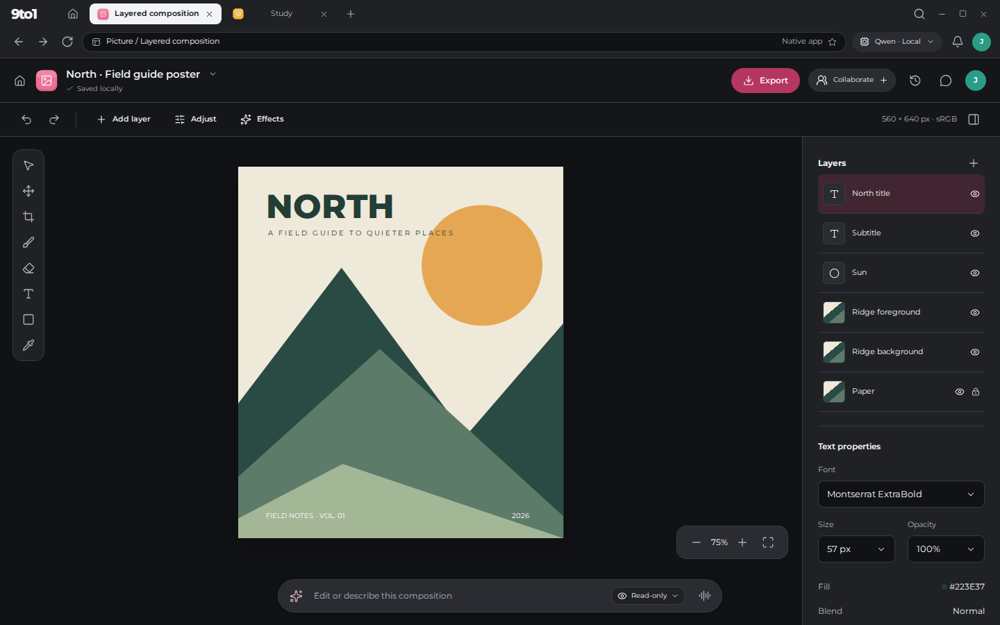
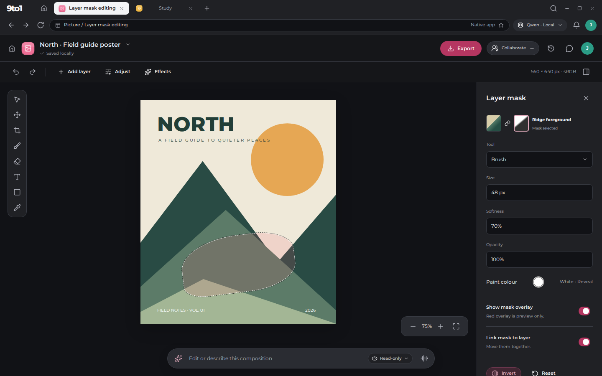
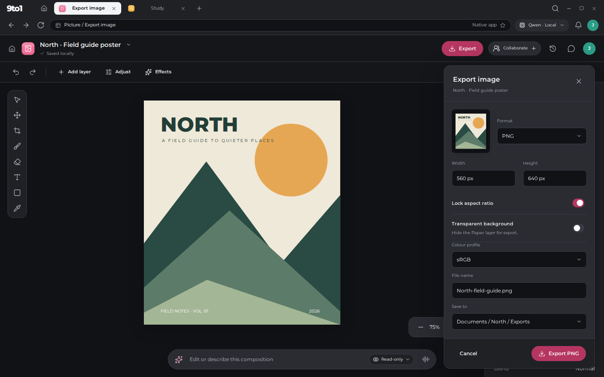

# Picture — image and layer editing

Module ID: `picture` · 9to1 Development Specification v3

## Prerequisites

- **CUI, themes and shared interaction system** — Typed UI components, theme tokens/materials, layout, focus, motion, accessibility and shared control states.
- **Shared productivity engine and canonical embeds** — Real document/object engines, semantic editing, canonical app embedding and donor feature parity.
- **Artifacts, local persistence and recovery** — Canonical artifacts, revisions, typed edits, local saves, derived exports, sync and recovery.
- **Shared AI controls and artifact collaboration** — Contextual AI bars, shared model/permission controls, global collaborators and typed artifact proposals.

## Overview

Picture is a full image editor with source-defined raster/vector, selection, layer, mask and adjustment capabilities. The CUI shell wraps the real engine and retains its substantive editing power.

## Layouts & visible states

- **V3-PICTURE-LAY-01** — Use a dominant image canvas, purposeful tool rail and layers/properties context. Selected layer, selection marquee, crop/transform and adjustment controls must correspond to actual document state.
- **V3-PICTURE-LAY-02** — Show destructive/non-destructive operation, generated layer and pending/failed export states clearly.

## Features & behaviour

- **V3-PICTURE-FEA-01** — Support layer ordering/visibility/opacity, masks, selections, drawing, vector/raster transforms, crop/resize and adjustments from the retained donor contract.
- **V3-PICTURE-FEA-02** — AI edits are typed, revision-bound proposals or generated content with preserved original/source metadata and meaningful undo.
- **V3-PICTURE-FEA-03** — Export exposes actual format/colour/transparency and dimensional constraints; a preview thumbnail is not exported bytes.

## Canonical entities & persistence

- **V3-PICTURE-ENT-01** — Persist image/document ID, layer/mask/selection/vector IDs, pixel resources, transforms, adjustments, colour metadata and revision.
- **V3-PICTURE-ENT-02** — Derived previews/proxies and export records reference the native content revision.

## Permissions & recovery

- **V3-PICTURE-PER-01** — Respect source image ownership and current edit grants. Preserve native layers when a derived export fails.
- **V3-PICTURE-PER-02** — Recover interrupted processing and prevent stale AI results from overwriting intervening edits.

## Acceptance checks

- **V3-PICTURE-ACC-01** — Test selection→layer/mask/adjustment→transform→undo and native reopen with identical structure.
- **V3-PICTURE-ACC-02** — Verify transparent/format export options, source preservation, AI review and failed-render recovery.

## Exact mock-up and state map

- **Picture · Layered composition** — screen `picture`. Editor.
- **Picture · Layer mask editing** — screen `picture-mask`. Interaction state.
- **Picture · Export image** — screen `picture-export`. Interaction state.

## Source clause IDs

UX27-OTHER-007

## Technical reading map

- Picture — image and layer editing — Picture; Product role and editing-first boundary (part 01) — `technical/picture-01.md` (3,277 words; V2-B1667).
- Picture — image and layer editing — Picture image editing (part 02) — `technical/picture-02.md` (99 words; V2-B2303, V2-B2304, V2-B2305).

Technical clauses retain APIs, data models, platform, recovery, donor and acceptance details. The technical files are part of this module, not optional background reading. Shared prerequisites mean stable service/interface contracts must be available; they do not require every dependent app UI to be complete. Use the named chunk for the relevant subtask or the complete module file for its full retained contract.

# Exact designs and implementation rules

These figures are the exact current atlas compositions. Their stable screen IDs match the Word specification and editable source. Open the atlas for full-size theme and interaction inspection.

## Picture · Layered composition

Screen ID: `picture`. Source: UX27-OTHER-007; Picture non-destructive layers/text/masks baseline; CUI-PREF-203.

- The poster is original geometric fixture content. Its colours remain unchanged when the app theme switches.
- Layers, masks, text and original sources remain separate editable objects; export composes actual content, not a screenshot of the editor.
- Selection geometry uses image coordinates and the same transform as pointer hit testing.
- Adjustment and transformation previews are nondestructive and undoable. Export is distinct from local project save.

## Picture · Layer mask editing

Screen ID: `picture-mask`. Source: Owner revision 28 October; UX27-OTHER-007; nondestructive masks and editable layers.

- A layer mask is a separate selected object linked to the source layer. Painting the mask never erases original pixels.
- Brush size, softness, opacity, mask visibility and inversion remain explicit. The selected mask thumbnail stays distinct from its layer thumbnail.
- The visible mask outline uses image coordinates and the same viewport transform as pointer hit testing.

## Picture · Export image

Screen ID: `picture-export`. Source: Owner revision 28 October; Picture export versus editable project save.

- Export renders a chosen image format from the canonical layer composition; it does not flatten the editable project file.
- Size, colour profile, alpha and destination are visible before rendering.
- Missing linked images or font failures block export with a clear explanation; they do not produce a false success state.
