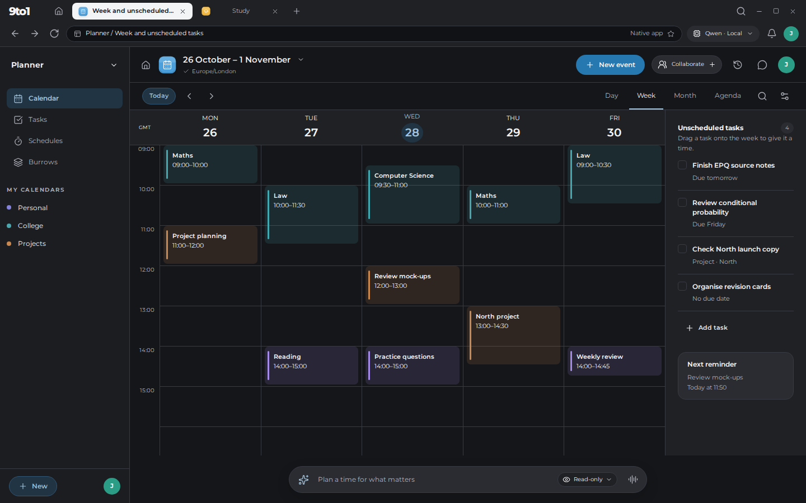
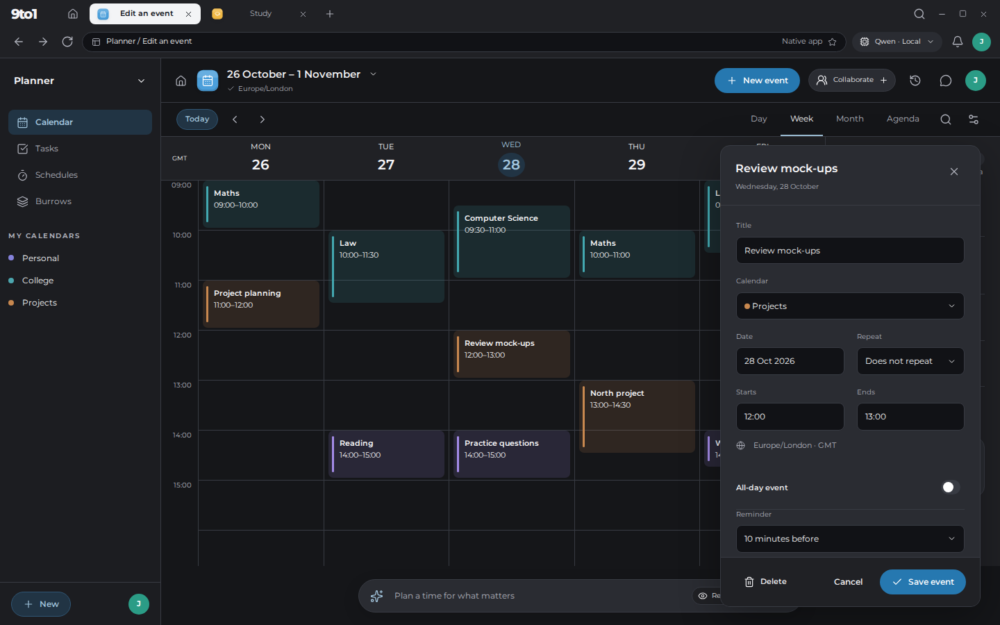
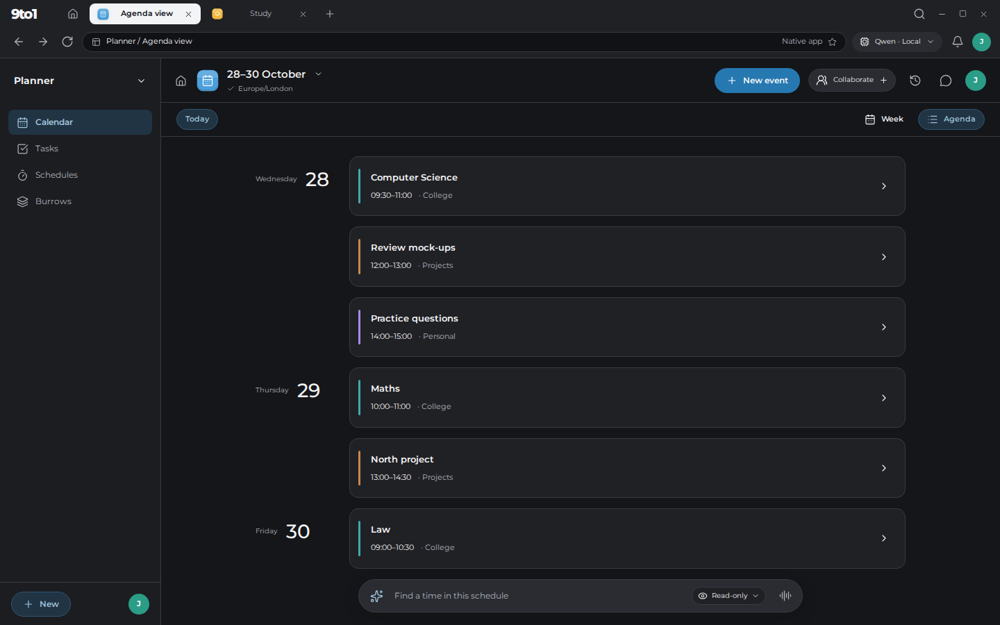

# Planner — calendars, burrows and tasks

Module ID: `planner` · 9to1 Development Specification v3

## Prerequisites

- **CUI, themes and shared interaction system** — Typed UI components, theme tokens/materials, layout, focus, motion, accessibility and shared control states.
- **Artifacts, local persistence and recovery** — Canonical artifacts, revisions, typed edits, local saves, derived exports, sync and recovery.
- **Permissions, approvals and execution scope** — Effective scoped grants, action approvals, policy intersections, revocation and audit.
- **Shared AI controls and artifact collaboration** — Contextual AI bars, shared model/permission controls, global collaborators and typed artifact proposals.

## Overview

Planner combines real calendar scheduling, tasks and burrow organisation with timezone/recurrence semantics. Burrows organise canonical work rather than duplicating events into independent stores.

Current owner overrides: V3-OWNER-015.

## Layouts & visible states

- **V3-PLANNER-LAY-01** — Provide day/week/month or retained supported views, time grid, event/task details and a clear calendar/burrow list. Event cards use a colour nib and readable interior padding.
- **V3-PLANNER-LAY-02** — Show selected event, create/edit panel, recurrence/reminder details, invitation/status and conflict states. Keep AI proposal context separate from committed calendar entries.

## Features & behaviour

- **V3-PLANNER-FEA-01** — Create/edit/move scheduled events and tasks with actual timezone, duration, recurrence/occurrence and reminder contracts. Editing one occurrence versus a series is explicit.
- **V3-PLANNER-FEA-02** — Burrow membership references canonical tasks/events/resources; removing membership does not delete source work.
- **V3-PLANNER-FEA-03** — AI scheduling produces a reviewable proposal with target calendar, dates/times, conflicts and applicable action approval. Do not infer schedule success from a decorative card.

## Canonical entities & persistence

- **V3-PLANNER-ENT-01** — Persist EventID/task IDs, CalendarID, BurrowID, timezone, recurrence rule/exception, attendee/reminder state and revisions.
- **V3-PLANNER-ENT-02** — Provider sync/delivery status stays separate from local save and proposed edits.

## Permissions & recovery

- **V3-PLANNER-PER-01** — Respect calendar/provider permissions, invite/send scope and current recurrence revision. Handle offline operations and conflicts without duplicate invitations.
- **V3-PLANNER-PER-02** — Surface ambiguous time/duration, unavailable provider and failed reminder/sync states.

## Acceptance checks

- **V3-PLANNER-ACC-01** — Test event create/move/edit, occurrence versus series, timezone changes, reminders and burrow reference removal.
- **V3-PLANNER-ACC-02** — Verify readable nib/padding, action-reviewed AI scheduling and local/provider recovery.

## Exact mock-up and state map

- **Planner · Week and unscheduled tasks** — screen `planner`. Calendar.
- **Planner · Edit an event** — screen `planner-event`. Interaction state.
- **Planner · Agenda view** — screen `planner-agenda`. Interaction state.

## Source clause IDs

LE-11, UX27-OTHER-001, UX27-OTHER-002

## Technical reading map

- Planner — calendars, burrows and tasks — Planner; Product role and boundary (part 01) — `technical/planner-01.md` (2,997 words; V2-B1646).
- Planner — calendars, burrows and tasks — Planner Burrows contract; Planner calendar and task scheduling (part 02) — `technical/planner-02.md` (539 words; V2-B2245, V2-B2285, V2-B2286…).

Technical clauses retain APIs, data models, platform, recovery, donor and acceptance details. The technical files are part of this module, not optional background reading. Shared prerequisites mean stable service/interface contracts must be available; they do not require every dependent app UI to be complete. Use the named chunk for the relevant subtask or the complete module file for its full retained contract.

# Retained technical requirements

# Planner — calendars, burrows and tasks — Planner; Product role and boundary (part 01)

Reading status: active retained clauses, subject to the v3 owner overrides listed in the primary module. Historical process instructions and replaced original wording are stored separately.

### V2-B1646 · v2 lines 7261–7425

V3 editorial amendment: V3-OWNER-003. Original wording is preserved in the replacement ledger.

Planner
Product role and boundary
9-1 Planner is the CUI calendar, schedule, countdown and assignment-planning app. It answers when something happens, when something is due, what the user needs to do, and which canonical 9to1 entities are connected to that plan. Planner is not Home Notifications activity, which is an ecosystem activity/history timeline; it is not Spaces Tasks, which represent goal-oriented agentic work/runs; and it is not Automations, which own recurring/event/condition-triggered execution.
Planner MUST expose local/native planning and provider-backed calendar/task data through one coherent typed model without duplicating canonical external or 9to1 entities. References to routes, Mail, Files, Write, Present, Boards, Canvas, Data, Spaces, Automations and other supported entities retain the owning entity's stable identity.
Donor and upstream contract
Planner is a first-party CUI surface. No external application donor is currently normative for Planner. Implementers MUST NOT silently choose a donor and allow donor-specific storage or behaviour to become public Planner authority. Mature calendar standards, provider APIs and the shared 9to1 frameworks MAY be used as implementation references where they do not contradict this specification.
Primary views and navigation
Planner MUST provide Today, Day, Week, Month, Agenda and Tasks views. The main calendar views use conventional direct manipulation: selecting a time range can create an item, timed items can be moved/resized where permitted, all-day items have a dedicated region, overlapping items remain legible, the current-time indicator is visible where relevant, and keyboard navigation can move through dates/items without requiring pointer input.
The sidebar MUST expose the user's calendars/task lists plus three optional modules — Schedule, Countdown and Assignments. Each optional module can be enabled, hidden and reordered by the user. Hiding a module removes its navigation surface only; it MUST NOT delete its data.
Agenda
Agenda is Planner's chronological list of upcoming planning items rather than a time-grid view. It MUST group and order upcoming events and other relevant due/scheduled Planner entities by date/time while preserving each item's canonical identity.
Agenda SHOULD surface at least events, scheduled PlannerTasks and Assignment deadlines. It MAY surface other Planner milestones such as selected Countdowns when the user has enabled that integration. Filters can narrow the list by calendar/list, completion/status, category and other applicable typed fields.
Canonical entity model
Planner's canonical entity families are:
* Calendar — organisation/source container for events, with stable CalendarID, display metadata, ownership/provider binding, capability state and revision metadata.
* PlannerEvent — a time-bounded or all-day event with stable EventID.
* PlannerTask — a personal planning/to-do item with stable PlannerTaskID; this is distinct from Spaces/Dulche TaskID.
* Reminder — a notification rule/state attached to an Event, PlannerTask, Assignment, Countdown or other supported Planner entity.
* RecurrenceDefinition and recurrence exceptions — a versioned repeating-series contract.
* Schedule and ScheduleItem — optional structured day-plan entities.
* Countdown — optional user-defined target-date/time entity.
* Assignment and AssignmentItem — optional structured deadline/work-completion entities.
Display names, sidebar order and current view state are not identities. Stable IDs survive rename, move, reorder, view changes and provider resynchronisation where the provider preserves identity.
PlannerEvent
PlannerEvent MUST contain at least EventID, CalendarID, Title, Description?, Start/End or all-day date span, TimeZone semantics, Location?, Recurrence?, References[], Reminders[], Status, CreatedAt, ModifiedAt, owner/scope, source/provider metadata and revision. Provider-backed events additionally retain the provider's stable event identity/version token where available.
An Event may reference a meeting, Maps route, Files/Write/Present/Board/Canvas/Data artifact, Mail thread/message, Space, Automation output or other registered 9to1 entity. Referencing an entity MUST NOT duplicate its canonical payload.
PlannerTask
PlannerTask MUST contain at least PlannerTaskID, Title, Description?, Status, TaskListID?, DueAt/date?, ScheduledStart?, ScheduledEnd?, Recurrence?, Priority?, References[], Reminders[], CreatedAt, ModifiedAt, owner/scope and revision.
A PlannerTask can be due without being scheduled. Scheduling a PlannerTask onto the calendar assigns ScheduledStart/ScheduledEnd to the same PlannerTaskID; Planner MUST NOT manufacture a duplicate Event merely to render the task in a time-grid.
Dragging an unscheduled task onto a calendar schedules it. Removing it from the time-grid may clear the scheduled window without deleting the task or its due date. Completing/reopening the task preserves its identity/history.
Time zones, all-day values and daylight saving
Timed Event/Task values MUST use real timezone-aware semantics. Planner distinguishes the authoritative event timezone, absolute instant(s), viewer timezone and an explicitly supported floating/local-time representation. A user travelling or changing device timezone MUST NOT silently change the intended meaning of the event.
All-day items are date-based and MUST NOT drift onto an adjacent date through UTC conversion. Recurrence across daylight-saving transitions uses timezone database rules rather than fixed UTC offsets.
Recurrence and occurrence identity
Recurring Events, PlannerTasks, Assignments and Countdowns MUST use a recurrence definition rather than pre-creating an unbounded list of copies. Supported recurrence semantics include the normal daily/weekly/monthly/yearly interval patterns, selected weekdays, end date and occurrence count where applicable.
Each expanded occurrence has stable occurrence identity derived from its series plus occurrence key/date-time. Editing a repeating item MUST support the applicable scopes This occurrence, This and following, and Entire series. A modified/skipped occurrence is stored as an exception; modifying one occurrence MUST NOT flatten the entire series into unrelated records.
The runtime expands only the requested/visible/query interval plus bounded prefetch. Infinite recurrence MUST never be materialised eagerly.
Reminders and Home notifications
Planner reminder delivery uses Home's shared notification service rather than a private Planner notification runtime. An entity MAY own multiple reminder rules such as at start, relative minutes/hours/days before, or a custom trigger supported by the reminder contract.
Reminder runtime state distinguishes at least Scheduled, Fired, Snoozed and Dismissed. Snoozing a reminder changes reminder state/next notification time and MUST NOT rewrite the Event/Task/Assignment's actual start or due time. Recurring-series reminders are evaluated per occurrence.
Optional sidebar module: Schedule
Schedule lets the user break a day or other bounded period into ordered timed ScheduleItems and inspect live progress through the current item/day. Example uses include a college day split into individual lessons, breaks and study periods.
Schedule MUST show, at minimum, current item start/end, elapsed time, remaining time, percentage elapsed and percentage remaining. These values update live from the clock without manual Refresh(). It MAY additionally show an item's share of the containing schedule, but that percentage must be labelled distinctly from time-progress percentage.
Schedule contains stable ScheduleID, Name, timezone/applicability/recurrence settings and ordered ScheduleItemIDs. ScheduleItem contains stable ScheduleItemID, title, start/end, optional colour/icon/location, References[] and optional links to EventID, PlannerTaskID or AssignmentID.
Schedules MAY be reusable/recurring and support date-specific exceptions without destroying the base pattern. Clicking a ScheduleItem opens details such as elapsed/remaining progress, previous/next item and its linked Planner entities/artifacts.
If a ScheduleItem references an Event, PlannerTask or Assignment, the reference remains canonical; changing the referenced entity does not create a divergent duplicate Schedule item payload except for Schedule-owned presentation fields.
Optional sidebar module: Countdown
Countdown is a dashboard of user-defined future targets such as birthdays, holidays, prom, deadlines or other milestones. Countdown entries have stable CountdownID, Name, TargetDate/TargetDateTime, timezone/all-day semantics, icon/image/category metadata where used, recurrence?, References[] and optional linked EventID/AssignmentID.
A Countdown can be standalone or linked to another canonical Planner entity. When linked, the linked entity's date/time is authoritative so moving that Event/Assignment automatically updates the Countdown rather than leaving two conflicting dates.
The dashboard MAY vary displayed precision by proximity, for example days when far away and hours/minutes/seconds when close, while preserving the same target. All-day Countdowns are date-based. Recurring Countdowns such as annual birthdays/holidays resolve the next occurrence deterministically.
Optional sidebar module: Assignments
Assignment represents structured homework, coursework, project/team work, revision deliverables or similar deadline-based work that needs richer completion tracking than a simple PlannerTask. Assignment has stable AssignmentID, Title, Description?, Status, StartDate?, DueAt/date?, CompletedAt?, Priority?, Category/Course/Project metadata?, owner/scope, Assignees/RelevantPeople, RequiredItems[], OptionalItems[], References[], Reminders[], AutomationRefs[] and revision.
AssignmentItem has stable AssignmentItemID, AssignmentID, parent/nesting relationship?, title/description, Required/Optional classification, completion/progress state, optional weight, optional assignee and revision. Required and optional items remain distinguishable in UI, API, Automations and completion rules.
Assignment progress and completion
Assignments MUST support partial completion rather than only Done/Not Done. Required statuses include at least Not Started, In Progress, Completed and Cancelled; overdue is derived from the due date versus completion state and MUST be queryable even if represented visually as a status badge.
Progress MAY be automatically calculated from required items, manually set for work that cannot be represented as a checklist, or calculated using explicit item weights. Equal weighting is the default only when no weights are supplied. Optional items do not prevent formal completion.
By default, an Assignment cannot be marked Completed while required items remain incomplete. A user may explicitly override that rule where permitted, with a visible warning/impact confirmation. Automation/API calls must make an equivalent override explicit rather than silently bypassing required items.
Assignment views MUST include useful states such as Due soon, Overdue, In progress, Completed and All, with filters/grouping such as due date, course/project/team, priority and assignee where data exists.
Team assignments
Assignments MAY have an owner, assignees/contributors and item-level assignees. Being named as an assignee or relevant person does not itself grant edit permission; normal sharing/ACL state remains authoritative.
Assignment-level completion can aggregate item work across people while preserving who completed/changed each item where audit/history is available.
Assignment Automations and extension workflows
Planner exposes Assignment events/state to Automations, but Planner itself MUST NOT secretly send external communications as a built-in overdue side effect. A user may create an Automation such as: when an Assignment becomes overdue and is incomplete, draft or send a Mail extension request to the relevant person.
The workflow boundary is strict: Planner owns Assignment state; Automations owns trigger/condition execution; Mail owns sending. Automatic external sending requires the applicable authorised Mail permission/trust grant and remains subject to the global external-side-effect/risk model.
Useful Assignment event families include AssignmentCreated, AssignmentUpdated, AssignmentProgressChanged, AssignmentDueSoon, AssignmentOverdue, AssignmentCompleted, AssignmentReopened and item-completion events. Automations can query DueAt, Status, Progress, RequiredItems, OptionalItems, assignees and references through typed Planner APIs.
Cross-app typed references
Planner references MUST use the owning app's canonical stable IDs and permissions. A referenced artifact may render a preview/embedded surface only through the owning app's declared reference/embed contract.
If a referenced entity is unavailable, revoked or deleted, the Planner item remains valid and surfaces the reference as unavailable/broken; Planner MUST NOT delete the Event/Task/Assignment simply because one attachment/reference disappeared.
Maps and travel integration
Planner Events MAY carry both Location and a canonical Maps RouteID. Route ownership remains with Maps. Planner may display current route summary/duration and can offer a departure reminder derived from Event start minus current route duration minus an explicit user buffer.
Derived travel reminders MUST NOT rewrite the Event's actual start time. A changed Maps route/duration is reflected from the canonical route rather than a stale Planner copy.
Mail integration
Mail may create or update Planner items through typed Planner actions while retaining a reference to the source MessageID/ThreadID. AI-extracted date/time/title values that are materially uncertain must be reviewable rather than silently committed as certain facts.
Planner mutations do not mutate the source Mail thread except through a separate authorised Mail action.
Meetings, attendees and external side effects
Events MAY support attendees, invitations, meeting references/links and RSVP state where the local/provider capability supports them. Provider-backed attendee/invitation operations remain provider-aware.
When saving a change can send invitations, updates or cancellations externally, Planner MUST distinguish local/save-only behaviour from save-and-notify/send behaviour where the provider supports that distinction. Consequential attendee communication uses the normal permission/impact rules.
External calendars and provider capability model
Planner supports 9to1-native calendars and connected provider calendars through External App Integrations. Provider-backed entities remain provider-aware rather than being silently copied into an unrelated local calendar.
Provider capabilities MUST be explicit and queryable, including relevant support for read/write, recurrence, attendees, free/busy, reminders, meeting links, colours/categories, calendar sharing, task support and push/change feeds. Unsupported operations must be hidden/disabled or return a structured ProviderCapabilityUnsupported error.
Connected-provider changes should use incremental change feeds/push where supported. Provider sync state distinguishes pending/synced/conflict/failed where relevant; conflicts MUST NOT be resolved by blind last-write-wins.
Search, filtering and global discovery
Planner search MUST cover Events, PlannerTasks, Assignments, Countdowns and Schedule entities where enabled. Filters MAY include date range, calendar/list, status/completion, category/project/course, assignee/attendee, location and referenced entity.
Search results preserve stable Planner IDs and open the canonical item. Planner entities that are eligible for Home/global search expose permission-filtered searchable metadata through the shared search/index contract.
Import and export
Planner MUST support iCalendar/.ics import and export for representable calendar data. Import preserves timezone/recurrence/attendee semantics when the format/provider can represent them and reports unsupported constructs rather than silently flattening them.
Importing data creates/links canonical Planner/provider entities according to the selected destination semantics; it MUST NOT create duplicate copies when a stable imported/provider identity already maps to an existing entity.
Persistent AI bar
Planner MUST host the global persistent Dulche AI bar. Its semantic context includes selected Event/PlannerTask/Assignment/Countdown/Schedule IDs, selected date/time range, visible calendar interval, active calendars/lists/modules, current timezone, relevant references, revision/sync state and the available typed Planner actions.
Read-only mode cannot mutate planning state. Write mode uses typed 9to1.Planner actions and the normal Home permission broker. Natural-language changes such as moving a set of tomorrow's events MUST resolve against stable entity/occurrence IDs rather than inferred screen coordinates.
Automations integration
Planner recurrence remains Planner state; repeating Events/Tasks MUST NOT be implemented as hidden Automations. Automations consumes Planner's typed events/actions for workflows around those entities.
Minimum automatable event families include EventCreated, EventUpdated, EventStarting, EventEnded, PlannerTaskCreated, PlannerTaskDue, PlannerTaskCompleted, ReminderFired and the Assignment event families defined above. For recurring items, event payloads include the concrete occurrence identity as well as the series identity.
Planner API
Planner's first-party API catalogue is exhaustive under the global API-parity rule. Minimum canonical entry points include:
9to1.Planner.ListCalendars();
9to1.Planner.GetCalendar(calendarID);
9to1.Planner.ListEvents(range, filters?);
9to1.Planner.GetEvent(eventID, occurrence?);
9to1.Planner.CreateEvent(config);
9to1.Planner.UpdateEvent(eventID, patch, recurrenceScope?);
9to1.Planner.DeleteEvent(eventID, recurrenceScope?);
9to1.Planner.RestoreEvent(eventID);
9to1.Planner.ListTasks(filters?);
9to1.Planner.GetTask(plannerTaskID);
9to1.Planner.CreateTask(config);
9to1.Planner.UpdateTask(plannerTaskID, patch);
9to1.Planner.CompleteTask(plannerTaskID);
9to1.Planner.ReopenTask(plannerTaskID);
9to1.Planner.ListAssignments(filters?);
9to1.Planner.GetAssignment(assignmentID);
9to1.Planner.CreateAssignment(config);
9to1.Planner.UpdateAssignment(assignmentID, patch);
9to1.Planner.UpdateAssignmentItem(assignmentItemID, patch);
9to1.Planner.CompleteAssignment(assignmentID, overrideIncompleteRequiredItems?);
9to1.Planner.ListSchedules(filters?);
9to1.Planner.GetSchedule(scheduleID);
9to1.Planner.CreateSchedule(config);
9to1.Planner.UpdateSchedule(scheduleID, patch);
9to1.Planner.ListCountdowns(filters?);
9to1.Planner.CreateCountdown(config);
9to1.Planner.UpdateCountdown(countdownID, patch);
9to1.Planner.AddReference(itemID, reference);
9to1.Planner.RemoveReference(itemID, referenceID);
9to1.Planner.AddReminder(itemID, reminder);
9to1.Planner.SnoozeReminder(reminderID, until);
Every additional user-visible Planner operation — including provider actions, sidebar-module operations, recurrence edits, assignment item manipulation, reminder management and import/export — MUST expose an equivalent supported typed action/query.
Persistence, sync, history and recovery
Planner native state is versioned and crash-safe. Calendar/Event/PlannerTask/Assignment/Schedule/Countdown changes use revision-aware mutations; partial failure must not leave a recurrence series or Assignment hierarchy half-updated.
Normal deletion is recoverable where the entity/storage provider supports recovery. Permanent purge is explicit/high-risk. Provider-backed deletion/recovery follows provider capability while preserving local audit/sync state.
Offline/reconnect queues MUST preserve operation identity/idempotency. Provider conflicts and concurrent same-entity edits surface deterministic merge/conflict state rather than silently overwriting one revision.
Permissions and risk
Read, edit, share/admin, provider/external-side-effect and destructive scopes remain distinct. Having a Planner item in view does not grant permission to mutate its referenced artifact, invite attendees, send Mail or operate a connected provider beyond the caller's authorised capabilities.
Invitation/cancellation sending, external Mail extension requests, provider sharing changes, permanent purge and destructive bulk changes retain their target action's elevated risk/approval requirements.
Accessibility
Planner MUST be keyboard-operable across calendar grids, Agenda, task/assignment lists, Schedule and Countdown. Time-grid cells/items expose meaningful accessible date/time labels; current item/progress and overdue state cannot be conveyed by colour alone.
Screen readers MUST be able to identify item type, title, date/time/due state, recurrence and applicable progress. Schedule percentages and countdown values require textual equivalents. Reduced motion and scalable text/layout follow the global CUI accessibility contract.
Platform capability behaviour
Planner MUST provide useful supported native behaviour on Windows and 9to1-OS plus a useful web version under the global web contract. All clients operate on the same canonical Planner/provider entities.
Native clients MAY have richer OS notification/calendar integration; web may depend on browser notification/background constraints. Capability differences are explicit and MUST NOT silently downgrade the canonical planning state or turn the web app into a read-only viewer.
Performance and resource behaviour
Calendar range queries load only the visible/requested interval plus bounded prefetch; recurring-series expansion is interval-bounded. Large Agenda/task/Assignment lists MUST virtualise. Provider change feeds and shared indexes update incrementally rather than repeatedly refetching all calendars/items.
Schedule live-progress and Countdown ticking MUST update efficiently without causing full Planner-tree rerenders each second. Background timers should coalesce/update at the precision actually visible to the user.
Failure behaviour
Planner MUST return structured failures for EventNotFound, PlannerTaskNotFound, AssignmentNotFound, ScheduleNotFound, CountdownNotFound, InvalidRecurrence, InvalidTimeZone, RevisionConflict, PermissionDenied, ProviderCapabilityUnsupported, ProviderSyncConflict, ReferenceUnavailable, ReminderUnavailable and ImportUnsupportedConstruct, plus the global error contract.
If Home notification/shared services are unavailable, Planner preserves canonical planning state and surfaces notification/reconnect limitations rather than losing Events/Tasks/Assignments. Provider outages preserve queued/retryable state with explicit sync status.
Acceptance requirements
Planner is implementation-complete only when acceptance coverage verifies at least:
* Today, Day, Week, Month, Agenda and Tasks views operate on persisted canonical Planner entities and survive restart.
* Agenda lists upcoming Events/scheduled tasks/Assignment deadlines chronologically without duplicating their underlying identities.
* Scheduling/unscheduling a PlannerTask changes its scheduled window without creating/deleting a duplicate Event.
* Timezone, all-day and daylight-saving tests preserve intended event meaning across viewer/device timezone changes.
* Recurring series support occurrence/this-and-following/whole-series edits, exceptions and bounded expansion.
* Reminders route through Home notifications and snoozing does not rewrite the item's canonical time.
* Schedule can be enabled as an optional sidebar module and shows live elapsed/remaining time plus percentage elapsed/remaining for the current item.
* Countdown can be enabled as an optional sidebar module, supports standalone and linked targets, and linked targets update without duplicated dates.
* Assignments can be enabled as an optional sidebar module and persist partial progress, required/optional items, nested/weighted items where configured, due state, team assignments and completion rules.
* An overdue Assignment can trigger an authorised Automation that drafts/sends a Mail extension request without Planner bypassing Mail/Automation permission rules.
* Maps routes, Mail threads and Files/Write/Present/Boards/Canvas/Data/Space/Automation outputs remain canonical typed references when attached to Planner items.
* Provider calendars capability-negotiate recurrence/attendees/reminders/etc. and synchronise without silent last-write-wins conflict loss.
* iCalendar import/export round-trips representable recurrence/timezone data and reports unsupported constructs.
* The persistent AI bar reads/writes Planner only through permission-filtered semantic context and typed Planner actions.
* Windows, 9to1-OS and web preserve the same canonical entity model while surfacing declared capability differences.
* Large calendar ranges/lists/recurrences remain responsive through bounded expansion, incremental sync/indexing and virtualisation.
* When Home is absent at process start, Planner follows the global Install Home/bootstrap contract rather than launching an incompatible private runtime.

# Planner — calendars, burrows and tasks — Planner Burrows contract; Planner calendar and task scheduling (part 02)

Reading status: active retained clauses, subject to the v3 owner overrides listed in the primary module. Historical process instructions and replaced original wording are stored separately.

### V2-B2245 · v2 lines 13240–13246

LE-11 — Planner Burrows contract
A Burrow is a named planning context over existing Planner entities, not a duplicate calendar engine or a copy of events/tasks/assignments. It has stable BurrowID, name/icon, owner/scope, ordering, archive state and revision. Native items may have one BurrowID or be Unassigned; the All view includes authorised items across burrows without duplicate identities. Existing items remain Unassigned unless the user assigns them or an existing explicit association provides a deterministic migration.
Study has one canonical Study burrow per owning Study scope, created idempotently and referenced by ID rather than the display name. A custom Minecraft burrow is an independent user-created context. Study's Planner button opens its Study burrow inside the real Planner surface, and Open in App preserves the burrow selection and canonical item identities.
Users MUST be able to create, rename, reorder, select, set a default, archive/recover and delete a burrow; assign/reassign/unassign existing events, PlannerTasks, assignments and other supported planning items; and filter normal Planner views by burrow or All/Unassigned. New items created within a selected burrow inherit that assignment. Moving between burrows changes organisation only, not event time, recurrence, provider calendar, attendees or reminder identity.
Provider-backed items retain provider IDs and permissions. Burrow membership may be local 9to1 metadata and MUST NOT silently move or duplicate the external item. Recurring-item assignment requires an explicit occurrence/series scope using Planner's existing recurrence rules. A burrow's visibility never grants access to otherwise private contained items.
Deleting a burrow MUST preview its item count and reassign its items to a chosen authorised burrow or Unassigned; it must not delete the events/tasks/assignments. Archive hides the context without destroying membership. Reminders continue under existing item policies, regardless of whether a burrow is currently visible.
Acceptance: keep Study and Minecraft items distinct while All shows both once; create and move items without changed IDs/times/reminders; restart; edit a recurring series with explicit scope; handle a read-only external event's local grouping; delete/recover a burrow without losing planning items; verify embedded and standalone Planner use the same state.

### V2-B2285 · v2 lines 13403–13403

### UX27-OTHER-001 — Planner calendar and task scheduling

### V2-B2286 · v2 lines 13405–13405

**B/D.** Day/week/month/agenda views are projections of the same canonical Events and PlannerTasks. Clicking an empty time slot opens a draft with the clicked date/time; dragging previews start/end before commit; resizing changes duration with visible time labels. A task dragged from an unscheduled list into the calendar schedules that same TaskID, not a duplicate Event. Removing its scheduled window does not delete the task or due date.

### V2-B2287 · v2 lines 13407–13407

Recurring edits explicitly choose occurrence/following/series scope. All-day items remain date-based and do not drift with timezone conversion. Undo, cross-view updates, reminders and reopen use the same state. Overlaps and unavailable calendars are visible rather than silently shifted to a different time.

### V2-B2288 · v2 lines 13409–13409

### UX27-OTHER-002 — Planner schedules, Burrows and reminders

### V2-B2289 · v2 lines 13411–13411

**B.** Schedule progress shows actual current item, elapsed and remaining time, with the timezone and paused/ended state where relevant. Burrows retain the baseline’s intended organisational/task semantics rather than becoming a second calendar database. Reminder snooze changes reminder delivery, not the underlying event’s start or due time.

### V2-B2290 · v2 lines 13413–13413

Navigation from a reminder opens its canonical source entity. Completing a task updates every view and its history; dismissing a notification is not task completion. Source-linked places/routes and artifacts remain canonical references with clear unavailable states.

# Exact designs and implementation rules

These figures are the exact current atlas compositions. Their stable screen IDs match the Word specification and editable source. Open the atlas for full-size theme and interaction inspection.

## Planner · Week and unscheduled tasks

Screen ID: `planner`. Source: UX27-OTHER-001–002; Planner calendar/schedule/task baseline.

- Event category colour is an inset vertical nib with its own radius; it is not the event container border.
- Calendar and task views project the same Events and PlannerTasks. Dragging an unscheduled task schedules that task rather than duplicating it.
- Show date, timezone and exact start/end during move or resize. Recurrence changes need occurrence/following/series scope.
- Task completion and notification dismissal remain separate actions.
- Panels collapse before the week grid becomes unusable; agenda is a supported narrow-layout alternative.

## Planner · Edit an event

Screen ID: `planner-event`. Source: Owner revision 28 October; Planner Events and occurrence semantics.

- The event opens beside its originating week and retains its start/end, calendar, timezone and reminder.
- The category colour is a separate inset nib, independent of the rounded event background.
- Saving edits the same EventID. Recurring events require an explicit occurrence/following/series choice; the current fixture does not repeat.

## Planner · Agenda view

Screen ID: `planner-agenda`. Source: Owner revision 28 October; Planner shared calendar/task projections.

- Agenda is a date-ordered projection of the same events as the Week view.
- The inset category nib has its own rounded ends and does not follow the event container corners.
- Event selection opens the same edit panel. Completed tasks and dismissed reminders remain separate from calendar events.
