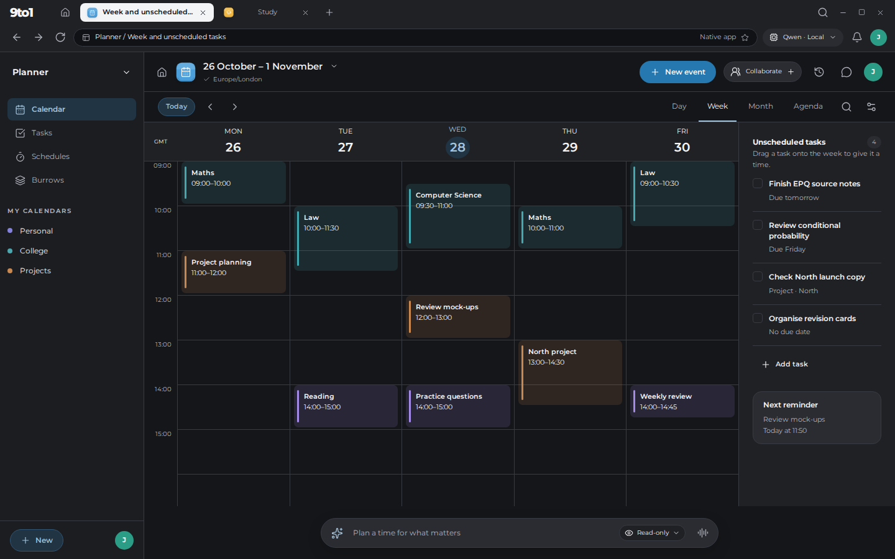
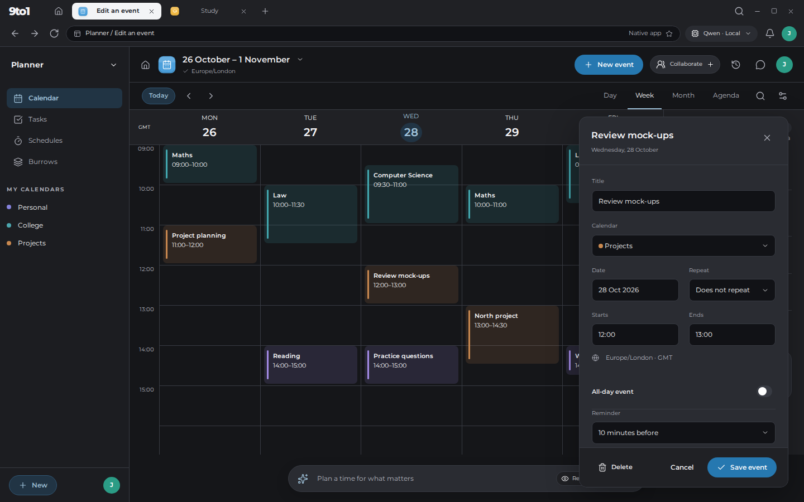
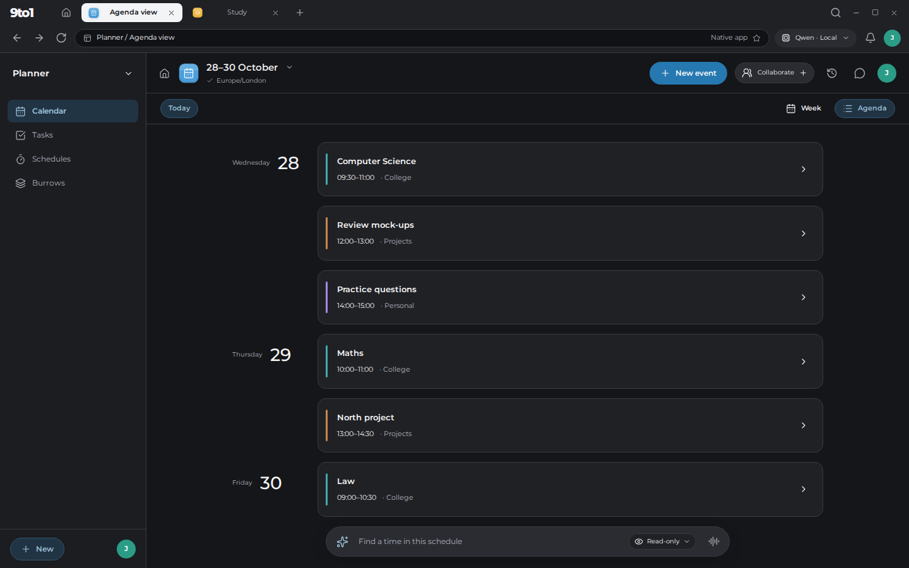

# Planner — calendars, burrows and tasks

Module ID: `planner` · 9to1 Development Specification v3

## Prerequisites

- **CUI, themes and shared interaction system** — Typed UI components, theme tokens/materials, layout, focus, motion, accessibility and shared control states.
- **Artifacts, local persistence and recovery** — Canonical artifacts, revisions, typed edits, local saves, derived exports, sync and recovery.
- **Permissions, approvals and execution scope** — Effective scoped grants, action approvals, policy intersections, revocation and audit.
- **Shared AI controls and artifact collaboration** — Contextual AI bars, shared model/permission controls, global collaborators and typed artifact proposals.

## Overview

Planner combines real calendar scheduling, tasks and burrow organisation with timezone/recurrence semantics. Burrows organise canonical work rather than duplicating events into independent stores.

Current owner overrides: V3-OWNER-015.

## Layouts & visible states

- **V3-PLANNER-LAY-01** — Provide day/week/month or retained supported views, time grid, event/task details and a clear calendar/burrow list. Event cards use a colour nib and readable interior padding.
- **V3-PLANNER-LAY-02** — Show selected event, create/edit panel, recurrence/reminder details, invitation/status and conflict states. Keep AI proposal context separate from committed calendar entries.

## Features & behaviour

- **V3-PLANNER-FEA-01** — Create/edit/move scheduled events and tasks with actual timezone, duration, recurrence/occurrence and reminder contracts. Editing one occurrence versus a series is explicit.
- **V3-PLANNER-FEA-02** — Burrow membership references canonical tasks/events/resources; removing membership does not delete source work.
- **V3-PLANNER-FEA-03** — AI scheduling produces a reviewable proposal with target calendar, dates/times, conflicts and applicable action approval. Do not infer schedule success from a decorative card.

## Canonical entities & persistence

- **V3-PLANNER-ENT-01** — Persist EventID/task IDs, CalendarID, BurrowID, timezone, recurrence rule/exception, attendee/reminder state and revisions.
- **V3-PLANNER-ENT-02** — Provider sync/delivery status stays separate from local save and proposed edits.

## Permissions & recovery

- **V3-PLANNER-PER-01** — Respect calendar/provider permissions, invite/send scope and current recurrence revision. Handle offline operations and conflicts without duplicate invitations.
- **V3-PLANNER-PER-02** — Surface ambiguous time/duration, unavailable provider and failed reminder/sync states.

## Acceptance checks

- **V3-PLANNER-ACC-01** — Test event create/move/edit, occurrence versus series, timezone changes, reminders and burrow reference removal.
- **V3-PLANNER-ACC-02** — Verify readable nib/padding, action-reviewed AI scheduling and local/provider recovery.

## Exact mock-up and state map

- **Planner · Week and unscheduled tasks** — screen `planner`. Calendar.
- **Planner · Edit an event** — screen `planner-event`. Interaction state.
- **Planner · Agenda view** — screen `planner-agenda`. Interaction state.

## Source clause IDs

LE-11, UX27-OTHER-001, UX27-OTHER-002

## Technical reading map

- Planner — calendars, burrows and tasks — Planner; Product role and boundary (part 01) — `technical/planner-01.md` (2,997 words; V2-B1646).
- Planner — calendars, burrows and tasks — Planner Burrows contract; Planner calendar and task scheduling (part 02) — `technical/planner-02.md` (539 words; V2-B2245, V2-B2285, V2-B2286…).

Technical clauses retain APIs, data models, platform, recovery, donor and acceptance details. The technical files are part of this module, not optional background reading. Shared prerequisites mean stable service/interface contracts must be available; they do not require every dependent app UI to be complete. Use the named chunk for the relevant subtask or the complete module file for its full retained contract.

# Exact designs and implementation rules

These figures are the exact current atlas compositions. Their stable screen IDs match the Word specification and editable source. Open the atlas for full-size theme and interaction inspection.

## Planner · Week and unscheduled tasks

Screen ID: `planner`. Source: UX27-OTHER-001–002; Planner calendar/schedule/task baseline.

- Event category colour is an inset vertical nib with its own radius; it is not the event container border.
- Calendar and task views project the same Events and PlannerTasks. Dragging an unscheduled task schedules that task rather than duplicating it.
- Show date, timezone and exact start/end during move or resize. Recurrence changes need occurrence/following/series scope.
- Task completion and notification dismissal remain separate actions.
- Panels collapse before the week grid becomes unusable; agenda is a supported narrow-layout alternative.

## Planner · Edit an event

Screen ID: `planner-event`. Source: Owner revision 28 October; Planner Events and occurrence semantics.

- The event opens beside its originating week and retains its start/end, calendar, timezone and reminder.
- The category colour is a separate inset nib, independent of the rounded event background.
- Saving edits the same EventID. Recurring events require an explicit occurrence/following/series choice; the current fixture does not repeat.

## Planner · Agenda view

Screen ID: `planner-agenda`. Source: Owner revision 28 October; Planner shared calendar/task projections.

- Agenda is a date-ordered projection of the same events as the Week view.
- The inset category nib has its own rounded ends and does not follow the event container corners.
- Event selection opens the same edit panel. Completed tasks and dismissed reminders remain separate from calendar events.
