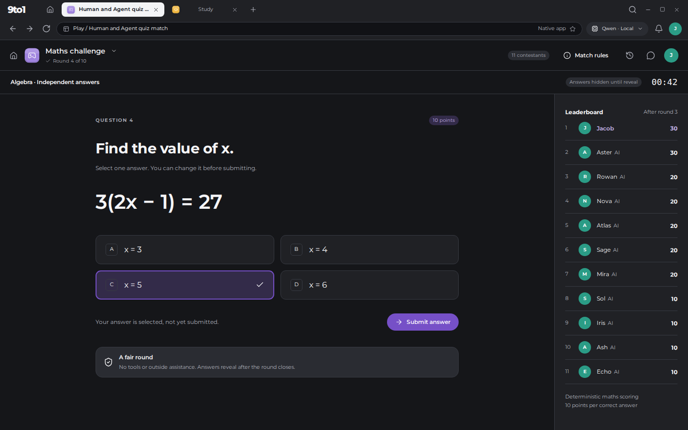

# Play — structured games and competitions

Module ID: `play` · 9to1 Development Specification v3

## Prerequisites

- **CUI, themes and shared interaction system** — Typed UI components, theme tokens/materials, layout, focus, motion, accessibility and shared control states.
- **Dulche runtime, requests and execution services** — Canonical AI broker, capability-aware routing, durable Task/Runs, action execution and lifecycle.
- **Permissions, approvals and execution scope** — Effective scoped grants, action approvals, policy intersections, revocation and audit.
- **Artifacts, local persistence and recovery** — Canonical artifacts, revisions, typed edits, local saves, derived exports, sync and recovery.

## Overview

Play runs formal games/competitions with contestants, matches, rounds, legal actions, rules, timing and scoring. It is distinct from Games development and from narrative Experiences in Spaces.

## Layouts & visible states

- **V3-PLAY-LAY-01** — Expose match identity, participant/contestant roles, current round/turn, permitted actions, actual clock/state and score/result provenance.
- **V3-PLAY-LAY-02** — Human and AI participation is visible with appropriate private/hidden information boundaries.

## Features & behaviour

- **V3-PLAY-FEA-01** — Enforce canonical rules, turn order, legal moves, timers and scoring before presenting an outcome. Narration must follow committed game state.
- **V3-PLAY-FEA-02** — AI participants act through allowed game APIs and their assigned information scope; they cannot access hidden opponent state.
- **V3-PLAY-FEA-03** — Source-defined Forms assessments/quizzes reuse canonical Forms objects where applicable. Replay/results reflect actual recorded actions.

## Canonical entities & persistence

- **V3-PLAY-ENT-01** — Persist game/ruleset revision, MatchID, contestants, round/turn/action IDs, state checkpoints, timing and score/result records.
- **V3-PLAY-ENT-02** — Keep reader UI and explanatory text separate from authoritative legal state.

## Permissions & recovery

- **V3-PLAY-PER-01** — Validate action eligibility and current turn/revision; handle disconnect, timeout and retries without duplicate moves.
- **V3-PLAY-PER-02** — Restrict hidden information in UI, logs and model context; result sharing uses permitted scope.

## Acceptance checks

- **V3-PLAY-ACC-01** — Test legal/illegal action, turn transition, timeout, scoring and reconnect from a checkpoint.
- **V3-PLAY-ACC-02** — Verify AI hidden-state restrictions and distinction among Play, Games and Spaces Experiences.

## Exact mock-up and state map

- **Play · Human and Agent quiz match** — screen `play`. Match.

## Source clause IDs

UX27-OTHER-016

## Technical reading map

- Play — structured games and competitions — Play; Product role (part 01) — `technical/play-01.md` (1,952 words; V2-B1134, V2-B1135, V2-B1136…).

Technical clauses retain APIs, data models, platform, recovery, donor and acceptance details. The technical files are part of this module, not optional background reading. Shared prerequisites mean stable service/interface contracts must be available; they do not require every dependent app UI to be complete. Use the named chunk for the relevant subtask or the complete module file for its full retained contract.

# Retained technical requirements

# Play — structured games and competitions — Play; Product role (part 01)

Reading status: active retained clauses, subject to the v3 owner overrides listed in the primary module. Historical process instructions and replaced original wording are stored separately.

### V2-B1134 · v2 lines 5008–5009

Play
Product role

### V2-B1135 · v2 lines 5012–5012

9to1 Play is the structured Agent-game framework and user-facing game surface where humans and Dulche Agents participate as contestants under explicit game rules. Play supports human-vs-Agent, Agent-vs-Agent, mixed teams and spectator-only matches. It is distinct from the built-in Experiences Space: Play owns formal games with contestant slots, rules, typed actions, visibility, turns/rounds, judging/scoring and winner conditions; Experiences owns open-ended conversational roleplay/simulation/story state.

### V2-B1136 · v2 lines 5015–5015

The canonical reference experience is a generated maths quiz in which the user competes against ten AI Agent contestants. Each contestant receives the same authorised question state, submits independently, cannot see competitors' answers before reveal, and is scored by the game engine using deterministic maths validation where possible.

### V2-B1137 · v2 lines 5018–5018

Game definitions and matches

### V2-B1138 · v2 lines 5021–5021

A GameDefinition describes reusable game rules/configuration and MUST have stable GameDefinitionID plus version/revision. It MAY define title/description/category, contestant limits/roles, teams, rounds/turn structure, state schema, visibility rules, available typed actions, timing policy, scoring/judging policy, win/elimination conditions, capability profile, UI/Generative UI definition, model requirements and template provenance.

### V2-B1139 · v2 lines 5024–5024

A Match is one concrete execution of a GameDefinition and MUST have stable MatchID, GameDefinitionID/GameRevision, Contestants, MatchState, current round/turn, scores, timing state, judge policy, visibility policy, status, ActionGraphID, created/updated timestamps and recovery/checkpoint metadata where supported.

### V2-B1140 · v2 lines 5027–5027

Starting a Match snapshots or pins the GameDefinition revision used for that Match. Later edits to the game definition MUST NOT silently alter an in-progress Match.

### V2-B1141 · v2 lines 5030–5030

Contestants

### V2-B1142 · v2 lines 5033–5033

Every contestant MUST have stable ContestantID within the Match and a contestant type such as Human, DulcheAgent or SessionAgent. Agent contestants MAY additionally reference canonical AgentID/DefinitionRevision or a session-scoped temporary Agent configuration, model policy, team, display identity, score/status and applicable game capability profile.

### V2-B1143 · v2 lines 5036–5036

Persistent Dulche Agents remain canonical Den-backed Agents with their normal identity/memory policy. Play MUST NOT clone them into private Play Agents. A persistent Agent participating in a Match receives only the game-authorised contestant view/capabilities for that Match.

### V2-B1144 · v2 lines 5039–5039

SessionAgent contestants are lightweight temporary game participants used when the user asks for generated/random opponents. They MAY have name/personality/strategy/model configuration for the Match but MUST NOT become permanent Den Agents unless the user explicitly saves/promotes them.

### V2-B1145 · v2 lines 5042–5042

Play MAY provide built-in contestant archetypes such as careful/accurate, fast/risky or balanced where appropriate. Such behavioural profiles may influence strategy/timing but MUST NOT alter objective truth, answer keys or hidden game rules.

### V2-B1146 · v2 lines 5045–5045

Contestant selection and automatic filling

### V2-B1147 · v2 lines 5048–5048

Game setup MUST support manual contestant selection from available Dulche Agents plus automatic creation/filling of remaining SessionAgent slots. The user may specify opponent count, model/Agent mix, team structure and broad difficulty/strategy policy where the GameDefinition supports it.

### V2-B1148 · v2 lines 5051–5051

Play MAY support model-vs-model style matches by assigning different explicit model policies to SessionAgent contestants, provided each still participates through the same contestant/action contract. The UI MUST disclose the effective model/Agent configuration when that distinction is relevant to the game.

### V2-B1149 · v2 lines 5054–5054

Isolation, visibility and fairness

### V2-B1150 · v2 lines 5057–5057

Play MUST enforce contestant-specific context isolation at the runtime/data layer rather than relying only on instructions such as 'do not cheat'. Before every Agent turn, the canonical MatchState is filtered through the GameDefinition visibility policy to produce that contestant's authorised view.

### V2-B1151 · v2 lines 5060–5060

A contestant MUST NOT receive another contestant's hidden answer/action, reference solution, hidden role, private inventory/state, unrevealed future round content, judge internals or other protected information unless the rules explicitly reveal it.

### V2-B1152 · v2 lines 5063–5063

Hidden-role, deduction and asymmetric-information games MAY assign different private state to each contestant. Private state MUST remain inaccessible to unauthorised contestants, spectator views and model context even if all participants are represented within the same Match.

### V2-B1153 · v2 lines 5066–5066

Where fairness requires simultaneous decisions, submissions MUST remain sealed until all eligible contestants have submitted or the configured deadline expires. Reveal is a separate state transition.

### V2-B1154 · v2 lines 5069–5069

Canonical game state and rules

### V2-B1155 · v2 lines 5072–5072

Match truth MUST live in canonical structured MatchState rather than in generated commentary. Narrative/UI text may describe a state transition only after the corresponding typed transition is accepted by the game engine.

### V2-B1156 · v2 lines 5075–5075

GameDefinition rules MUST be enforceable independently from contestant prompts where practical. Typed constraints may cover legal moves, resource limits, turn ownership, score bounds, prerequisites, timers, elimination, visibility and other deterministic rules. An Agent proposing an illegal action receives a structured rejection and may retry according to game policy.

### V2-B1157 · v2 lines 5078–5078

Rule-critical data such as quiz answer keys, legal move generation or score calculations SHOULD use deterministic evaluators where technically appropriate rather than an LLM judge.

### V2-B1158 · v2 lines 5081–5081

Typed game actions

### V2-B1159 · v2 lines 5084–5084

Agents and humans interact with a Match through GameDefinition-declared typed actions. Play MUST NOT depend on parsing arbitrary prose to infer critical actions when a structured action contract is available.

### V2-B1160 · v2 lines 5087–5087

Examples include SubmitAnswer, SelectOption, MakeMove, PlaceBid, ChooseTarget, Pass, Vote, SubmitCreativeEntry or EndTurn. Every available action MUST define input schema, visibility/availability conditions, validation rules and whether the action is reversible before resolution.

### V2-B1161 · v2 lines 5090–5090

Agent contestants receive only the actions currently available to them. Calling an unavailable/illegal action returns a structured error without mutating MatchState.

### V2-B1162 · v2 lines 5093–5093

Rounds, turns and timing

### V2-B1163 · v2 lines 5096–5096

Play MUST support at least Sequential, Simultaneous and RealTimeLike timing models where required by a GameDefinition. Quiz/race games SHOULD support simultaneous submission; board/strategy games may use sequential turns; other games may use event/timer-driven phases.

### V2-B1164 · v2 lines 5099–5099

When speed affects scoring, Play MUST record authoritative presentation/start and submission timestamps from the Match runtime rather than trusting contestant-supplied timing. Pauses/reconnects MUST follow the GameDefinition timing policy and be represented explicitly.

### V2-B1165 · v2 lines 5102–5102

Round state SHOULD expose at least Pending, Active, AwaitingSubmissions, Resolving, Revealed and Completed or equivalent typed phases where applicable.

### V2-B1166 · v2 lines 5105–5105

Judging and scoring

### V2-B1167 · v2 lines 5108–5108

Every GameDefinition that scores or selects winners MUST declare a JudgePolicy/ScoringPolicy. The policy MAY use deterministic rules, human voting, one or more Dulche judge Agents, rubric-based model grading or a combination.

### V2-B1168 · v2 lines 5111–5111

Objective domains MUST prefer deterministic evaluation when available. For example, maths answers should use symbolic/numeric validation rather than asking an LLM which contestant 'looks correct'. Subjective games such as slogan or creative-writing competitions MAY use transparent Agent/human rubric judging.

### V2-B1169 · v2 lines 5114–5114

If model/Agent judging is used, Play MUST record judge identity/model/revision, rubric, inputs available to the judge and resulting score/reasoning artifact where policy allows. A judge MUST NOT receive contestant identity when blind judging is part of the game rules.

### V2-B1170 · v2 lines 5117–5117

Scores, penalties, tie-breaks, eliminations and winner resolution MUST be derived from the GameDefinition rules and stored as canonical Match events/state rather than only rendered text.

### V2-B1171 · v2 lines 5120–5120

Tools and capability profiles

### V2-B1172 · v2 lines 5123–5123

A GameDefinition MUST declare the game-specific capability profile available to Agent contestants. Tools such as web search, calculators, code execution, Files, Plugins or external connectors may be Allowed, Denied or constrained per game/role.

### V2-B1173 · v2 lines 5126–5126

Disallowed capabilities MUST be removed/blocked at runtime rather than merely discouraged in instructions. A no-calculator maths quiz cannot expose calculator/code/web tools to Agent contestants. A research contest may explicitly permit them.

### V2-B1174 · v2 lines 5129–5129

External consequential 9to1 actions are denied by default for Play contestants unless the GameDefinition explicitly integrates an approved capability and normal Home permission/approval policy permits it. Simulated game actions MUST remain clearly distinct from real-world side effects.

### V2-B1175 · v2 lines 5132–5132

Teams and collaboration

### V2-B1176 · v2 lines 5135–5135

Play MUST support optional team membership where the GameDefinition permits it. Teams MAY mix human and Agent contestants. Visibility policy may expose team-private state/chat while hiding it from opposing teams.

### V2-B1177 · v2 lines 5138–5138

A team game may therefore support Human + Agents versus Agents, multiple human/Agent teams or other configured compositions without changing the underlying contestant identity/action model.

### V2-B1178 · v2 lines 5141–5141

Spectator mode

### V2-B1179 · v2 lines 5144–5144

Play MUST support spectator-only Matches in which Agents compete while the user watches. Spectator UI MAY expose live round/turn state, locked/submitted indicators, permitted public reasoning/status, reveal events, scores/leaderboard and replay controls according to the GameDefinition visibility policy.

### V2-B1180 · v2 lines 5147–5147

Spectators MUST NOT automatically gain access to hidden contestant/judge state merely because they are not playing. Debug/developer visibility is a separate explicit permissioned mode.

### V2-B1181 · v2 lines 5150–5150

Game creation and quick starts

### V2-B1182 · v2 lines 5153–5153

Play MUST support conversational game creation from a natural-language request, for example 'Make a 15-question A-Level Maths quiz with increasing difficulty where I compete against 10 AI contestants'. The creation flow resolves that request into an inspectable structured GameDefinition before or as the Match starts.

### V2-B1183 · v2 lines 5156–5156

The Play landing page SHOULD provide Create with AI, quick-start categories/templates, Continue/Recent Matches, saved/favourite GameDefinitions and available shared templates. Candidate categories MAY include Quiz/Knowledge, Strategy, Creative, Deduction/Social and Collaborative/Team games.

### V2-B1184 · v2 lines 5159–5159

Generated games MUST be real GameDefinitions with typed rules/state/actions rather than a one-off prompt pretending to be a game.

### V2-B1185 · v2 lines 5162–5162

UI and Generative UI

### V2-B1186 · v2 lines 5165–5165

Play MAY use CUI/Generative UI for question cards, timers, answer controls, boards, maps, cards, inventories, contestant panels, scoreboards, leaderboards, reveal animations and other game-specific interfaces. Generated UI MUST bind to typed Play actions/state and MUST NOT become an alternate unsynchronised game engine.

### V2-B1187 · v2 lines 5168–5168

For a quiz, the primary screen SHOULD make the current question, user's answer control, contestant submission status, round state and leaderboard understandable without exposing hidden answers before reveal.

### V2-B1188 · v2 lines 5171–5171

Voice, images and multimodality

### V2-B1189 · v2 lines 5174–5174

Play MAY use Vision & Voice while preserving the same MatchID/ContestantID/state. Voice is another input/output modality for the Match rather than a separate game session.

### V2-B1190 · v2 lines 5177–5177

GameDefinitions MAY use images, generated visuals or other media as questions, assets or submissions where supported. Persistent continuity-critical assets MUST receive canonical asset identity/references rather than being regenerated unpredictably each turn.

### V2-B1191 · v2 lines 5180–5180

Checkpoints, reconnect and replay

### V2-B1192 · v2 lines 5183–5183

Play SHOULD checkpoint canonical MatchState at safe phase/round boundaries and support reconnect/recovery where the game permits. Recovery MUST preserve sealed submissions, scores and resolved side effects rather than restarting a round invisibly.

### V2-B1193 · v2 lines 5186–5186

Replay/history SHOULD be derived from canonical Match events and Action Graph. A debug/replay branch MUST NOT alter the original completed Match history.

### V2-B1194 · v2 lines 5189–5189

Play and Experiences interoperability

### V2-B1195 · v2 lines 5192–5192

Play and the Experiences Space are separate products over shared Dulche/Home primitives. Experiences MAY launch a Play Match for a formal competition inside a broader scenario; Play MAY offer Continue in Experiences for open-ended continuation after a Match. Any handoff MUST explicitly map permitted state/artifacts rather than treating MatchState and ExperienceState as the same object.

### V2-B1196 · v2 lines 5195–5195

Canonical Play API

### V2-B1197 · v2 lines 5198–5222

9to1.Play.ListGames();
9to1.Play.GetGame(gameDefinitionID, revision?);
9to1.Play.CreateGame(definition);
9to1.Play.GenerateGame(prompt, options?);
9to1.Play.UpdateGame(gameDefinitionID, patch, expectedRevision?);
9to1.Play.ValidateGame(gameDefinitionID, revision?);
9to1.Play.StartMatch(gameDefinitionID, config?);
9to1.Play.GetMatch(matchID);
9to1.Play.ListContestants(matchID);
9to1.Play.AddContestant(matchID, contestantConfig);
9to1.Play.RemoveContestant(matchID, contestantID);
9to1.Play.FillAgentSlots(matchID, policy);
9to1.Play.GetContestantView(matchID, contestantID);
9to1.Play.ListActions(matchID, contestantID);
9to1.Play.PerformAction(matchID, contestantID, actionID, input?);
9to1.Play.SubmitAnswer(matchID, contestantID, answer);
9to1.Play.GetRound(matchID, roundID?);
9to1.Play.ResolveRound(matchID, roundID);
9to1.Play.GetLeaderboard(matchID);
9to1.Play.PauseMatch(matchID);
9to1.Play.ResumeMatch(matchID);
9to1.Play.EndMatch(matchID);
9to1.Play.CreateCheckpoint(matchID);
9to1.Play.GetReplay(matchID);
9to1.Play.ContinueInExperiences(matchID, options?);

### V2-B1198 · v2 lines 5225–5225

These are minimum canonical entry points. Every user-visible game/match/contestant action MUST have equivalent typed API coverage under the global API-parity rule.

### V2-B1199 · v2 lines 5228–5228

Failure behaviour

### V2-B1200 · v2 lines 5231–5231

Play MUST return structured failures including GameNotFound, GameRevisionUnavailable, InvalidGameDefinition, MatchNotFound, MatchAlreadyStarted, MatchNotJoinable, ContestantNotFound, ContestantNotEligible, ContestantViewDenied, NotContestantTurn, RoundNotActive, SubmissionAlreadyLocked, SubmissionDeadlinePassed, ActionUnavailable, IllegalAction, CapabilityDeniedByGame, JudgeUnavailable, ResolutionFailed, RecoveryUnavailable and RevisionConflict in addition to normal Dulche/Home/tool failures.

### V2-B1201 · v2 lines 5234–5234

Acceptance requirements

### V2-B1202 · v2 lines 5237–5251

Play is implementation-complete only when acceptance coverage verifies at least:
* A user can generate and start a maths quiz against ten AI Agent contestants from a natural-language request.
* Persistent Dulche Agents can enter a Match without being cloned into a Play-private Agent registry.
* Automatically filled SessionAgent opponents remain session-scoped unless explicitly saved.
* Every contestant receives an isolated authorised view and cannot access sealed competitors' answers, hidden roles or judge/reference state.
* A simultaneous quiz keeps submissions sealed until reveal/deadline and records authoritative timing when speed affects scoring.
* Maths correctness/scoring uses deterministic validation where available rather than an unnecessary LLM judge.
* Agent contestants act through typed game actions and illegal/unavailable actions fail without mutating MatchState.
* Game-specific tool restrictions are enforced at runtime, including a no-web/no-code/no-calculator quiz profile.
* Teams can mix humans and Agents while team-private state remains isolated from opponents.
* An Agent-vs-Agent spectator Match can run without the user occupying a contestant slot.
* Canonical MatchState remains authoritative over generated narrative/UI text.
* Reconnect/recovery preserves locked submissions, scores and already-resolved state.
* Play can hand off explicitly to an Experiences Space without merging MatchState and ExperienceState implicitly.
* Core game creation, Match, contestant, action, scoring and replay operations have equivalent typed API coverage.

### V2-B2330 · v2 lines 13493–13493

### UX27-OTHER-016 — Play and Experiences

### V2-B2331 · v2 lines 13495–13495

**B/D.** Play shows actual match/round/turn state, contestants, legal actions, timing and score provenance. Controls cannot execute actions outside the current rules/visibility policy. Spectator view is not authority to reveal hidden state. Restart/replay reconstructs the recorded match without duplicating external tool effects.

# Exact designs and implementation rules

These figures are the exact current atlas compositions. Their stable screen IDs match the Word specification and editable source. Open the atlas for full-size theme and interaction inspection.

## Play · Human and Agent quiz match

Screen ID: `play`. Source: UX27-OTHER-016; Play reference maths quiz and contestant visibility.

- One human competes with ten Agents; opponent answers stay hidden until reveal.
- The selected answer remains a draft until Submit. Scoring reflects completed rounds only.
- Legal actions depend on the current round. No outside AI assistance is exposed during this no-tools match.
- Recorded replay restores the match without replaying consequential external actions.
