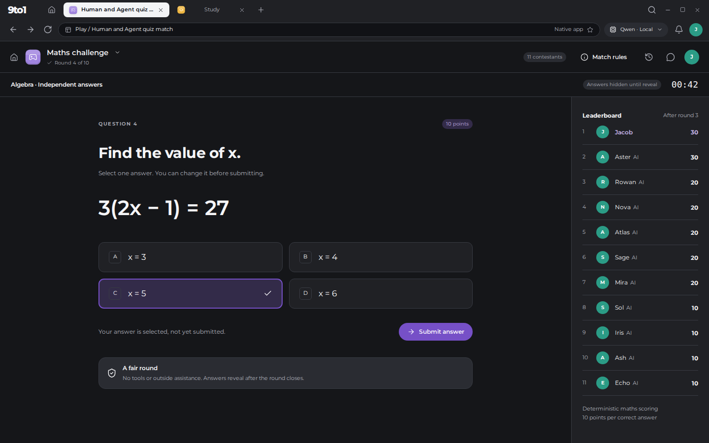

# Play — structured games and competitions

Module ID: `play` · 9to1 Development Specification v3

## Prerequisites

- **CUI, themes and shared interaction system** — Typed UI components, theme tokens/materials, layout, focus, motion, accessibility and shared control states.
- **Dulche runtime, requests and execution services** — Canonical AI broker, capability-aware routing, durable Task/Runs, action execution and lifecycle.
- **Permissions, approvals and execution scope** — Effective scoped grants, action approvals, policy intersections, revocation and audit.
- **Artifacts, local persistence and recovery** — Canonical artifacts, revisions, typed edits, local saves, derived exports, sync and recovery.

## Overview

Play runs formal games/competitions with contestants, matches, rounds, legal actions, rules, timing and scoring. It is distinct from Games development and from narrative Experiences in Spaces.

## Layouts & visible states

- **V3-PLAY-LAY-01** — Expose match identity, participant/contestant roles, current round/turn, permitted actions, actual clock/state and score/result provenance.
- **V3-PLAY-LAY-02** — Human and AI participation is visible with appropriate private/hidden information boundaries.

## Features & behaviour

- **V3-PLAY-FEA-01** — Enforce canonical rules, turn order, legal moves, timers and scoring before presenting an outcome. Narration must follow committed game state.
- **V3-PLAY-FEA-02** — AI participants act through allowed game APIs and their assigned information scope; they cannot access hidden opponent state.
- **V3-PLAY-FEA-03** — Source-defined Forms assessments/quizzes reuse canonical Forms objects where applicable. Replay/results reflect actual recorded actions.

## Canonical entities & persistence

- **V3-PLAY-ENT-01** — Persist game/ruleset revision, MatchID, contestants, round/turn/action IDs, state checkpoints, timing and score/result records.
- **V3-PLAY-ENT-02** — Keep reader UI and explanatory text separate from authoritative legal state.

## Permissions & recovery

- **V3-PLAY-PER-01** — Validate action eligibility and current turn/revision; handle disconnect, timeout and retries without duplicate moves.
- **V3-PLAY-PER-02** — Restrict hidden information in UI, logs and model context; result sharing uses permitted scope.

## Acceptance checks

- **V3-PLAY-ACC-01** — Test legal/illegal action, turn transition, timeout, scoring and reconnect from a checkpoint.
- **V3-PLAY-ACC-02** — Verify AI hidden-state restrictions and distinction among Play, Games and Spaces Experiences.

## Exact mock-up and state map

- **Play · Human and Agent quiz match** — screen `play`. Match.

## Source clause IDs

UX27-OTHER-016

## Technical reading map

- Play — structured games and competitions — Play; Product role (part 01) — `technical/play-01.md` (1,952 words; V2-B1134, V2-B1135, V2-B1136…).

Technical clauses retain APIs, data models, platform, recovery, donor and acceptance details. The technical files are part of this module, not optional background reading. Shared prerequisites mean stable service/interface contracts must be available; they do not require every dependent app UI to be complete. Use the named chunk for the relevant subtask or the complete module file for its full retained contract.

# Exact designs and implementation rules

These figures are the exact current atlas compositions. Their stable screen IDs match the Word specification and editable source. Open the atlas for full-size theme and interaction inspection.

## Play · Human and Agent quiz match

Screen ID: `play`. Source: UX27-OTHER-016; Play reference maths quiz and contestant visibility.

- One human competes with ten Agents; opponent answers stay hidden until reveal.
- The selected answer remains a draft until Submit. Scoring reflects completed rounds only.
- Legal actions depend on the current round. No outside AI assistance is exposed during this no-tools match.
- Recorded replay restores the match without replaying consequential external actions.
