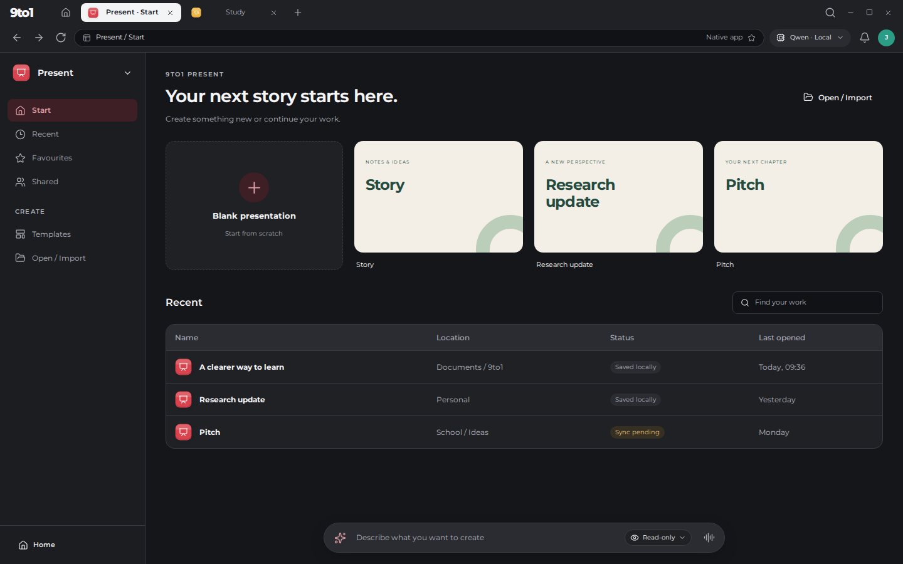
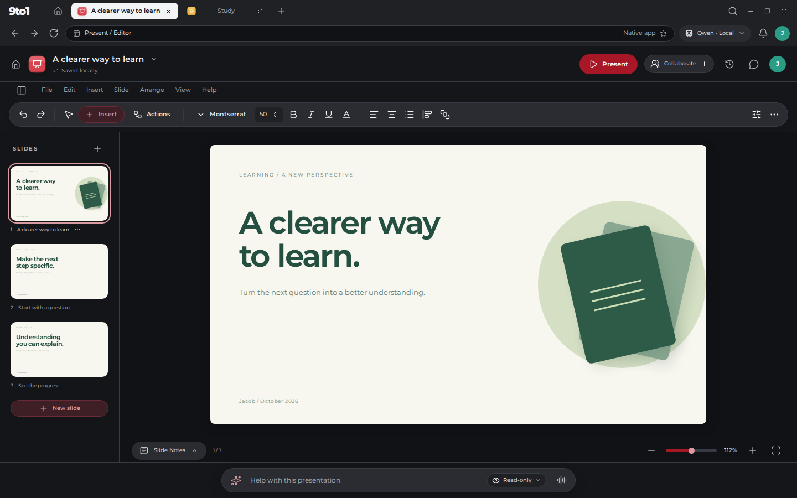
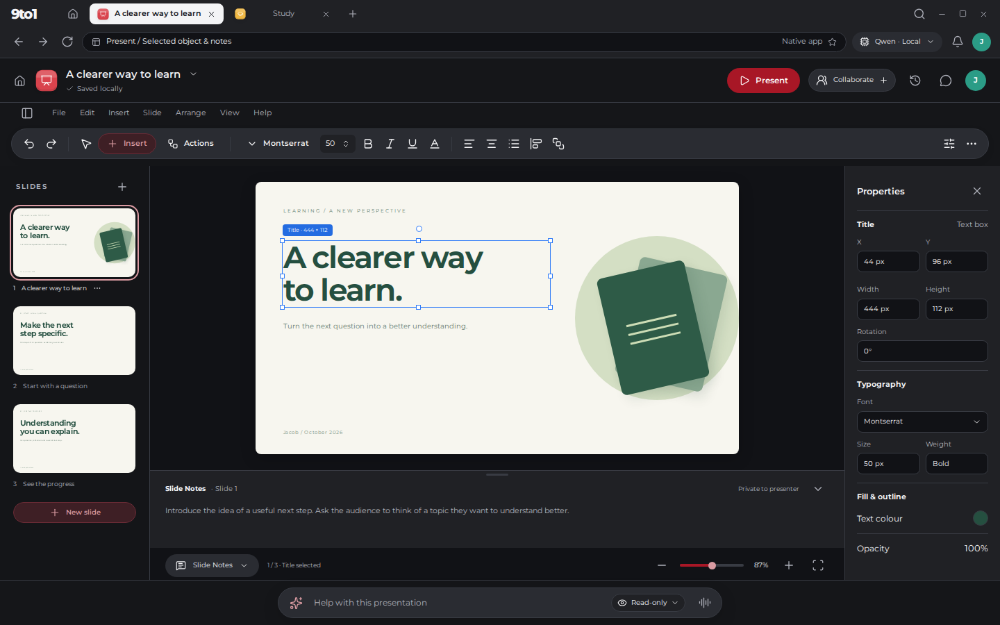
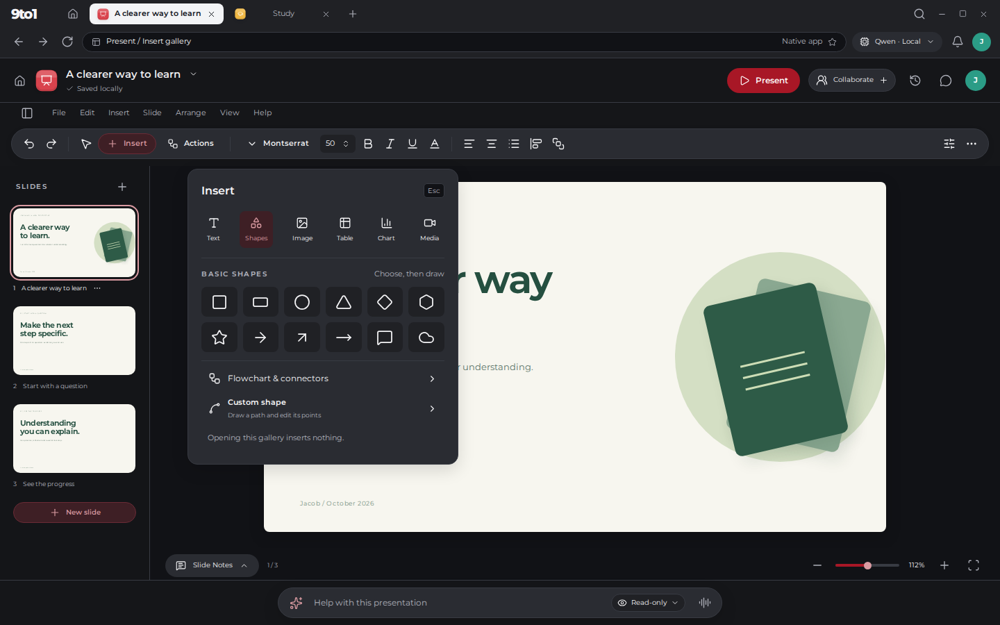
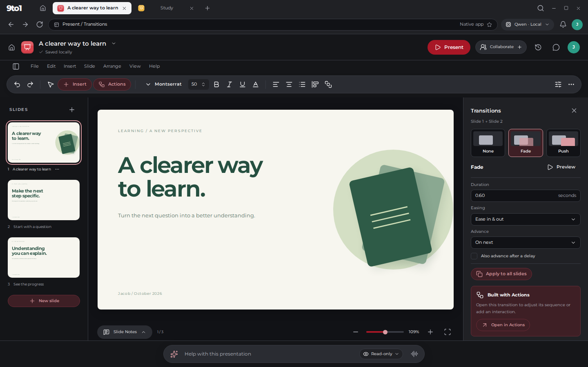
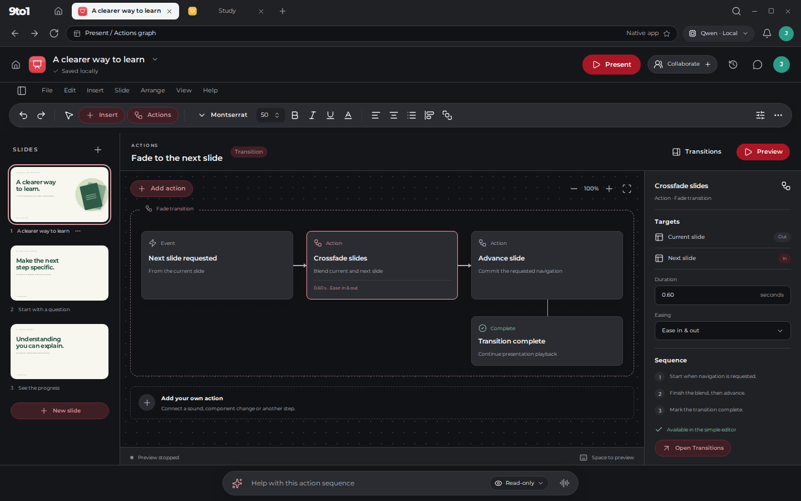
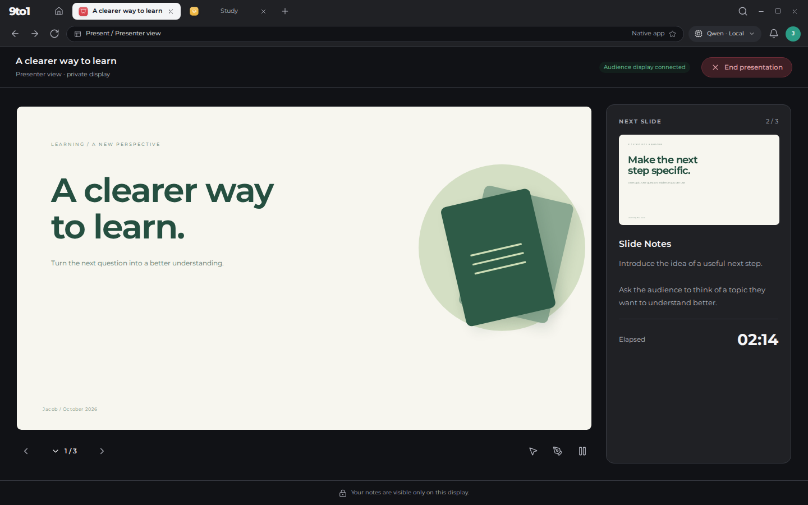
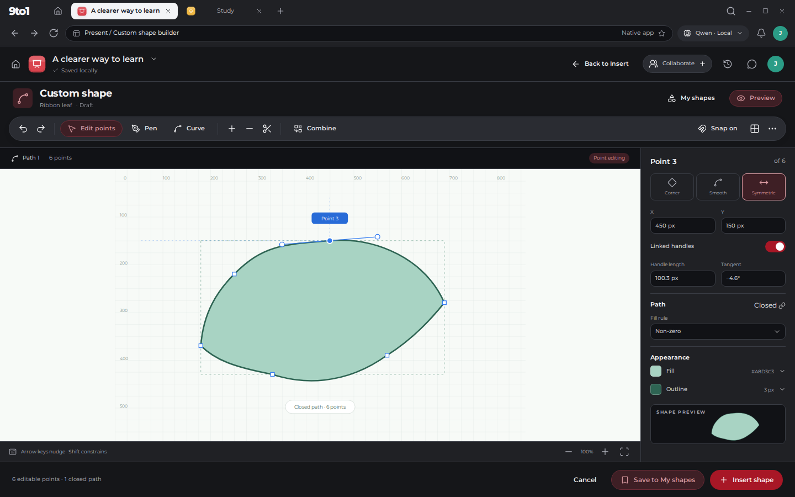
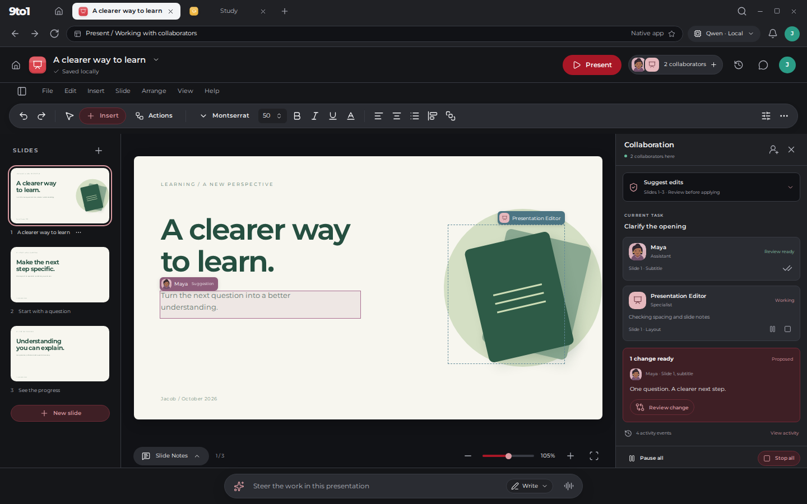

# Present — slide authoring and presentation

Module ID: `present` · 9to1 Development Specification v3

## Prerequisites

- **CUI, themes and shared interaction system** — Typed UI components, theme tokens/materials, layout, focus, motion, accessibility and shared control states.
- **Shared productivity engine and canonical embeds** — Real document/object engines, semantic editing, canonical app embedding and donor feature parity.
- **Node Editor — shared graph framework** — Shared typed graph schemas, editing/validation, draft activation and runtime presentation.
- **Shared AI controls and artifact collaboration** — Contextual AI bars, shared model/permission controls, global collaborators and typed artifact proposals.
- **Artifacts, local persistence and recovery** — Canonical artifacts, revisions, typed edits, local saves, derived exports, sync and recovery.

## Overview

Present provides full slide authoring, object editing, actions/animation and presentation playback. The Professional annex and authoritative slide 16 define its clean three-tier editing shell and object-selection behaviour.

Current owner overrides: V3-OWNER-001, V3-OWNER-013.

## Layouts & visible states

- **V3-PRESENT-LAY-01** — Use document header, File/Edit/Insert/Slide/Arrange/View/Help menu row and a single floating contextual toolbar. Thumbnails occupy the left, aspect-correct slide dominates, notes sit below and an optional right inspector follows selection.
- **V3-PRESENT-LAY-02** — Object selection shows eight resize handles and rotation; text editing shows a real caret/range. Do not confuse selected shape with text-entry mode.
- **V3-PRESENT-LAY-03** — Include Shapes, custom shape creation/editing, Actions and presentation/playback states. Custom shapes need real path/geometry editing rather than a static gallery label.
- **V3-PRESENT-LAY-04** — Presenter view keeps notes and next-slide/control information private from the audience display. Notes are editable content, not a decorative placeholder.

## Features & behaviour

- **V3-PRESENT-FEA-01** — Maintain slide order/layouts/masters, text/shapes/media, object alignment/arrangement, notes, animation, action graph and playback through canonical semantics.
- **V3-PRESENT-FEA-02** — Action configuration identifies trigger, target, effect, transition/navigation or permitted external action and preview behaviour. Use the shared Node Editor where source-defined graph authoring applies.
- **V3-PRESENT-FEA-03** — Preserve pointer transforms at zoom and viewport changes, selection geometry, keyboard nudge, proportional resizing and real undo.
- **V3-PRESENT-FEA-04** — Global collaborators expose typed changes to this deck/selected slide with review and expected revision. Live work from Spaces opens the same deck.

## Canonical entities & persistence

- **V3-PRESENT-ENT-01** — Keep DeckID, SlideID, object IDs, geometry, text/style, note content, action/animation definitions, revision and playback state distinct.
- **V3-PRESENT-ENT-02** — Export and audience rendering use the chosen slide size and content revision; app theme never retints authored slides.

## Permissions & recovery

- **V3-PRESENT-PER-01** — Preview/presentation mode must not grant document-write or external-action permission. Publishing/exporting remains a separate operation with truthful state.
- **V3-PRESENT-PER-02** — Preserve native deck when an export fails; reconcile stale collaborative changes and recover unsaved selection/edit state.

## Acceptance checks

- **V3-PRESENT-ACC-01** — Test selection versus caret, all handles/rotation at zoom, slide reorder, notes, custom shape edit and Actions configuration.
- **V3-PRESENT-ACC-02** — Verify presenter notes remain private, authored colours survive all themes, and live Spaces work/collaborator review references the same deck revision.

## Exact mock-up and state map

- **Present · Start** — screen `present-launch`. Launch.
- **Present · Editor** — screen `present-editor`. Editor.
- **Present · Selected object & notes** — screen `present-selection`. Selection.
- **Present · Insert gallery** — screen `present-insert`. Insertion.
- **Present · Transitions** — screen `present-transitions`. Simple Actions editor.
- **Present · Actions graph** — screen `present-actions`. Transition graph.
- **Present · Presenter view** — screen `present-presenter`. Playback.
- **Present · Custom shape builder** — screen `present-shape-builder`. Editable path.
- **Present · Working with collaborators** — screen `present-collaborators`. Presence & scoped work.

## Source clause IDs

PRESENT-UX-102, PRESENT-UX-103, PRESENT-UX-104, PRESENT-UX-105, PRESENT-UX-106, PRESENT-INT-102, PRESENT-INT-103, PRESENT-INT-104, PRESENT-INT-105, PRESENT-INT-106, PRESENT-INT-107, PRESENT-AC-102, PRESENT-AC-103, PRESENT-AC-104, UX27-PRESENT-001, UX27-PRESENT-002, UX27-PRESENT-003, UX27-PRESENT-004, UX27-PRESENT-005, UX27-PRESENT-006, UX27-PRESENT-007, UX27-PRESENT-008, SECTION-09, UTF-16, UX27-TEST-082, UX27-TEST-083, UX27-TEST-084, UX27-TEST-085, UX27-TEST-086, PRESENT-DES-201, PRESENT-DES-202, PRESENT-DES-203, PRESENT-DES-204, PRESENT-DES-205, PRESENT-DES-206, PRESENT-DES-207, PRESENT-INT-201, PRESENT-INT-202, PRESENT-AC-201, PRESENT-AC-202, PRESENT-AC-203, PRESENT-AC-204, PRESENT-SCALE-201

## Technical reading map

- Present — slide authoring and presentation — Floating rich toolbar; Primary actions versus inspector precision (part 01) — `technical/present-01.md` (2,289 words; V2-B0024, V2-B0025, V2-B0026…).
- Present — slide authoring and presentation — Present; Purpose, ownership and conformance (part 02) — `technical/present-02.md` (4,384 words; V2-B1374).
- Present — slide authoring and presentation — Present; Host route renders the intended editor (part 03) — `technical/present-03.md` (1,588 words; V2-B2805, V2-B2806, V2-B2807…).

Technical clauses retain APIs, data models, platform, recovery, donor and acceptance details. The technical files are part of this module, not optional background reading. Shared prerequisites mean stable service/interface contracts must be available; they do not require every dependent app UI to be complete. Use the named chunk for the relevant subtask or the complete module file for its full retained contract.

# Retained technical requirements

# Present — slide authoring and presentation — Floating rich toolbar; Primary actions versus inspector precision (part 01)

Reading status: active retained clauses, subject to the v3 owner overrides listed in the primary module. Historical process instructions and replaced original wording are stored separately.

### V2-B0024 · v2 lines 64–64

PRESENT-UX-102 — Floating rich toolbar. The toolbar MUST look like a single softly rounded floating CUI surface, separated subtly from the workspace with consistent margins/surface elevation; it MUST be predominantly icon-led, with modestly generous spacing, optically centred consistent icon hit areas, logical grouped separators, accessible names, shortcuts/tooltips and visible hover/focus/pressed/selected/disabled states. It MUST contain a substantial, useful set of daily commands rather than a sparse six-button strip. Stable primary groups include Undo/Redo, zoom/fit, selection, prominent + Insert, frequently used format/arrange options, inspector visibility and overflow. Contextual groups expose font family/type, font size and +/- sizing, bold, italic, underline, strikethrough, colour, text alignment, bullets/numbering, spacing, link and other applicable text commands, OR shape/image fill, outline, opacity, arrangement, align/distribute and other object-specific actions. Do not present irrelevant operations as enabled. Responsive width changes MUST use priority-based overflow instead of wrapping another toolbar row or clipping icons. Major commands MUST remain accessible in menus/shortcuts.

### V2-B0025 · v2 lines 67–67

PRESENT-UX-103 — Primary actions versus inspector precision. Common formatting operations MUST be directly usable from the toolbar and/or contextual command surfaces without repeatedly opening or scrolling an inspector. The optional resizable Properties inspector is for precise position/size/rotation, detailed typography, shape fill/stroke, image/crop options, slide settings and advanced configuration. Its sections MUST be logically grouped/collapsible as useful, with readable fields, appropriate labels, controlled scrolling and no arbitrary unrelated command dump (for example Import/Export/Present MUST NOT be inspector-only miscellany). The toolbar, inspector, context menu and keyboard shortcuts MUST be views of ONE authoritative canonical object/document state; changes must immediately synchronise and support logical undo. Routine changes such as fill colour SHOULD preview/apply directly instead of requiring a redundant Apply button. Popovers may use explicit Apply only when an actual staged operation justifies it.

### V2-B0026 · v2 lines 70–70

PRESENT-UX-104 — + Insert catalogue and shape gallery. A prominent + control MUST open a fully working, categorised Insert menu; the menu bar's Insert menu exposes the same domain actions. Cover all applicable donor/spec insertion types, including new slide/section/layout, text box, shapes, lines/arrows/connectors, images/media, tables, charts, links, comments and Generative UI/other canonical specialised objects according to feature-stage capability. Selecting Shapes MUST open a proper icon/preview gallery (e.g. rectangles, rounded rectangles, ellipses, polygons, lines, arrows, callouts, flowchart forms and other applicable donor-supported shapes); never insert a single default rectangle merely by opening Shapes. Selecting a shape MUST activate predictable draw-to-insert or explicit click-to-insert behaviour, with live preview, correct post-insertion selection and Escape cancellation. Visible actions MUST have real implementations or clearly truthful unavailable/capability states; no dead illustrative buttons.

### V2-B0027 · v2 lines 73–73

PRESENT-UX-105 — Layout and side surfaces. Keep the slide thumbnail/navigator on the left, the actual central 16:9 or document-aspect slide canvas visually dominant, optional contextual inspector on the right and collapsible/resizable speaker notes below. Thumbnails MUST use consistent mildly rounded corners, accurate previews, clear but restrained selected states, clean slide number/title spacing, readable truncated long labels and reliable thumbnail scrolling. The left navigation sidebar should be somewhat darker than the earlier medium-grey Present sidebar, consistent with the 9to1 dark palette; this is theme guidance, not a fixed hard-coded colour. Pane sizes and slide centring MUST respond to window, sidebar/inspector and notes changes without distorting the slide. The slide stage preserves aspect ratio, Fit-to-Window and real editable content; no tiny-slide regression or hard-coded zoom.

### V2-B0028 · v2 lines 76–76

PRESENT-UX-106 — Notes are real content. Each selected slide's existing notes MUST appear immediately from the canonical NotesID/SlideID mapping in a real editable speaker-notes surface; 'Add Notes' or equivalent is an empty-state placeholder ONLY when content is empty. Support focus, accessible caret, readable text, formatting consistent with the specified rich notes capability, correct switching across slides, autosave/save/reopen and failure feedback. Notes MUST not be replaced by a decorative card or lose state during navigation. Preserve the notes/Presenter View and export-privacy rules of the existing Present section.

### V2-B0030 · v2 lines 83–83

PRESENT-INT-102 — Explicit editor interaction state machine. MUST distinguish idle, hover/preselection, selected object, text-editing, moving, resizing, rotating, multi-selection, insertion, panning and zooming. Single click normally selects an object; double click or an appropriate keyboard command enters text editing; Escape exits editing/insertion or cancels an active gesture as appropriate. Dragging to select text in editing mode MUST NOT move the parent object. Dragging the body/border of a selected non-editing object MUST move it. Clicking empty slide space should clear selection predictably. Toolbar/inspector/selection UI MUST track the same state. Document object events and any runtime Actions events MUST not be confused with authoring gestures.

### V2-B0031 · v2 lines 86–86

PRESENT-INT-103 — Deterministic hit-testing and pointer capture. Define correct event-routing priority for open menus, handles/adorners, active text editor, selected object, frontmost other objects and empty slide. Respect z-order, locked/hidden states, overlapping objects, the clicked object and focus; do not let editable text intercept movement outside editing mode. Use correct pointer down/move/up, drag threshold, capture/release, cancellation and out-of-window handling. No jump at drag start: preserve pointer grab offset. Screen/window/viewport/slide/object coordinates and zoom/scroll/rotation transforms MUST be converted consistently, with no arbitrary pixel-offset patches or stale geometry.

### V2-B0032 · v2 lines 89–89

PRESENT-INT-104 — Hover outlines, selection geometry and handles. Hovering over a selectable object MUST show an unobtrusive preselection outline before click; a selected object MUST show a stronger accurate bounding outline and resize handles, clearly distinct from hover, without flicker or content mutation. For applicable rectangular resizable objects, expose eight handles (four corners and four side midpoints) plus rotation control where supported. Handles MUST have usable pointer hit targets, correct directional semantics and cursor feedback. Very narrow/tiny objects MUST NOT produce overlapping unusable handles; use an adapted adorner/hit target strategy. Outlines/handles MUST stay attached to actual selected geometry at all zooms, after transforms and across slide changes. The selection overlay MUST NOT be stored as slide content.

### V2-B0033 · v2 lines 92–92

PRESENT-INT-105 — Cursor and direct manipulation feedback. Provide distinct relevant default/select, text caret, move/grab, horizontal/vertical/diagonal resize, rotate, crosshair for shape insertion, pan/grabbing and unavailable cursor states; respect object rotation where appropriate. Moving, resizing, rotating and applicable object/formatting previews MUST update visibly DURING pointer gestures (not only after release), with accurate content, outlines and property previews. Keep gestures responsive without needless full-document reflow. Commit each gesture as one logical undoable operation; cancelling restores the preceding state. No unexpected movement, resizing, lost focus or selected-text modification.

### V2-B0034 · v2 lines 95–95

PRESENT-INT-106 — Selection and keyboard quality. MUST handle Shift-click multi-selection, suitable area selection, overlapping objects, group/ungroup, duplication, delete, copy/paste, z-order and keyboard nudging where required by the donor/spec. Keys obey state: arrows move a text caret when editing text, not the text-box object. Object transforms retain bounds; edits survive save/reopen with stable IDs. Provide right-click without breaking normal left-click or keyboard operations.

### V2-B0035 · v2 lines 98–98

PRESENT-INT-107 — Reliable scrolling and zoom. Normal mouse wheel scrolls the correct hovered scroll container (slide list, inspector, notes or oversized canvas), with appropriate event propagation rather than occasionally swallowing input. Ctrl+wheel over the editing canvas zooms incrementally; pinch zoom on supported trackpads behaves appropriately and must not confuse two-finger scrolling with zoom. Zoom SHOULD be anchored around the pointer location when practical, obey safe bounds, and share one state with the toolbar percent/Fit-to-Window controls. Changing zoom, scrolling, toggling panels or resizing window MUST NOT desynchronise object positions, hit-testing, resize handles or canvas centring. Fit-to-Window uses actual available viewport rather than arbitrary constants. Normal wheel behaviour outside the canvas remains panel scrolling.

### V2-B0045 · v2 lines 131–131

PRESENT-AC-102 — Functional acceptance scenes. In an identified real running build, verify: (1) create/open/save/close/reopen and truthful save status; (2) text select -> drag -> resize at all eight handles -> double-click edit -> text selection -> exit -> undo/redo; (3) thin, overlapping, rotated and edge-of-slide objects; (4) hover outline versus selected outline and cursor changes; (5) shape gallery -> choose distinct shapes -> live draw -> format -> duplicate -> delete; (6) toolbar formatting and inspector synchronisation; (7) right-click target-specific menus on objects, text, thumbnails and blank canvas; (8) notes existing content/placeholder, slide switching and persistence; (9) scrolling over each panel, Ctrl+wheel/pinch/toolbar zoom at fit/50/75/100/150/200% where supported; (10) layout/panel resize and correct fit; (11) presentation/playback and relevant import/export; (12) clipboard, accessibility, keyboard-only actions and realistic donor-parity journeys. Run actual pointer/keyboard interactions, not event-handler presence checks.

### V2-B0046 · v2 lines 134–134

PRESENT-AC-103 — Visual and integration evidence. Capture evidence of actual build identity (source commit, branch/worktree, package/route, dependencies), default shell, selected/edited text, selected shape, hover outlines/handles, + menu, multiple-shape gallery, right-click menus, font/colour popover, toolbar overflow, inspector, speaker notes, narrow and full windows, startup/theme transition, and zoomed canvas. Inspect real on-screen icon rendering, menu layering and selection geometry. Record passes/failures and timings; screenshots cannot alone verify interaction or CUI source compliance, tests cannot alone verify visual polish. A true independent reviewer must exercise the exact integrated artifact and apply existing seven APP-AC gates.

### V2-B0047 · v2 lines 137–137

PRESENT-AC-104 — Explicit fail conditions. Present FAILS usability/visual acceptance if it has a flat sparse toolbar with key format tools hidden in the inspector; insertion limited to a single default shape; no functional contextual right-click menu; selected-versus-edited text ambiguity; unreliable drag, cursor, hover, handle or scroll/zoom interactions; decorative notes or missing saved notes; broken SVGs; native theme leakage; white 5–10-second refresh without investigated resolution; or commands that only simulate success. An RCVP CHECKPOINT can be visible while work continues, but MUST NOT be labelled VERIFIED until its entire applicable baseline and the above essential user journeys pass on the real app. Full-stage enhancements remain governed by the existing four-part schedule.

### V2-B1350 · v2 lines 5757–5757

## 9. Present — routed editor, direct manipulation and playback

### V2-B1351 · v2 lines 5759–5759

### UX27-PRESENT-001 — Correct route and one implementation

### V2-B1352 · v2 lines 5761–5761

**O/B.** Trace the actual `9to1://present` registration to the current production surface and verify the installed build uses it. A badge or layout change in an unused standalone scene does not count. Preserve the 12 October Present amendments and all donor baseline capabilities; the source names PresentPage and PresentHavenScene are historical diagnostic leads, not permanent architecture requirements.

### V2-B1353 · v2 lines 5763–5763

Test the actual host activation and the standalone app against the same deck identity. A test that directly constructs a page and asserts a badge is present is useful unit evidence but is not proof of host route activation, visual correctness or a functioning presentation editor.

### V2-B1354 · v2 lines 5765–5765

### UX27-PRESENT-002 — Header, menu and editing toolbar

### V2-B1355 · v2 lines 5767–5767

**B/D.** Retain the specified compact document header, conventional menu row above the toolbar, and exactly one persistent primary floating editing toolbar. Group title/chevron, truthful save state and relevant history/collaboration actions coherently. Present is a prominent action. File/Edit/Insert/Slide/Arrange/View/Help open real menus; do not replace them with labels or scatter another ribbon below.

### V2-B1356 · v2 lines 5769–5769

Use the current approved Present identity/accent assets, not a hardcoded sample badge standing in for the full shell. Commands expose accessible names and contextual enabled/mixed states. Overflow preserves all commands without wrapping into an uncontrolled second permanent toolbar.

### V2-B1357 · v2 lines 5771–5771

### UX27-PRESENT-003 — Slide list, notes and canvas

### V2-B1358 · v2 lines 5773–5773

**B.** The left navigator contains real slide thumbnails and section structure, with selected state, slide order and context menus. The central slide remains visually dominant and preserves its actual aspect ratio under Fit/zoom. Notes are a real editable per-SlideID/NotesID surface, collapsible/resizable below; a placeholder appears only when notes are empty.

### V2-B1359 · v2 lines 5775–5775

Changing slide restores the correct notes, selection and content. Thumbnail generation follows the relevant deck revision and does not freeze editing. Adding/deleting/reordering a slide modifies the deck, not merely the UI list, and remains undoable/reopenable. The right inspector is optional and cannot squeeze the slide to an unusable postage stamp.

### V2-B1360 · v2 lines 5777–5777

### UX27-PRESENT-004 — Selection versus text editing

### V2-B1361 · v2 lines 5779–5779

**B/D.** The interaction state machine distinguishes hover, object selection, text editing, moving, resizing, rotating, insertion, multi-selection and panning. A single click selects the intended object; the supported double-click/keyboard action enters text editing. Text-range dragging in editing mode must not move the parent text box. Dragging the border/body in object-move mode preserves the pointer’s grab offset.

### V2-B1362 · v2 lines 5781–5781

Escape cancels the current insertion/gesture or exits text editing before clearing higher-level selection. Arrow keys move the text caret while editing and nudge an object only in the corresponding selection state. Context menus target the clicked object rather than a stale selection behind it.

### V2-B1363 · v2 lines 5783–5783

### UX27-PRESENT-005 — Handles, cursors and live transforms

### V2-B1364 · v2 lines 5785–5785

**B.** Applicable rectangular objects show eight resize handles and a rotation affordance where supported, with usable hit targets and directionally correct cursors. Hover outlines are distinct from selection. Tiny or narrow objects use an adapted hit-target strategy rather than overlapping handles. Moving/resizing/rotating updates content and adorners during the gesture, with correct zoom/scroll transforms.

### V2-B1365 · v2 lines 5787–5787

One finished gesture is one undo entry. Escape/cancel restores the previous geometry. Group/ungroup, multi-select, align/distribute and z-order operate on real object IDs. A selection frame must not detach from its object after viewport resize or theme change.

### V2-B1366 · v2 lines 5789–5789

### UX27-PRESENT-006 — Insertion catalogue and shape gallery

### V2-B1367 · v2 lines 5791–5791

**B/D.** Insert exposes slide/layout/section, text, shapes, images/media, tables, charts, links and other applicable registered types. Shapes opens a gallery of actual available forms with recognisable previews; merely opening the gallery must not insert a rectangle. Choosing a shape starts a defined draw-to-insert or explicit click placement, with preview and Escape cancellation.

### V2-B1368 · v2 lines 5793–5793

New objects enter a useful selected/editable state and can immediately be formatted, moved, saved and reopened. A gallery item without a real engine action is disabled with an honest reason or absent until supported, not treated as implemented insertion.

### V2-B1369 · v2 lines 5795–5795

### UX27-PRESENT-007 — Formatting and shared state

### V2-B1370 · v2 lines 5797–5797

**B/D.** Toolbar, inspector, context menu and shortcuts operate on one authoritative object/document state. Text controls include supported font, size, emphasis, colour, alignment, lists and spacing; object controls include fill/outline/opacity and geometry. Common formatting applies/previews directly where appropriate; an unnecessary Apply button is not required for every colour change.

### V2-B1371 · v2 lines 5799–5799

Mixed selections show mixed state and apply only valid shared operations. Changing a slide’s theme/layout/master uses donor-backed semantics, preserving custom content and providing undo. Do not flatten an editable object to an image to avoid handling its properties.

### V2-B1372 · v2 lines 5801–5801

### UX27-PRESENT-008 — Present, presenter view and recovery

### V2-B1373 · v2 lines 5803–5803

**B/D.** Present starts playback from the chosen slide using the actual deck, with reliable navigation, exit and supported media/transition behaviour. Presenter View shows the proper notes/current-next slide information on its intended display without leaking notes into audience output. Stopping playback returns to the same editor/slide/selection.

# Present — slide authoring and presentation — Present; Purpose, ownership and conformance (part 02)

Reading status: active retained clauses, subject to the v3 owner overrides listed in the primary module. Historical process instructions and replaced original wording are stored separately.

### V2-B1374 · v2 lines 5805–6155

Test slide editing, notes, media, save/reopen and playback from the exact final build. Missing display hardware or native-platform coverage stays BLOCKED/NOT RUN. A successful editor launch is not playback acceptance, and a playback screenshot is not proof that the deck remains editable.
<!-- UX27:END SECTION-09 -->
Present
Purpose, ownership and conformance
9-1 Present is the CUI presentation authoring, presenting and interactive-runtime application. LibreOffice Impress/Draw is the donor foundation for applicable mature presentation editing, interoperability and quality-of-life behaviour. 9-1 owns the CUI shell, the native .9to1p model, the Actions runtime, typed APIs, AI integration, component model and cross-app semantics.
Applicable donor functionality MUST be preserved unless a scoped donor-parity exception is recorded in the canonical donor-parity manifest. Present MUST NOT ship as a reduced slide editor whose only conformance evidence is file opening or basic text/shape editing.
Present MUST use Home's Shared Productivity Engine for every registered shared object type that it supports. Shared text, tables, charts/graphs, images/media, drawings/ink and other shared objects copied between Present, Write, Canvas, Boards and Spaces MUST preserve the shared object schema, semantic identifiers, formatting, accessibility metadata and clipboard representation.
Release boundary:
* Present owns PresentationID, SlideID, slide order, slide composition, presentation-level state, slide-local state, speaker notes references, presentation sessions and the Actions graph.
* Home owns shared productivity object schemas, permission brokerage, shared AI/runtime services, common clipboard bundles and other platform services defined in Home.
* Present MUST NOT introduce a second private implementation of a Home-owned shared object or platform service.
* The native .9to1p representation is authoritative for full-fidelity 9-1 behaviour.
Normative applicability and capability negotiation
Terms such as applicable, supported and available are not discretionary escape hatches in this section. They are resolved from explicit manifests or runtime capability declarations.
* A donor feature is applicable unless it is classified in the Present donor-parity manifest as Replace with 9-1-native equivalent or Not applicable with a recorded technical/legal reason.
* A platform capability is supported only when the platform capability registry declares the required capability and version for the active device/runtime.
* A file-format construct is representable only when the import/export capability matrix declares a mapping for the source construct and target format/version.
* Failure of a required capability check MUST produce a typed unavailable/unsupported result and the specified fallback or CompatibilityIssue; silent omission is prohibited.
* An implementation MUST NOT reinterpret a MUST requirement as optional merely because its current code path does not implement the required capability.
Landing page, file lifecycle and persistence
Present MUST implement the global launch-screen contract. The launch surface MUST expose Create New, Open/Import, recent presentations and real template/theme discovery. Recent items MUST be derived from persisted history; fabricated recent files are prohibited except for explicitly labelled onboarding or template content.
The release file contract MUST support native .9to1p plus PPTX and ODP import/export. Static output MUST support PDF and image export. Present MUST provide complete create -> edit -> save -> close -> reopen workflows with autosave, crash/interrupted-save recovery, revision tracking and conflict-safe persistence.
* A failed save, partial media write, unresolved revision conflict or recovery failure MUST be surfaced as an explicit error state.
* Present MUST NOT report success until the target revision and all referenced persisted objects required for the save have been committed.
* Recovery MUST preserve the last known-good durable revision and MUST NOT overwrite it with a partially reconstructed presentation.
Canonical data model and identity
All persistent entities MUST use stable opaque IDs. Slide number, slide title, list position, object name and file path are mutable presentation attributes and MUST NOT be used as persistent identity.
Presentation {
  PresentationID: StableID
  SchemaVersion: Version
  RevisionID: RevisionID
  SlideOrder: SlideID[]
  ThemeRef: ThemeID + ThemeRevision
  MasterRefs: MasterID[]
  PresentationVariables: VariableMap
  ComponentTypes: ComponentTypeID[]
  ActionsGraphRef: GraphID + GraphRevision
  Settings: PresentationSettings
  Permissions: PermissionDescriptor
}
Slide {
  SlideID: StableID
  MasterID?: StableID
  LayoutID?: StableID
  ObjectOrder: ObjectID[]
  SlideVariables: VariableMap
  NotesID: StableID
  Hidden: boolean
  ActionsBindings: ActionBinding[]
  RevisionID: RevisionID
}
Reordering, renaming, hiding, duplicating or moving a slide MUST NOT mutate the identity of an existing SlideID. Duplicating a slide MUST allocate a new SlideID and new IDs for duplicated slide-owned objects while preserving references that are explicitly shared by definition.
A reference to a slide or object MUST resolve by stable ID. Position-based references such as 'slide 4' MAY be accepted as user input, but MUST be resolved to a stable ID before persistence or execution.
Required release defaults:
SpeakerWordsPerMinute = 130
IncludeHiddenSlidesInStatistics = true
LiveDrawingMode = OFF
LiveInkPersistence = SESSION_ONLY
IncludeSpeakerNotesInAudienceOutput = false
PersistSessionState = false
Changing a release default MUST create an explicit persisted setting override. Absence of an override means the release default above; implementations MUST NOT infer a different default from platform, file origin or prior session state.
Authoring shell and slide navigation
The editing shell MUST expose a persistent slide navigator, thumbnail view, slide sorter/grid view and searchable presentation outline. The same SlideID MUST back every representation of a slide.
Required slide operations:
* Create, duplicate, delete/recover, reorder, hide/unhide and move slides between presentation sections.
* Jump to slide by outline/search result, stable reference or user-visible position.
* Multi-select slides for reorder, duplicate, delete, export and section assignment where the operation is semantically valid.
* Preserve selection and focus predictably after slide mutations; deleting the active slide MUST move focus to a deterministic adjacent surviving slide.
The authoring shell MUST provide undo/redo, zoom, fit slide, fit selection, rulers, guides, grid, snapping controls and a status surface showing at least current slide/total slide count, zoom and relevant selection/document state. Keyboard-only navigation MUST cover the navigator, canvas, notes pane and inspectors.
Conventional object editing and layout
Present MUST provide mature slide-object editing for text, shapes, lines/connectors, images, shared tables/charts/graphs, drawings, media, code objects, 3D objects, Generative UI objects and supported embedded/shared objects.
Every spatial object type that declares geometric editing MUST support the applicable subset of:
* Create, duplicate, delete, multi-select, group/ungroup and lock/unlock.
* Move, resize, rotate, flip, z-order change, align and distribute.
* Snap to grid/guides/objects and enter exact position, size and rotation values.
* Crop or mask only for object types whose renderer declares crop/mask support.
* Style copy/paste without silently copying object identity, runtime state or permissions.
Shape and text styling MUST persist actual stored values. Inspectors, toolbars and keyboard commands MUST read from and write to the same canonical object properties; a visible control that does not mutate the corresponding stored property is non-conformant.
Present MUST support object naming and a selection/object tree. The tree MUST expose stacking order, locked/hidden state and semantic object identity. Reordering the tree MUST change z-order only when the selected object type participates in z-order.
Themes, masters, layouts and templates
Present MUST support theme colours, theme fonts, backgrounds, reusable style tokens, slide masters, slide layouts, placeholders and reusable templates.
* A slide linked to a layout MUST inherit layout/master properties unless that property has an explicit slide-level override.
* Changing a master or layout MUST update linked slides without deleting valid slide-level overrides.
* Reset Layout MUST remove only slide-level overrides governed by the selected layout; it MUST NOT delete unrelated slide-owned objects.
* PPTX/ODP import MUST preserve representable master/layout relationships instead of flattening every slide to unrelated absolute objects.
Notes-page and handout layout data present in an imported format MUST be retained when the source construct maps to a declared Present capability. If no declared mapping exists, import MUST emit a CompatibilityIssue rather than silently dropping the construct.
Speaker notes and notes workflow
Every slide MUST have first-class speaker notes identified by a stable NotesID. Notes are authoring content associated with a SlideID and are not audience-slide content.
SpeakerNotes {
  NotesID: StableID
  SlideID: StableID
  Content: SharedRichTextDocument
  Locale?: LocaleID
  RevisionID: RevisionID
}
* Notes MUST be editable in a dedicated notes pane and a full Notes view.
* Notes MUST support shared rich-text editing, lists, links, proofing and supported shared embedded objects.
* Notes MUST be searchable and addressable by typed APIs.
* The shared Dictation capability MUST operate in speaker notes.
* Notes MUST appear in Presenter View and notes-page print/export when explicitly selected.
* Normal slideshow output, ordinary audience capture, PDF/image export and generated video MUST exclude speaker notes by default.
* A notes-inclusive export MUST require an explicit notes output mode; it MUST NOT be inferred from the presence of notes.
* PPTX/ODP import/export MUST preserve speaker notes when the destination format supports them. Loss or degradation MUST be listed in the compatibility report.
Word, character and speaking statistics
Present MUST provide live text statistics for presentation content. The statistics engine MUST expose the following explicit scopes: SELECTION, CURRENT_SLIDE, CURRENT_NOTES, ALL_SLIDES, ALL_NOTES and PRESENTATION_COMBINED.
PresentationTextStatistics {
  Scope: StatisticsScope
  WordCount: integer >= 0
  CharacterCountWithSpaces: integer >= 0
  CharacterCountWithoutSpaces: integer >= 0
  SlideTextWordCount?: integer >= 0
  NotesWordCount?: integer >= 0
  EstimatedSpeakingSeconds?: integer >= 0
}
Word boundaries MUST follow the platform Unicode word-segmentation implementation based on Unicode word-boundary rules. Character counts MUST count user-perceived Unicode grapheme clusters rather than UTF-16 code units. CharacterCountWithoutSpaces MUST exclude grapheme clusters classified by the platform Unicode implementation as whitespace.
* Slide-text statistics include authored text visible in text-bearing slide objects and component labels in the selected scope.
* Speaker-note statistics include only speaker-note rich-text content.
* Comments, alt text, object names, Actions node labels, code source, hidden implementation metadata and compatibility metadata MUST NOT be included in ordinary word/character counts.
* ALL_SLIDES MUST include hidden slides by default because they are part of the authored document; the statistics UI MUST provide an explicit Exclude hidden slides filter.
* PRESENTATION_COMBINED MUST expose slide-text and notes counts separately in addition to the combined totals.
Estimated speaking time MUST be calculated from notes WordCount using SpeakerWordsPerMinute. The release default is 130 words/minute. The user MUST be able to change this value without altering the note text. EstimatedSpeakingSeconds = round(WordCount / SpeakerWordsPerMinute * 60).
Counts MUST update after a committed text edit without requiring a save/reopen cycle and MUST be accessible from normal authoring UI without inserting count text into the presentation.
Search, proofing, comments and collaboration
Present MUST provide presentation-wide search and replace across slide text and speaker notes. Every result MUST identify the SlideID, object/notes target and exact text range required to navigate to the match semantically.
* Spell-check/proofing MUST operate on slide text and speaker notes and MUST preserve per-range language metadata.
* Comments and replies MUST be anchorable to a SlideID, ObjectID and, where supported, a text range.
* Realtime collaboration MUST preserve concurrent object, text, notes and comment edits using revision/conflict semantics; naive timestamp last-writer-wins data loss is prohibited.
* Presence indicators and remote selections are session UI state and MUST NOT mutate presentation content.
Actions runtime and state model
Present MUST NOT implement an independent legacy animation engine or an independent transition runtime. All dynamic, timed, interactive and transition behaviour MUST be represented by a canonical typed Actions graph executed by the shared graph runtime.
ActionGraph {
  GraphID: StableID
  GraphRevision: RevisionID
  Nodes: ActionNode[]
  Edges: ActionEdge[]
  Entrypoints: ActionBinding[]
}
PresentationRuntimeState {
  GlobalVariables: VariableMap
  SlideVariables: Map<SlideID, VariableMap>
  ComponentState: Map<ComponentInstanceID, VariableMap>
  SessionState: VariableMap
}
Slides, objects, interactive components, media, code objects, 3D objects and live-drawing surfaces MUST expose versioned typed events. Event payloads MUST be schema-validated before graph execution.
The release event vocabulary MUST include at least:
* PresentationStarted, PresentationEnded, SlideEntered, SlideLeft, NextSlideRequested and PreviousSlideRequested.
* Clicked, DoubleClicked, PointerEntered, PointerLeft, Focused, Blurred and supported key/gesture events.
* TimerElapsed and VariableChanged.
* MediaStarted, MediaPaused, MediaPositionChanged, MediaEnded and MediaError.
* ComponentValueChanged and ComponentSubmitted.
* DrawingChanged and code-result/code-event output.
Actions MUST support conditions, branching, sequencing, parallel branches, delays/timers, reusable subgraphs and typed error paths. Actions MUST address targets by stable semantic IDs and MUST NOT simulate mouse/keyboard input when a typed capability exists.
Graph execution MUST be deterministic for the same graph revision, initial local state and deterministic inputs. When multiple nodes become runnable simultaneously, ordering MUST be defined by explicit dependencies/priority and a stable NodeID tie-breaker. External service results are recorded inputs and do not make the local scheduling order unspecified.
Cycles are permitted only when the runtime execution guard can bound them. Every event cascade MUST have a finite execution budget and loop detection. Exceeding the budget MUST terminate the affected cascade with a typed runtime error rather than freezing the presentation.
Starting a presentation creates a new PresentationSession with a defined initial state. SessionState and component runtime state reset on restart by default. Persistence requires an explicit author-configured persistence binding and the normal permission/write rules.
Transitions builder
The Transitions sidebar MUST remain available as a simple authoring surface, but it is a specialised Actions-graph editor. It MUST NOT invoke a second transition engine.
* Choosing or editing a transition MUST create/update a marked Actions subgraph owned by that transition definition.
* The sidebar MUST expose Open in Actions to reveal the exact generated subgraph.
* Simple-editor changes MUST modify only nodes owned by the transition definition and MUST preserve user-authored extension nodes connected outside that owned region.
* If an advanced graph edit makes the transition no longer representable by the simple sidebar, the sidebar MUST show a Custom/Advanced state rather than deleting or approximating the graph.
A transition completes only when its graph reaches the transition completion node. Slide navigation MUST commit exactly once per NavigationRequestID.
Interactive and reusable components
Present MUST ship first-class accessible Button, Switch, Text Input, Dropdown, Slider and Flashcard component types.
* Components MUST expose typed properties, state, focus/keyboard semantics, accessibility role/name/value and versioned events.
* Built-in hover, focus, pressed and value behaviour MUST work without requiring an author to construct a graph.
* The same primitives MUST be exposed to authors through Actions; built-in components MUST NOT depend on a hidden private animation system.
ComponentType {
  ComponentTypeID: StableID
  DefinitionRevision: RevisionID
  VisualTree: ComponentNode[]
  PropertySchema: Schema
  StateSchema: Schema
  EventSchema: Schema
  ActionSchema: Schema
  DefaultValues: ValueMap
  Variants: Variant[]
  AccessibilitySemantics: AccessibilityDescriptor
  InternalActionsGraph: GraphID
  ExposedProperties: PropertyID[]
  ExposedEvents: EventTypeID[]
}
Users MUST be able to convert selected objects/components into a reusable Component Type. An instance MUST retain ComponentInstanceID, ComponentTypeID, ComponentDefinitionRevision, property overrides and instance state.
* Linked instances MAY receive compatible definition updates only through an explicit update policy.
* Detached/local copies MUST NOT receive future definition updates.
* An incompatible component-definition update MUST NOT silently rewrite or invalidate an existing instance; it MUST require migration or retain the older definition revision.
* Reusable component types MUST be storable in the user's/workspace component library.
Generative UI
Present's Insert surface MUST include Generative UI. The user may insert an existing generated UI artifact or request a new generated interactive surface through Dulche.
GenerativeUIObject {
  GenerativeUIObjectID: StableID
  SchemaRevision: RevisionID
  StateSchema: Schema
  EventSchema: Schema
  ActionsBindings: ActionBinding[]
  Permissions: PermissionDescriptor
}
* Generated UI MUST execute in the approved shared CUI/Generative UI runtime.
* Arbitrary raw HTML/JavaScript embedded directly into the presentation is prohibited.
* Generated UI events MUST be connectable to the presentation Actions graph.
* A generated UI object MAY be saved as a reusable Component Type only when its visual, state, event and action schemas use ComponentType-supported constructs and pass component validation.
* Write, Present, Boards and Canvas MUST use the same canonical Generative UI representation rather than app-specific incompatible formats.
Runnable code, media, 3D and live ink
Runnable code:
* A runnable-code object MUST store source, registered language/runtime ID, declared inputs, typed outputs, permissions and execution limits.
* Execution MUST occur in a sandbox. Filesystem, network, account and device access are denied by default and may be granted only through declared platform capabilities.
* CPU/time, memory and output limits MUST be enforced by the selected runtime provider. Limit violations MUST return typed errors.
* Code results/events MUST be consumable by Actions and MAY update authorised presentation objects through typed APIs.
Audio and video:
* Media objects MUST expose Play, Pause, Stop, Seek, SetVolume and SetPlaybackRate.
* Media events MUST include Started, Paused, PositionChanged, Ended and Error.
* Missing, offline or unsupported media MUST produce an explicit media error state; silent broken placeholders are prohibited.
Native 3D:
* The initial supported interchange formats MUST include glTF and GLB.
* 3D objects MUST support transform, camera/orbit controls, camera presets, lighting/environment, material rendering, hotspots and Actions integration.
* Model-intrinsic animation/timeline playback MUST be controlled through typed 3D Actions; it MUST NOT create a legacy presentation-animation subsystem.
Drawing/live ink:
* Present MUST use the shared Rnote-derived structured drawing/ink model.
* Live drawing modes are OFF, PRESENTER_ONLY and PARTICIPANTS where the collaboration surface supports participant input.
* Live ink persistence modes are SESSION_ONLY, AUTO_SAVE and EXPLICIT_COMMIT.
* DrawingChanged MUST be available to Actions and, when authorised, Dulche.
Slideshow runtime and Presenter View
PresentationSession {
  SessionID: StableID
  PresentationID: StableID
  SourceRevisionID: RevisionID
  ActiveSlideID: SlideID
  RuntimeState: PresentationRuntimeState
  RouteHistory: NavigationRecord[]
  StartedAt: Timestamp
  Status: RUNNING | PAUSED | ENDED | FAILED
}
Present MUST support full-screen and windowed slideshow playback and presenter/audience display selection when multiple display targets are available.
* Presenter View MUST display current slide, next slide, speaker notes, slide navigator, elapsed timer, clock and presentation controls.
* AudienceOutput and PresenterUI are separate render targets. Speaker notes, timers, controls, diagnostics and presenter-only overlays MUST NOT enter AudienceOutput unless the user explicitly selects a presenter-view recording/export mode.
* The runtime MUST support keyboard navigation, slide jumping, hidden-slide rules, black/white blank screen, presenter pointer/laser, permitted live ink, live captions/subtitles where configured and interactive components/Actions.
* Reduced-motion preference MUST be exposed to the Actions runtime. Motion-heavy Actions MUST provide a defined reduced-motion result rather than ignoring the preference.
* Presenter notes MUST support presenter-side text sizing and auto-scroll/teleprompter behaviour without mutating stored note content.
A presentation session MUST execute against a defined SourceRevisionID. If the document changes during a live session, the runtime MUST either remain pinned to SourceRevisionID or apply an explicit safe live-update policy; it MUST NOT mix arbitrary object revisions silently.
Rehearsal, timings and recording
Present MUST support rehearsal of timings and structured session recording.
* Rehearsal MUST record navigation and Action-path timing without converting the authored presentation into a fixed linear deck.
* Recording MAY capture narration, camera, pointer/ink and the actual executed Action path subject to device permissions.
* A recorded session MUST retain RouteHistory and timing data sufficient to replay or export the recorded route.
* Replacing an existing recording MUST be reviewable and undoable; destructive replacement without a recoverable prior revision is prohibited.
AI-aware authoring and live presentation
The persistent AI bar MUST receive permission-filtered semantic context for all authorised slides, off-screen objects, speaker notes, Actions graphs, component definitions/state, media metadata, runnable code metadata, 3D objects, drawings and current presentation-session state. Semantic context MUST be preferred over screenshot/OCR interpretation.
* Read-only AI mode MAY inspect, explain, summarise, rehearse and propose changes, but MUST NOT mutate the presentation or live runtime state.
* Write AI mode MAY create/edit slides, notes, objects, components and Actions only through typed Present APIs and the normal permission, revision, undo and conflict semantics.
* Requests such as branching on an audience answer, converting objects into a flashcard component or highlighting diagram regions on click MUST produce canonical typed graph/component mutations rather than UI automation.
* AI-generated edits MUST be attributable to a revision/audit event and MUST be reversible through the normal revision/undo model.
Video, audio, podcast, print and static export
Present MUST generate Video, Audio and Podcast outputs from the canonical presentation model rather than from a detached textual summary.
* Video rendering MUST execute the actual presentation runtime and timed Actions for a selected route.
* Audio output MUST use presentation content and speaker/narration configuration without rendering slide visuals.
* Podcast output MUST transform presentation content into a conversational treatment using selected Dulche Voice models/voices.
* Generated narration/script and timeline MUST be previewable and editable before final rendering.
An interactive presentation may have multiple valid routes. Export MUST require one of RECORDED_SESSION, DEFAULT_ACTION_PATH or EXPLICIT_BRANCH_PATH. Present MUST NOT guess arbitrary button/quiz choices.
Static output MUST support full slides, selected slides, notes pages, outline text and configurable handout layouts with multiple slides per page where the target supports them.
* PDF/image export MUST expose slide range, hidden-slide inclusion, background/transparency handling and notes inclusion.
* Speaker notes are excluded from audience-facing static output by default.
* Page size, orientation, margins and scaling MUST be explicit and previewable for print/handout output.
Import/export compatibility contract
Import/export MUST produce an explicit CompatibilityReport whenever a source or destination format cannot represent the complete native model.
CompatibilityIssue {
  IssueID: StableID
  Severity: INFO | WARNING | ERROR
  Direction: IMPORT | EXPORT
  FeatureType: string
  SourceTargetID?: StableID
  Description: string
  Resolution: TRANSLATED | DEGRADED | OMITTED | BLOCKED
}
* Compatibility severity semantics:
* INFO means the construct is translated without user-visible semantic loss; export/import may continue without acknowledgement.
* WARNING means the construct is degraded or omitted but the operation can still produce a usable artifact; the issue MUST identify the exact affected source/target and resulting behaviour.
* ERROR means continuing would violate the selected export/import policy, produce an invalid artifact or cause unaccepted destructive loss; the operation MUST block until the user changes the policy, removes the blocking feature or chooses a supported target.
* TRANSLATED means the destination preserves the source semantics; DEGRADED means semantics remain usable but differ; OMITTED means the construct is absent from the result; BLOCKED means no result is committed.
* PPTX/ODP legacy transitions and animations MUST be translated into Actions graphs when representable.
* Present MUST NOT retain a hidden executable legacy animation engine solely for compatibility.
* Unsupported or partially translated import behaviour MUST be listed in the CompatibilityReport.
* PPTX/ODP export MUST compile the representable Actions subset into destination-native constructs.
* Custom components, arbitrary stateful branching, runnable code, Generative UI, AI behaviours and richer interactive 3D logic that cannot be represented MUST be reported explicitly; silent disappearance is prohibited.
* Import/export validation MUST cover slides, masters/layouts, text, speaker notes, media, supported charts/tables, links, accessibility metadata and representable Actions.
.9to1p is the authoritative full-fidelity format. A successful destination file creation is not sufficient evidence of compatibility.
Accessibility
Present MUST expose accessible semantics in both authoring and presentation runtimes.
* Relevant visual objects MUST support alt text/description.
* Slides MUST have an explicit reading order; interactive content MUST have an explicit focus order when reading order is insufficient.
* Interactive components MUST expose accessible role, name, state/value and keyboard interaction.
* Authoring and presenting MUST be operable without a pointer for required workflows.
* Focus MUST be visible; required state MUST NOT be communicated only by colour.
* Zoom/text scaling and reduced-motion behaviour MUST be supported.
* An accessibility checker MUST identify at least missing required alt text, problematic reading/focus order and inaccessible interactive controls.
* Accessibility metadata MUST round-trip through .9to1p and MUST be preserved in PPTX/ODP when the destination construct can represent it.
Security, permissions and external side effects
Present Actions, generated UI, runnable code, media, participant input and AI integrations MUST obey the platform permission broker and risk classification. A presentation MUST NOT gain arbitrary filesystem, network, account or device control merely because it is opened or presented.
* Viewer interaction MUST NOT grant permissions that the presenting user/session does not already possess.
* External side effects invoked from a slideshow MUST use the same confirmation, idempotency, audit and typed-error rules as the equivalent app/Automation action.
* A denied permission MUST produce an explicit denied/error result that Actions can handle; the runtime MUST NOT silently substitute a weaker or different side effect.
* Presentation content from untrusted sources MUST NOT be able to modify Home permissions or disable sandbox restrictions.
Typed Present API and mutation semantics
Present MUST expose versioned typed APIs sufficient for Spaces, Automations, Dulche and other authorised apps to inspect and mutate presentation state without UI simulation.
MutationRequest {
  BaseRevisionID: RevisionID
  OperationID: StableID
  ActorContext: PermissionFilteredActorContext
}
MutationResult {
  RevisionID: RevisionID
  ChangedIDs: StableID[]
  Warnings: Warning[]
  CompatibilityIssues: CompatibilityIssue[]
}
Mutation operations MUST reject a stale incompatible BaseRevisionID with REVISION_CONFLICT rather than silently overwriting newer edits. OperationID MUST support idempotent retry for operations declared retry-safe.
Required public capability groups:
* Presentation/slide/object queries, including selection-safe semantic search.
* CreateSlide, DuplicateSlide, MoveSlide, DeleteSlide and restore/recovery operations.
* InsertObject, UpdateObject, DeleteObject and shared-object operations.
* GetSpeakerNotes and SetSpeakerNotes.
* GetStatistics with an explicit StatisticsScope.
* Theme/master/layout read and mutation operations.
* Actions.GetGraph, Actions.ValidateGraph and Actions.ApplyPatch.
* Components.CreateType, Components.UpdateType and component-instance operations.
* Media, 3D and drawing query/control operations.
* StartPresentation, GetPresentationSession, NavigatePresentation, PausePresentation, ResumePresentation and EndPresentation.
Typed errors MUST distinguish at least NOT_FOUND, INVALID_ARGUMENT, PERMISSION_DENIED, REVISION_CONFLICT, UNSUPPORTED_FEATURE, RUNTIME_ERROR and CANCELLED. APIs MUST NOT collapse these states into a generic success=false result with no machine-readable reason.
Release acceptance criteria
Release conformance requires behaviour evidence. Source presence, UI screenshots or a successful build are insufficient on their own.
The release validation suite MUST demonstrate, at minimum:
* Create -> edit -> save -> close -> reopen with slide/object identity, masters/layouts/themes and speaker notes preserved.
* Live word/character statistics for selection, slide, notes and full-presentation scopes, including separate slide/notes totals and speaking-time calculation.
* Mature conventional slide editing: multi-select, group, align/distribute, exact geometry, z-order, lock, crop/mask where applicable, guides/grid/snapping and object-tree operations.
* A non-trivial Actions graph containing an event, condition, parallel/sequential work, state mutation and navigation.
* A Transitions-sidebar edit that produces an Actions subgraph and survives Open in Actions plus a compatible round-trip back to the simple editor.
* All required built-in interactive components and one reusable custom Component Type with revisioned linked instances.
* A Generative UI object connected to Actions without raw HTML/JavaScript injection.
* One sandboxed runnable-code example that emits a typed result and one denied-capability test.
* Audio/video playback through typed controls and media events.
* A supported glTF/GLB model with camera/hotspot Actions.
* Structured live ink in at least SESSION_ONLY and EXPLICIT_COMMIT modes.
* Presenter View with current/next slide, notes and timer while AudienceOutput remains free of presenter-only state.
* Rehearsal/recording with recoverable RouteHistory.
* PPTX/ODP import containing legacy transitions/animations with translated or explicitly reported results.
* PPTX/ODP export with a CompatibilityReport for any non-representable native feature.
* PDF/handout/notes-page export with explicit slide range and notes policy.
* Keyboard-only authoring/presenting and accessibility-checker coverage.
* AI Read-only versus Write enforcement and typed mutation auditability.
* Crash/interrupted-save recovery and concurrent-edit/revision-conflict behaviour.
* Cross-app shared-object clipboard fidelity for Present <-> Write, Present <-> Canvas and Present <-> Boards, using at least one shared text object and one non-text shared object supported by each tested endpoint.
Any acceptance case that fails by silently omitting data, silently degrading behaviour, bypassing typed APIs or exposing presenter-only/private state to the audience MUST block release conformance.

# Present — slide authoring and presentation — Present; Host route renders the intended editor (part 03)

Reading status: active retained clauses, subject to the v3 owner overrides listed in the primary module. Historical process instructions and replaced original wording are stored separately.

### V2-B2805 · v2 lines 14904–14904

## Present

### V2-B2806 · v2 lines 14906–14906

### UX27-TEST-082 — Host route renders the intended editor

### V2-B2807 · v2 lines 14908–14908

**Requirements:** UX27-PRESENT-001, UX27-PRESENT-002 · **Status:** NOT RUN

### V2-B2808 · v2 lines 14910–14910

**Given:** Normal integrated host and standalone candidate from the same source.

### V2-B2809 · v2 lines 14912–14914

**When:**
1. Open 9to1://present through actual host navigation.
2. Inspect runtime surface identity and header/menu/toolbar composition.

### V2-B2810 · v2 lines 14916–14919

**Then:**
- The routed editor—not an unused standalone scene—shows the intended CUI chrome.
- Menus are above exactly one persistent main editing toolbar.
- A direct component-constructor badge assertion alone cannot pass.

### V2-B2811 · v2 lines 14921–14921

### UX27-TEST-083 — Slide list and notes retain content

### V2-B2812 · v2 lines 14923–14923

**Requirements:** UX27-PRESENT-003 · **Status:** NOT RUN

### V2-B2813 · v2 lines 14925–14925

**Given:** Deck with several slides and distinct notes, including one empty note.

### V2-B2814 · v2 lines 14927–14929

**When:**
1. Select/reorder/duplicate slides and edit notes.
2. Resize navigator/notes panels; save/reopen.

### V2-B2815 · v2 lines 14931–14934

**Then:**
- Slide/Notes IDs and text remain correctly paired.
- Empty placeholder appears only for empty notes.
- Canvas remains aspect-correct and dominant with accurate thumbnails.

### V2-B2816 · v2 lines 14936–14936

### UX27-TEST-084 — Text editing versus object transforms

### V2-B2817 · v2 lines 14938–14938

**Requirements:** UX27-PRESENT-004, UX27-PRESENT-005 · **Status:** NOT RUN

### V2-B2818 · v2 lines 14940–14940

**Given:** Slide with overlapping text boxes, a shape and image.

### V2-B2819 · v2 lines 14942–14945

**When:**
1. Select object, enter text editing and drag to select text.
2. Exit editing; move/resize/rotate object at varied zoom.
3. Escape a gesture and undo a completed one.

### V2-B2820 · v2 lines 14947–14950

**Then:**
- Text selection never drags the parent inadvertently.
- Handles/cursors remain aligned and previews update during gestures.
- Cancel/undo restore correct geometry and content.

### V2-B2821 · v2 lines 14952–14952

### UX27-TEST-085 — Real insertion gallery and shared formatting

### V2-B2822 · v2 lines 14954–14954

**Requirements:** UX27-PRESENT-006, UX27-PRESENT-007 · **Status:** NOT RUN

### V2-B2823 · v2 lines 14956–14956

**Given:** Editable slide with a selected object.

### V2-B2824 · v2 lines 14958–14961

**When:**
1. Open Shapes without choosing one; then select/draw a shape.
2. Cancel another insertion.
3. Format from toolbar/inspector/context menu.

### V2-B2825 · v2 lines 14963–14966

**Then:**
- Opening the gallery inserts nothing.
- Confirmed action creates the chosen real object once.
- All formatting surfaces share state and preserve selection.

### V2-B2826 · v2 lines 14968–14968

### UX27-TEST-086 — Playback and save/reopen

### V2-B2827 · v2 lines 14970–14970

**Requirements:** UX27-PRESENT-008 · **Status:** NOT RUN

### V2-B2828 · v2 lines 14972–14972

**Given:** Deck with notes/media and a second display where available.

### V2-B2829 · v2 lines 14974–14977

**When:**
1. Start presentation/presenter mode.
2. Exit, edit, save and reopen.
3. Test unavailable display/media conditions.

### V2-B2830 · v2 lines 14979–14982

**Then:**
- Playback is the actual deck and does not overwrite authoring state.
- Notes privacy follows the canonical presenter/export rules.
- Unsupported platform/display coverage is recorded, not fabricated.

### ANNEX-B0015 · annex lines 43–43

PRESENT-DES-201 — Preserve the existing Present editor and its approved three-row shell; refine, don't restart. A working new feature must NOT replace a compliant CUI layout with older Fluent/native design. Carry its actual commands, storage and integration forward into the approved interface; don't lose old functionality to gain a better-looking shell. Keep the existing slide/object IDs, editing engine, save/reopen/history, media, table/chart support, object manipulation, playback, donor-based interchange and current source services. Where architecture needs correction, modify the narrowest correct owner.

### ANNEX-B0016 · annex lines 46–46

PRESENT-DES-202 — Row 1: rounded red Present identity, editable document title, compact accurate Saved/Saving/Unsaved/Error state, well-aligned genuinely working document-level controls. Row 2: sidebar toggle immediately LEFT of File, with conventional compact File, Edit, Insert, Slide(s), Arrange/Presentation, View and Help menu access (respect the existing command hierarchy). Row 3: ONE unified floating pill/capsule toolbar, subtly brighter/raised, compact and logically grouped, with useful undo/redo/insert/select/format actions, contextual font family/size, clear separators, icon-first buttons, accessible labels/tooltips and real small-screen overflow; never duplicate or stack a second toolbar. Don't hide daily actions solely in Properties, but use the contextual inspector for precision.

### ANNEX-B0017 · annex lines 49–49

PRESENT-DES-203 — The target image's missing left slide rail is an intentional speed shortcut in the mockup, NOT a design instruction. Present MUST show a polished left scrollable rail with accurate actual slide previews, slide number/name metadata, clear understated selected state, clean spacing, truncated long names, reorder and real context actions. Slide names are persisted metadata shown in the rail, not a strange non-removable overlay on the slide. Right-click thumbnail > Rename slide must change only Slide.Title metadata, with undo/save/reopen intact, never a genuine editable title object. The earlier two bottom Slides/Notes buttons remain removed.

### ANNEX-B0018 · annex lines 52–52

PRESENT-DES-204 — Central slide is the real editable, full, usable white slide, default 16:9 when the document is 16:9, horizontally and vertically centred inside the remaining stage, with slightly rounder frame corners. It is not a placeholder or thumbnail substitute. Fit-to-Window computes from measured free viewport after toolbar, left rail, optional right Properties inspector, expanded notes and actual window size. Recompute correctly on slide switch, presentation reopen, pane resize, narrow window and layout changes, preserving transform, hit-test accuracy, content positions and actual selection geometry. The document remains opaque and unblurred even over Professional's Mica surface.

### ANNEX-B0019 · annex lines 55–55

PRESENT-DES-205 — Keep speaker-notes semantics, data, Presenter View/export behaviour and storage contracts, but name their visible editing surface Slide Notes. When expanded it displays the selected slide's real saved notes and allows editing. When collapsed, it leaves a compact distinguishable Slide Notes bubble that reopens the panel. There are no redundant bottom Slides/Notes buttons. Notes may not be blanked by slide switching or replaced with decorative empty-state text when content exists.

### ANNEX-B0020 · annex lines 58–58

PRESENT-DES-206 — The zoom graphic in the rushed target mockup is a pasted screenshot from the PREVIOUS interface; it must be replaced by genuine CUI Professional-styled controls: minus/zoom-out icon, real slider, live percentage, plus/zoom-in icon, and icon-only Fit. Group the controls neatly bottom-right. All share the actual canvas zoom state, including fit scale; updating minimum, switching modes, resizing or changing theme must never reset the slider maximum to 100%. Preserve the configured upper zoom capability (400% where provided). Ctrl+wheel/pinch, manual zoom and Fit must behave coherently; no old screenshot-as-widget, fake percent or redundant text Fit control.

### ANNEX-B0021 · annex lines 61–61

PRESENT-DES-207 — Remove 'Select an object to format or arrange' filler from the normal workspace. Keep real contextual Properties reachable, but do not fill it with unrelated file actions or enormous default panels. Maintain consistent charcoal panel hierarchy, Slide Notes bubble, footer zoom alignment, accurate actual vector icons and content fit. Only working AI/comments/history actions may look enabled; partially implemented functions must be truthfully marked unavailable, without sacrificing existing working features.

### ANNEX-B0023 · annex lines 67–67

PRESENT-INT-201 — Maintain separate hierarchical layers for selected slide ObjectID, a text object's genuinely editable child content and transient hover/selection/handle overlay. Single-click selection, double-click or Enter text editing, body dragging when not editing, escape/cancel, move/resize/rotate, selection clearing and text caret actions MUST follow one deterministic gesture/focus state machine. Hover outlines appear BEFORE click, selection outlines are visibly distinct, side and corner resize handles remain usable, with directional resize/move/rotation/text/insert cursors and real live previews. Object dragging must not accidentally select text; text editing must not move the parent. Correct rotated/overlapping/tiny objects, z-order, pointer capture/offset and cancel/undo boundaries.

### ANNEX-B0024 · annex lines 70–70

PRESENT-INT-202 — Reliable scroll/wheel/zoom; proper menu hit targets. The pointer's hovered rail/notes/inspector/stage scrolls correctly without mysterious input swallowing. Ctrl+wheel and pinch zoom use actual viewport transforms. Menus, galleries, toolbar overflow, colour/font popovers and right-click actions are shared CUI floating controls with full-row pointer and keyboard hit targets, correct layering and focus restoration to the ACTUAL inner text/edit scene. Cut, Copy, Paste and keyboard shortcuts must work immediately after dismissal. Table/chart text input retains full strings, caret, signed numbers and editing focus across per-keystroke data refreshes. Avoid retained-tree detach/reparent and expensive full-document redraw on every keystroke. Updates must call canonical editor commands, save state and history.

### ANNEX-B0025 · annex lines 73–73

PRESENT-AC-201 — Visual check matrix. Inspect the exact running build and take unaltered screenshots at desktop ~1536/1280, tablet ~800 and narrow ~390 pixel widths, plus Properties and Slide Notes open/closed, selection, hover, context menu, shape gallery, toolbar overflow, manual zoom and Fit. Compare to the owner's target reference while correcting its intentional missing thumbnails/old pasted zoom control. Reject clipped popup shadows, malformed SVGs, missing glyphs, native Avalonia chrome, oversized gaps, duplicate toolbars, mis-centred slide, invisible controls, hard-coded colours, poor focus/contrast or fake notes.

### ANNEX-B0026 · annex lines 76–76

PRESENT-AC-202 — Functional and donor tests. Exercise real pointer/keyboard workflows: create/open/import slide deck; select/double-click-edit/drag/resize/rotate; thumbnail rename without touching authored text; notes preservation; shape insertion and formatting; table/chart typing including signed values; Cut/Paste focus; undo/redo; wheel/Ctrl+wheel; zoom 50/75/100/150/200% and configured maximum; Fit after each panel/window size change; save/close/reopen identical objects/IDs; editable PPTX export/import with style/notes fidelity; slideshow playback; and repeated Home→Present→another app→Home navigation. Include accessibility, cross-theme, shared CUI other-app and real LibreOffice Impress comparison. A successful file download or isolated ABI check is not full donor parity evidence.

### ANNEX-B0027 · annex lines 79–79

PRESENT-AC-203 — Startup and performance. The observed 5–10-second blank white 'Opening 9to1' refresh is a failure until investigated and corrected. Earliest rendered surfaces must respect selected CUI theme rather than flashing a native/Fluent white host. Measure cold vs warm startup, initial shell, actually usable Present editor, saved-document reopen, typing/caret latency, theme switch, menus, object drag, zoom and repeated navigation with exact source/build/runtime details. Profile unnecessary service startup, repeated UI markup parsing, theme resolution/resource observer loops, retained row rebuilds and browser material costs. Preserve correct restoration/data while optimising. Use existing STARTUP-UX budgets and note honest misses.

### ANNEX-B0028 · annex lines 82–82

PRESENT-AC-204 — Private cloud browser gate. The existing Cloudflare-Access-protected Present preview is the authorised browser validation surface. It must be reachable independently of the developer's PC; obscurity of the hostname is not authentication. Publish only a verified, hash-matched browser/WASM asset to its previously identified Worker using an authorised deployment route, preserve current Access policy and prior working version, and test exact served build after publication in a legitimately authenticated browser with anonymous access denied. Do not alter unrelated DNS/Workers or leak tokens/cookies. Missing cloud shell, OAuth/credentials, hosted authentication or verified asset pipeline is BLOCKED, not a made-up success.

### SCALABILITY-B0015 · scalability lines 45–45

PRESENT-SCALE-201 — VERY LARGE DECKS. Present MUST lazily create selected-slide and near-slide surfaces, virtualise slide lists/thumbnails, incrementally update slide order/section indexes, retain persistent SlideIDs and NotesIDs, and load embedded media on demand. Inserting/reordering a slide cannot require reconstructing all slide UI. Playback and export must process every applicable slide accurately via bounded batches or truthful progress. No arbitrary native slide-count or file-byte ceiling.

# Exact designs and implementation rules

These figures are the exact current atlas compositions. Their stable screen IDs match the Word specification and editable source. Open the atlas for full-size theme and interaction inspection.

## Present · Start

Screen ID: `present-launch`. Source: LAUNCH-001–006; Present Home/start; UX27-AUTH-005 for Boards.

- Start is a separate active view. The editor is not mounted under a welcome banner.
- New, Open, Import, Templates and Recent resolve actual artifact identities. Missing or failed imports receive their own recovery states.
- Direct-open and session restore bypass Start. Returning here preserves the existing document session.

## Present · Editor

Screen ID: `present-editor`. Source: Owner revision: correct selected-object/notes layout and add Actions; authoritative PPT slide 16; PRESENT-UX-101–106; PRESENT-DES-201–207; PRESENT-INT-101–107 / 201–202.

- Keep the three tiers in order: identity/save/actions, conventional menu row, exactly one floating contextual toolbar. Actions is a visible toolbar entry alongside Insert.
- Fit derives from the actual remaining central viewport, including Notes and Properties. The 16:9 slide must never overflow vertically into the toolbar, notes or status area.
- Single click selects the object; double click/Enter edits text. The eight handles and rotation handle follow the title geometry; the selection overlay is not authored content.
- Slide Notes has its own pane, resize edge and scroll area. It remains separate from the audience slide and is excluded from ordinary audience output.
- Insert opens a catalogue; Shapes opens its gallery without creating an object. Custom shape opens the shared editable-path builder and returns a canonical shape only when committed.
- Bottom-right zoom keeps minus, slider, actual percentage, plus and icon-only Fit. The numeric value is derived from the displayed transform, not fixed to the previous panel layout.

## Present · Selected object & notes

Screen ID: `present-selection`. Source: Owner revision: correct selected-object/notes layout and add Actions; authoritative PPT slide 16; PRESENT-UX-101–106; PRESENT-DES-201–207; PRESENT-INT-101–107 / 201–202.

- Keep the three tiers in order: identity/save/actions, conventional menu row, exactly one floating contextual toolbar. Actions is a visible toolbar entry alongside Insert.
- Fit derives from the actual remaining central viewport, including Notes and Properties. The 16:9 slide must never overflow vertically into the toolbar, notes or status area.
- Single click selects the object; double click/Enter edits text. The eight handles and rotation handle follow the title geometry; the selection overlay is not authored content.
- Slide Notes has its own pane, resize edge and scroll area. It remains separate from the audience slide and is excluded from ordinary audience output.
- Insert opens a catalogue; Shapes opens its gallery without creating an object. Custom shape opens the shared editable-path builder and returns a canonical shape only when committed.
- Bottom-right zoom keeps minus, slider, actual percentage, plus and icon-only Fit. The numeric value is derived from the displayed transform, not fixed to the previous panel layout.

## Present · Insert gallery

Screen ID: `present-insert`. Source: Owner revision: correct selected-object/notes layout and add Actions; authoritative PPT slide 16; PRESENT-UX-101–106; PRESENT-DES-201–207; PRESENT-INT-101–107 / 201–202.

- Keep the three tiers in order: identity/save/actions, conventional menu row, exactly one floating contextual toolbar. Actions is a visible toolbar entry alongside Insert.
- Fit derives from the actual remaining central viewport, including Notes and Properties. The 16:9 slide must never overflow vertically into the toolbar, notes or status area.
- Single click selects the object; double click/Enter edits text. The eight handles and rotation handle follow the title geometry; the selection overlay is not authored content.
- Slide Notes has its own pane, resize edge and scroll area. It remains separate from the audience slide and is excluded from ordinary audience output.
- Insert opens a catalogue; Shapes opens its gallery without creating an object. Custom shape opens the shared editable-path builder and returns a canonical shape only when committed.
- Bottom-right zoom keeps minus, slider, actual percentage, plus and icon-only Fit. The numeric value is derived from the displayed transform, not fixed to the previous panel layout.

## Present · Transitions

Screen ID: `present-transitions`. Source: Owner revision: visible Actions/Transitions; Present canonical Actions runtime and Transitions builder.

- The Transitions sidebar is a simple editor for the same canonical Actions graph. It must not create a second animation or transition engine.
- Choosing Fade updates only the marked transition-owned subgraph. Duration, easing and advance conditions map to its stored properties.
- Open in Actions reveals the exact generated graph. User-authored extension nodes outside the owned region survive subsequent simple-editor changes.
- If an advanced edit is no longer representable here, show Custom/Advanced instead of deleting or approximating it.
- The slide remains aspect-correct in the viewport left after the sidebar opens. Preview is a deliberate runtime mode; authoring gestures do not accidentally trigger slide Actions.

## Present · Actions graph

Screen ID: `present-actions`. Source: Owner revision: Actions in the editor toolbar; Present ActionGraph / PresentationRuntimeState / Transitions builder.

- This graph is the same Fade transition shown in the simple sidebar: navigation request, crossfade, one navigation commit and explicit completion.
- Targets resolve by stable slide/object IDs, not display position or simulated mouse input. A navigation request commits exactly once.
- The selected node and its properties share one graph revision. Graph preview is explicit and its transient runtime state stays separate from authored content.
- Transition-owned nodes are visually grouped; extensions connect outside that region. The simple editor preserves those extensions or shows Custom/Advanced when needed.
- Event budgets, typed failures and deterministic scheduling belong to the shared runtime. These mock-ups illustrate authoring state and do not claim a functioning playback engine.

## Present · Presenter view

Screen ID: `present-presenter`. Source: Present Presenter View; UX27-PRESENT-008; notes/export privacy.

- This is the private presenter surface. The audience receives only the current slide.
- Notes, next slide and elapsed time do not enter the audience output by default. Slide Notes remains canonical editable content.
- Leaving playback returns to the same authoring state. Session ink is separate from permanent document content.

## Present · Custom shape builder

Screen ID: `present-shape-builder`. Source: Owner revision: detailed custom-shape builder; shared shape catalogue, vector path/anchor/Bézier capabilities; Present Insert and Canvas insertion parity.

- Custom shape is a focused draft authoring mode reached from Insert → Shapes. Opening it allocates no document object; Insert shape commits one editable canonical shared shape.
- The path has six stable anchor points, explicit cubic segments, a closed state and a non-zero fill rule. The selected point exposes coordinates, point type and linked Bézier handles.
- Corner, Smooth and Symmetric change tangent constraints. Add/remove/split, keyboard nudge and Boolean operations retain editable geometry and use logical undo transactions.
- The preview omits selection adorners. Fill #A8D3C3 and outline #2E6453 are authored values and remain unchanged across all eight UI themes.
- Save to My shapes creates a reusable definition; inserting an instance keeps its geometry editable. Cancel discards this uncommitted builder draft and restores the calling app’s insertion context.
- Present and Canvas use the same path and shape model. The two screens illustrate different callers, not app-specific incompatible editors.

## Present · Working with collaborators

Screen ID: `present-collaborators`. Source: Owner revision 28 October: Assistants and Specialists are global identities available from Home and every editor; later steering supersedes Space-only placement; canonical identity, document ownership, Task/Run and permission contracts.

- Assistant and Specialist avatars join the document header as actual collaborators, with the same stable identities shown in Home and Spaces. Presence is session UI, not authored document content.
- The work panel attributes each active task, target and proposed change to its participant. Working, paused, stopped, review-ready and committed states remain distinct.
- The owning app keeps the canonical document, object/range identities, revision history and undo. Collaboration does not copy the document into a private Spaces artifact.
- Suggest edits is the granted scope here. Write in the contextual AI bar does not waive range limits, current ACLs or review; a proposal remains unapplied until the user accepts the exact change.
- Pause and Stop are visible for the run and individual workers. Stop cancels future work, retains checkpoints/proposals and never silently reverts already committed edits.
- Remote selections, transient previews and presence overlays do not enter exports. Revision conflicts require revalidation of the exact change and cannot be resolved by unconditional last-writer-wins.
