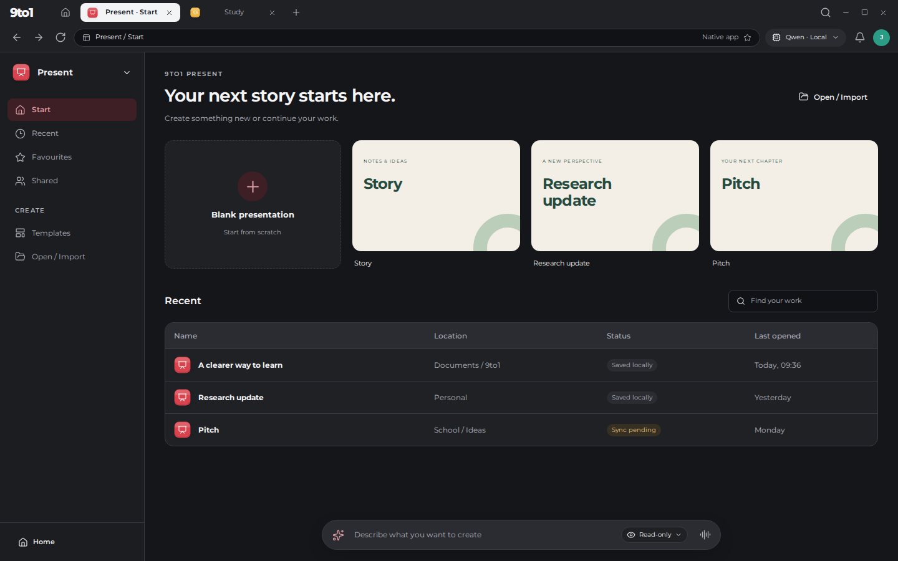
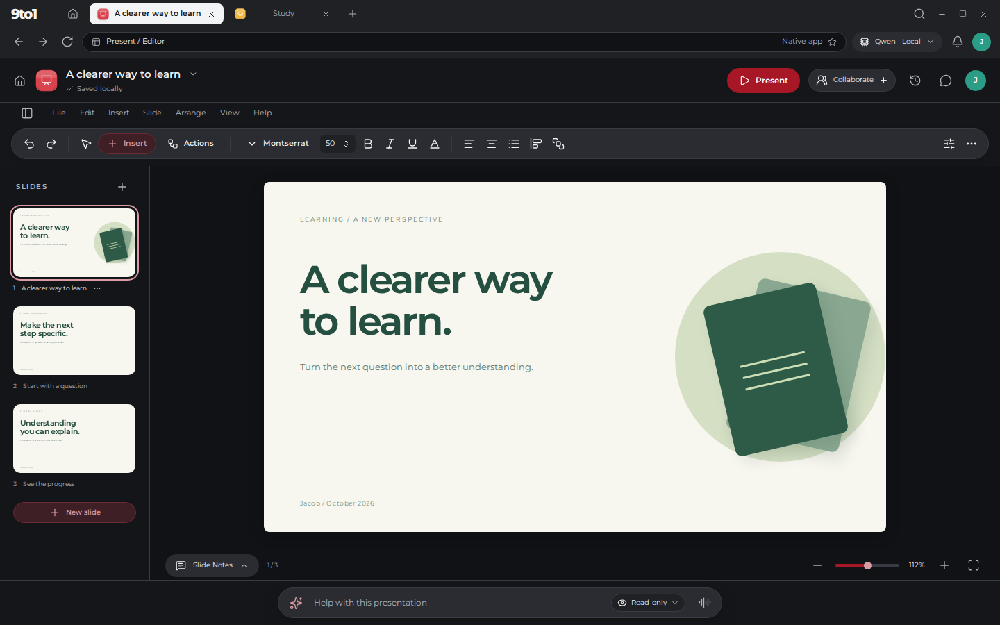
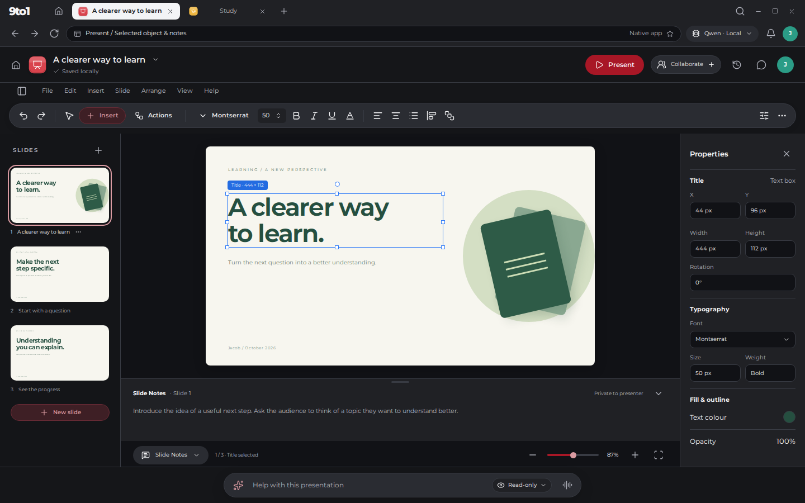
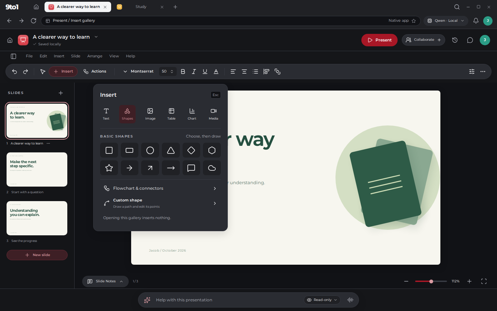
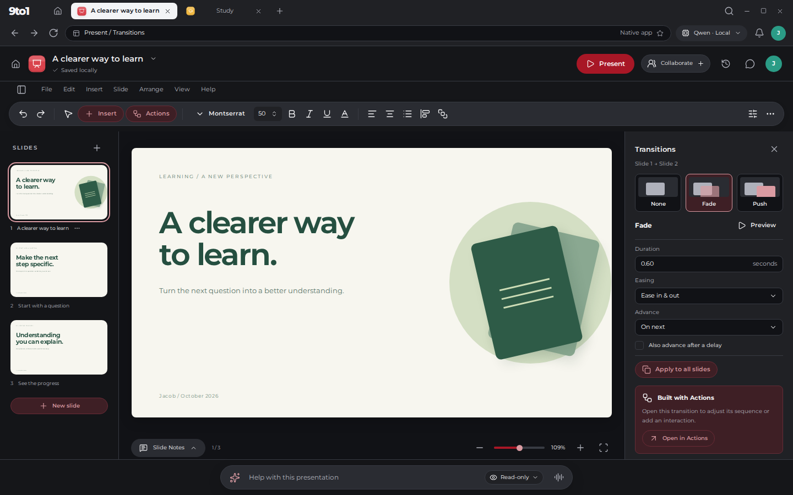
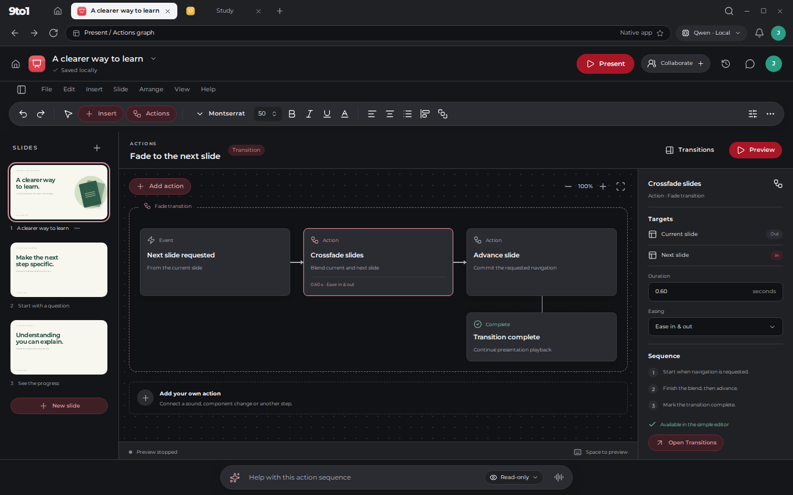
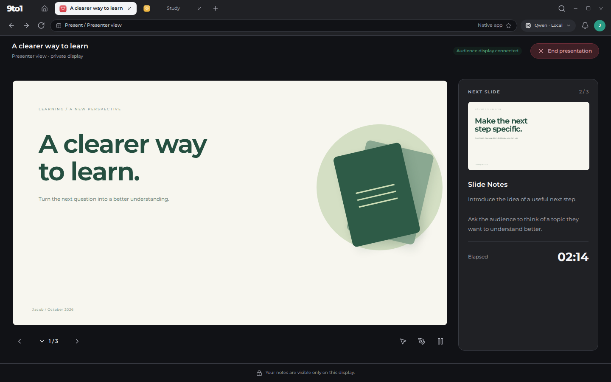
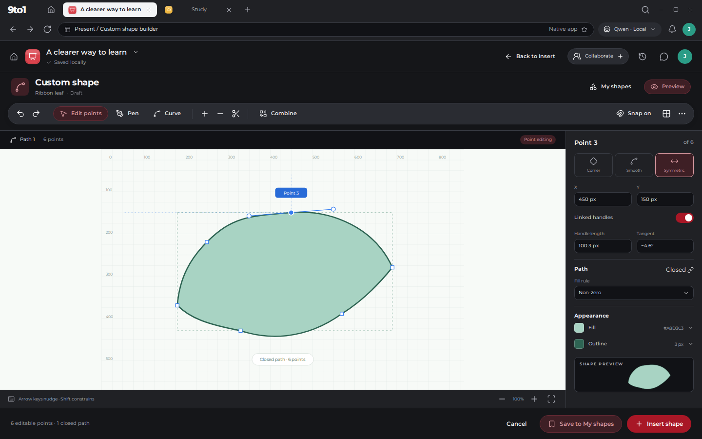
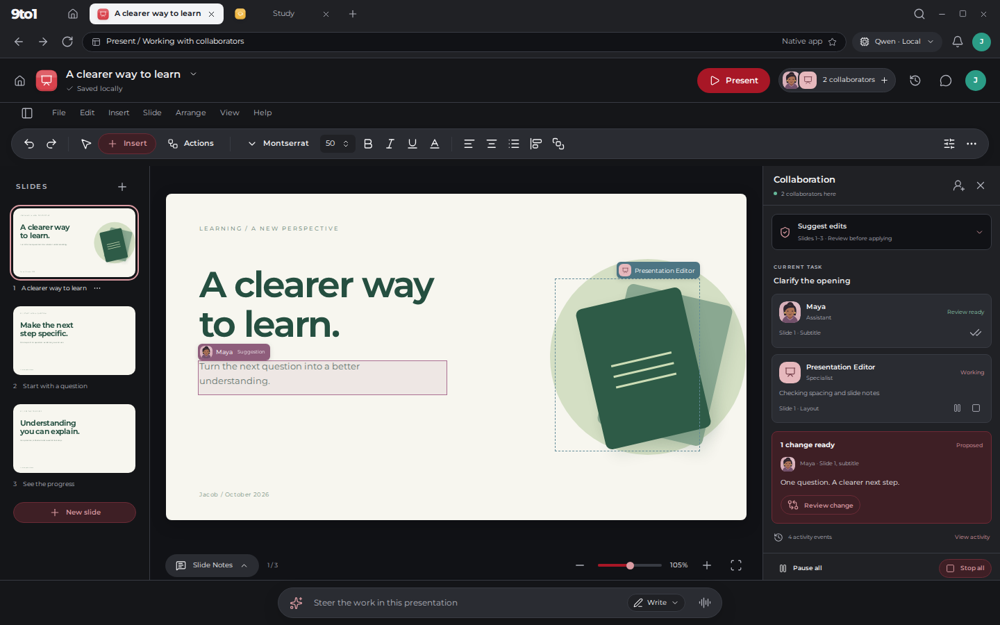

# Present — slide authoring and presentation

Module ID: `present` · 9to1 Development Specification v3

## Prerequisites

- **CUI, themes and shared interaction system** — Typed UI components, theme tokens/materials, layout, focus, motion, accessibility and shared control states.
- **Shared productivity engine and canonical embeds** — Real document/object engines, semantic editing, canonical app embedding and donor feature parity.
- **Node Editor — shared graph framework** — Shared typed graph schemas, editing/validation, draft activation and runtime presentation.
- **Shared AI controls and artifact collaboration** — Contextual AI bars, shared model/permission controls, global collaborators and typed artifact proposals.
- **Artifacts, local persistence and recovery** — Canonical artifacts, revisions, typed edits, local saves, derived exports, sync and recovery.

## Overview

Present provides full slide authoring, object editing, actions/animation and presentation playback. The Professional annex and authoritative slide 16 define its clean three-tier editing shell and object-selection behaviour.

Current owner overrides: V3-OWNER-001, V3-OWNER-013.

## Layouts & visible states

- **V3-PRESENT-LAY-01** — Use document header, File/Edit/Insert/Slide/Arrange/View/Help menu row and a single floating contextual toolbar. Thumbnails occupy the left, aspect-correct slide dominates, notes sit below and an optional right inspector follows selection.
- **V3-PRESENT-LAY-02** — Object selection shows eight resize handles and rotation; text editing shows a real caret/range. Do not confuse selected shape with text-entry mode.
- **V3-PRESENT-LAY-03** — Include Shapes, custom shape creation/editing, Actions and presentation/playback states. Custom shapes need real path/geometry editing rather than a static gallery label.
- **V3-PRESENT-LAY-04** — Presenter view keeps notes and next-slide/control information private from the audience display. Notes are editable content, not a decorative placeholder.

## Features & behaviour

- **V3-PRESENT-FEA-01** — Maintain slide order/layouts/masters, text/shapes/media, object alignment/arrangement, notes, animation, action graph and playback through canonical semantics.
- **V3-PRESENT-FEA-02** — Action configuration identifies trigger, target, effect, transition/navigation or permitted external action and preview behaviour. Use the shared Node Editor where source-defined graph authoring applies.
- **V3-PRESENT-FEA-03** — Preserve pointer transforms at zoom and viewport changes, selection geometry, keyboard nudge, proportional resizing and real undo.
- **V3-PRESENT-FEA-04** — Global collaborators expose typed changes to this deck/selected slide with review and expected revision. Live work from Spaces opens the same deck.

## Canonical entities & persistence

- **V3-PRESENT-ENT-01** — Keep DeckID, SlideID, object IDs, geometry, text/style, note content, action/animation definitions, revision and playback state distinct.
- **V3-PRESENT-ENT-02** — Export and audience rendering use the chosen slide size and content revision; app theme never retints authored slides.

## Permissions & recovery

- **V3-PRESENT-PER-01** — Preview/presentation mode must not grant document-write or external-action permission. Publishing/exporting remains a separate operation with truthful state.
- **V3-PRESENT-PER-02** — Preserve native deck when an export fails; reconcile stale collaborative changes and recover unsaved selection/edit state.

## Acceptance checks

- **V3-PRESENT-ACC-01** — Test selection versus caret, all handles/rotation at zoom, slide reorder, notes, custom shape edit and Actions configuration.
- **V3-PRESENT-ACC-02** — Verify presenter notes remain private, authored colours survive all themes, and live Spaces work/collaborator review references the same deck revision.

## Exact mock-up and state map

- **Present · Start** — screen `present-launch`. Launch.
- **Present · Editor** — screen `present-editor`. Editor.
- **Present · Selected object & notes** — screen `present-selection`. Selection.
- **Present · Insert gallery** — screen `present-insert`. Insertion.
- **Present · Transitions** — screen `present-transitions`. Simple Actions editor.
- **Present · Actions graph** — screen `present-actions`. Transition graph.
- **Present · Presenter view** — screen `present-presenter`. Playback.
- **Present · Custom shape builder** — screen `present-shape-builder`. Editable path.
- **Present · Working with collaborators** — screen `present-collaborators`. Presence & scoped work.

## Source clause IDs

PRESENT-UX-102, PRESENT-UX-103, PRESENT-UX-104, PRESENT-UX-105, PRESENT-UX-106, PRESENT-INT-102, PRESENT-INT-103, PRESENT-INT-104, PRESENT-INT-105, PRESENT-INT-106, PRESENT-INT-107, PRESENT-AC-102, PRESENT-AC-103, PRESENT-AC-104, UX27-PRESENT-001, UX27-PRESENT-002, UX27-PRESENT-003, UX27-PRESENT-004, UX27-PRESENT-005, UX27-PRESENT-006, UX27-PRESENT-007, UX27-PRESENT-008, SECTION-09, UTF-16, UX27-TEST-082, UX27-TEST-083, UX27-TEST-084, UX27-TEST-085, UX27-TEST-086, PRESENT-DES-201, PRESENT-DES-202, PRESENT-DES-203, PRESENT-DES-204, PRESENT-DES-205, PRESENT-DES-206, PRESENT-DES-207, PRESENT-INT-201, PRESENT-INT-202, PRESENT-AC-201, PRESENT-AC-202, PRESENT-AC-203, PRESENT-AC-204, PRESENT-SCALE-201

## Technical reading map

- Present — slide authoring and presentation — Floating rich toolbar; Primary actions versus inspector precision (part 01) — `technical/present-01.md` (2,289 words; V2-B0024, V2-B0025, V2-B0026…).
- Present — slide authoring and presentation — Present; Purpose, ownership and conformance (part 02) — `technical/present-02.md` (4,384 words; V2-B1374).
- Present — slide authoring and presentation — Present; Host route renders the intended editor (part 03) — `technical/present-03.md` (1,588 words; V2-B2805, V2-B2806, V2-B2807…).

Technical clauses retain APIs, data models, platform, recovery, donor and acceptance details. The technical files are part of this module, not optional background reading. Shared prerequisites mean stable service/interface contracts must be available; they do not require every dependent app UI to be complete. Use the named chunk for the relevant subtask or the complete module file for its full retained contract.

# Exact designs and implementation rules

These figures are the exact current atlas compositions. Their stable screen IDs match the Word specification and editable source. Open the atlas for full-size theme and interaction inspection.

## Present · Start

Screen ID: `present-launch`. Source: LAUNCH-001–006; Present Home/start; UX27-AUTH-005 for Boards.

- Start is a separate active view. The editor is not mounted under a welcome banner.
- New, Open, Import, Templates and Recent resolve actual artifact identities. Missing or failed imports receive their own recovery states.
- Direct-open and session restore bypass Start. Returning here preserves the existing document session.

## Present · Editor

Screen ID: `present-editor`. Source: Owner revision: correct selected-object/notes layout and add Actions; authoritative PPT slide 16; PRESENT-UX-101–106; PRESENT-DES-201–207; PRESENT-INT-101–107 / 201–202.

- Keep the three tiers in order: identity/save/actions, conventional menu row, exactly one floating contextual toolbar. Actions is a visible toolbar entry alongside Insert.
- Fit derives from the actual remaining central viewport, including Notes and Properties. The 16:9 slide must never overflow vertically into the toolbar, notes or status area.
- Single click selects the object; double click/Enter edits text. The eight handles and rotation handle follow the title geometry; the selection overlay is not authored content.
- Slide Notes has its own pane, resize edge and scroll area. It remains separate from the audience slide and is excluded from ordinary audience output.
- Insert opens a catalogue; Shapes opens its gallery without creating an object. Custom shape opens the shared editable-path builder and returns a canonical shape only when committed.
- Bottom-right zoom keeps minus, slider, actual percentage, plus and icon-only Fit. The numeric value is derived from the displayed transform, not fixed to the previous panel layout.

## Present · Selected object & notes

Screen ID: `present-selection`. Source: Owner revision: correct selected-object/notes layout and add Actions; authoritative PPT slide 16; PRESENT-UX-101–106; PRESENT-DES-201–207; PRESENT-INT-101–107 / 201–202.

- Keep the three tiers in order: identity/save/actions, conventional menu row, exactly one floating contextual toolbar. Actions is a visible toolbar entry alongside Insert.
- Fit derives from the actual remaining central viewport, including Notes and Properties. The 16:9 slide must never overflow vertically into the toolbar, notes or status area.
- Single click selects the object; double click/Enter edits text. The eight handles and rotation handle follow the title geometry; the selection overlay is not authored content.
- Slide Notes has its own pane, resize edge and scroll area. It remains separate from the audience slide and is excluded from ordinary audience output.
- Insert opens a catalogue; Shapes opens its gallery without creating an object. Custom shape opens the shared editable-path builder and returns a canonical shape only when committed.
- Bottom-right zoom keeps minus, slider, actual percentage, plus and icon-only Fit. The numeric value is derived from the displayed transform, not fixed to the previous panel layout.

## Present · Insert gallery

Screen ID: `present-insert`. Source: Owner revision: correct selected-object/notes layout and add Actions; authoritative PPT slide 16; PRESENT-UX-101–106; PRESENT-DES-201–207; PRESENT-INT-101–107 / 201–202.

- Keep the three tiers in order: identity/save/actions, conventional menu row, exactly one floating contextual toolbar. Actions is a visible toolbar entry alongside Insert.
- Fit derives from the actual remaining central viewport, including Notes and Properties. The 16:9 slide must never overflow vertically into the toolbar, notes or status area.
- Single click selects the object; double click/Enter edits text. The eight handles and rotation handle follow the title geometry; the selection overlay is not authored content.
- Slide Notes has its own pane, resize edge and scroll area. It remains separate from the audience slide and is excluded from ordinary audience output.
- Insert opens a catalogue; Shapes opens its gallery without creating an object. Custom shape opens the shared editable-path builder and returns a canonical shape only when committed.
- Bottom-right zoom keeps minus, slider, actual percentage, plus and icon-only Fit. The numeric value is derived from the displayed transform, not fixed to the previous panel layout.

## Present · Transitions

Screen ID: `present-transitions`. Source: Owner revision: visible Actions/Transitions; Present canonical Actions runtime and Transitions builder.

- The Transitions sidebar is a simple editor for the same canonical Actions graph. It must not create a second animation or transition engine.
- Choosing Fade updates only the marked transition-owned subgraph. Duration, easing and advance conditions map to its stored properties.
- Open in Actions reveals the exact generated graph. User-authored extension nodes outside the owned region survive subsequent simple-editor changes.
- If an advanced edit is no longer representable here, show Custom/Advanced instead of deleting or approximating it.
- The slide remains aspect-correct in the viewport left after the sidebar opens. Preview is a deliberate runtime mode; authoring gestures do not accidentally trigger slide Actions.

## Present · Actions graph

Screen ID: `present-actions`. Source: Owner revision: Actions in the editor toolbar; Present ActionGraph / PresentationRuntimeState / Transitions builder.

- This graph is the same Fade transition shown in the simple sidebar: navigation request, crossfade, one navigation commit and explicit completion.
- Targets resolve by stable slide/object IDs, not display position or simulated mouse input. A navigation request commits exactly once.
- The selected node and its properties share one graph revision. Graph preview is explicit and its transient runtime state stays separate from authored content.
- Transition-owned nodes are visually grouped; extensions connect outside that region. The simple editor preserves those extensions or shows Custom/Advanced when needed.
- Event budgets, typed failures and deterministic scheduling belong to the shared runtime. These mock-ups illustrate authoring state and do not claim a functioning playback engine.

## Present · Presenter view

Screen ID: `present-presenter`. Source: Present Presenter View; UX27-PRESENT-008; notes/export privacy.

- This is the private presenter surface. The audience receives only the current slide.
- Notes, next slide and elapsed time do not enter the audience output by default. Slide Notes remains canonical editable content.
- Leaving playback returns to the same authoring state. Session ink is separate from permanent document content.

## Present · Custom shape builder

Screen ID: `present-shape-builder`. Source: Owner revision: detailed custom-shape builder; shared shape catalogue, vector path/anchor/Bézier capabilities; Present Insert and Canvas insertion parity.

- Custom shape is a focused draft authoring mode reached from Insert → Shapes. Opening it allocates no document object; Insert shape commits one editable canonical shared shape.
- The path has six stable anchor points, explicit cubic segments, a closed state and a non-zero fill rule. The selected point exposes coordinates, point type and linked Bézier handles.
- Corner, Smooth and Symmetric change tangent constraints. Add/remove/split, keyboard nudge and Boolean operations retain editable geometry and use logical undo transactions.
- The preview omits selection adorners. Fill #A8D3C3 and outline #2E6453 are authored values and remain unchanged across all eight UI themes.
- Save to My shapes creates a reusable definition; inserting an instance keeps its geometry editable. Cancel discards this uncommitted builder draft and restores the calling app’s insertion context.
- Present and Canvas use the same path and shape model. The two screens illustrate different callers, not app-specific incompatible editors.

## Present · Working with collaborators

Screen ID: `present-collaborators`. Source: Owner revision 28 October: Assistants and Specialists are global identities available from Home and every editor; later steering supersedes Space-only placement; canonical identity, document ownership, Task/Run and permission contracts.

- Assistant and Specialist avatars join the document header as actual collaborators, with the same stable identities shown in Home and Spaces. Presence is session UI, not authored document content.
- The work panel attributes each active task, target and proposed change to its participant. Working, paused, stopped, review-ready and committed states remain distinct.
- The owning app keeps the canonical document, object/range identities, revision history and undo. Collaboration does not copy the document into a private Spaces artifact.
- Suggest edits is the granted scope here. Write in the contextual AI bar does not waive range limits, current ACLs or review; a proposal remains unapplied until the user accepts the exact change.
- Pause and Stop are visible for the run and individual workers. Stop cancels future work, retains checkpoints/proposals and never silently reverts already committed edits.
- Remote selections, transient previews and presence overlays do not enter exports. Revision conflicts require revalidation of the exact change and cannot be resolved by unconditional last-writer-wins.
