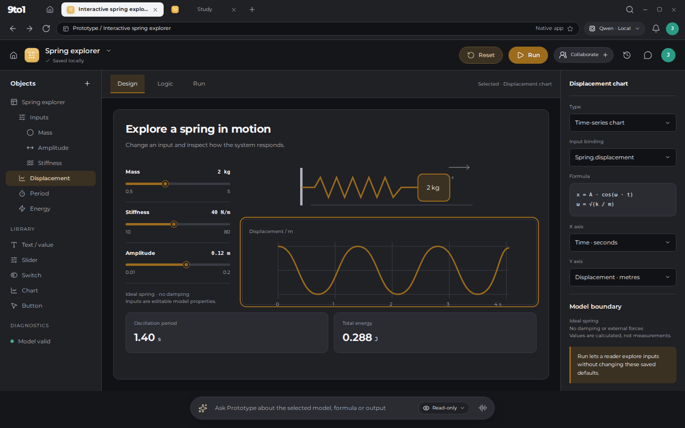
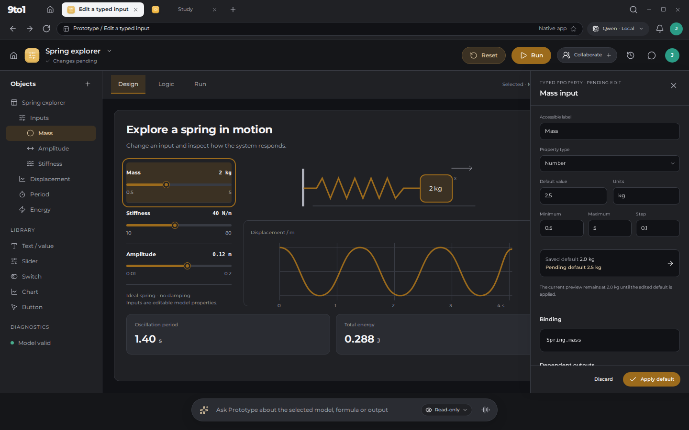

# Prototype — Design, Logic and Run

Module ID: `prototype` · 9to1 Development Specification v3

## Prerequisites

- **CUI, themes and shared interaction system** — Typed UI components, theme tokens/materials, layout, focus, motion, accessibility and shared control states.
- **Node Editor — shared graph framework** — Shared typed graph schemas, editing/validation, draft activation and runtime presentation.
- **Artifacts, local persistence and recovery** — Canonical artifacts, revisions, typed edits, local saves, derived exports, sync and recovery.
- **Permissions, approvals and execution scope** — Effective scoped grants, action approvals, policy intersections, revocation and audit.

## Overview

Prototype is a canonical interactive model/simulation authoring surface. Design, Logic and Run are coordinated views of the same typed model rather than three disconnected documents.

## Layouts & visible states

- **V3-PROTOTYPE-LAY-01** — Use Design/Logic/Run tabs with a meaningful preview/canvas, outline and parameter/property inspector. Show parameter default/current values, units, bounds and binding explicitly.
- **V3-PROTOTYPE-LAY-02** — Run exposes actual input controls, state and derived outputs with clear preview/simulation status.

## Features & behaviour

- **V3-PROTOTYPE-FEA-01** — Define typed parameters, constraints, bindings, formulas/dependencies, interactions and supported state/time behaviour. Validate cycles/limits and missing values before running.
- **V3-PROTOTYPE-FEA-02** — Parameter editing distinguishes author defaults from per-reader run input. Reset/restart applies documented simulation semantics without altering the source unexpectedly.
- **V3-PROTOTYPE-FEA-03** — Use shared graph components for logic where specified and safe typed external actions; a prototype control cannot execute arbitrary code by appearance.

## Canonical entities & persistence

- **V3-PROTOTYPE-ENT-01** — Persist PrototypeID, object/parameter/binding/rule IDs, schema/revision, author defaults and separate Run/session state.
- **V3-PROTOTYPE-ENT-02** — Derived values carry dependency/provenance; preview state does not overwrite canonical configuration.

## Permissions & recovery

- **V3-PROTOTYPE-PER-01** — Apply sandbox/capability boundaries and explicit action grants. Invalid parameter/rule changes preserve the last valid model.
- **V3-PROTOTYPE-PER-02** — Recover paused/failed runs and stale bindings with inspectable error and safe reset/retry.

## Acceptance checks

- **V3-PROTOTYPE-ACC-01** — Edit parameter min/max/default/units, validate binding, run with different input and verify author defaults remain unchanged.
- **V3-PROTOTYPE-ACC-02** — Test invalid cycles/out-of-range values, switching Design/Logic/Run and persisted identity/revision.

## Exact mock-up and state map

- **Prototype · Interactive spring explorer** — screen `prototype`. Design / Run.
- **Prototype · Edit a typed input** — screen `prototype-parameters`. Property draft · constraints.

## Source clause IDs

TF-P01, TF-P02, TF-P03

## Technical reading map

- Prototype — Design, Logic and Run — Prototype; Product boundary and editor layout (part 01) — `technical/prototype-01.md` (784 words; V2-B2166).

Technical clauses retain APIs, data models, platform, recovery, donor and acceptance details. The technical files are part of this module, not optional background reading. Shared prerequisites mean stable service/interface contracts must be available; they do not require every dependent app UI to be complete. Use the named chunk for the relevant subtask or the complete module file for its full retained contract.

# Retained technical requirements

# Prototype — Design, Logic and Run — Prototype; Product boundary and editor layout (part 01)

Reading status: active retained clauses, subject to the v3 owner overrides listed in the primary module. Historical process instructions and replaced original wording are stored separately.

### V2-B2166 · v2 lines 12670–12684

Prototype
TF-P01 — Product boundary and editor layout
Prototype creates editable interactive systems: objects with typed properties, formulas, rules, relationships, adjustable inputs and visible outputs. Its scope includes simulations, calculations, interactive explanations and experimental tools, not only software-interface mock-ups or 3D geometry. It MUST be useful without AI and MUST NOT be renamed Models in menus, artifact types or launch screens.
The editor MUST provide a component/object library, an object hierarchy, a central Design surface, a Logic/relationships surface, a contextual property inspector and a Run/Preview surface. Users MUST be able to switch between Design, Logic and Run without losing work or creating separate copies of the model. A collapsible diagnostics area shows validation, formula errors and runtime problems with links to the responsible object/property. The contextual AI bar shares the selected model/object scope rather than creating an unrelated chat-only prototype.
The component library MUST include text/value outputs, numeric and text inputs, sliders, switches, buttons, selectors, tables/charts and reusable containers/components. The Design surface supports placement, size, grouping and shared layout controls. The inspector exposes accessible label, property type, default/current value, limits/options, units where declared, binding and event actions. Controls MUST be backed by typed properties and real behaviour; a visually plausible slider disconnected from the model is not implemented functionality.
TF-P02 — Typed model, logic and execution
The canonical model MUST contain versioned stable object/property/component/relationship/event/action IDs, types, defaults, constraints, formulas, dependency references, layout, assets and saved authoring revision. Bindings target stable identities rather than display labels. The Logic surface uses the shared Node Graph Framework for applicable typed ports, connections, comments/groups, pan/zoom, keyboard editing, validation and execution overlays. A readable formula editor remains available for expressions that are clearer as formulas than as large graphs.
Authors can create typed properties, bind controls to them, define formulas, connect object relationships, add events/actions and compose reusable components with explicit inputs/outputs. Numeric, Boolean, text and structured/list values MUST be distinguishable. Incompatible assignments/connections are rejected or require an explicit conversion. Renaming a property MUST not break its bindings. Removing one previews dependent formulas and controls and requires repair or an explicit unresolved state rather than quietly replacing references with zero.
Derived calculations MUST follow validated dependencies. Circular combinational dependencies, invalid types, division/domain errors and unavailable inputs MUST be surfaced at their actual source, not hidden as plausible values. Simulations that require feedback MUST use explicit state/time-step semantics rather than relying on an uncontrolled formula cycle. Evaluation MUST have bounded resource use, cancellation and inspectable diagnostics. Long-running calculation MUST not block navigation or Stop.
Run/Preview shows the interactive output with Play/Run, Pause/Stop where time-based execution applies, Reset and inspectable current input/output values. Runtime experimentation MUST be separate from saved authoring defaults: moving a slider during a viewer session changes that session, not every reader's shared model. An editor can explicitly apply chosen inputs as new defaults. Reset restores the declared initial state; reopening an authored model MUST not silently resume unintended external actions. Controlled calculations with the same revision and inputs MUST behave consistently; nondeterministic inputs and random seeds MUST be declared when used.
TF-P03 — Safety, reuse and acceptance
Expressions and scripts MUST execute in the declared sandbox, not arbitrary host code. No file, network, credential, process or device access is implicitly granted by opening or running a Prototype. External actions, when supported, go through existing typed app APIs and Home permissions, with visible effects and cancellation rules. Reader preview MUST not execute consequential actions solely because an author embedded them. The model MUST remain inspectable when execution is blocked.
Measured/imported values, assumptions, calculations and outputs MUST be identifiable in the inspector and relevant output presentation. Units and declared limitations MUST be preserved. AI-generated assumptions MUST not be presented as measurements or validated predictions. AI edits are reviewable typed model operations with normal undo, validation and source permissions. Reusable components retain stable definitions and explicit dependency versions; a component update MUST not silently break existing instances.
Prototype integrates with Files, Spaces, Link, Boards and Paths through registered renderers, references and typed actions. A reader may adjust permitted local inputs without acquiring authoring rights. Native export/import preserves the model and declared dependencies; static output exports are labelled as non-interactive. Missing components keep their payload and show a repair state rather than disappearing.
Prototype acceptance MUST build a working calculator with two inputs, a typed formula and output; build a bounded time-based example with Run/Pause/Reset; bind a slider and switch; display a chart; reuse a component; reject invalid types and a dependency cycle; change inputs without changing saved defaults; recover from a runtime error; and prove that an untrusted script cannot reach host files or network without an authorised capability. Save/reopen and API-driven edits MUST preserve the same model and behaviour.

# Exact designs and implementation rules

These figures are the exact current atlas compositions. Their stable screen IDs match the Word specification and editable source. Open the atlas for full-size theme and interaction inspection.

## Prototype · Interactive spring explorer

Screen ID: `prototype`. Source: TF-P01–03: typed model, Design / Logic / Run and session-local inputs.

- Prototype models interactive systems, calculations and simulations; it is not limited to UI or 3D mock-ups.
- Design, Logic and Run operate on one typed model with stable object/property IDs.
- Runtime input changes are session-local. Applying them as saved defaults is a separate author action.
- Formulas, units, assumptions and derived outputs remain inspectable. Invalid dependencies must show errors rather than plausible invented values.

## Prototype · Edit a typed input

Screen ID: `prototype-parameters`. Source: TF-P01–03; TF-X02.

- The selected slider binds to the stable typed mass property. Name, type, units, default, limits and step are editable model data rather than an isolated visual control.
- The proposed default 2.5 kg is pending; the current preview still uses its existing 2.0 kg input. Applying defaults is a separate authoring action.
- Validation enforces constraints and previews dependent outputs. Renaming or adjusting a property must preserve bindings and undo history.
- Session-local Run inputs remain separate from saved defaults; Reset uses the declared initial state and cannot repeat external effects.
