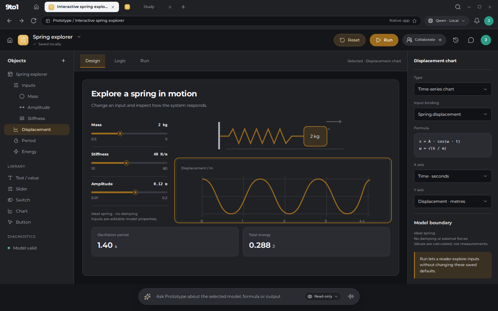
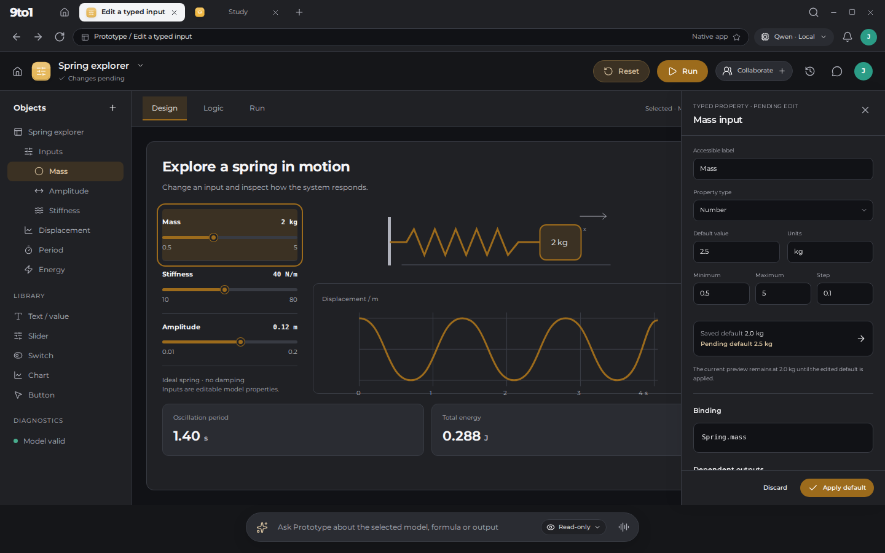

# Prototype — Design, Logic and Run

Module ID: `prototype` · 9to1 Development Specification v3

## Prerequisites

- **CUI, themes and shared interaction system** — Typed UI components, theme tokens/materials, layout, focus, motion, accessibility and shared control states.
- **Node Editor — shared graph framework** — Shared typed graph schemas, editing/validation, draft activation and runtime presentation.
- **Artifacts, local persistence and recovery** — Canonical artifacts, revisions, typed edits, local saves, derived exports, sync and recovery.
- **Permissions, approvals and execution scope** — Effective scoped grants, action approvals, policy intersections, revocation and audit.

## Overview

Prototype is a canonical interactive model/simulation authoring surface. Design, Logic and Run are coordinated views of the same typed model rather than three disconnected documents.

## Layouts & visible states

- **V3-PROTOTYPE-LAY-01** — Use Design/Logic/Run tabs with a meaningful preview/canvas, outline and parameter/property inspector. Show parameter default/current values, units, bounds and binding explicitly.
- **V3-PROTOTYPE-LAY-02** — Run exposes actual input controls, state and derived outputs with clear preview/simulation status.

## Features & behaviour

- **V3-PROTOTYPE-FEA-01** — Define typed parameters, constraints, bindings, formulas/dependencies, interactions and supported state/time behaviour. Validate cycles/limits and missing values before running.
- **V3-PROTOTYPE-FEA-02** — Parameter editing distinguishes author defaults from per-reader run input. Reset/restart applies documented simulation semantics without altering the source unexpectedly.
- **V3-PROTOTYPE-FEA-03** — Use shared graph components for logic where specified and safe typed external actions; a prototype control cannot execute arbitrary code by appearance.

## Canonical entities & persistence

- **V3-PROTOTYPE-ENT-01** — Persist PrototypeID, object/parameter/binding/rule IDs, schema/revision, author defaults and separate Run/session state.
- **V3-PROTOTYPE-ENT-02** — Derived values carry dependency/provenance; preview state does not overwrite canonical configuration.

## Permissions & recovery

- **V3-PROTOTYPE-PER-01** — Apply sandbox/capability boundaries and explicit action grants. Invalid parameter/rule changes preserve the last valid model.
- **V3-PROTOTYPE-PER-02** — Recover paused/failed runs and stale bindings with inspectable error and safe reset/retry.

## Acceptance checks

- **V3-PROTOTYPE-ACC-01** — Edit parameter min/max/default/units, validate binding, run with different input and verify author defaults remain unchanged.
- **V3-PROTOTYPE-ACC-02** — Test invalid cycles/out-of-range values, switching Design/Logic/Run and persisted identity/revision.

## Exact mock-up and state map

- **Prototype · Interactive spring explorer** — screen `prototype`. Design / Run.
- **Prototype · Edit a typed input** — screen `prototype-parameters`. Property draft · constraints.

## Source clause IDs

TF-P01, TF-P02, TF-P03

## Technical reading map

- Prototype — Design, Logic and Run — Prototype; Product boundary and editor layout (part 01) — `technical/prototype-01.md` (784 words; V2-B2166).

Technical clauses retain APIs, data models, platform, recovery, donor and acceptance details. The technical files are part of this module, not optional background reading. Shared prerequisites mean stable service/interface contracts must be available; they do not require every dependent app UI to be complete. Use the named chunk for the relevant subtask or the complete module file for its full retained contract.

# Exact designs and implementation rules

These figures are the exact current atlas compositions. Their stable screen IDs match the Word specification and editable source. Open the atlas for full-size theme and interaction inspection.

## Prototype · Interactive spring explorer

Screen ID: `prototype`. Source: TF-P01–03: typed model, Design / Logic / Run and session-local inputs.

- Prototype models interactive systems, calculations and simulations; it is not limited to UI or 3D mock-ups.
- Design, Logic and Run operate on one typed model with stable object/property IDs.
- Runtime input changes are session-local. Applying them as saved defaults is a separate author action.
- Formulas, units, assumptions and derived outputs remain inspectable. Invalid dependencies must show errors rather than plausible invented values.

## Prototype · Edit a typed input

Screen ID: `prototype-parameters`. Source: TF-P01–03; TF-X02.

- The selected slider binds to the stable typed mass property. Name, type, units, default, limits and step are editable model data rather than an isolated visual control.
- The proposed default 2.5 kg is pending; the current preview still uses its existing 2.0 kg input. Applying defaults is a separate authoring action.
- Validation enforces constraints and previews dependent outputs. Renaming or adjusting a property must preserve bindings and undo history.
- Session-local Run inputs remain separate from saved defaults; Reset uses the declared initial state and cannot repeat external effects.
