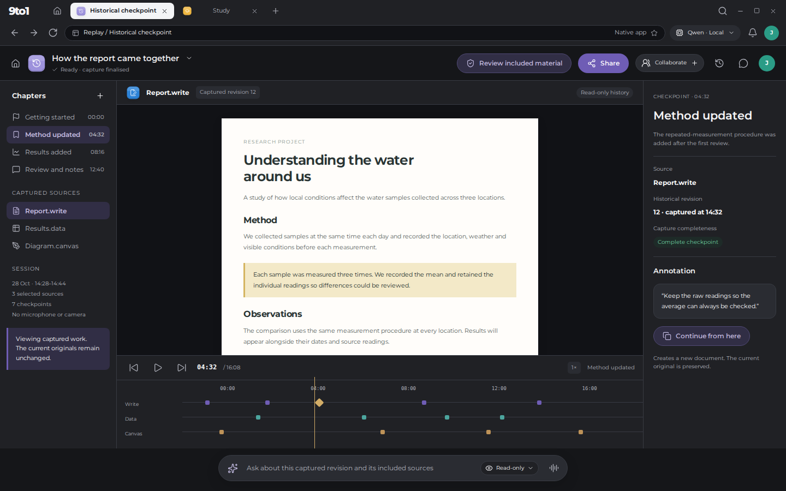
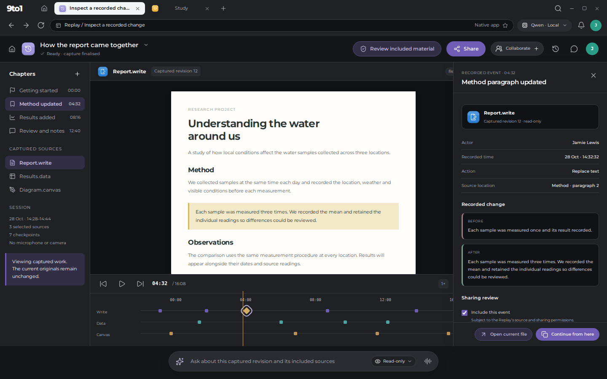

# Replay — semantic history and inspection

Module ID: `replay` · 9to1 Development Specification v3

## Prerequisites

- **CUI, themes and shared interaction system** — Typed UI components, theme tokens/materials, layout, focus, motion, accessibility and shared control states.
- **Artifacts, local persistence and recovery** — Canonical artifacts, revisions, typed edits, local saves, derived exports, sync and recovery.
- **Permissions, approvals and execution scope** — Effective scoped grants, action approvals, policy intersections, revocation and audit.

## Overview

Replay records and presents explicit permissioned semantic activity/history. Timeline inspection is read-only historical viewing; seeking must never replay external actions.

## Layouts & visible states

- **V3-REPLAY-LAY-01** — Use source/capture identity, timeline/checkpoints, historical viewport/detail and selected event inspector. Event detail shows target/revision, actor, time, input/output and safe provenance.
- **V3-REPLAY-LAY-02** — Capture start/stop and incomplete/paused/failed states remain visible; no ambient microphone/camera capture is implied.

## Features & behaviour

- **V3-REPLAY-FEA-01** — Record supported semantic changes/checkpoints from explicitly selected sources. Preserve source-defined capture, filtering, narration and export/share behaviour.
- **V3-REPLAY-FEA-02** — Seek changes the historical view only. Continue from here creates an independent canonical fork/copy with traceable origin when supported.
- **V3-REPLAY-FEA-03** — Review redaction and sharing scope before export. A replay rendering is not evidence that the captured application is still in that state.

## Canonical entities & persistence

- **V3-REPLAY-ENT-01** — Persist ReplayID, capture source/grants, event/checkpoint IDs, canonical artifact revisions, timestamps and redaction/share metadata.
- **V3-REPLAY-ENT-02** — Playback position/view settings are transient; captured history remains immutable except authorised redaction/versioning semantics.

## Permissions & recovery

- **V3-REPLAY-PER-01** — Recheck source visibility and redact revoked/private content. Explicit capture grants are required; no hidden ambient recording.
- **V3-REPLAY-PER-02** — Handle incomplete capture/missing assets with truthful gaps and recovery rather than invented events.

## Acceptance checks

- **V3-REPLAY-ACC-01** — Capture authorised semantic edits, seek events and verify no external command/action runs again.
- **V3-REPLAY-ACC-02** — Test event detail, incomplete capture, redaction/share review and Continue from here creating an independent identity.

## Exact mock-up and state map

- **Replay · Historical checkpoint** — screen `replay`. Playback.
- **Replay · Inspect a recorded change** — screen `replay-event-detail`. Historical event · source revision.

## Source clause IDs

TF-R01, TF-R02, TF-R03

## Technical reading map

- Replay — semantic history and inspection — Replay; Explicit capture and source selection (part 01) — `technical/replay-01.md` (683 words; V2-B2168).

Technical clauses retain APIs, data models, platform, recovery, donor and acceptance details. The technical files are part of this module, not optional background reading. Shared prerequisites mean stable service/interface contracts must be available; they do not require every dependent app UI to be complete. Use the named chunk for the relevant subtask or the complete module file for its full retained contract.

# Retained technical requirements

# Replay — semantic history and inspection — Replay; Explicit capture and source selection (part 01)

Reading status: active retained clauses, subject to the v3 owner overrides listed in the primary module. Historical process instructions and replaced original wording are stored separately.

### V2-B2168 · v2 lines 12699–12712

Replay
TF-R01 — Explicit capture and source selection
Replay creates explorable records of how selected work developed. Its core model is semantic revisions, events, work states and checkpoints, not a raw screen recording. Optional screenshots, video and narration may accompany that record. Capture MUST be explicitly started and limited to the selected authorised sources; opening Replay MUST NOT begin recording unrelated work or private activity.
New capture MUST present a source picker, selected files/sub-objects, available capture capabilities per owning app, destination, retention/export implications and optional media settings. Unsupported semantic sources are identified before starting; the UI MUST not silently claim semantic capture when it can only obtain an image. Optional microphone/camera/screen access requires its own explicit selection and platform permissions. A preview of the scope MUST be available before Start.
During capture, show an unmistakable Recording/Paused state, selected-source summary, elapsed session information, Add checkpoint, annotation/narration controls and Pause/Stop. A source-scope change is explicit and timestamped. Stop MUST stop subscriptions and selected media capture, finalise durable state and show any pending/failed material. Losing permission to a source MUST stop future capture for that source and expose the limitation rather than continue through a cached unrestricted channel.
TF-R02 — Semantic timeline and playback UI
The editor/player MUST provide a chronological event/checkpoint timeline, source tracks/filtering, a central historical artifact viewer, a checkpoint/annotation list and an inspector showing the selected source revision and capture completeness. Users can label/reorder presentation chapters where supported without falsifying the underlying event order, add explanations and choose a shareable presentation range. Changes to Replay presentation MUST NOT rewrite the original source's history.
Playback MUST support play/pause, seek, previous/next checkpoint and adjustable playback speed for timed material. At a checkpoint the recipient can inspect the document, calculation, diagram or other supported artifact as it existed then. The historical viewer MUST be visibly read-only and identify the captured revision. It MUST NOT resolve a checkpoint to the source's latest content merely because that is easier to load. Narrative media follows the selected timeline while retaining accessible captions/transcripts when provided.
Capture records MUST include SessionID, authorised source identities, ordered EventIDs, event/revision provenance, CheckpointIDs, timestamps/sequence, required base revisions or validated snapshot references, annotations and media references. Replay stores enough authorised retained state or pinned revision dependencies to reconstruct the included checkpoints under the declared retention policy. It MUST NOT depend on an ephemeral cache that disappears after the app closes. Missing bases, gaps and unavailable retained sources produce an explicit incomplete-checkpoint state, not invented reconstruction.
A Continue from here action is available only when the owning app supports an independent copy from that checkpoint and permissions permit it. The action shows destination, copy scope and unavailable dependencies, creates a new canonical artifact through the owner and opens that copy. It MUST NOT restore the original over its current version or imply that a Replay viewer has edit rights to the source.
TF-R03 — Review, sharing, failure and acceptance
Before sharing/export, Replay MUST provide an included-material review showing files, revisions, annotations, optional recordings and recipient access implications. Referenced live access and an exported independent snapshot are distinct. Copy/export rights are required for retained source bytes shared independently. Excluding or redacting captured content MUST also address derived thumbnails, search text, transcripts and dependent snapshots; metadata MUST not leak a supposedly removed secret. A presentation trim alone MUST not be labelled permanent redaction.
Session state MUST distinguish Not started, Recording, Paused, Finalising, Ready, Incomplete and Error. Interruption recovery resumes from a durable checkpoint/journal without claiming the missing interval was captured. Storage/quota exhaustion, unavailable owning apps and media-device failure MUST be visible, bounded and recoverable. Media failure MUST not silently destroy valid semantic checkpoints. Delete/retention cleanup applies to Replay-owned captures and assets, not the original source documents.
Replay acceptance MUST capture selected changes in two supported artifacts, exclude an unrelated open file, pause/resume, create an annotated checkpoint, restart after interruption, inspect historical state after the original advances, reveal a missing dependency, stop on revoked permission and create an authorised independent copy. Export/share review MUST detect excluded material in thumbnails/transcripts and MUST not claim that view-only rights permit exporting source bytes.

# Exact designs and implementation rules

These figures are the exact current atlas compositions. Their stable screen IDs match the Word specification and editable source. Open the atlas for full-size theme and interaction inspection.

## Replay · Historical checkpoint

Screen ID: `replay`. Source: TF-R01–03: semantic capture, historical viewer, timeline and sharing review.

- Replay records selected semantic revisions, events and checkpoints. Optional media is supplementary.
- The historical viewer identifies the captured revision and stays read-only even when the source has advanced.
- Missing intervals and dependencies remain visible as incomplete capture, never invented reconstruction.
- Continue from here makes an independent copy through the owning app. It must never overwrite the current original.

## Replay · Inspect a recorded change

Screen ID: `replay-event-detail`. Source: TF-R01–03; TF-X01–02.

- The event identifies the captured source, actor, timestamp and historical revision. The rendered checkpoint is read-only and separate from the current source.
- Before/after content belongs to the recorded semantic event and source revision. Seeking or playback reconstructs history; it does not execute the original mutation again.
- Sharing review can exclude or redact captured material without deleting the current original. Access and capture completeness remain explicit.
- Continue from here requests an independent copy through the owning app, preserving the source. Open current file uses the current source’s actual permissions.
