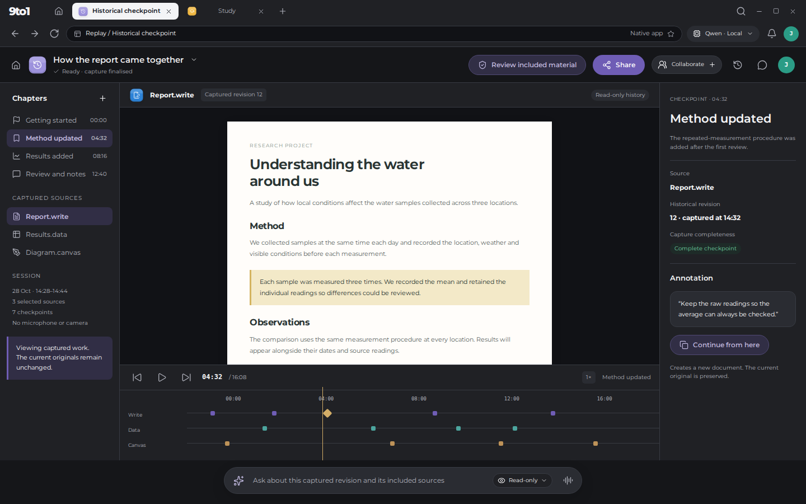
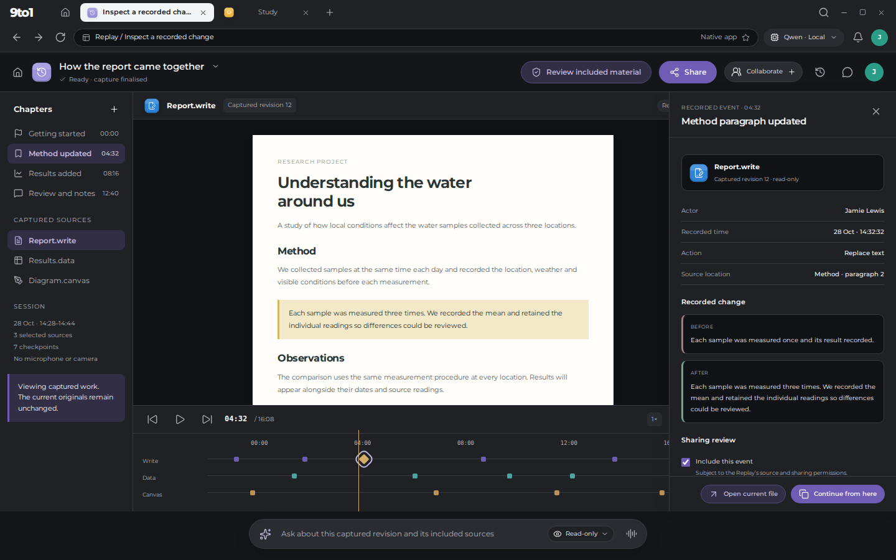

# Replay — semantic history and inspection

Module ID: `replay` · 9to1 Development Specification v3

## Prerequisites

- **CUI, themes and shared interaction system** — Typed UI components, theme tokens/materials, layout, focus, motion, accessibility and shared control states.
- **Artifacts, local persistence and recovery** — Canonical artifacts, revisions, typed edits, local saves, derived exports, sync and recovery.
- **Permissions, approvals and execution scope** — Effective scoped grants, action approvals, policy intersections, revocation and audit.

## Overview

Replay records and presents explicit permissioned semantic activity/history. Timeline inspection is read-only historical viewing; seeking must never replay external actions.

## Layouts & visible states

- **V3-REPLAY-LAY-01** — Use source/capture identity, timeline/checkpoints, historical viewport/detail and selected event inspector. Event detail shows target/revision, actor, time, input/output and safe provenance.
- **V3-REPLAY-LAY-02** — Capture start/stop and incomplete/paused/failed states remain visible; no ambient microphone/camera capture is implied.

## Features & behaviour

- **V3-REPLAY-FEA-01** — Record supported semantic changes/checkpoints from explicitly selected sources. Preserve source-defined capture, filtering, narration and export/share behaviour.
- **V3-REPLAY-FEA-02** — Seek changes the historical view only. Continue from here creates an independent canonical fork/copy with traceable origin when supported.
- **V3-REPLAY-FEA-03** — Review redaction and sharing scope before export. A replay rendering is not evidence that the captured application is still in that state.

## Canonical entities & persistence

- **V3-REPLAY-ENT-01** — Persist ReplayID, capture source/grants, event/checkpoint IDs, canonical artifact revisions, timestamps and redaction/share metadata.
- **V3-REPLAY-ENT-02** — Playback position/view settings are transient; captured history remains immutable except authorised redaction/versioning semantics.

## Permissions & recovery

- **V3-REPLAY-PER-01** — Recheck source visibility and redact revoked/private content. Explicit capture grants are required; no hidden ambient recording.
- **V3-REPLAY-PER-02** — Handle incomplete capture/missing assets with truthful gaps and recovery rather than invented events.

## Acceptance checks

- **V3-REPLAY-ACC-01** — Capture authorised semantic edits, seek events and verify no external command/action runs again.
- **V3-REPLAY-ACC-02** — Test event detail, incomplete capture, redaction/share review and Continue from here creating an independent identity.

## Exact mock-up and state map

- **Replay · Historical checkpoint** — screen `replay`. Playback.
- **Replay · Inspect a recorded change** — screen `replay-event-detail`. Historical event · source revision.

## Source clause IDs

TF-R01, TF-R02, TF-R03

## Technical reading map

- Replay — semantic history and inspection — Replay; Explicit capture and source selection (part 01) — `technical/replay-01.md` (683 words; V2-B2168).

Technical clauses retain APIs, data models, platform, recovery, donor and acceptance details. The technical files are part of this module, not optional background reading. Shared prerequisites mean stable service/interface contracts must be available; they do not require every dependent app UI to be complete. Use the named chunk for the relevant subtask or the complete module file for its full retained contract.

# Exact designs and implementation rules

These figures are the exact current atlas compositions. Their stable screen IDs match the Word specification and editable source. Open the atlas for full-size theme and interaction inspection.

## Replay · Historical checkpoint

Screen ID: `replay`. Source: TF-R01–03: semantic capture, historical viewer, timeline and sharing review.

- Replay records selected semantic revisions, events and checkpoints. Optional media is supplementary.
- The historical viewer identifies the captured revision and stays read-only even when the source has advanced.
- Missing intervals and dependencies remain visible as incomplete capture, never invented reconstruction.
- Continue from here makes an independent copy through the owning app. It must never overwrite the current original.

## Replay · Inspect a recorded change

Screen ID: `replay-event-detail`. Source: TF-R01–03; TF-X01–02.

- The event identifies the captured source, actor, timestamp and historical revision. The rendered checkpoint is read-only and separate from the current source.
- Before/after content belongs to the recorded semantic event and source revision. Seeking or playback reconstructs history; it does not execute the original mutation again.
- Sharing review can exclude or redact captured material without deleting the current original. Access and capture completeness remain explicit.
- Continue from here requests an independent copy through the owning app, preserving the source. Open current file uses the current source’s actual permissions.
