# Settings — complete page family

Module ID: `settings` · 9to1 Development Specification v3

## Prerequisites

- **CUI, themes and shared interaction system** — Typed UI components, theme tokens/materials, layout, focus, motion, accessibility and shared control states.
- **Account, identity and resource entitlements** — Canonical CAKE account identity, secure sessions, server entitlements and resource allocation state.
- **Permissions, approvals and execution scope** — Effective scoped grants, action approvals, policy intersections, revocation and audit.
- **Models, discovery and universal model routing** — Model discovery/lifecycle, stable provider capabilities, ordered routing and truthful usage/effort metadata.
- **Privacy, data boundaries and context isolation** — Privacy scopes, consent, local/remote boundaries, source provenance, retention and revocation.

## Overview

Settings provides eleven navigable pages, each with practical controls bound to the owning shared service. Appearance remains part of this family while its visual token contract is defined by CUI.

Current owner overrides: V3-OWNER-003, V3-OWNER-005, V3-OWNER-006, V3-OWNER-007.

## Layouts & visible states

- **V3-SETTINGS-LAY-01** — The sidebar contains Account, Appearance, Models, Permissions, Apps, Storage, Mesh, Privacy, Accessibility, Notifications and Advanced. Keep the current page selected, navigation predictable and content comfortably spaced.
- **V3-SETTINGS-LAY-02** — Account focuses identity/sessions/resources; Models shows default routing and provider management; Permissions uses a scoped capability matrix; Apps manages availability/default owners; Storage shows real use and locations.
- **V3-SETTINGS-LAY-03** — Mesh focuses device capability/connectivity; Privacy covers history/memory/context; Accessibility covers motion/contrast/text/input; Notifications covers channels, quiet periods and activity; Advanced covers diagnostics, experimental/configuration and recovery controls.
- **V3-SETTINGS-LAY-04** — Include provider detail with secure credential state, scopes, route/model eligibility and connection diagnostics. Use suitable page structures instead of repeating one generic card grid.

## Features & behaviour

- **V3-SETTINGS-FEA-01** — Use Home-owned account/device preference APIs and identify effective inherited/organisation-controlled values. Native form state must bind to canonical settings in implementation.
- **V3-SETTINGS-FEA-02** — Appearance changes the full theme family and previews shared states without modifying document content. Memory frequency and Background Learning remain independent.
- **V3-SETTINGS-FEA-03** — Distinguish conversation permission scope from editor AI access and document modes; link to Manage app permissions without implying a local override widens policy.
- **V3-SETTINGS-FEA-04** — Explain pending, saved, failed, read-only/policy-controlled and restart-required changes. Do not claim backend success from a displayed toggle.

## Canonical entities & persistence

- **V3-SETTINGS-ENT-01** — Persist values by setting ID, scope, schema/version and source of effective rule. Provider credentials remain in secure storage rather than plain preference payloads.
- **V3-SETTINGS-ENT-02** — Remember page/section navigation independently from dirty configuration; switching pages must preserve or explicitly resolve unapplied edits.

## Permissions & recovery

- **V3-SETTINGS-PER-01** — Use concrete confirmation only for consequential resets/removals. Diagnostics/export must respect privacy and redact secrets.
- **V3-SETTINGS-PER-02** — Handle failed saves, unavailable providers, revoked grants and unsupported device controls without discarding unrelated edits.

## Acceptance checks

- **V3-SETTINGS-ACC-01** — Navigate all eleven pages and provider detail by pointer and keyboard. Verify narrow layouts, focus labels, long-page scrolling and no clipped selects.
- **V3-SETTINGS-ACC-02** — Test policy inheritance, failed setting persistence and a preference change reflected in a second app surface.

## Exact mock-up and state map

- **Appearance · Theme and accent preferences** — screen `appearance`. Theme picker.
- **Settings · Account & subscription** — screen `settings-account`. Profile · resources.
- **Settings · AI & models** — screen `settings-models`. Routes · discovery.
- **Settings · Permissions & trust** — screen `settings-permissions`. Grants · scope.
- **Settings · Apps & updates** — screen `settings-apps`. Packages · policy.
- **Settings · Storage** — screen `settings-storage`. Local · account.
- **Settings · Mesh & devices** — screen `settings-mesh`. Pairing · sharing.
- **Settings · Privacy** — screen `settings-privacy`. Processing · data.
- **Settings · Accessibility** — screen `settings-accessibility`. Scale · motion · input.
- **Settings · Notifications** — screen `settings-notifications`. Delivery · activity.
- **Settings · Advanced** — screen `settings-advanced`. Services · diagnostics.
- **Settings · Provider access detail** — screen `settings-provider`. Connection draft.

## Source clause IDs

Named baseline section(s) retained in the technical-source chapters below.

## Technical reading map

- Settings — complete page family — Settings; Home-managed CUI theme preference (part 01) — `technical/settings-01.md` (271 words; V2-B0498, V2-B0499, V2-B0500…).

Technical clauses retain APIs, data models, platform, recovery, donor and acceptance details. The technical files are part of this module, not optional background reading. Shared prerequisites mean stable service/interface contracts must be available; they do not require every dependent app UI to be complete. Use the named chunk for the relevant subtask or the complete module file for its full retained contract.

# Exact designs and implementation rules

These figures are the exact current atlas compositions. Their stable screen IDs match the Word specification and editable source. Open the atlas for full-size theme and interaction inspection.

## Appearance · Theme and accent preferences

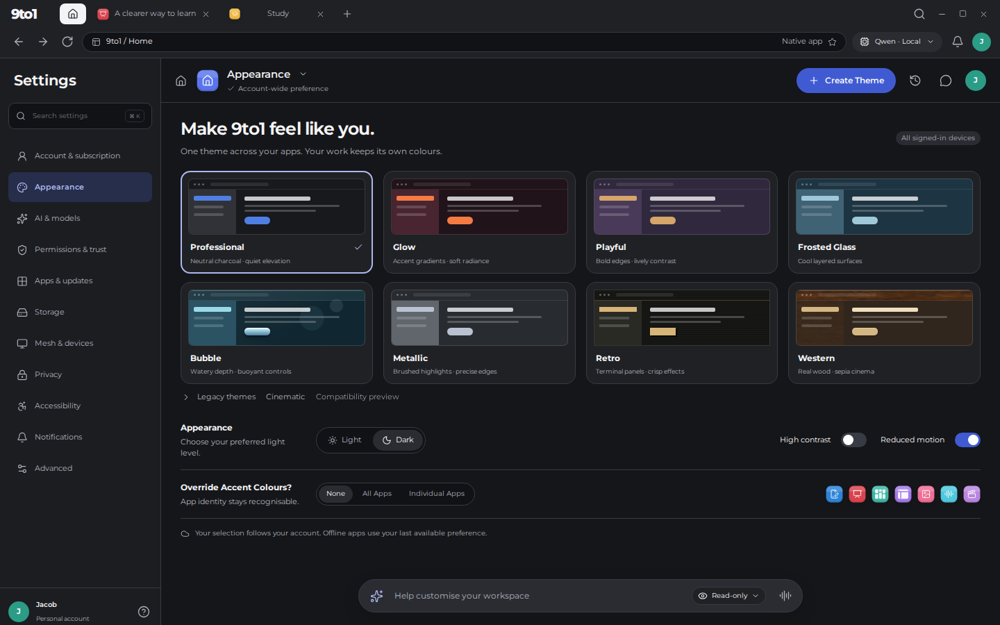

Screen ID: `appearance`. Source: CUI-PREF-201–205; CUI-THEME-001–004; UX27-SHARED-005; authoritative PPT 1–6.

- Current picker contains eight built-ins plus Create Theme. Cinematic is handled as a legacy preference, never silently relabelled.
- Authenticated settings are account-wide through Home. Device cache supports offline use without becoming a competing authority.
- Accent modes are None, All Apps and Individual Apps. None retains each app’s specified accent; per-app choices still belong to Home settings.
- Bubble uses watery dimensional controls and an optional click wobble; Western uses an original wood texture with sepia limited to chrome icons; Retro uses terminal-style monochrome panels, monospace chrome and restrained effects. These follow the latest owner refinement. Frosted Glass has no Gaussian/Mica; that material remains reserved for Professional.
- Theme changes preserve active document, selection, scroll position, topology and authored colours. Reduced Motion removes Bubble wobble and Retro active effects; no content or action depends on an animation.

## Settings · Account & subscription

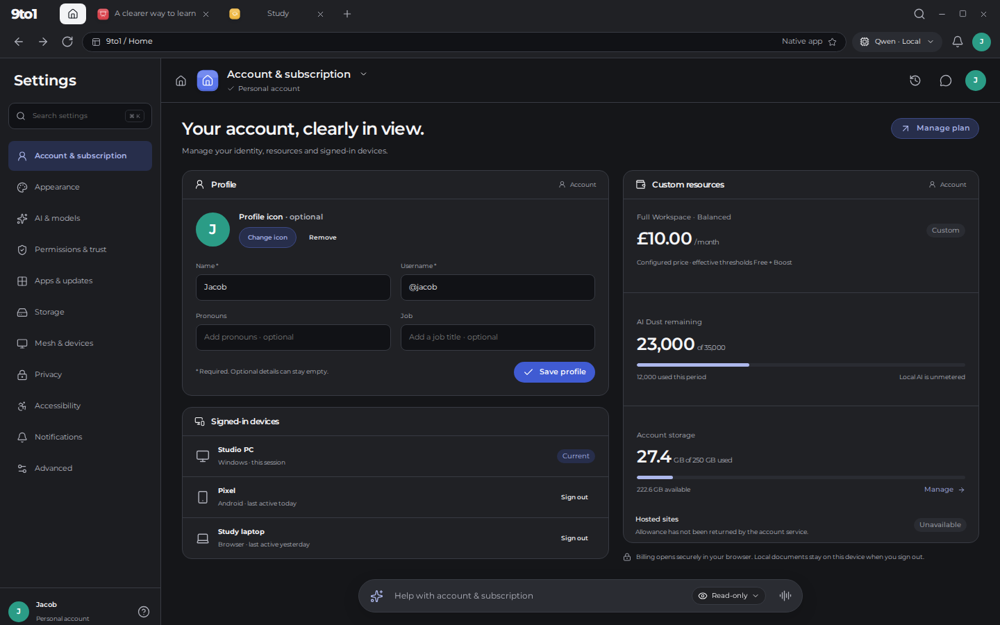

Screen ID: `settings-account`. Source: Home / Settings and Account and subscription surface; Accounts & Subscription / Profile customisation — required and optional fields; Canonical subscription state; Custom resource allocation.

- Name and Username are the only required profile fields; Icon, Pronouns and Job are optional and clearable. Profile changes preserve CAKE ID, ownership, permissions and entitlements.
- The illustrated custom Balanced configuration uses the specification’s £10 allocation example: 35,000 AI Dust and 250 GB. A tier label does not compute entitlements or resource balances.
- Dust, storage, prices, entitlement thresholds and sessions come from the authoritative account service. Missing site-limit data remains unavailable rather than a fabricated allocation.
- Manage plan, checkout and sensitive billing changes open the trusted authenticated CAKEMODS flow. Session revocation or sign-out does not silently delete local artifacts.

## Settings · AI & models

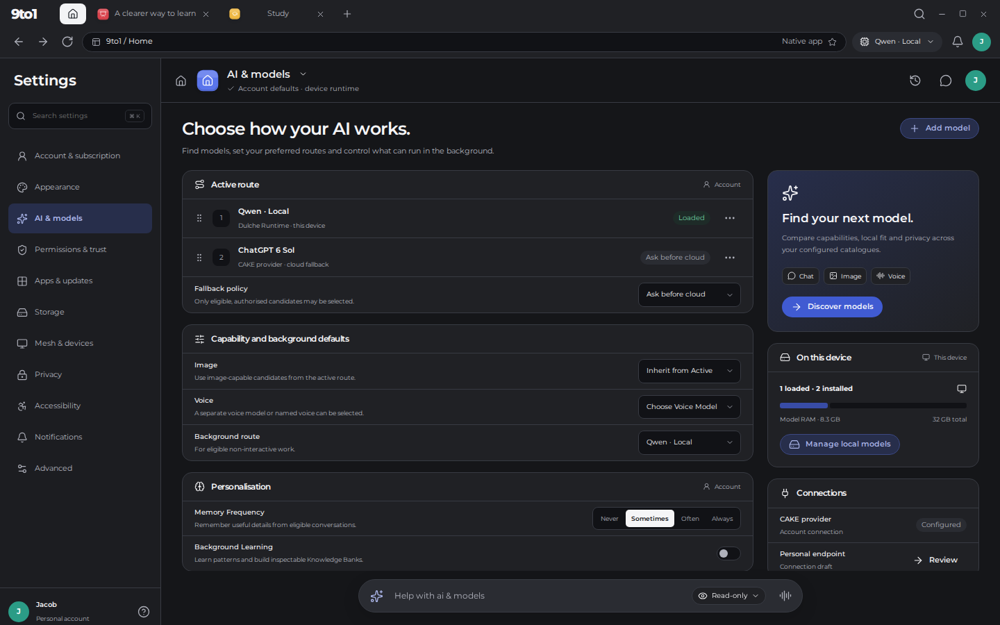

Screen ID: `settings-models`. Source: Home / Discover; Universal Model Picker / Compact picker and full manager, Ordered Model Routes, Local model lifecycle; Dulche Den / Persistent Memory and Memory Frequency; Background Learning.

- Discovery, routes and local management share the canonical Dulche model catalogue. Chat, Image and Voice are primary categories; Advanced includes Audio and Video. Discovery links retain provider identity and unknown capability metadata.
- Active and Background routes are distinct. Candidate ordering is considered only after capability, privacy, availability, entitlement and policy filtering; adding a cloud fallback does not authorise remote disclosure.
- Memory Frequency has exactly Never, Sometimes, Often and Always. It affects future autonomous memory creation and does not delete existing memories; Temporary Chats cannot write memories.
- Background Learning is separately opt-in and does not substitute for Persistent Memory or grant cloud access. Local runtime, residency and resource settings remain device scoped.
- Providers and MCP servers expose authentication, capability, permission and health state; a missing or untested connection is never shown as ready.

## Settings · Permissions & trust

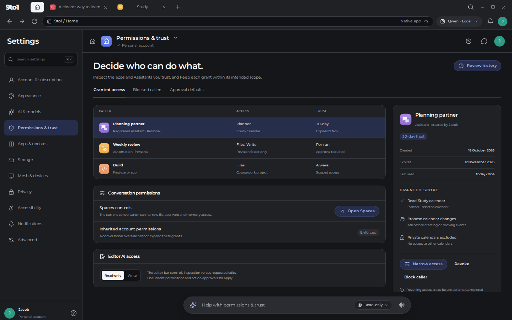

Screen ID: `settings-permissions`. Source: Home / Permission and trust broker; App APIs and automation permissions; UX27-SHARED-001; platform shared AI-bar access-mode contract; current owner revision (Spaces Conversation permissions).

- Show stable caller identity/origin, target apps/actions/scopes, trust level, creation, expiry and last use. Trust can be temporary, 30-day or always, but never bypasses a target’s protected action rules.
- Narrow, revoke, block and unblock operate through the Home broker. Revocation governs future protected actions, with truthful handling of any operation already in flight.
- Spaces exposes Conversation permissions as a scoped control for the current conversation. It cannot broaden the account’s grants or the current Space’s policy.
- Conversation permissions are separate from an editor’s AI Read-only/Write access mode and from document Edit/Suggest/View. Data still requires explicit approval for every AI mutation.
- A changed caller identity or signing/content identity requires re-evaluation; an old friendly name does not silently retain trust.

## Settings · Apps & updates

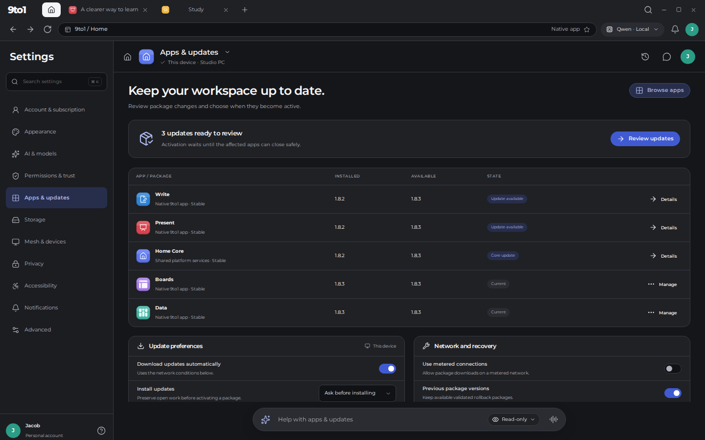

Screen ID: `settings-apps`. Source: Home / Apps surface and package management; UX27-HOST-001, UX27-HOST-009; Home / Service registry and compatibility handshake.

- Home Apps, Settings and Launcher consume the same package/update service and database. Installed, available, dependency, compatibility and repair states retain stable package identity.
- Install and update use staged signature/integrity checks, dependency resolution and compatible atomic activation. A failed activation preserves the last validated package when rollback is available.
- Download, review and activation are distinct states. Controls show the actual package/version/channel and do not claim an update has completed merely because it was requested.
- Uninstall does not delete user-created documents. Artifact retention or deletion is a separate, explicitly scoped operation.

## Settings · Storage

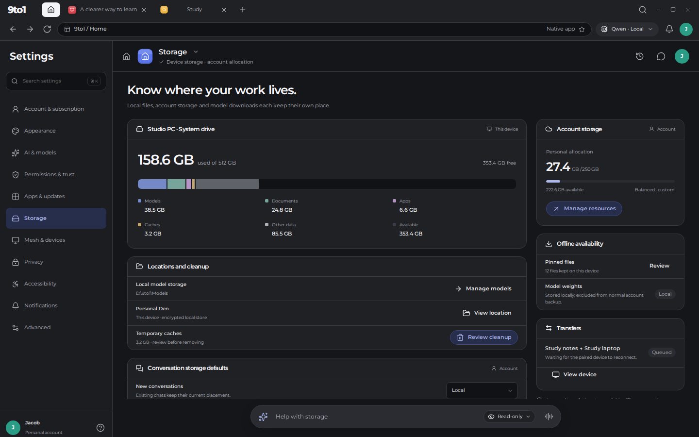

Screen ID: `settings-storage`. Source: Home / Settings; Accounts & Subscription / Storage usage and Custom resource allocation; Dulche Den / Storage structure and portability; LE-07 / Chat storage, transfer and privacy contract.

- Local disk usage and account storage are separate measurements and authorities. Installed model files, caches and original documents are distinct categories; model RAM/VRAM is not disk storage.
- Conversation placement Local, Mesh and Cloud is separate from AI/tool execution locality. A new chat defaults to Local unless an eligible alternative was explicitly chosen.
- Moving managed data or changing placement requires an explicit destination and capability checks. Preview affected items; pending replica cleanup must remain visibly pending.
- Caches and search indexes are rebuildable. Cleanup must not remove the only canonical document, Den record, source file or unreadable offline replica.
- Account storage allocation shown here is the specification’s custom Balanced example; usage is illustrative account data. Device paths remain device-local.

## Settings · Mesh & devices

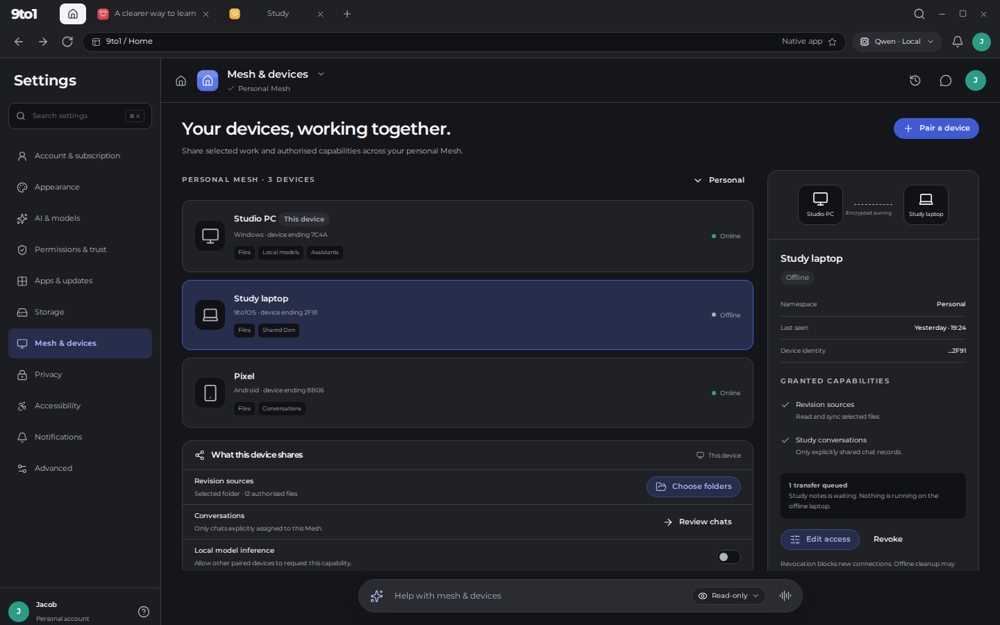

Screen ID: `settings-mesh`. Source: Home / Mesh; UX27-OTHER-017; Accounts & Subscription / organisation Mesh; Dulche Den / Synchronisation and conflicts.

- Mesh is a Home feature. Devices use stable authenticated DeviceIDs and explicit pairing; friendly names do not establish identity or authority.
- Sharing is scoped by namespace and selected objects. Pairing does not expose every file, secret, conversation or Assistant; personal and organisation namespaces remain distinct.
- Remote invocation uses advertised typed capabilities and both caller and target permissions. Mesh is not implicit remote desktop, input control or arbitrary execution.
- Offline devices show queued/unavailable state. Revocation blocks future authentication, sync and remote calls without claiming to erase offline replicas or undo completed actions.
- Conflicting revisions are preserved for review; reconnecting does not replay historical requests or completed external effects.

## Settings · Privacy

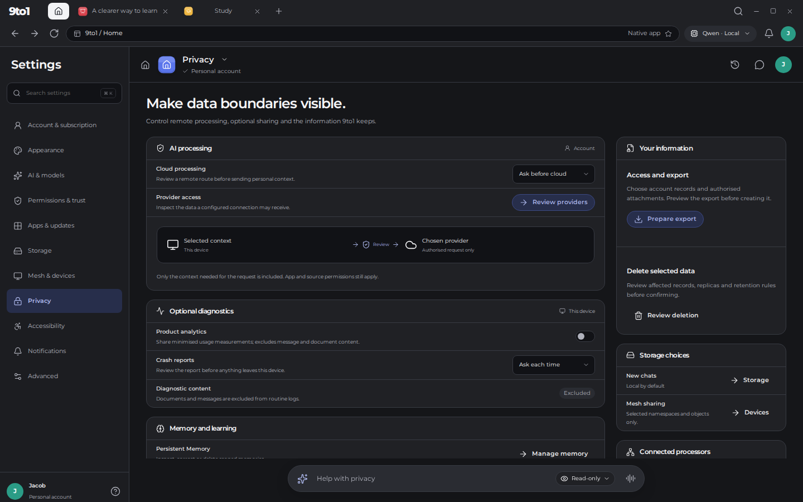

Screen ID: `settings-privacy`. Source: Privacy and data-protection baseline / Privacy Ceiling; Home / Universal Model Picker / Fallback privacy and control; Dulche Den / DEN-PRIV-001–008; LE-07 / Chat storage, transfer and privacy contract.

- Show storage locality separately from AI/tool execution. Local conversation storage does not itself authorise or forbid a separately permissioned remote model request.
- A configured cloud provider or fallback is not consent to transmit private content. Provider, purpose, context categories and permitted route remain inspectable.
- Optional telemetry, diagnostics, personalisation and disclosure have explicit controls with privacy-protective defaults. Credentials and recovery material use secure storage; diagnostic exports redact sensitive content.
- Export, deletion and consent withdrawal have visible scope and lifecycle. Replica/index/cache cleanup is reported truthfully rather than merely hiding the primary record.
- Persistent Memory, Background Learning and permission to disclose their contents are independent controls; temporary-chat memory write suppression cannot be bypassed.

## Settings · Accessibility

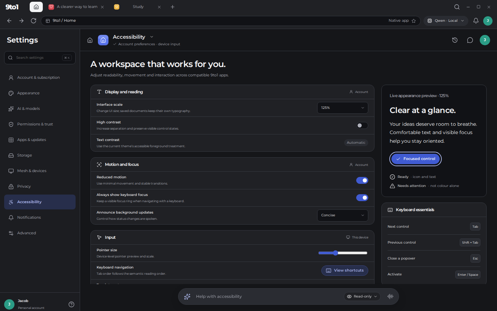

Screen ID: `settings-accessibility`. Source: CUI / Accessibility, focus and keyboard semantics; UX27-SHARED-006–008, UX27-SHARED-019; CUI-PRO-201–204; CUI-PREF-202.

- Reduced motion, high contrast, scale/zoom and non-colour-only states are framework capabilities shared across compatible apps. Theme changes preserve these preferences.
- Reduced motion replaces unnecessary movement and preserves truthful progress. Focus remains visible through popovers, tool use and theme changes.
- Semantic labels, focus order and keyboard operation follow the shared CUI accessibility tree; inactive controls do not remain hidden keyboard targets.
- The preview demonstrates scale, focus and redundant status communication without changing saved document font sizes or authored content.
- Account-level accessibility preferences and device input/display adjustments keep explicit scopes; unsupported host facilities must remain unavailable with a reason.

## Settings · Notifications

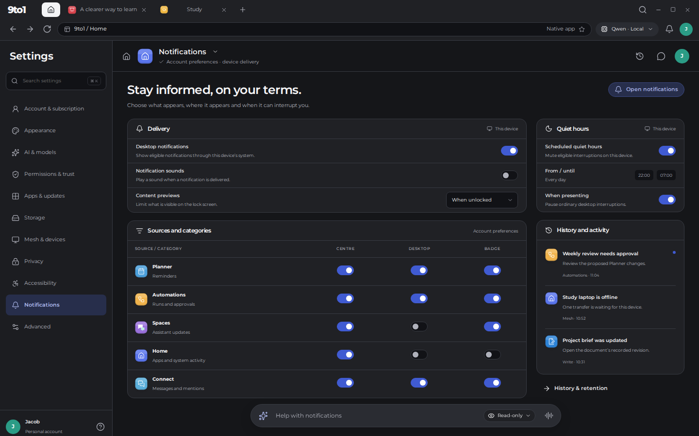

Screen ID: `settings-notifications`. Source: Home / Notifications; Home / Events typed activity contract (owned by Notifications under current owner revision); UX27-SHARED-001, UX27-SHARED-019.

- Notifications owns the notification centre, history and typed ecosystem activity; the superseded separate Events destination is not shown.
- Each notification/activity item retains stable identity, timestamp, source, category, related entity and typed deep link. Generated digests cannot replace or invent the underlying record.
- Read/unread, dismiss, clear and retention policies operate on canonical records. Desktop delivery is a bridge and does not create a competing notification database.
- Source/category preferences, previews and delivery channels remain separate controls. A notification action cannot bypass target-app permissions or approval requirements.
- Quiet-hours and source controls display effective policy, including any managed restrictions; they cannot silently suppress required security or approval state.

## Settings · Advanced

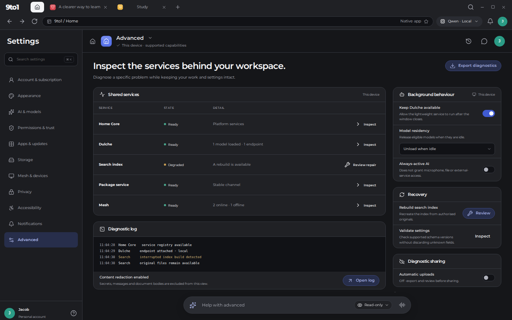

Screen ID: `settings-advanced`. Source: Home / Service registry and compatibility handshake; Startup, background lifecycle and recovery; Dulche runtime control; 9to1OS / System Log and crash diagnostics; UX27-HOST-009; Privacy baseline.

- Shared Home Core services expose real version, compatibility and health states. Required service failure gets a scoped repair path; apps preserve their documents instead of launching competing private services.
- Dulche lifecycle states include Starting, Ready, Degraded, Restarting and Stopped. Closing the visible Home window does not implicitly terminate dependent background work.
- Diagnostics identify component, severity and request/session correlation where available, while redacting secrets and unnecessary personal content. Export is a reviewed local operation; upload is separate.
- Rebuildable indexes/caches may be repaired without discarding canonical files, grants, package identities or Den state. Recovery never silently resets durable settings to regain startup.
- OS-specific resource reclamation and system-log capabilities must be advertised by the actual host. Desktop UI must not pretend unsupported privileged OS controls are available.

## Settings · Provider access detail

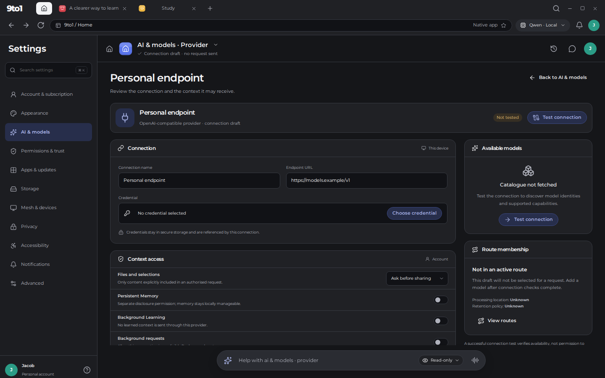

Screen ID: `settings-provider`. Source: Home / Universal Model Picker / Provider support, Fallback privacy and control; Privacy and data-protection baseline; Dulche MCP / connection, authentication and permission contracts.

- A provider draft has no verified connectivity, model catalogue or capability state. Test and model discovery use the configured provider adapter and show truthful results.
- Authentication references secure credential storage; UI, logs and exports never expose raw tokens. Endpoint and provider identity are distinct from a friendly connection name.
- Provider availability and permission to disclose context are separate decisions. Optional memory, learning and background-use grants remain off until explicitly authorised.
- Only authorised routes may invoke a provider. Unavailable or denied providers are filtered before route ordering; connection success alone cannot override privacy policy.
- MCP server management additionally exposes transport, declared tools/capabilities and Agent/app assignment. It must not share an endpoint’s credentials or authority merely because names match.
