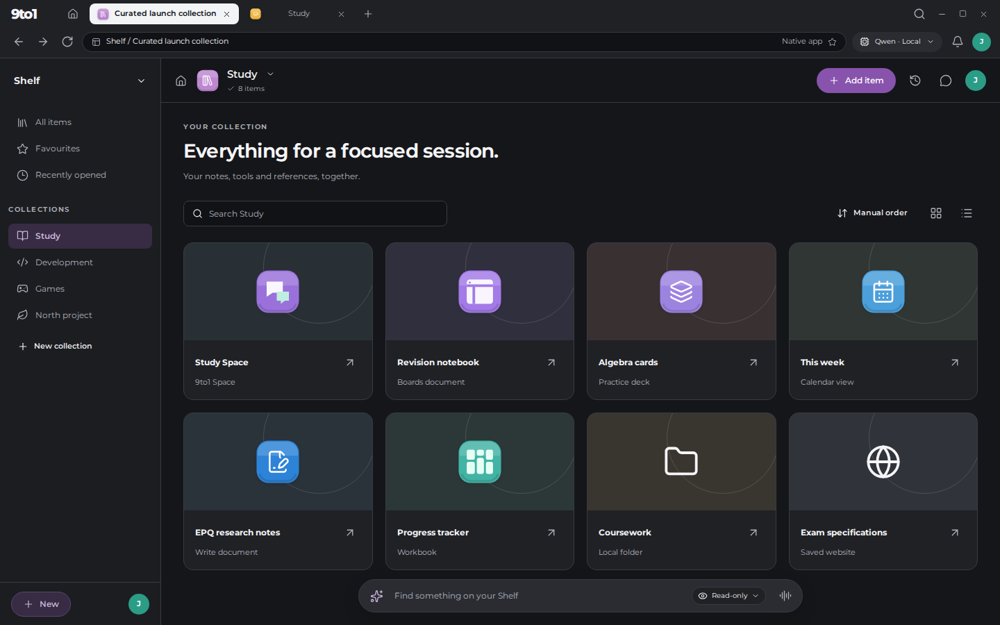
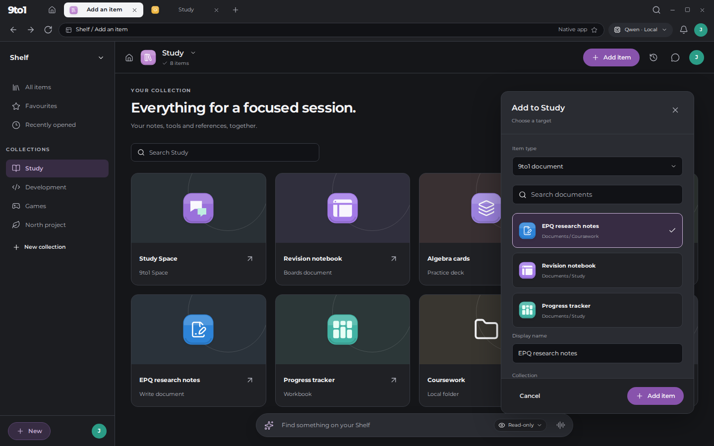

# Shelf — cross-app library and collections

Module ID: `shelf` · 9to1 Development Specification v3

## Prerequisites

- **CUI, themes and shared interaction system** — Typed UI components, theme tokens/materials, layout, focus, motion, accessibility and shared control states.
- **Platform, app registry and host integration** — Canonical app registry, artifact routes, native/browser embedding, lifecycle and semantic UI/API parity.
- **Artifacts, local persistence and recovery** — Canonical artifacts, revisions, typed edits, local saves, derived exports, sync and recovery.
- **Permissions, approvals and execution scope** — Effective scoped grants, action approvals, policy intersections, revocation and audit.

## Overview

Shelf organises canonical apps, media and file targets into useful libraries/collections. It references real resources and distinguishes collection membership from installation or source deletion.

## Layouts & visible states

- **V3-SHELF-LAY-01** — Show searchable/filterable library and collection contents with type/owner, artwork/preview and actual availability.
- **V3-SHELF-LAY-02** — Selected item details offer the real Open, Locate, Install/available or unavailable action appropriate to its type.

## Features & behaviour

- **V3-SHELF-FEA-01** — Add, organise, pin and remove reference membership without silently moving/deleting source files or uninstalling apps.
- **V3-SHELF-FEA-02** — Resolve launching through the canonical app registry and opening media/artifacts through their owner. Keep Shelf distinct from the Launcher home screen and Files provider operations.

## Canonical entities & persistence

- **V3-SHELF-ENT-01** — Persist Shelf/CollectionID, membership IDs, ordered target references and user metadata. Source artifact/package identity remains owned elsewhere.
- **V3-SHELF-ENT-02** — Availability and preview caches are derived from actual target state.

## Permissions & recovery

- **V3-SHELF-PER-01** — Recheck access on open; removed/revoked/missing targets remain safely recoverable by Locate/remove-reference where supported.
- **V3-SHELF-PER-02** — Installing or deleting a source uses that owner’s explicit operation and confirmation semantics.

## Acceptance checks

- **V3-SHELF-ACC-01** — Test add/reorder/remove-reference and verify the source remains intact.
- **V3-SHELF-ACC-02** — Open installed/unavailable/missing targets and verify truthful actions and canonical owner routing.

## Exact mock-up and state map

- **Shelf · Curated launch collection** — screen `shelf`. Library.
- **Shelf · Add an item** — screen `shelf-add`. Interaction state.

## Source clause IDs

UX27-OTHER-011

## Technical reading map

- Shelf — cross-app library and collections — Shelf; Core model (part 01) — `technical/shelf-01.md` (837 words; V2-B1822, V2-B2315, V2-B2316…).

Technical clauses retain APIs, data models, platform, recovery, donor and acceptance details. The technical files are part of this module, not optional background reading. Shared prerequisites mean stable service/interface contracts must be available; they do not require every dependent app UI to be complete. Use the named chunk for the relevant subtask or the complete module file for its full retained contract.

# Retained technical requirements

# Shelf — cross-app library and collections — Shelf; Core model (part 01)

Reading status: active retained clauses, subject to the v3 owner overrides listed in the primary module. Historical process instructions and replaced original wording are stored separately.

### V2-B1822 · v2 lines 10752–10790

Shelf
Shelf is the cross-platform quick-access library for things the user wants to launch or open frequently. It is a separate product from the Android Launcher. Shelf can organise applications, games, 9to1 surfaces, projects, files, folders, websites and other supported shortcuts into reusable user-defined collections.
Core model
Shelf MUST model launch targets as stable typed LaunchItem entities rather than a grid of copied shortcuts. A LaunchItem can represent, where supported and permitted:
* Installed desktop/native applications.
* 9to1 applications and 9to1:// routes/deep links.
* Games detected from supported game/application sources or added manually.
* Android applications where the hosting platform supports them.
* Executable/application targets with supported arguments and working-directory configuration.
* Files and folders.
* Web URLs and registered URI schemes.
* Dev/Stack projects or other 9to1 canonical resources with a launch/open action.
* Explicit user-created shortcuts and other extension-defined launch targets.
Each LaunchItem can retain a stable ID, name, icon/artwork, target type, canonical target/reference, optional launch parameters, tags, collection membership, launch behaviour and supported contextual actions. Shelf MUST preserve the underlying target identity instead of duplicating the actual app/game/file.
Collections and organisation
Collections are first-class many-to-many organisational entities, not filesystem-style one-parent folders. The same LaunchItem may appear in multiple collections without duplication. Examples include Offline Games, FNAF Games, 9to1 Apps, Development, Blender & Unreal, Coursework or any user-created grouping.
Shelf MUST support manual collections, favourites/pins, ordering, tags and smart/dynamic collections where reliable typed criteria exist. Dynamic collections may automatically surface targets such as detected Unreal projects or installed games matching declared offline-capability metadata without converting those results into duplicate LaunchItems.
Collections should support configurable presentation such as list/grid/card density, artwork/icon treatment and ordering while keeping the same canonical contents underneath.
Discovery and target import
Shelf can discover supported locally installed applications, platform-recognised games, 9to1 applications and registered projects through typed providers. Discovery MUST be permission-aware and reversible; detected items do not have to be added to the user's curated Shelf unless the user chooses or a configured smart collection references them.
Users can always add a supported target manually when automatic discovery is unavailable. Missing/uninstalled targets SHOULD remain recoverable as unavailable entries when preserving them is useful, rather than silently deleting the user's organisation.
Search / AI
Shelf uses the shared Search / AI interaction pattern. Search mode performs deterministic lookup across LaunchItems, collections, tags and supported metadata. AI mode uses Dulche to interpret natural-language library requests and operate Shelf's typed APIs.
Examples include 'add all my FNAF games to a FNAF collection', 'find all Unreal projects and put them in Development', 'show games I can play offline', 'where is that game I installed last month?', or 'open everything I use for Refuelled'. Dulche MUST resolve real discovered/canonical targets and MUST NOT invent installed applications or projects.
Launching and actions
Opening an item delegates to the owning platform/application service using the target's canonical semantics. 9to1-native targets use their registered 9to1:// identity/deep-link contracts where applicable. Files/folders use Files/platform open semantics; web targets use Browse/default-browser semantics; applications/games use the appropriate registered launcher/provider.
Shelf may expose typed contextual actions such as Open, Open with, Reveal in Files, Open project, Launch with arguments, Pin, Add/remove collection, Edit metadata or provider-specific actions where the underlying target supports them. Consequential or command-like launch actions remain subject to normal 9to1 permission/risk policy.
Cross-device and missing-target behaviour
Shelf organisation is user state and should be serialisable/synchronisable where enabled. A synced collection may contain a target unavailable on another device. That device MUST represent the item as unavailable/not installed or resolve an appropriate equivalent only through explicit canonical mapping; it must not silently substitute an unrelated app.
Extensions
Extensions may register LaunchItem providers, target types, discovery providers, metadata enrichers, actions and smart-collection predicates subject to permissions. Providing Shelf integration does not grant unrestricted filesystem enumeration, package inventory or private project access.
Shelf acceptance requirements
* Shelf remains a distinct cross-platform quick-access product and is never conflated with the Lawnchair-derived Android Launcher.
* Apps, games, 9to1 routes, projects, files, folders, URLs and supported shortcuts can be represented as typed stable LaunchItems.
* Collections support many-to-many membership so an item can belong to multiple groups without duplication.
* Manual and supported smart collections, search, favourites, tags, custom ordering and unavailable-target recovery work consistently.
* Dulche can organise, discover and launch real Shelf targets through typed APIs without hallucinating installed content.
* Launching delegates to the target's authoritative owner/platform service and respects normal permission/security boundaries.
Frameworks

### V2-B2315 · v2 lines 13463–13463

### UX27-OTHER-011 — Shelf collections and launching

### V2-B2316 · v2 lines 13465–13465

**B/D.** Shelf presents real typed launch targets with useful icons/artwork, availability and explicit open actions. An item can belong to multiple collections without duplicating the underlying file/app. Dragging within a collection changes ordering; dragging to another collection adds/moves membership according to a visible chosen operation. Removing membership is not uninstalling or deleting the target.

### V2-B2317 · v2 lines 13467–13467

Missing applications/files remain recoverable unavailable entries with Locate/Install where supported. AI organisation resolves actual targets and shows its proposed changes. Do not claim a game/app is installed or offline-capable from an invented label. Shelf remains distinct from the Android Launcher.

# Exact designs and implementation rules

These figures are the exact current atlas compositions. Their stable screen IDs match the Word specification and editable source. Open the atlas for full-size theme and interaction inspection.

## Shelf · Curated launch collection

Screen ID: `shelf`. Source: Shelf canonical LaunchItems/collections baseline; UX27-OTHER-010–011.

- Shelf is a quick-access product, distinct from the Android Launcher and Files storage.
- A LaunchItem can appear in multiple collections without copying the target artifact.
- Missing targets remain recoverable and explicitly unavailable; never silently substitute another application.
- Search uses real typed targets. Opening delegates to the canonical owning app, website or platform launcher.

## Shelf · Add an item

Screen ID: `shelf-add`. Source: Owner revision 28 October; Shelf canonical LaunchItems and collection references.

- A Shelf item references the original app, document, website or platform target. It does not move or duplicate the original.
- The picker shows the target identity and destination collection before adding it.
- Unavailable targets can remain as recoverable entries and must not silently resolve to another item.
