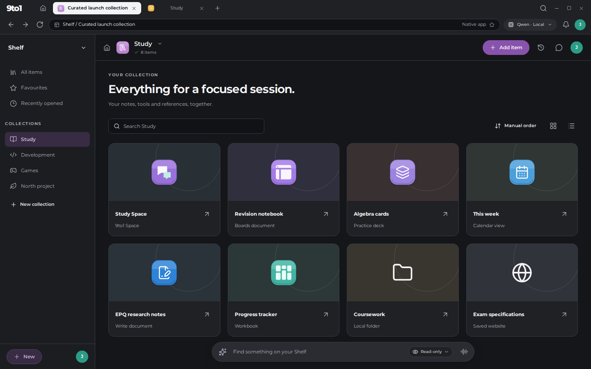
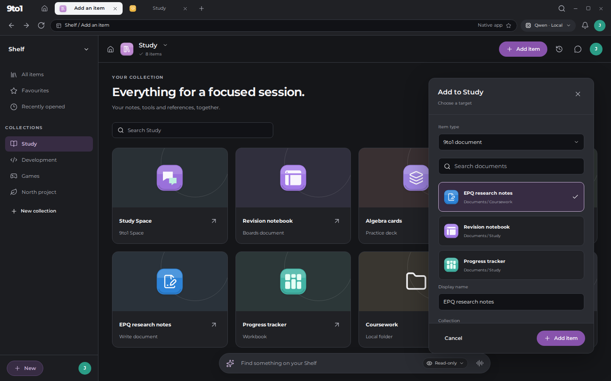

# Shelf — cross-app library and collections

Module ID: `shelf` · 9to1 Development Specification v3

## Prerequisites

- **CUI, themes and shared interaction system** — Typed UI components, theme tokens/materials, layout, focus, motion, accessibility and shared control states.
- **Platform, app registry and host integration** — Canonical app registry, artifact routes, native/browser embedding, lifecycle and semantic UI/API parity.
- **Artifacts, local persistence and recovery** — Canonical artifacts, revisions, typed edits, local saves, derived exports, sync and recovery.
- **Permissions, approvals and execution scope** — Effective scoped grants, action approvals, policy intersections, revocation and audit.

## Overview

Shelf organises canonical apps, media and file targets into useful libraries/collections. It references real resources and distinguishes collection membership from installation or source deletion.

## Layouts & visible states

- **V3-SHELF-LAY-01** — Show searchable/filterable library and collection contents with type/owner, artwork/preview and actual availability.
- **V3-SHELF-LAY-02** — Selected item details offer the real Open, Locate, Install/available or unavailable action appropriate to its type.

## Features & behaviour

- **V3-SHELF-FEA-01** — Add, organise, pin and remove reference membership without silently moving/deleting source files or uninstalling apps.
- **V3-SHELF-FEA-02** — Resolve launching through the canonical app registry and opening media/artifacts through their owner. Keep Shelf distinct from the Launcher home screen and Files provider operations.

## Canonical entities & persistence

- **V3-SHELF-ENT-01** — Persist Shelf/CollectionID, membership IDs, ordered target references and user metadata. Source artifact/package identity remains owned elsewhere.
- **V3-SHELF-ENT-02** — Availability and preview caches are derived from actual target state.

## Permissions & recovery

- **V3-SHELF-PER-01** — Recheck access on open; removed/revoked/missing targets remain safely recoverable by Locate/remove-reference where supported.
- **V3-SHELF-PER-02** — Installing or deleting a source uses that owner’s explicit operation and confirmation semantics.

## Acceptance checks

- **V3-SHELF-ACC-01** — Test add/reorder/remove-reference and verify the source remains intact.
- **V3-SHELF-ACC-02** — Open installed/unavailable/missing targets and verify truthful actions and canonical owner routing.

## Exact mock-up and state map

- **Shelf · Curated launch collection** — screen `shelf`. Library.
- **Shelf · Add an item** — screen `shelf-add`. Interaction state.

## Source clause IDs

UX27-OTHER-011

## Technical reading map

- Shelf — cross-app library and collections — Shelf; Core model (part 01) — `technical/shelf-01.md` (837 words; V2-B1822, V2-B2315, V2-B2316…).

Technical clauses retain APIs, data models, platform, recovery, donor and acceptance details. The technical files are part of this module, not optional background reading. Shared prerequisites mean stable service/interface contracts must be available; they do not require every dependent app UI to be complete. Use the named chunk for the relevant subtask or the complete module file for its full retained contract.

# Exact designs and implementation rules

These figures are the exact current atlas compositions. Their stable screen IDs match the Word specification and editable source. Open the atlas for full-size theme and interaction inspection.

## Shelf · Curated launch collection

Screen ID: `shelf`. Source: Shelf canonical LaunchItems/collections baseline; UX27-OTHER-010–011.

- Shelf is a quick-access product, distinct from the Android Launcher and Files storage.
- A LaunchItem can appear in multiple collections without copying the target artifact.
- Missing targets remain recoverable and explicitly unavailable; never silently substitute another application.
- Search uses real typed targets. Opening delegates to the canonical owning app, website or platform launcher.

## Shelf · Add an item

Screen ID: `shelf-add`. Source: Owner revision 28 October; Shelf canonical LaunchItems and collection references.

- A Shelf item references the original app, document, website or platform target. It does not move or duplicate the original.
- The picker shows the target identity and destination collection before adding it.
- Unavailable targets can remain as recoverable entries and must not silently resolve to another item.
