# Spaces — conversations, workspaces and custom Space Builder

Module ID: `spaces` · 9to1 Development Specification v3

## Prerequisites

- **CUI, themes and shared interaction system** — Typed UI components, theme tokens/materials, layout, focus, motion, accessibility and shared control states.
- **Dulche runtime, requests and execution services** — Canonical AI broker, capability-aware routing, durable Task/Runs, action execution and lifecycle.
- **Node Editor — shared graph framework** — Shared typed graph schemas, editing/validation, draft activation and runtime presentation.
- **Global Assistants, Specialists and collaborators** — Persistent global Assistant/Specialist identities, Teams, canonical conversations and editor collaboration.
- **Subagents, delegation and task trees** — Durable delegated task trees, inherited scope, bounded budgets, joins and recovery.
- **Generative UI and live artifact output** — Safe typed generated components, canonical live artifacts and verified durable output/export cards.
- **Artifacts, local persistence and recovery** — Canonical artifacts, revisions, typed edits, local saves, derived exports, sync and recovery.
- **Permissions, approvals and execution scope** — Effective scoped grants, action approvals, policy intersections, revocation and audit.
- **Models, discovery and universal model routing** — Model discovery/lifecycle, stable provider capabilities, ordered routing and truthful usage/effort metadata.
- **Vision & Voice — shared live session system** — Vision & Voice owns real conversational speech, visual context and live translation services, reused by the in-chat Voice pill. Multiple surfaces attach to the same session rather than creating a second speech/capture stack.

## Overview

Spaces is the conversation and task workspace for Chat, Tasks, Study, Assistant conversation views, Research, Shopping, Translate and Experiences, plus user-created Spaces. Each Space has a real domain workflow. Global Assistants/Specialists retain canonical identities outside Spaces, while their conversation views and work remain accessible here. This chapter is a copyable implementation unit; its prerequisite contracts define shared services, and the retained technical chunks preserve the full baseline and confirmed companion.

Current owner overrides: V3-OWNER-001, V3-OWNER-002, V3-OWNER-006, V3-OWNER-008, V3-OWNER-017.

## Layouts & visible states

- **V3-SPACES-LAY-01** — The far-left rail switches stable Space destinations and includes Manage Spaces; support the existing rail/dropdown preference, pinning, reorder and discovery. The contextual sidebar is independently collapsible/customisable with Space Overrides > User Preferences > Default precedence.
- **V3-SPACES-LAY-02** — Preserve active conversation, draft, selection, scroll, voice/session and Task/Run across Space switching. On narrow screens use responsive drawers with a durable reopen affordance rather than squeezing desktop columns.
- **V3-SPACES-LAY-03** — Chat is a Space, not a separate app. Default Chat sidebar sections may include New Chat, Chat Groups, Specialists and Recent Chats; they are defaults, not a fixed mandatory ordering.
- **V3-SPACES-LAY-04** — Keep conversation readable with distinct user/AI provenance. Plain Text/Speech Bubbles and alignment remain preferences. The current Professional wrapper and authoritative slides govern current chrome, not the older later-slide diagrams.
- **V3-SPACES-LAY-05** — The compact/expanded composer has + attachment/resource access, editable draft, focus-aware Aa and native emoji, model/effort context and state-appropriate send/voice controls. Keep attachment/plugin chips identity-backed, inspectable and scoped.
- **V3-SPACES-LAY-06** — Place a Conversation permissions icon in the composer; it is not the editor Read-only/Write switch. Its panel shows files/apps/web/memory scope and links to Manage app permissions.
- **V3-SPACES-LAY-07** — The contextual option shelf shows at most five current choices plus a peek, navigation/dots and truthful selection; browsing choices does not submit the draft.
- **V3-SPACES-LAY-08** — Idle controls expose Send/Voice; an empty disabled Send still permits Voice. Running work exposes Steer, Stop, Queue and Voice as supported; paused work exposes Resume/End Pass and approval-held work shows the actual pending decision.
- **V3-SPACES-LAY-09** — Summary is an optional floating top-right widget with Activity, Outputs and Sources. It must not become a permanent fourth column or shrink the conversation; keep required controls uncovered.
- **V3-SPACES-LAY-10** — Voice mode is a floating icon-first pill within Chat over the same canonical Vision & Voice session. Include mute, screen sharing, camera, captions, pause/resume, end, current voice/mode and more settings with permission indicators.
- **V3-SPACES-LAY-11** — Optional Tab View hosts actual conversations, Browse pages, CUI apps, artifacts and safe GenUI. Spaces itself remains a tab; hiding the strip does not destroy tabs.
- **V3-SPACES-LAY-12** — Show high-level thinking/work summaries, subagent task tree/detail, typed interactive output and live semantic Present/Canvas work. Completed/failed/approval-held states need their own truthful controls and artifact receipts.
- **V3-SPACES-LAY-13** — Generated-file cards show name, owning app, revision, format and durable availability, with Open and eligible Download. Failed export shows the saved native artifacts and targeted retry.
- **V3-SPACES-LAY-14** — Custom Space Builder has freely switchable Basic, Advanced and Expert tabs of one canonical Space. Basic/Advanced use a cohesive borderless configuration document; Expert uses Boards-style navigation for Details, Harness Logic, Model Logic, User Message Logic and Files.
- **V3-SPACES-LAY-15** — Study Home, Subject Workspace and Study Session are separate active views within one Space/navigation scope. Restore the actual conversation/workspace when appropriate; do not stack a dashboard over an inactive editor. The default sidebar is New Chat; Subjects; Study Tools (My Progress, Planner, Revision Bank); Revise These; Recent Chats, under the shared customisation precedence.
- **V3-SPACES-LAY-16** — Study Session exposes the four exact modes Learn, Practise, Test and Review near the standard composer, and a visible source-policy selector: My sources only / Wider knowledge allowed. Subject/topic, mode and policy remain legible without overwhelming the header. Switching mode preserves ConversationID, topic, sources, draft and voice/session state.

## Features & behaviour

- **V3-SPACES-FEA-01** — Submit only after admission succeeds; keep the draft when validation/admission fails. Steer affects future work, Queue preserves the queued message, and Stop reports actual stop acknowledgement rather than rewriting past outputs.
- **V3-SPACES-FEA-02** — Respect per-Space default Steer/Queue policy and Alt+Enter inversion where the companion specifies it. A queued message must not be silently interpreted as a retroactive edit or immediate tool invocation.
- **V3-SPACES-FEA-03** — Resolve +, @ and slash commands through canonical registered resource/invocation inventories. Passive mentions are references; explicit bounded commands execute only through real permission-aware APIs. Rich formatting and per-message Canvas composition preserve original message history.
- **V3-SPACES-FEA-04** — Model effort labels bind directly to supported provider level IDs; they are neither quota nor confidence. Separate context and provider usage metrics, show unknown values honestly and hide inapplicable cloud allowance for local routes.
- **V3-SPACES-FEA-05** — Chat Type and Chat Location are independent dimensions. Types are Normal, Multi-Agent and Temporary; locations are Local, Mesh and Cloud. Model execution location is separately governed from conversation storage.
- **V3-SPACES-FEA-06** — Support approved conversions Temporary→Normal, Temporary→Multi-Agent and Normal→Multi-Agent without replaying tools or fabricating past participant replies. Temporary first becomes a durable local chat; Mesh/Cloud promotion is a separate authorised action. Unapproved reverse conversions are not silently added.
- **V3-SPACES-FEA-07** — Chat Groups contains Group and Project organisation containers, not multi-agent chats and not new Spaces. Both reference canonical member conversations; Group adds shared instructions/relevant authorised context; Project additionally adds Sources, Rules and local/server/remote/cloud resource connections.
- **V3-SPACES-FEA-08** — Group→Project is a one-way supported conversion preserving identity/history/members where safe; Project→Group is rejected. Removing a container does not silently delete its member chats.
- **V3-SPACES-FEA-09** — Tasks defaults to the user’s own relevant task scope with explicit All Tasks filtering. Show objective, plan, steps, dependencies, blockers, approvals, source/outputs, real state and canonical task badges with accessible detail.
- **V3-SPACES-FEA-10** — Study provides dashboard→subjects→subject/topics, source-backed tutor/practice and recorded progress. Revision Bank exposes Recommended, All, Flashcards, Notes, Papers and Quizzes, using Cards and Forms canonical artifacts. The older concept is a rough approved behaviour/layout reference under the current wrapper.
- **V3-SPACES-FEA-11** — Assistant views open the global system’s permanent Main thread, additional conversations, Teams and work. Specialists launch the correct owned/available configured identity. These views do not replace Home/editor access to the global systems.
- **V3-SPACES-FEA-12** — Research moves from initial conversation to reviewable plan, scope, sources and selected deliverables before Start. Quick/Extended/Deep/Custom modes use actual supported budgets; active execution time excludes waiting/paused periods and is not a completion guarantee.
- **V3-SPACES-FEA-13** — Shopping combines natural-language control and conventional filters, distinguishes Required from Preferred constraints and exposes strict matches, alternatives/near matches and contextual recommendations with explicit reasons. Keep products separate from merchant offers, currency/price/freshness/source provenance visible, and purchase actions external and authorised.
- **V3-SPACES-FEA-14** — Translate keeps language chips above the standard composer and one response bubble per target language, linked as sibling outputs in a TranslationSet. Route through real translation/model capabilities.
- **V3-SPACES-FEA-15** — Experiences owns persistent world/scene, character, inventory, evidence, objectives, flags, checkpoints and branching state. Commit validated canonical state before narrating its outcome, enforce hidden-state visibility and retain recoverable checkpoints. Formal competition remains Play’s domain.
- **V3-SPACES-FEA-16** — Basic configures name, description, icon, instructions, supported category availability and resources. Advanced adds Mandatory/Allowed/Blocked/Inherited capabilities, memory, genuine model parameters, Assistant/Specialist defaults, canonical Automations, theme/sidebar/message-control overrides and prompts.
- **V3-SPACES-FEA-17** — Expert reuses the Home-owned Node Editor. Harness Logic configures permitted lifecycle/composer/sidebar/GenUI behaviour; Model Logic configures authorised routes/prompts/parameters; User Message Logic operates on derived representations without rewriting the immutable original message; Files is a real nested resource system.
- **V3-SPACES-FEA-18** — Switching Builder tabs must preserve Expert-only nodes/behaviour and show Expert configurations active where simplified views cannot express it. Preview, Validate and Activate/Create are distinct; invalid drafts never replace the valid active graph. Templates and AI-assisted edits are inspectable starter changes, not implicit installed connections or automatic publication.
- **V3-SPACES-FEA-19** — Typed GenUI is safely schema-bound and stateful. Open in App retains canonical identity. Live artifact work uses the owning app’s semantic edit APIs and any required review/approval rather than raw pointer simulation.
- **V3-SPACES-FEA-20** — Subagent activity exposes delegation objective, current state, scope, blockers, outputs and high-level work events. Useful thinking summaries may show observed steps/tools/evidence but never private internal reasoning.
- **V3-SPACES-FEA-21** — Study proficiency uses the four explicit labels Not assessed (neutral), Needs work (red), Developing (amber) and Confident (green), backed by attributable attempts and documented rules. Keep self-reported confidence separate from demonstrated proficiency; opening a lesson or flipping a card is not mastery evidence. Revise These ranks at most three distinct topics across all subjects using weak-first, then overdue/oldest-reviewed and stable TopicID ties, with an intelligible reason; unassessed is not weak.
- **V3-SPACES-FEA-22** — Learn provides guided explanation; Practise records actual answers/working, hints and feedback; Test uses canonical Forms assessments with rubric/timing/provenance; Review uses recorded due/weak topics and Cards attempts. My sources only enforces the configured closed corpus and never fabricates citations. Revision Bank opens the real owning-app viewer/interactor with explicit Edit/Open in App; Study scheduling uses one canonical Planner Study burrow and proposes authorised review events rather than silently creating them.

## Canonical entities & persistence

- **V3-SPACES-ENT-01** — Persist SpaceID, configuration Draft/Active revisions, sidebar item IDs, ConversationID, immutable MessageID/history, group/project IDs and memberships, TabIDs, TaskID/RunID and attachment/source references.
- **V3-SPACES-ENT-02** — Temporary chats remain local and do not automatically create/reinforce durable memory or transfer to Mesh/Cloud. Explicit conversion preserves history where safe. Open questions about optional existing-memory reads remain explicit until the owner resolves them.
- **V3-SPACES-ENT-03** — Storage Local/Mesh/Cloud uses canonical LE-07 entitlement, quota, encryption, device, replication and conflict contracts. Choosing Local storage does not assert local inference.
- **V3-SPACES-ENT-04** — Keep original full conversation history when context is compacted; summaries are derived with source provenance and eligibility. A context-window optimisation must not silently delete messages or output history.
- **V3-SPACES-ENT-05** — Domain records remain owned by their actual apps/services: Cards/Forms study assets, Planner scheduling, Present/Canvas documents, Files resources, Automations triggers and global Assistant identities. Space folders/reference cards do not clone or move those objects.
- **V3-SPACES-ENT-06** — Persist generated output artifacts and verified export manifests by canonical revision. A preview or completion sentence cannot create a downloadable file.
- **V3-SPACES-ENT-07** — User-created Space settings and all three Builder projections share one SpaceID, graph, permissions, resources and history. Source references and imported packages retain canonical owner/version/trust metadata.

## Permissions & recovery

- **V3-SPACES-PER-01** — Conversation permissions narrow current use within durable grants; they cannot elevate app/org policy. Every consequential action still requires its applicable action approval, even if a category is available.
- **V3-SPACES-PER-02** — Voice toggle never silently enables camera/screen sharing. Persistent indicators reflect actual capture; Stop sharing must stop frames reaching the runtime. Open in Vision & Voice preserves the same session.
- **V3-SPACES-PER-03** — Group/Project sharing, multi-agent participation and context retrieval preserve provenance and participant/source permissions. Do not assume detailed turn-taking/human participation policy from the mere presence of a Multi-Agent label where source decisions remain open.
- **V3-SPACES-PER-04** — Builder validates mandatory-but-blocked conflicts, unavailable dependencies, typed ports, cycles/budgets, model capability, CUI safety and effective policy. Imported Skills/Plugins/MCP/models/mini apps are validated through their owners, never auto-trusted by folder membership.
- **V3-SPACES-PER-05** — An invalid generated component preserves prior valid content and offers repair. A failed PDF/export preserves the saved native artifact and retries only that export from the selected revision; repeated retry must not duplicate earlier external effects.
- **V3-SPACES-PER-06** — Tab close/back respects dirty state and preserves background runs. Revoked resources are redacted from cached display/retrieval; unavailable contexts show recoverable state without discarding drafts.
- **V3-SPACES-PER-07** — Peer Review limits count aggregate reviewer active time against measured productive worker active time, not wall-clock waiting or duplicated simultaneous worker clocks. Exhaustion never bypasses a required permission/review gate.

## Acceptance checks

- **V3-SPACES-ACC-01** — Create a Chat, attach a permitted canonical source, type rich content, switch Space/sidebar/tab and return with the same draft/focus. Verify failed admission retains the draft and queued/steered work follows the configured semantics.
- **V3-SPACES-ACC-02** — Test Normal/Multi-Agent/Temporary, all approved conversions, denied reverse conversion, Local/Mesh/Cloud eligibility, temporary memory/transfer restrictions and no tool replay.
- **V3-SPACES-ACC-03** — Create Group and Project containers, share scoped context, convert Group→Project and reject downgrade; remove a container without losing member conversations.
- **V3-SPACES-ACC-04** — Exercise Study topic→tutor/practice→Revision Bank/Cards/Forms, Research review/start/results, Shopping Required/Preferred filtering, Translate sibling language outputs and Experiences checkpoint recovery.
- **V3-SPACES-ACC-05** — Open global Assistant Main work in Spaces and an editor; verify identity, grants and task references match. Exercise a child task blocked on approval, parent cancellation and partial sibling outputs.
- **V3-SPACES-ACC-06** — Interact with a typed GenUI control, watch actual semantic Present/Canvas changes, open the same saved artifact and download only verified bytes. Force export failure and recover without losing native content.
- **V3-SPACES-ACC-07** — Test the floating Summary and Voice pill together with no blocked controls; camera/screen sharing require explicit grant and ending them stops runtime capture. Verify accessible keyboard/touch/narrow layouts and reduced motion.
- **V3-SPACES-ACC-08** — Switch Basic/Advanced/Expert repeatedly after creating Expert-only logic; verify the same SpaceID, graph and draft/active revision, inspectable conflicts, genuine nested resources and safe preview/activation.
- **V3-SPACES-ACC-09** — Use independent real runtime evidence for acceptance. These mock-ups and primary rules do not assert that any Space is complete or that backend acceptance has passed.
- **V3-SPACES-ACC-10** — Exercise all four Study modes in the same conversation, enforce both source policies, inspect Not assessed/Needs work/Developing/Confident evidence, and verify self-confidence does not itself change demonstrated proficiency. Across multiple subjects show no more than three ranked recommendations; open a canonical Forms/Cards resource and a Planner Study-burrow event without duplicate stores or false mastery.

## Exact mock-up and state map

- **Spaces · Conversation permissions** — screen `spaces-permissions`. Scoped permissions drawer.
- **Spaces · Native emoji picker** — screen `spaces-emoji`. Composer edit state.
- **Spaces · Conversation** — screen `spaces-chat`. Core conversation.
- **Spaces · Draft and contextual shelf** — screen `spaces-compose`. Composer.
- **Spaces · Attach menu** — screen `spaces-attachments`. Popover.
- **Tasks · Run summary and approval** — screen `spaces-running`. Run state.
- **Spaces · Specialists** — screen `spaces-specialists`. Configured expertise.
- **Assistants · Persistent collaborators** — screen `spaces-assistants`. Assistant Space.
- **Assistants · Alex Main** — screen `spaces-assistant-alex`. Persistent Main thread.
- **Assistants · Maya Main** — screen `spaces-assistant-maya`. Persistent Main thread.
- **Assistants · Rowan Main** — screen `spaces-assistant-rowan`. Persistent Main thread.
- **Study · Learning dashboard** — screen `spaces-study`. Study overview.
- **Study · Maths topic tracker** — screen `study-subject`. Topics and evidence.
- **Study · Lesson and Revision Bank** — screen `study-topic`. Practice and resources.
- **Study · Session modes and source policy** — screen `study-session`. Learn / Practise / Test / Review.
- **Research · Plan, sources and outputs** — screen `spaces-research`. Research workflow.
- **Shopping · Requirements and comparison** — screen `spaces-shopping`. Product comparison.
- **Spaces · Settings and permission scope** — screen `spaces-manage`. Space management.
- **Translate · Conversational localisation** — screen `spaces-translate`. Translation Space.
- **Spaces · Generated interactive planner** — screen `spaces-generative-ui`. Generative UI.
- **Spaces · Thinking and visible activity** — screen `spaces-thinking`. Thinking state.
- **Spaces · Coordinated subagents** — screen `spaces-subagents`. Delegation.
- **Spaces · Subagent scope and activity** — screen `spaces-subagent-detail`. Agent detail.
- **Spaces · Presentation work in progress** — screen `spaces-present-working`. Live artifact.
- **Spaces · Canvas work in progress** — screen `spaces-canvas-working`. Live artifact.
- **Spaces · Generated files and outputs** — screen `spaces-generated-files`. Output state.
- **Spaces · Export failure and recovery** — screen `spaces-export-recovery`. Output recovery.
- **Spaces · Experiences** — screen `spaces-experiences`. Story · state.
- **Mobile · Spaces conversation** — screen `mobile-chat`. 390 × 844.
- **Mobile · Study dashboard** — screen `mobile-study`. 390 × 844.
- **Mobile · Conversation permissions** — screen `mobile-permissions`. 390 × 844.

## Source clause IDs

SECTION-05, UX27-SPACES-001, UX27-SPACES-002, UX27-SPACES-003, UX27-SPACES-004, UX27-SPACES-005, UX27-SPACES-006, UX27-SPACES-007, UX27-SPACES-008, DEC-014, UX27-SPACES-009, UX27-SPACES-010, UX27-SPACES-011, UX27-SPACES-012, UX27-SPACES-013, UX27-SPACES-014, LE-03, LE-04, LE-05, LE-07, LE-08, LE-09, LE-02, STUDY-UI-201, STUDY-AC-201, SECTION-13, UX27-TEST-063, UX27-TEST-064, UX27-TEST-065, UX27-TEST-066, UX27-TEST-067, UX27-TEST-068, UX27-TEST-069, UX27-TEST-070, UX27-TEST-071, SPUI-147, SPUI-148, SPUI-149, SPUI-150, SPUI-151, SPUI-152, SPUI-153, SPUI-164, SPUI-165, SPUI-166, SPUI-167, SPUI-168, SPUI-169, SPUI-170, SPUI-171, SPUI-172, SPUI-173, SPUI-174, SPUI-175, SPUI-176, SPUI-177, SPUI-178, SPUI-179, SPUI-180, SPUI-181, SPUI-182, SPUI-183, SPUI-184, SPUI-185, SPUI-133, SPUI-186, SPUI-187, SPUI-188, SPUI-200, SPUI-189, SPUI-190, SPUI-191, SPUI-192, SPUI-193, SPUI-201, SPUI-202, SPUI-203, SPUI-204, SPUI-205, SPUI-206, SPUI-207, SPUI-208, SPUI-209, SPUI-210, SPUI-211, LE-10, LE-11, LE-12, STUDY-UI-202, STUDY-UI-203, STUDY-UI-204, STUDY-UI-205, STUDY-UI-206, STUDY-UI-207, STUDY-UI-208, STUDY-UI-209, STUDY-UI-210, STUDY-UI-211, STUDY-UI-212, STUDY-UI-213, STUDY-UI-214, STUDY-UI-215, STUDY-UI-216, STUDY-UI-217, STUDY-UI-218, STUDY-UI-219, STUDY-UI-220, STUDY-UI-221, STUDY-UI-222, STUDY-UI-223, STUDY-UI-224, STUDY-UI-225, STUDY-UI-226, STUDY-UI-227, STUDY-UI-228, STUDY-UI-229, STUDY-UI-230, STUDY-UI-231, STUDY-UI-232, STUDY-UI-233, STUDY-UI-234, STUDY-UI-235, STUDY-AC-202, STUDY-AC-203, STUDY-AC-204, STUDY-AC-205, STUDY-AC-206, STUDY-AC-207, STUDY-AC-208, STUDY-AC-209, STUDY-AC-210, STUDY-AC-211, STUDY-AC-212, STUDY-AC-213, STUDY-AC-214, STUDY-AC-215, STUDY-AC-216, STUDY-AC-217, STUDY-AC-218, STUDY-AC-219

## Technical reading map

- Spaces — conversations, workspaces and custom Space Builder — Spaces, composer, models and agent visibility; Space entry and retained sidebars (part 01) — `technical/spaces-01.md` (2,353 words; V2-B0749, V2-B0750, V2-B0751…).
- Spaces — conversations, workspaces and custom Space Builder — User-created Spaces and nesting; Sidebar and navigation (part 02) — `technical/spaces-02.md` (2,375 words; V2-B0806, V2-B0807, V2-B0808…).
- Spaces — conversations, workspaces and custom Space Builder — Custom sidebar surfaces; Long-running work and Action Graph (part 03) — `technical/spaces-03.md` (2,398 words; V2-B0869, V2-B0870, V2-B0871…).
- Spaces — conversations, workspaces and custom Space Builder — Usage; Local/Cloud Chats (part 04) — `technical/spaces-04.md` (2,392 words; V2-B2202, V2-B2204, V2-B2205…).
- Spaces — conversations, workspaces and custom Space Builder — Specialised Spaces retain their own workflows; 9to1 V2 — SPACES UI DECISIONS & WORKING SPECIFICATION (part 05) — `technical/spaces-05.md` (2,374 words; V2-B2744, V2-B2745, V2-B2746…).
- Spaces — conversations, workspaces and custom Space Builder — CANONICAL TASK TILE BADGES (OWNER CONFIRMED); BADGE DETAIL AND ACCESSIBILITY (OWNER CONFIRMED) (part 06) — `technical/spaces-06.md` (2,276 words; COMPANION-B0035, COMPANION-B0036, COMPANION-B0037…).
- Spaces — conversations, workspaces and custom Space Builder — UNIVERSAL SPACES STEER / QUEUE WITH PER-SPACE DEFAULT (OWNER CONFIRMED) (part 07) — `technical/spaces-07.md` (2,379 words; COMPANION-B0057, COMPANION-B0058, COMPANION-B0059…).
- Spaces — conversations, workspaces and custom Space Builder — CONFIGURABLE PER-MESSAGE ACTION TOOLBARS; DEFAULT AI RESPONSE ACTION SEMANTICS (part 08) — `technical/spaces-08.md` (2,308 words; COMPANION-B0069, COMPANION-B0070, COMPANION-B0071…).
- Spaces — conversations, workspaces and custom Space Builder — PLAN PLUGIN; EXPANDED Aa FORMATTING IN THE SHARED COMPOSER (part 09) — `technical/spaces-09.md` (2,281 words; COMPANION-B0081, COMPANION-B0082, COMPANION-B0083…).
- Spaces — conversations, workspaces and custom Space Builder — BUILDER REAL-RUNTIME ACCEPTANCE; OPEN VISUAL DETAILS; 9to1 V2 — STUDY SPACE DETAILED INTERFACE SPECIFICATION (part 10) — `technical/spaces-10.md` (2,179 words; COMPANION-B0102, STUDY-B0001, STUDY-B0002…).
- Spaces — conversations, workspaces and custom Space Builder — F. REVISION BANK — A UNIFIED RESOURCE EXPERIENCE OVER ACTUAL APPS (part 11) — `technical/spaces-11.md` (1,798 words; STUDY-B0009, STUDY-B0010, STUDY-B0011…).

Technical clauses retain APIs, data models, platform, recovery, donor and acceptance details. The technical files are part of this module, not optional background reading. Shared prerequisites mean stable service/interface contracts must be available; they do not require every dependent app UI to be complete. Use the named chunk for the relevant subtask or the complete module file for its full retained contract.

# Retained technical requirements

# Spaces — conversations, workspaces and custom Space Builder — Spaces, composer, models and agent visibility; Space entry and retained sidebars (part 01)

Reading status: active retained clauses, subject to the v3 owner overrides listed in the primary module. Historical process instructions and replaced original wording are stored separately.

### V2-B0749 · v2 lines 3688–3689

<!-- UX27:BEGIN SECTION-05 -->
## 5. Spaces, composer, models and agent visibility

### V2-B0750 · v2 lines 3691–3691

### UX27-SPACES-001 — Space entry and retained sidebars

### V2-B0751 · v2 lines 3693–3693

**O/B.** Selecting a Space from the chosen rail/dropdown opens its actual conversation environment directly, with the selected Space’s contextual sidebar intact. Do not insert an unnecessary management/details screen before chat. New Chat creates a conversation inside the current Space, not a new Space. Conversation rows resolve stable IDs and show the correct title/status without mixing histories from other Spaces.

### V2-B0752 · v2 lines 3695–3695

The rail/dropdown preference persists and both expose equivalent navigation. Switching Spaces atomically updates context, history, model policy and tools while retaining each conversation’s draft. The Toolbox/Space-manager affordance remains a meaningful control, not an unexplained lone plus sign substituted for the approved layout.

### V2-B0753 · v2 lines 3697–3697

### UX27-SPACES-002 — Composer shelf layout and activation

### V2-B0754 · v2 lines 3699–3699

**O/B/D.** Replace a single static Send button with the owner’s contextual action shelf: at most five active contextual items, a primary visible action with the next item visually tucked/peeking, and a dot position indicator. Support the configured horizontal/vertical scroll or swipe browsing direction without triggering the selected action merely because the shelf was scrolled. Buttons have distinct semantic labels/icons and accessible position/state.

### V2-B0755 · v2 lines 3701–3701

The shelf’s visual stack is not a queue of already submitted work. Browsing changes the selected control, not the conversation. Activation uses the currently displayed action and a current-state guard; if the run state changes between pointer-down and release, cancel or revalidate rather than sending the wrong command. Cyclic wrapping and extra unrequested actions are not inferred from the original owner examples; the default is bounded navigation.

### V2-B0756 · v2 lines 3703–3703

### UX27-SPACES-003 — Composer action-state table

### V2-B0757 · v2 lines 3705–3705

**O/B/D.** Required owner examples and safe default completion:

### V2-B0758 · v2 lines 3707–3715

| Runtime/composer state | Shelf actions | Meaning |
|---|---|---|
| Idle, nonempty draft | Send, Voice | Send starts one new request with the retained draft/context |
| Idle, empty draft | Send disabled with reason, Voice | No empty accidental request; Voice starts only through its permission flow |
| Agent running, nonempty draft | Steer, Stop, Queue, Voice | Steer targets the active run; Queue creates ordered later work; Stop requests cancellation at its supported boundary |
| Agent running, empty draft | Stop, Voice; Steer/Queue unavailable until content exists | Do not fabricate an empty steering message |
| Response stopped/paused at a resumable state | Resume, End Pass | Resume continues the same eligible run; End Pass closes it deliberately without erasing prior artifacts |
| Permission/form hold | Contextual status and permitted user controls | A shelf action must not grant permission or answer the form implicitly |
| Offline/provider unavailable | Retained draft plus truthful retry/configuration state | No fake send success; no automatic paid provider change |

### V2-B0759 · v2 lines 3717–3717

The rows completing unspecified empty-draft states are D defaults, not earlier owner quotations. Preserve more specific supported runtime contracts. The text draft is cleared only after the corresponding message/queue admission is established, not when the button animates.

### V2-B0760 · v2 lines 3719–3719

### UX27-SPACES-004 — Steer, Queue, Stop and Resume semantics

### V2-B0761 · v2 lines 3721–3721

**B/D.** Steer durably associates the new instruction with the active request and presents it at a supported safe boundary. It is not a hidden Replace/Restart operation. Queue retains order, stable message IDs and the target context; its admission receipt is distinct from execution. Stop displays Stopping until cancellation/settlement is actually confirmed, preserves partial results and does not declare every side effect undone.

### V2-B0762 · v2 lines 3723–3723

Resume is available only for an eligible paused/stopped run under current permissions. End Pass preserves source/artifacts/history and closes the pass intentionally; it is not deletion. Repeated clicks or transport retries reconcile the same request rather than duplicate work. Explain unavailable operations instead of presenting dead controls.

### V2-B0763 · v2 lines 3725–3725

### UX27-SPACES-005 — Drafts, attachments and input keys

### V2-B0764 · v2 lines 3727–3727

**B/D.** Draft text, attachments, selected context and chosen responder survive tab/Space changes and supported restart recovery. Enter/Shift+Enter in the chat composer follow its documented send/newline preference and are not inherited from Boards block editing. IME commit never accidentally sends a request. Attaching a local file uses authorised local access without requiring an unrelated cloud account.

### V2-B0765 · v2 lines 3729–3729

Each attachment has a visible name/type, ingestion/upload state and remove control. Failed processing does not appear Ready. Removing one attachment preserves the others and the draft. Image/audio/video capability must be truthful for the selected model; a text-only route cannot silently claim to analyse pixels or sound.

### V2-B0766 · v2 lines 3731–3731

### UX27-SPACES-006 — Message rendering and actions

### V2-B0767 · v2 lines 3733–3733

**B/D.** Render actual Markdown/rich content with distinct headings, paragraphs, code, lists, links, tables and citations. Streaming updates the existing message rather than duplicating its text or scrolling the reader to the bottom after they intentionally scroll up. Code blocks preserve whitespace and copy exactly the code; wide tables/code have deliberate horizontal scrolling without widening the entire conversation.

### V2-B0768 · v2 lines 3735–3735

Per-message actions are contextual and target a stable message/revision: copy, applicable edit/retry/regenerate/branch/read-aloud/share operations from the canonical feature set, with unavailable actions explained. Editing an earlier message shows the affected continuation/branch semantics before mutation. A visual action icon without a functioning command does not satisfy message-action completeness.

### V2-B0769 · v2 lines 3737–3737

### UX27-SPACES-007 — Summary, tasks and status truth

### V2-B0770 · v2 lines 3739–3739

**O/B.** Keep the collapsible Summary surface in the agreed top-right placement, with Action Graph access/toggle rather than a second competing progress database. Task Space defaults to its own tasks, with All Tasks as an explicit filter. Working, completed, checkpoint, permission, stalled and blocked states use distinct meaningful icons/labels; a checkpoint badge clears according to the viewed-state contract, not simply because time passed.

### V2-B0771 · v2 lines 3741–3741

Sort active/actionable work coherently and preserve stable task identity through filtering. A live process or growing token count is not completion. Show submitted instruction, queue admission, running work, saved checkpoint and independently accepted output as different evidence states.

### V2-B0772 · v2 lines 3743–3743

### UX27-SPACES-008 — Custom sidebar targets and DEC-014

### V2-B0773 · v2 lines 3745–3745

**O/B.** An extension entry has stable SidebarItemID, origin/package identity, target kind, configured target, permitted Spaces and current permission/revision state. Supported targets include URL/page, authorised app surface, authored CUI, GenerativeUI and declared Automation/action. The row’s icon/label aligns with ordinary navigation; users do not need a separate Plugin panel just to activate a permitted entry.

### V2-B0774 · v2 lines 3747–3747

Use the established typed host/session navigation/action adapter. Visibility is not execution permission. Detaching/revoking an extension removes its active contributions and prevents orphaned actions without deleting unrelated conversations. No arbitrary string execution, guessed URI fallback or inactive rows presented as implemented functionality.

### V2-B0775 · v2 lines 3749–3749

### UX27-SPACES-009 — Model Groups and lazy selection

### V2-B0776 · v2 lines 3751–3751

**O/B.** Preserve the owner’s 16 October Model Groups decision where not yet consolidated: one stable group identity can contain different model versions, quantisations, providers/backends and role/modal capability profiles. Named levels may be Low/Medium/High/Ultra or other owner-defined labels; they are not necessarily numerical reasoning tiers. Persist the group and member routing in Den for cross-app use.

### V2-B0777 · v2 lines 3753–3753

Selecting a member changes the intended responder; it does not immediately load/unload large models. Resolve and load the selected route on Send under capability/resource/permission checks. An active run remains pinned to its actual model/configuration; a later selection affects later work unless an explicit supported handover occurs. Display the effective backend/member so a group label does not conceal a paid or incompatible route.

### V2-B0778 · v2 lines 3755–3755

### UX27-SPACES-010 — Reasoning effort is not confidence or quota

### V2-B0779 · v2 lines 3757–3757

**O/B.** Retain the approved display mappings for models exposing discrete reasoning effort: three levels map to 35/70/100%; four to 25/50/75/100%; five to 20/40/60/80/100%. These percentages select supported effort tiers; they are not measured intelligence, correctness probability, usage consumption or a promise of continuously adjustable internal reasoning.

### V2-B0780 · v2 lines 3759–3759

Expose only supported levels and distinguish unavailable/disabled reasoning. The UI label and tooltip identify effort. A model-group level and a reasoning level remain separate concepts. The actual selected provider tier is recorded with the request so later evidence is not inferred from a rounded display percentage.

### V2-B0781 · v2 lines 3761–3761

### UX27-SPACES-011 — Usage display and unknown data

### V2-B0782 · v2 lines 3763–3763

**O/B/D.** Usage is separate from reasoning effort and context usage. Hide provider-allowance meters for local models when no such allowance applies. When a likely metered provider supplies no usable data, show the agreed M/unknown indication rather than an invented percentage. Home model settings support pinned/custom limits with explicit unit and provider/model scope; custom values are labelled user-defined, not provider-reported.

### V2-B0783 · v2 lines 3765–3765

Where several real limits apply, show the currently constraining/soonest-blocking limit with details for the others, subject to a user pin override. Never compare raw remaining messages with remaining tokens as if they were the same unit. Any time-to-exhaustion estimate must expose its basis and uncertainty. Retain last-observed timestamps and distinguish stale data from a current allowance reset.

### V2-B0784 · v2 lines 3767–3767

### UX27-SPACES-012 — Research, Shopping and Study surfaces

### V2-B0785 · v2 lines 3769–3769

**O/B/D.** Research presents a plan, source scope, actual run status and report/artifact outputs. Retain the established Quick/Extended/Deep/Custom options where supported, labelling duration as a selected budget rather than guaranteed execution. Shopping separates strict matches, partial/similar matches and other contextual suggestions, with currency/source/freshness and the reason a result qualifies. Do not silently replace a constrained result with a sponsored or merely adjacent item.

### V2-B0786 · v2 lines 3771–3771

Study presents Topics, practice, revision materials and recorded progress from actual answers. Showing content does not count as mastering it. These Space types keep their distinct typed interfaces while sharing conversation, permissions and artifact models; they are not only different system prompts over an identical empty chat screen.

### V2-B0787 · v2 lines 3773–3773

### UX27-SPACES-013 — Assistants, Main chats and teams

### V2-B0788 · v2 lines 3775–3775

V3 editorial amendment: V3-OWNER-002. Original wording is preserved in the replacement ledger.

**O/B.** Assistants is the global system available through Home and editors, with its canonical conversation views retained in Spaces. Each persistent Assistant has its permanent Main conversation and stable Agent identity; renaming or changing an avatar does not replace either. Team interactions use the canonical Dulche coordination and visibility policy, including the agreed All/Relevant/None presentation setting for Assistant-to-Assistant chat where applicable.

### V2-B0789 · v2 lines 3777–3777

Presentation filtering does not hide consequential actions from the audit/permission record. Team membership does not grant every member access to all private context. New or restored conversations use the correct Assistant, tools and source scope without manufacturing another independent runtime.

### V2-B0790 · v2 lines 3779–3779

### UX27-SPACES-014 — Voice & Vision and context indication

### V2-B0791 · v2 lines 3781–3781

**B/D.** Listening, recording, screen sharing and camera use are visibly distinguishable and stop through real controls. Device selection, permission denial, reconnect and end states preserve session identity and transcript where policy allows. Typing during Voice remains available through the shared composer without unexpectedly ending the session. Captions and transcript edits are not silently treated as new commands.

### V2-B0792 · v2 lines 3783–3786

Show which screen/window/source is shared and whether processing is local/cloud. A model that cannot process video/images must receive an appropriate supported representation or a truthful limitation; it must never claim visual inspection from a filename alone. Preserve the base privacy and ephemeral-audio rules.
<!-- UX27:END SECTION-05 -->
Spaces
Product role

### V2-B0793 · v2 lines 3789–3789

9-1 Spaces is the conversational, research, study and agentic-work environment across the 9to1 ecosystem. A Space is a persistent context and behaviour container with stable identity, conversations, sources, model policy, memory policy, connected capabilities and permissions. Spaces operate on canonical app entities through their owning typed APIs and MUST NOT duplicate mutable 9to1 artifacts merely to make them conversational.

### V2-B0794 · v2 lines 3792–3792

Spaces MUST support cross-app actions including Write document mutation, Board/embedded-Canvas editing, Data updates, Planner mutation, Maps route creation, media/project-file actions, Stack operations and Automation coordination whenever the target app exposes the corresponding API. Consequential mutations inherit the target action’s permission/review contract. Spaces MUST NOT fall back to raw UI automation when a typed action exists.

### V2-B0795 · v2 lines 3795–3795

Built-in Space types

### V2-B0796 · v2 lines 3798–3798

The built-in first-party Space types are Chat, Study, Tasks, Agent, Shopping, Research, Translate and Experiences. These are distinct product environments with protected first-party behaviour and UI; they are not merely system-prompt presets.

### V2-B0797 · v2 lines 3801–3801

Chat is the broad general-purpose conversational environment for ordinary questions, app actions, files, web research where enabled, shared objects, tools and agentic work.

### V2-B0798 · v2 lines 3804–3804

Study is the learning environment and MUST support source-backed explanation, topics, practice questions, quizzes, flashcards, progress/weak-area tracking and review scheduling. Study progress MUST be based on recorded interactions/answers rather than inferred solely because material was shown to the user.

### V2-B0799 · v2 lines 3807–3807

Tasks is the goal-oriented work environment and MUST expose structured objective, plan/steps, current step, dependencies, blockers, approvals, outputs, status and run state. Tasks are individual work items/runs and are distinct from Automations, which own recurring/event-triggered execution.

### V2-B0800 · v2 lines 3810–3810

Agent is the environment for interacting with and supervising persistent 9to1 Agents. It MUST surface the selected Agent identity, state, runs, relevant memory/tools and Action Graph access while preserving the Agent definition and permissions owned by the Agents/AI Studio/Dulche contracts.

### V2-B0801 · v2 lines 3813–3813

Shopping is a product-discovery/comparison environment for requirements, candidates, research, saved items and purchase-related context. It MUST preserve source/provenance and MUST NOT treat generated claims as product facts.

### V2-B0802 · v2 lines 3816–3816

Research is the deeper source-oriented research environment for research plans, source sets, citations/provenance, findings, notes and structured outputs. It MUST make source scope and outside-web access explicit.

### V2-B0803 · v2 lines 3819–3819

Translate is the conversational translation/localisation environment backed by Dulche Translate. It uses the normal Space conversation, context, sources, Plugins, Skills, Agents, memory, model policy and permissions rather than a special two-box translator UI. Its translation-specific persistent control is the selected target-language set shown immediately above the standard Space chatbar; there is no separate Translate-specific context row because current artifact/selection/files/sources and semantic app context use the normal Spaces context architecture. Translate supports one or many target languages, conversational refinement, structured Translation Sets/variants, artifact-aware translation and authorised agentic follow-up actions through normal typed owning-app APIs.

### V2-B0804 · v2 lines 3822–3823

For conversational translation into multiple target languages, each language variant MUST render as its own assistant speech bubble rather than being collapsed into one combined multi-language response card. The language/locale name is shown directly above the corresponding bubble, for example French above the French translation bubble, Spanish above the Spanish bubble and German above the German bubble. The bubbles remain siblings of the same TranslationSetID/request so retry, edit, regenerate, apply or publish operations may target one language without losing the others.
Experiences is the conversational stateful environment for open-ended interactive experiences such as roleplay, simulations, interactive stories, mysteries, fictional worlds, scenario training and other AI-driven experiences that do not require the formal contestant/scoring structure of Play. It uses the normal Space conversation, context, Agents, Skills, Plugins, model policy, permissions, memory and Generative UI architecture.

### V2-B0805 · v2 lines 3826–3826

Every active Experience MUST maintain canonical structured experience state rather than treating generated narrative prose as the sole source of truth. Experience state MAY include world/scene/time, characters, relationships, inventory/resources, objectives, flags, timeline, hidden information, rules and typed domain-specific state. When the narrative says a state-changing event occurred, the corresponding canonical state transition MUST be committed before future turns rely on it.

# Spaces — conversations, workspaces and custom Space Builder — User-created Spaces and nesting; Sidebar and navigation (part 02)

Reading status: active retained clauses, subject to the v3 owner overrides listed in the primary module. Historical process instructions and replaced original wording are stored separately.

### V2-B0806 · v2 lines 3829–3829

Experiences MAY use persistent Dulche Agents for autonomous characters/roles that genuinely benefit from independent identity, memory or goals, while lightweight characters MAY remain scoped experience actors/state rather than becoming permanent Den Agents. Agent knowledge and private/hidden state MUST be filtered by the Experience visibility policy so one character cannot access information it has not learned.

### V2-B0807 · v2 lines 3832–3832

Experiences SHOULD support checkpoints, rewind and branching. A branch combines the conversation branch with the matching Experience-state revision so trying a different decision does not mutate the original timeline. Rewind/branch of simulated state MUST NOT pretend to undo real external side effects that already occurred through authorised Plugins/actions.

### V2-B0808 · v2 lines 3835–3835

Experiences MAY expose maps, inventories, evidence, character panels, timelines, objectives, cards or other interactive elements through safe CUI/Generative UI. The normal conversation remains the primary interaction surface; generated UI is a structured representation of canonical Experience state, not a separate hidden game runtime.

### V2-B0809 · v2 lines 3838–3838

Experiences MAY launch or embed a formal Play Match when the scenario requires a structured competition, and Play MAY offer Continue in Experiences for an open-ended continuation. Experience state and Play Match state remain distinct canonical entities rather than being silently merged.

### V2-B0810 · v2 lines 3843–3843

User-created Spaces and nesting

### V2-B0811 · v2 lines 3846–3846

The sidebar does not expose a ninth Custom type. Users create user-defined Spaces through + New Space and manage the hierarchy through Edit Spaces. User-created Spaces have SpaceOrigin = UserCreated and receive the full Space graph editor described below; built-in first-party Spaces have SpaceOrigin = BuiltIn and expose only the protected Events & Extensions editor.

### V2-B0812 · v2 lines 3849–3849

Spaces MAY be nested through ParentSpaceID to create logical hierarchies. Nesting MUST preserve each Space’s stable identity and MUST NOT imply permission escalation. Child inheritance of sources, connected apps, model policy, memory, Skills, Plugins or Agents must be explicit/inspectable; a child cannot regain a capability or permission explicitly denied by a parent/security policy.

### V2-B0813 · v2 lines 3852–3852

Edit Spaces MUST support reorder, nest/unnest, rename, icon, sharing, inheritance configuration, duplicate, archive/delete/recover and other structural management without exposing protected first-party internal implementation.

### V2-B0814 · v2 lines 3855–3855

Sidebar and navigation

### V2-B0815 · v2 lines 3858–3858

The Spaces sidebar is scoped around the currently selected Space. Its top control MUST display the currently selected Space and provide a Space switcher when activated; an adjacent overflow control provides quick actions for that Space.

### V2-B0816 · v2 lines 3861–3861

Immediately below, the sidebar MUST expose the built-in Space destinations Chat, Study, Tasks, Agent, Shopping, Research, Translate and Experiences, followed by New Chat, then Space-relevant options. A divider separates the persistent + New Space and Edit Spaces controls.

### V2-B0817 · v2 lines 3864–3864

Space-relevant options are typed capabilities/surfaces appropriate to the selected Space and may include Sources, Files/context, Topics, Progress, Runs, Findings, Tools, Agents, Approvals, Settings or custom sidebar items. The set is context-sensitive but MUST be deterministic and inspectable, not arbitrary hidden AI-generated navigation.

### V2-B0818 · v2 lines 3867–3867

New Chat creates a new conversation inside the currently selected Space. It MUST NOT create another Space. Recent/pinned conversations may appear within the selected Space’s Chat/conversation surface without turning the global sidebar into an unbounded cross-Space history list.

### V2-B0819 · v2 lines 3870–3880

Plugins — custom sidebar elements and per-Space visibility
Plugins MUST support contributing custom sidebar elements. An element MUST be able to open an arbitrary configured page/URL, an authorised app surface, an authored CUI page or a generative page, or invoke an Automation or another declared authorised action. Navigation and action-triggering behaviour MUST be explicit. Arbitrary pages remain subject to the existing safe rendering, origin, permissions and external-navigation rules; this capability does not authorise unrestricted code execution.
For each Plugin, the user MUST be able to select which Spaces display its sidebar elements. This selection MUST be inspectable, editable and persisted using stable Plugin, Space and SidebarItem identities. An excluded Space MUST NOT display that Plugin's sidebar contributions merely because the Plugin is installed globally. Sidebar visibility is distinct from permission to execute the Plugin or access Space data; it MUST NOT silently change either.
Attaching a Plugin MUST now be the primary method of supplying custom sidebar elements in custom Spaces. Ordinary Plugin-provided sidebar elements MUST NOT require users to construct a built-in Automation or Space lifecycle graph solely to load the element.
The existing built-in automation/Events & Extensions/full Space graph mechanisms for loading, showing and controlling custom sidebar elements MUST remain supported for enhanced and combined workflows. Plugin and graph routes MUST share the existing sidebar identity, ownership, lifecycle and rendering contracts, preserving AppSurface, CUI and GenerativeUI support. They MUST NOT duplicate the same contribution or replace protected first-party sidebar items. Disabling or detaching a Plugin MUST stop its active contributions without leaving executable orphan actions or deleting unrelated Space content.
Plugin sidebar — supplied concept mockup clarification
The supplied sidebar concept mockup is the applicable visual reference. The relevant example is the My Homework row immediately below New chat and above the divider; the earlier expanded-composer screenshot is not the sidebar reference.
Plugin-contributed sidebar elements MUST support this ordinary navigation-row presentation: an icon on the left, a readable text label beside it, and alignment, spacing and interaction treatment consistent with neighbouring sidebar items. A custom entry can sit directly beneath New Chat within the selected Space's permitted custom-sidebar area; it MUST NOT require opening a separate Plugin panel simply to reach the entry.
The screenshot is a concept reference for the custom entry's presentation and placement, not a requirement to copy its project names, conversation history, colours or complete sidebar structure. Existing protected navigation and Space-scoping requirements remain in force. The Plugin's per-Space visibility selection still determines where its entries appear, and the existing automation/Space-graph route remains supported.
Plugin sidebar API and acceptance
Extend the canonical Plugin and Spaces APIs for contribution registration, configuration, removal, per-Space visibility and authorised action dispatch; UI and API MUST use the same stable SidebarItemID and ownership/lifecycle rules. Test Plugin-defined URL/page, authored CUI, generative-page and Automation actions; persistence after restart; visibility only in selected Spaces; keyboard navigation and accessible names; and safe disable/detach without orphan actions or deletion of unrelated content. The original automation/Events & Extensions/Space-graph contribution route MUST continue to work, including combined workflows without duplicate contributions. The Plugin manifest and Builder MUST expose these contribution contracts rather than creating a second sidebar registry.

### V2-B0820 · v2 lines 3883–3883

Canonical Space and conversation model

### V2-B0821 · v2 lines 3886–3886

Space MUST contain at least SpaceID, SpaceOrigin, built-in type where applicable, Name, Icon?, ParentSpaceID?, owner/scope, instructions/configuration, model policy, context/source policy, memory policy, capability bindings, permissions, created/modified timestamps and revision metadata. SpaceID is stable across rename, nesting and UI ordering.

### V2-B0822 · v2 lines 3889–3889

Conversation MUST contain at least ConversationID, SpaceID, Title, CreatedAt, ModifiedAt, ActiveBranchID, optional model override and revision metadata. Messages MUST have stable MessageID, author principal/role, branch/parent relationship, timestamp, content blocks, model/provider provenance where AI-generated and tool/action references where applicable.

### V2-B0823 · v2 lines 3892–3892

Conversation branching and history

### V2-B0824 · v2 lines 3895–3895

Editing an earlier message, regenerating a response or branching from a message MUST preserve prior history as a conversation branch rather than silently destroying descendants. Users MUST be able to return to earlier branches and identify which branch is active.

### V2-B0825 · v2 lines 3898–3898

Tool calls and consequential actions already executed remain historical facts attached to their original run/branch and MUST NOT be retroactively undone merely because text was regenerated. New branches start from the selected historical conversational state but respect current external entity revisions/permissions.

### V2-B0826 · v2 lines 3901–3901

Stop and resume

### V2-B0827 · v2 lines 3904–3904

While a response/run is active, Spaces MUST expose Stop. After the user stops a resumable response, the stopped response remains in place and its primary control becomes a Play/Resume button. Resume continues the same user-visible RequestID/run from persisted execution state rather than behaving like Regenerate.

### V2-B0828 · v2 lines 3907–3907

Request states MUST distinguish at least Queued, Running, Stopping, Stopped, Completed, Failed, Cancelled and Blocked. Stopped is resumable when the underlying run/checkpoint supports continuation; Cancelled is terminal unless a new/restarted run is explicitly created.

### V2-B0829 · v2 lines 3910–3910

A stopped run MUST retain RequestID, conversation/message linkage, selected model/provider policy, context references/snapshot metadata, completed tool/action records, Action Graph, Subagent state/checkpoints and remaining budget/limits where applicable. Resume MUST NOT repeat already-completed consequential actions. If the provider cannot literally resume a token stream, Dulche may continue from persisted checkpoint/context while preserving the same user-visible continuation semantics.

### V2-B0830 · v2 lines 3913–3913

Regenerate and Retry remain distinct from Resume: Regenerate creates a new response branch; Retry re-attempts a failed operation/run with idempotency and side-effect safeguards.

### V2-B0831 · v2 lines 3916–3916

Model selection

### V2-B0832 · v2 lines 3919–3919

Spaces MUST use the Universal Model Picker. Effective model policy resolves explicit request override, conversation override, Space default, app/default policy and global default in that order, subject to capability/privacy/entitlement restrictions.

### V2-B0833 · v2 lines 3922–3922

Switching model mid-conversation MUST NOT rewrite provenance of prior responses. Every AI response/run must retain effective model/provider identity and relevant policy provenance.

### V2-B0834 · v2 lines 3925–3925

Sources and context

### V2-B0835 · v2 lines 3928–3928

Spaces context MUST be represented as explicit typed references rather than opaque prompt stuffing. Supported reference families include Files/folders, Boards/pages, Write/Present/Canvas/Data artifacts, Mail threads/messages, Planner items, Map routes, Stack projects, Sites/projects, connected-app entities, conversations and uploaded sources.

### V2-B0836 · v2 lines 3931–3931

Each context/source reference MUST retain stable source identity, revision/change token where applicable, permission state and ingestion/index state where required. Spaces must be able to detect that a referenced source has changed rather than treating an old snapshot as current.

### V2-B0837 · v2 lines 3934–3934

A Sources/Context surface MUST let the user inspect what is attached, where it came from, current revision/availability, whether it is included automatically, ingestion/index status and remove/disable controls. Spaces MUST NOT rely on mysterious hidden context for ordinary operation.

### V2-B0838 · v2 lines 3937–3937

Dragging/adding a folder SHOULD create a folder reference plus scope/filter configuration rather than eagerly duplicating every contained file. Spaces can retrieve authorised current files on demand through Files APIs.

### V2-B0839 · v2 lines 3940–3940

Context budgeting and retrieval

### V2-B0840 · v2 lines 3943–3943

When available material exceeds the selected model’s context, Dulche/Spaces MUST use deterministic context selection/retrieval. Required/current selection and explicit attached sources take priority over optional historical context. Retrieval/summarisation/omission decisions MUST be represented in run logs/Action Graph sufficiently for inspection.

### V2-B0841 · v2 lines 3946–3946

Spaces MUST NOT claim that an answer considered an entire source set when only a subset was retrieved. Source-grounded modes must retain provenance for the chunks/entities actually used.

### V2-B0842 · v2 lines 3949–3949

Canonical artifact editing

### V2-B0843 · v2 lines 3952–3952

Any authorised mutable 9to1 document/project/entity whose owning app exposes domain APIs MUST be openable/editable from Spaces without creating a duplicate canonical copy. Spaces MAY host an embedded artifact surface alongside conversation, but the artifact retains its owning app identity, revision history and permissions.

### V2-B0844 · v2 lines 3955–3955

Spaces MUST support direct low-risk edits when clearly requested and reviewable proposed-change workflows for larger/ambiguous mutations. Review UI MUST correspond to actual typed target-app actions/diffs and MUST NOT present a fabricated text-only diff disconnected from the canonical artifact.

### V2-B0845 · v2 lines 3958–3958

Shared Productivity Engine

### V2-B0846 · v2 lines 3961–3961

Spaces MUST use Home’s Shared Productivity Engine for supported rich content/object rendering and editing. Pasted or embedded tables, code blocks, images, drawings, graphs and other shared objects MUST preserve shared schema/formatting and remain editable through the same object actions used by Write, Present, Canvas and Boards.

### V2-B0847 · v2 lines 3964–3964

AI-generated shared-engine objects SHOULD be directly transferable to supporting apps without reconstructing them from rendered text/images.

### V2-B0848 · v2 lines 3967–3967

Plugins, Skills and Agents

### V2-B0849 · v2 lines 3970–3970

Every Space has its own capability bindings for Dulche Plugins, Skills and persistent Agents. By default, a newly created Space inherits all currently installed/enabled Dulche Plugins and Skills and all available Agents unless restricted by policy.

### V2-B0850 · v2 lines 3973–3973

Space capability bindings MUST support inherited availability plus explicit per-Space enable/disable/exclusion and optional version pinning where the underlying package/Agent contract supports it. Installing a new globally enabled Plugin/Skill or making a new Agent available automatically makes it available to Spaces that still inherit that category.

### V2-B0851 · v2 lines 3976–3976

Space bindings reference canonical Dulche package IDs/versions and Agent IDs; they MUST NOT clone package/Agent definitions into the Space. Availability does not grant permission: a Space may see a Plugin/Skill/Agent while still requiring the normal permission/trust decision before protected actions execute.

### V2-B0852 · v2 lines 3979–3979

Shared node-editor framework

### V2-B0853 · v2 lines 3982–3982

All Space graph editing uses the Home-owned Node Graph Framework also used by Automations. Home owns graph data structures, node registry, typed ports/connections, renderer, pan/zoom/selection, grouping, validation, clipboard/duplicate, undo/redo, graph versioning, execution visualisation hooks and contextual AI-bar integration. Spaces owns Space-specific event/action nodes and graph semantics; Dulche executes AI/model/Agent/tool portions; owning apps execute their typed actions.

### V2-B0854 · v2 lines 3985–3985

Graph connections MUST be typed. Incompatible connections MUST be rejected or require an explicit conversion node. Graph nodes MUST reference stable canonical app/capability IDs rather than UI coordinates or screen controls.

### V2-B0855 · v2 lines 3988–3988

Built-in Space Events & Extensions editor

### V2-B0856 · v2 lines 3991–3991

Built-in Chat, Study, Tasks, Agent, Shopping, Research, Translate and Experiences Spaces expose a limited Events & Extensions graph editor attached only through published safe extension hooks. The protected first-party core graph/behaviour is not editable, disconnectable or replaceable.

### V2-B0857 · v2 lines 3994–3994

Allowed extension hooks may include Space loaded/activated/deactivated/closed, conversation created/opened, response started/stopped/resumed/completed and relevant type-specific events such as Study session started/completed, Task started/blocked/completed, Research run completed, Translate Translation Set/job completed, Experience started/checkpointed/branched/completed or Agent run state changed.

### V2-B0858 · v2 lines 3997–3997

Allowed extension actions may include Set Do Not Disturb, send Home notification, add/remove allowed context, open app/entity, create Planner item, invoke Automation/Agent/Skill/Plugin/permitted MCP capability, update extension-owned Space variables and add/show custom sidebar surfaces.

### V2-B0859 · v2 lines 4000–4000

The built-in extension editor MUST NOT allow removal/replacement of protected sidebar items, suppression of required first-party events, replacement of the Space’s conversation/runtime behaviour, bypass of permissions, mutation of protected first-party graph internals, disabling required recovery/safety behaviour or creation of unbounded loops.

### V2-B0860 · v2 lines 4003–4003

Published extension hooks are versioned. After a 9to1 update, incompatible/retired hooks MUST produce a needs-attention/repair state rather than silently breaking the whole Space.

### V2-B0861 · v2 lines 4006–4006

User-created Space full graph editor

### V2-B0862 · v2 lines 4009–4009

User-created Spaces created through + New Space may use the full Space graph editor. Their graph may define lifecycle behaviour, conversation routing, source retrieval, model/Agent selection, logic/branching, state, app actions, Generative UI, custom sidebar surfaces and other authorised Space behaviour.

### V2-B0863 · v2 lines 4012–4012

Full graphs MAY use bounded logic nodes such as If, Switch, Filter, Merge, Wait, bounded Loop, variables, compare/transform plus typed AI/runtime nodes such as Prompt model, Choose model, Run Agent, invoke Skill/Plugin/MCP, retrieve/search sources and Generate UI.

### V2-B0864 · v2 lines 4015–4015

Full graphs MUST still obey Home permissions, Dulche runtime limits, package/Agent availability, target-app contracts and loop/budget safeguards. A graph is not a permission escalation mechanism.

### V2-B0865 · v2 lines 4018–4018

Custom graph edits MUST use Draft versus Active revision semantics. Changes are validated before Apply/Publish; invalid drafts do not replace the last valid active graph. Prior active revisions SHOULD be rollback-capable.

### V2-B0866 · v2 lines 4021–4021

Graph-editor AI bar

### V2-B0867 · v2 lines 4024–4024

Both the built-in Events & Extensions editor and the full user-created Space graph editor MUST host the persistent contextual AI bar. The bar receives graph-semantic context and modifies graphs only through typed Node Graph APIs, never by mouse/keyboard simulation.

### V2-B0868 · v2 lines 4027–4027

A user MUST be able to request behaviour in natural language such as turning on Do Not Disturb when Study activates or adding a Planner sidebar surface. AI-generated graph changes MUST be presented as valid graph mutations and the assistant SHOULD explain the resulting behaviour in plain language, with relevant nodes highlightable from the explanation.

# Spaces — conversations, workspaces and custom Space Builder — Custom sidebar surfaces; Long-running work and Action Graph (part 03)

Reading status: active retained clauses, subject to the v3 owner overrides listed in the primary module. Historical process instructions and replaced original wording are stored separately.

### V2-B0869 · v2 lines 4030–4030

If a request would modify protected built-in behaviour, the editor/AI MUST reject that mutation and direct the user toward a user-created Space/full graph instead of attempting an unsafe override.

### V2-B0870 · v2 lines 4033–4033

Custom sidebar surfaces

### V2-B0871 · v2 lines 4036–4036

Space extension graphs MAY add custom sidebar items without replacing protected built-in items. Every custom SidebarItem MUST have stable SidebarItemID, title, icon, order/placement, visibility condition where supported, InterfaceType, interface reference/definition and required permissions.

### V2-B0872 · v2 lines 4039–4039

Supported InterfaceType families MUST include AppSurface, CUI and GenerativeUI. AppSurface embeds an authorised surface from another 9to1 app such as Planner, Files, Boards, Maps, Stack or another declared embeddable surface while preserving canonical owning-app behaviour. CUI renders an explicitly authored safe interface backed by typed state/actions. GenerativeUI renders a Dulche-generated interface constrained by the Generative UI schema/component/action rules.

### V2-B0873 · v2 lines 4042–4042

Generative sidebar interfaces MAY be Dynamic (regenerated/refreshed from current authorised context) or Persisted (stored definition until explicitly regenerated/edited). Generated UI MUST NOT execute arbitrary code or gain permissions merely because it is displayed.

### V2-B0874 · v2 lines 4045–4045

Protected built-in sidebar IDs/namespaces cannot be shadowed/overwritten by extensions. Custom entries use extension-owned stable IDs.

### V2-B0875 · v2 lines 4048–4048

Long-running work and Action Graph

### V2-B0876 · v2 lines 4051–4051

Long-running requests/tasks MUST expose run status, current objective/step, elapsed state, Subagents/tool activity summaries, blockers, approvals and outputs where applicable, with Pause/Resume/Stop/Open Action Graph controls supported by the underlying run.

### V2-B0877 · v2 lines 4054–4054

Closing/navigating away from Spaces MUST NOT automatically kill a run that was explicitly started with background-capable semantics. Home/Dulche retains durable run state and may notify through Home when work completes, blocks, needs approval or fails.

### V2-B0878 · v2 lines 4057–4057

Tool/action rendering may be collapsed in conversation but MUST remain inspectable. Action Graph opens the actual Dulche execution graph; Spaces MUST NOT fabricate a second independent action history.

### V2-B0879 · v2 lines 4060–4060

Agents and Subagents

### V2-B0880 · v2 lines 4063–4063

Persistent Agents may be invoked inside any Space where available/authorised. The Space contributes authorised context but MUST NOT expand the Agent’s own effective permissions, tool scopes or memory policy.

### V2-B0881 · v2 lines 4066–4066

Dulche Subagents remain runtime child-execution primitives and MUST NOT be conflated with persistent user-facing Agents. Spaces may show concise worker counts/status while detailed execution remains inspectable in Action Graph.

### V2-B0882 · v2 lines 4069–4069

Memory and Dulche Den

### V2-B0883 · v2 lines 4072–4072

Spaces MUST support explicit memory/context scopes including conversation-local, Space-level and permitted broader personal/team/organisation scopes. Space-level persistent memory/context lives through Dulche Den under stable Space identity and applicable permissions.

### V2-B0884 · v2 lines 4075–4075

Shared Spaces MUST NOT implicitly expose a participant’s private personal Den context or private connected accounts. Caller-specific private context remains private unless deliberately shared through an authorised shared/team mechanism.

### V2-B0885 · v2 lines 4078–4078

Web access and source provenance

### V2-B0886 · v2 lines 4081–4081

Web access MUST be an explicit Space/tool policy with at least Allowed, Ask and Disabled semantics where applicable. Source-only/closed-corpus workflows MUST be able to disable outside web retrieval completely.

### V2-B0887 · v2 lines 4084–4084

When an answer materially relies on identifiable source material, Spaces MUST preserve clickable provenance/citations back to the underlying file/page/message/web source/entity where supported. It MUST distinguish source-derived claims from generated reasoning and must not claim support that the retrieved sources do not provide.

### V2-B0888 · v2 lines 4087–4087

Search, organisation and sharing

### V2-B0889 · v2 lines 4090–4090

Spaces MUST support search across authorised Space/conversation titles, messages, source names and applicable run/tool metadata. Search respects Space sharing/permissions.

### V2-B0890 · v2 lines 4093–4093

Conversations MUST support rename, pin, archive, delete/recover, move to another compatible Space, duplicate/fork and export. Moving a conversation changes future Space environment/policy but MUST preserve historical provenance/model/action records.

### V2-B0891 · v2 lines 4096–4096

Spaces MAY be shared at Space or conversation level with explicit roles such as Viewer, Participant and Editor/Admin or equivalent typed scopes. Multi-human conversations MUST record AuthorPrincipalID per human message. Sharing a Space MUST NOT automatically share private external-account credentials or personal Den state.

### V2-B0892 · v2 lines 4099–4099

Study structured state

### V2-B0893 · v2 lines 4102–4102

Study MUST persist structured learning state such as course/topic/concept, attempts, recorded confidence/proficiency evidence, last reviewed, next review and source references. It MUST support source-only versus broader-information policy and clearly distinguish supplied-source content from outside knowledge when both are permitted.

### V2-B0894 · v2 lines 4105–4105

Tasks structured state

### V2-B0895 · v2 lines 4108–4108

Task MUST contain at least TaskID, Objective, Status, Plan, ordered Steps, CurrentStep, Dependencies, Inputs, Outputs, Blockers, Approvals and associated RunID(s). Required states include Draft, Ready, Running, Waiting, Blocked, Paused, Completed, Failed and Cancelled.

### V2-B0896 · v2 lines 4111–4111

A Task may invoke persistent Agents, Dulche Subagents and tools, and may itself be launched by an Automation, but Task identity remains the user-level work item rather than becoming an Agent or Automation.

### V2-B0897 · v2 lines 4114–4114

Spaces API

### V2-B0898 · v2 lines 4117–4154

9to1.Spaces.List();
9to1.Spaces.Get(spaceID);
9to1.Spaces.Create(config);
9to1.Spaces.Update(spaceID, patch, expectedRevision?);
9to1.Spaces.Delete(spaceID);
9to1.Spaces.Restore(spaceID);
9to1.Spaces.Move(spaceID, parentSpaceID?, position?);
9to1.Spaces.ListConversations(spaceID);
9to1.Spaces.CreateConversation(spaceID, config?);
9to1.Spaces.GetConversation(conversationID);
9to1.Spaces.Send(conversationID, message);
9to1.Spaces.Stop(requestID);
9to1.Spaces.Resume(requestID);
9to1.Spaces.Retry(messageID, options?);
9to1.Spaces.Regenerate(messageID, options?);
9to1.Spaces.BranchFrom(messageID);
9to1.Spaces.SwitchBranch(conversationID, branchID);
9to1.Spaces.Context.List(conversationID);
9to1.Spaces.Context.Add(conversationID, reference);
9to1.Spaces.Context.Remove(conversationID, contextID);
9to1.Spaces.Capabilities.List(spaceID);
9to1.Spaces.Capabilities.SetOverride(spaceID, capabilityID, state);
9to1.Spaces.Artifact.Open(reference);
9to1.Spaces.Artifact.ApplyAction(reference, action);
9to1.Spaces.Tasks.Create(spaceID, config);
9to1.Spaces.Tasks.Run(taskID);
9to1.Spaces.Tasks.Pause(taskID);
9to1.Spaces.Tasks.Resume(taskID);
9to1.Spaces.Tasks.Cancel(taskID);
9to1.Spaces.Sidebar.List(spaceID);
9to1.Spaces.Sidebar.Add(spaceID, item);
9to1.Spaces.Sidebar.Update(spaceID, sidebarItemID, patch);
9to1.Spaces.Sidebar.Remove(spaceID, sidebarItemID);
9to1.Spaces.Extensions.GetGraph(spaceID);
9to1.Spaces.Extensions.UpdateDraft(spaceID, graph, expectedRevision?);
9to1.Spaces.Extensions.Validate(spaceID, revision?);
9to1.Spaces.Extensions.Activate(spaceID, revision);
9to1.Spaces.Share(spaceID, principalID, role);

### V2-B0899 · v2 lines 4157–4157

These are minimum canonical entry points. Every user-visible Space operation, built-in extension action and full custom graph action MUST have equivalent typed APIs under the global API-parity rule.

### V2-B0900 · v2 lines 4160–4160

Failure behaviour

### V2-B0901 · v2 lines 4163–4163

Spaces MUST return structured failures including SpaceNotFound, ConversationNotFound, MessageNotFound, ContextUnavailable, ContextRevisionConflict, SourceIngestionFailed, PermissionDenied, ModelUnavailable, ModelCapabilityMismatch, ToolUnavailable, ToolFailed, ArtifactUnavailable, ArtifactRevisionConflict, RunBlocked, RunCancelled, RunFailed, WebAccessDisabled, MemoryScopeDenied, SharedContextUnavailable, ProtectedSpaceMutationDenied, InvalidGraphConnection, GraphValidationFailed and ExtensionHookIncompatible in addition to the global error contract.

### V2-B0902 · v2 lines 4166–4166

Acceptance requirements

### V2-B0903 · v2 lines 4169–4199

Spaces is implementation-complete only when acceptance coverage verifies at least:
* Chat, Study, Tasks, Agent, Shopping, Research, Translate and Experiences remain distinct protected first-party Space types.
* Translate Space shows selected language chips immediately above the normal chatbar, uses normal Space context, and renders each target-language result as its own labelled assistant speech bubble.
* Experiences maintains canonical structured Experience state separately from generated narrative text, including hidden/private state where configured.
* Experience branching/rewind preserves the matching conversation and Experience-state revision without pretending to undo real external side effects.
* Persistent Agent characters receive only their authorised Experience view, while lightweight characters do not require permanent Den Agent creation.
* Experiences can launch a formal Play Match and receive an explicit Play-to-Experiences handoff without implicitly merging MatchState and ExperienceState.
* + New Space creates a user-defined Space and Edit Spaces can reorder/nest/manage Spaces without exposing protected first-party internals.
* The sidebar uses the selected-Space control, built-in destinations, New Chat, Space-relevant options, + New Space and Edit Spaces in the defined hierarchy.
* Stopping a resumable response replaces Stop with Play/Resume and Resume continues the same run without redoing completed consequential actions.
* Editing/regenerating earlier messages creates branches without destroying prior history/action records.
* Every Space inherits globally installed/enabled Dulche Skills/Plugins and available Agents by default, while per-Space exclusions work and do not grant permissions.
* Built-in Spaces expose only the protected Events & Extensions graph and cannot remove/replace required first-party behaviour/UI.
* A built-in Study extension can turn on Do Not Disturb on activation and restore/perform a configured safe action on deactivation.
* A built-in Space can add a custom sidebar item without shadowing/removing protected items.
* Custom sidebar items can host an authorised app surface such as Planner, an authored CUI interface and a safe Generative UI interface.
* User-created Spaces expose the full graph editor with Draft/Validate/Activate behaviour and rollback-capable prior active revision.
* The graph-editor AI bar can create a valid extension graph through typed Node Graph actions and explain the resulting behaviour.
* Invalid type connections, unavailable packages/Agents, missing permissions and unbounded cycles are detected before activation.
* A Write artifact and Board/shared object can be opened/edited canonically from Spaces without duplicate copies.
* Shared Productivity Engine objects round-trip between Spaces and supporting productivity apps without schema/format loss.
* Explicit sources preserve identity/revision/provenance and large source sets use inspectable retrieval/context budgeting.
* A web-disabled/source-only workflow cannot silently browse outside its allowed corpus.
* Persistent Agent permissions are not expanded merely because the Agent is invoked from a Space.
* Private personal Den context does not leak into a shared Space.
* Long-running background-capable work survives navigation/closing the UI and reconnects to Home/Dulche state.
* Action Graph opens the real Dulche execution graph and Subagents remain distinct from persistent Agents.
* Study progress is based on recorded study interactions/answers rather than unsupported confidence inference.
* Tasks remain distinct entities from Agents and Automations.
* Home/Dulche restart preserves durable conversation/run state and does not corrupt Space history.
* Spaces remains usable for ordinary conversation when advanced agentic/tool capabilities are unavailable.

### V2-B2184 · v2 lines 12960–12962

User Interface
Mini Sidebar
Spaces sidebar - Replaces the dropdown switcher by default. Each pinned space is listed as an individual item on the mini sidebar, plus the spaces browser.

### V2-B2185 · v2 lines 12965–12965

Option in settings between dropdown switcher and sidebar.

### V2-B2186 · v2 lines 12968–12971

LE-03 — Mini sidebar behaviour
The rail is the default. Each pinned Space is an independently selectable, named item, followed by access to the Spaces browser. The browser exposes all authorised Spaces and the existing create/edit/manage actions, including unpinned built-ins and nested user-created Spaces. Pinning, unpinning and reordering preserve SpaceID; names are not identities.
Settings MUST persist the rail/dropdown preference. Both layouts expose equivalent navigation and current-Space identity; switching layouts does not move conversations, reset the active Space or drop drafts. Overflow, keyboard navigation, touch targets and screen-reader names MUST work without relying on icons alone.
Acceptance: navigate pinned and unpinned Spaces in both layouts, change pins/order, restart and verify persistence, and operate the same flows with keyboard and narrow/touch layouts.

### V2-B2187 · v2 lines 12974–12975

Horizontal Tabs
Horizontal tabs in spaces app for multiple chats, open windows, etc.

### V2-B2188 · v2 lines 12978–12978

Other 9to1 apps (e.g. browse) can be embedded into spaces via a tab, as well as things like chats and images. Thanks to a shared ui framework, the design should be able to adapt to fit seamlessly with the rest of the spaces interface.

### V2-B2189 · v2 lines 12981–12981

UI can also be generated into a separate tab if the context makes sense for that, but that should not replace inline generative UI.

### V2-B2190 · v2 lines 12984–12989

LE-04 — Tabs and embedded app lifecycle
A Spaces tab MUST have stable TabID, target type/identity, source Space/context, current view mode and restorable navigation state. Targets include canonical conversations, images/artifacts, registered AppSurfaces and safe Generative UI surfaces. Ordinary Open focuses an existing equivalent target tab; an explicit new-view action may open another view of the same canonical entity. Tabs support select, close, reorder and keyboard navigation.
Switching or closing a tab MUST NOT delete its artifact or cancel an explicitly background-capable Dulche run. Preserve drafts; closing an unsaved editor must save safely or offer Save/Discard/Cancel where a decision is required. Restore saved tab targets and layout after restart, showing unavailable targets honestly. Restoration MUST NOT replay prompts, external actions or historical tool calls.
Embedded apps use their real registered CUI surfaces and owning services. Open in App retains the same artifact ID, revision and permissions. The active tab's source Space, account and semantic target MUST be clear to the user and AI bar; unrelated tabs do not silently contribute private context. Host and embedded chrome MUST avoid duplicate overlapping AI bars or inaccessible Save/Close controls.
Generated tab UI uses the existing safe schema, stable SurfaceID and typed actions. It may supplement, but MUST NOT replace, inline conversational Generative UI. Closing a generated view does not silently erase a separately saved artifact.
Acceptance: keep two chats and an editable app artifact open; switch and restart without losing work; verify Open in App sees the same edit; close a tab while an authorised background run continues; revoke access and verify cached tabs cannot bypass it; confirm inline and tabbed generated UI both function. Inactive tabs MUST release avoidable render work and use bounded caches rather than running every hidden surface at full activity.

### V2-B2191 · v2 lines 12992–12993

Main Sidebar
The main sidebar should be fully customisable via a visual drag/drop editor. The order of precedence is: Space Overrides (eg adding a custom item or forcing a certain sidebar layout), User Preferences, Default.

### V2-B2192 · v2 lines 12996–13000

Example:
| New Chat |
– Pinned ❌ –
| View All |
| Pinned Chats (Top 5)

### V2-B2193 · v2 lines 13007–13007

 |

### V2-B2194 · v2 lines 13010–13012

– College ❌–
| New Assignment |
| Chats from ‘College’ space (Top 5)

### V2-B2195 · v2 lines 13019–13019

 |

### V2-B2196 · v2 lines 13022–13022

| + Add | // Add a section, item, etc.

### V2-B2197 · v2 lines 13027–13027

This will support custom sections on the sidebar, like chatgpt desktop app does. A section can be configured to take chats manually or automatically (eg all chats of a certain topic or containing certain words automatically go into the section, and chats can also be autoremoved after x days of inactivity - this is all done via the automations node system).

### V2-B2198 · v2 lines 13030–13030

You can also add automations/plugins to the sidebar, allowing you to create entirely custom buttons.

### V2-B2199 · v2 lines 13033–13033

You can also display chats, buttons, and interfaces from other spaces, allowing you to create a home/master space with everything one click away.

### V2-B2200 · v2 lines 13036–13036

Drag items to re-arrange.

### V2-B2201 · v2 lines 13039–13045

LE-05 — Custom sidebar editor and section rules
The visual editor MUST expose + Add for a section, chat/reference, app/CUI/Generative UI surface, or authorised Plugin/Automation action. Users can rename, configure, move, reorder and remove custom entries and sections. Dragging rearranges items and sections, including moving an item between sections. Keyboard/touch alternatives, undo and Reset to Default are required. The example's remove controls remove sidebar organisation only, not the underlying chats or assignments.
Use stable SidebarSectionID and the existing SidebarItemID/contribution registry. Persist section order, item order, source references, rule/Automation bindings, visibility, configurable result limit and revision. The Pinned and College examples must support View All, a top-five chat list and New Assignment; they are not fabricated demo data. An item may reference another Space without copying its content or changing its owner.
Resolve each configurable field as Space Override, then User Preference, then Default. Show which values are controlled by a Space and why an attempted edit is constrained. Reset clears the chosen user override rather than deleting Space data. Built-in protected behaviour cannot be removed, replaced or shadowed through either editor or Plugin IDs. Security and organisation policy restrict every level of this presentation precedence.
Manual section membership stores references. Automatic membership is an inspectable, validated Automation/Node Graph rule over authorised chat metadata/content, including topic/keyword matching and configured inactivity duration. Removing an inactive chat from a section MUST NOT archive, delete or move the source chat. Manual and rule-based contributions must resolve to one visible reference per section; changing/disabling a rule must not erase unrelated manual membership. Match updates are incremental and bounded, not repeated whole-history scans.
Cross-Space buttons and interfaces retain explicit source-Space context and current permissions. Displaying an item does not grant execution rights. Plugin detachment, revoked access or unavailable actions produces a non-executable unavailable state and removes obsolete contributions without orphan handlers. All contribution routes use the same registry and typed operations.
Acceptance: add/remove sections and items with + Add; drag and keyboard-reorder them; test all three precedence levels and reset; configure a keyword and inactivity rule; prove section removal leaves the chat intact; embed College actions in a master Space; restart; detach a Plugin and revoke access without duplicate or executable orphan entries.

# Spaces — conversations, workspaces and custom Space Builder — Usage; Local/Cloud Chats (part 04)

Reading status: active retained clauses, subject to the v3 owner overrides listed in the primary module. Historical process instructions and replaced original wording are stored separately.

### V2-B2202 · v2 lines 13048–13049

Usage
A usage bar should be displayed floating at the bottom of the chat list’s section of the screen. It should show the usage for 9to1 (daily/weekly/monthly, etc), plus any other measurable usage limits from other connected providers.

### V2-B2204 · v2 lines 13058–13058

Local/Cloud Chats

### V2-B2205 · v2 lines 13061–13062

9to1 MUST support Local, Mesh and Cloud chat storage. Local chats remain on the current device and MUST NOT enter account storage without an explicit eligible Send to Cloud action. Cloud chats use encrypted account storage and require a paid account with more than 10 GB allocated storage. Describe actual behaviour, for example “Your local chats live on this device”, without claiming absolute privacy. Storage controls, remote AI processing and replica lifecycle are governed by LE-07; restrained marketing wording never weakens these requirements.
Support sending local chat directly to another device within your mesh in addition to the cloud.

### V2-B2206 · v2 lines 13065–13068

Supported Chat Modes:
* Local - Current Device only
* Mesh - All Mesh Devices
* Cloud - All Mesh Devices + Backed up to the Cloud

### V2-B2207 · v2 lines 13071–13071

Temporary chats are ALWAYS local-only and cannot be transferred to the cloud, mesh, or another device without being saved first.

### V2-B2208 · v2 lines 13074–13082

LE-07 — Chat storage, transfer and privacy contract
Storage mode is a property of the existing canonical conversation and its managed attachments/derived records, not a separate Local Chats database. Local permits storage on the current device only; Mesh permits authorised replicas across devices in the selected personal/team namespace; Cloud adds encrypted account-storage backup to that Mesh scope. All Mesh Devices never means every device in an unrelated organisation. A newly created chat defaults to Local unless the user has explicitly chosen another eligible default. Existing chats retain their known placement on upgrade; do not migrate them silently.
Persist ConversationID, requested/effective storage mode, authorised namespace/destination DeviceIDs, storage-policy revision and transfer state through the existing Spaces/Den/Files/Home contracts. Transfers expose JobID and per-destination Pending, Transferring, Synced, Failed or Blocked state with revision acknowledgements and retry/cancel controls. Cloud access requires a server-authoritative paid entitlement and StorageAllocatedBytes greater than 10,000,000,000 bytes; available quota is a separate check. Exactly 10 GB does not qualify, and a client label or Send to Cloud action cannot bypass entitlement checks.
Send to Cloud is an explicit promotion. Send to Device previews one authorised Mesh destination and sends only there; it does not silently enable full Mesh or Cloud mode. The destination initially retains that received chat locally. Transfers preserve canonical history/branches and do not replay stored requests or tools. Independent edits reconcile through existing revision/branch conflict rules, never silent last-write-wins.
Before widening placement, show the destination/account, affected conversation and attachment scope, encryption/permission state and quota impact. Commit the widened policy only through authorised domain actions; pending transfers are not reported as complete. Cancellation or interruption retains a valid source copy and exposes any already completed destination copies. Retries are idempotent and recheck permissions, device revocation and entitlements.
Reducing placement stops new replication immediately. The UI MUST distinguish future sync policy from deletion of existing replicas. Show existing copies and offer an explicit, recoverable removal/reassignment flow under the owning storage policy. Offline cleanup remains pending until acknowledged; do not claim remote copies or external backups have been erased without evidence. Billing expiry/quota failure preserves local work and blocks newly unauthorised cloud writes rather than destroying the sole copy.
Temporary chats are always local-only. Their messages, attachments and derived chat state MUST NOT enter Mesh, account backup or durable cross-Space memory while temporary. Save creates a durable local conversation first; a separate authorised action is needed to widen placement. Direct UI/API/Automation transfer attempts on an unsaved temporary chat return TemporaryChatMustBeSaved.
Storage locality and AI/tool execution locality are separate controls. A Local chat MUST NOT be uploaded for account storage or silently exposed through sync, search indexes, telemetry, memory or logging. Remote model/tool processing is allowed only through the separately authorised privacy route, clearly disclosed; a configured cloud fallback alone is not permission. Enforce the global Privacy Ceiling, encryption and log-minimisation rules. User copy must describe verified behaviour, not promise absolute privacy or treat restrained wording as permission for accidental uploads.
Acceptance: inspect network/storage effects for Local and temporary chats; reject temporary transfers through UI and API; save then explicitly promote; send to one device without propagating to others; enforce paid, exact-threshold, quota and revoked-device failures; interrupt/retry transfers without duplicate history; handle offline conflicts; verify downshift/replica-cleanup status and denial of unauthorised cloud-model fallback.

### V2-B2209 · v2 lines 13085–13086

Study Space Update
Study will be updated to utilise the new custom sidebar system.

### V2-B2210 · v2 lines 13089–13091

New Sidebar:
| New Chat |
| Subjects |

### V2-B2211 · v2 lines 13094–13097

– Study Tools –
| My Progress | // RAG topic tracker
| Planner | // opens the study burrow* inside planner, embedded into the spaces app (*more on this later).
| Revision Bank** |

### V2-B2212 · v2 lines 13100–13101

– Revise These –
| [ 3 topics (the 3 slots shared across subjects, not 3 each), opens a new chat for revision. Pulls from your hardest topics or ones not reviewed for a while] |

### V2-B2213 · v2 lines 13104–13105

– Recent Chats –
| [Recent Chat List] |

### V2-B2214 · v2 lines 13108–13112

LE-08 — Study state and recommendations
The listed Study sidebar is its default layout under the shared custom-sidebar system, not a private second sidebar implementation. Planner opens the canonical Study burrow in an embedded Planner tab. My Progress opens the existing topic tracker, and Revision Bank opens the resource catalogue below.
Revise These contains at most three distinct topics across all subjects combined; show fewer when fewer eligible topics exist. Candidates come from the user's recorded difficulty/proficiency and review dates. Use a deterministic, versioned ranking: recorded weak topics first, then overdue or oldest-reviewed topics, with stable TopicID tie-breaking; do not invent a low proficiency for an unassessed topic. Explain the recommendation basis and open a new Study chat bound to the selected topic and authorised sources.
Cards self-ratings and quiz/answer results are recorded as attributed review evidence with topic links and timestamps. They feed the existing Study progress/review service, not an incompatible Cards-only mastery score. Displaying, opening or flipping a card alone is not proof of proficiency. Topic rename/move and resource reclassification preserve stable links.
Acceptance: populate several subjects and prove there are only three slots total; test fewer/no eligible topics; record a review and verify recommendation/progress updates; open the expected topic chat; confirm unreviewed content is not reported as mastered.

### V2-B2215 · v2 lines 13115–13116

Revision Bank
Revision Bank is the persistent catalogue of the user’s created revision materials, including flashcards, past papers, notes, quizzes and other supported resources. It retains canonical references to their owning artifacts rather than maintaining duplicate payload storage, as specified in LE-09.

### V2-B2216 · v2 lines 13119–13120

It is split into categories with a tabber (but not the same type as the horizontal tabs, just a navigation tabber)
Eg

### V2-B2217 · v2 lines 13125–13126

The split should be
| Recommended* | All | Flashcards | Notes | Papers | Quizzes | 

### V2-B2218 · v2 lines 13129–13129

*pulled from your progress tracker, resources for difficult and ignored topics.

### V2-B2219 · v2 lines 13132–13132

You can create custom sections and add them, like “Homework.” Sections can also be added automatically (if the option is enabled) if you have a certain type of material not covered (eg revision games).

### V2-B2220 · v2 lines 13135–13135

You can also create new materials directly from the screen, with a right-aligned button on the same row as the category switcher.

### V2-B2221 · v2 lines 13138–13146

| + Create New |
→ Describe a Resource
→ Flashcard
→ Quiz
→ Document
→ Presentation
→ Canvas
→ Board 
→ Other (Dev)

### V2-B2222 · v2 lines 13149–13149

Quizzes should be built using Forms.

### V2-B2223 · v2 lines 13152–13152

Clicking on a revision material should open it in its respective app (embedded into the spaces app, but the user can choose to open it directly in that app via either right clicking on the revision material and selecting it or right clicking the tab the embed opened in and clicking open in app) - usually as a viewer/interacter rather than an editor by default and then the user can switch to editing mode.

### V2-B2224 · v2 lines 13155–13161

LE-09 — Revision Bank ownership and operations
Revision Bank is a persistent Study resource catalogue over canonical artifacts, not a second file store. It includes created revision materials, existing materials explicitly enrolled/imported and future materials classified by an authorised rule; it MUST NOT silently expose unrelated private documents. Each ResourceID records owning app, canonical ArtifactID/FileID or source reference, resource type, subject/topic links, category membership, provenance, owner/scope and revision. Files/owning apps retain payload, sharing, history and deletion authority.
Recommended, All, Flashcards, Notes, Papers and Quizzes are the default category tabs. Custom categories such as Homework have stable IDs and configurable order. Automatic creation of a category for an uncovered material type is opt-in and idempotent. Categories are filters/membership views, not duplicated artifacts. Recommended draws from recorded difficult/neglected topics and authorised linked resources, with an honest empty state when no match exists.
+ Create New MUST remain right-aligned on the category row and expose Describe a Resource, Flashcard, Quiz, Document, Presentation, Canvas, Board and Other (Dev). Creation routes through Cards, Forms, Write, Present, Canvas, Boards and Dev respectively. Describe a Resource uses Dulche to select an appropriate existing owning type and perform authorised creation; it does not invent another resource app. A failed or cancelled creation must not leave a false completed Bank entry.
Resources open in the real owning-app viewer/interactor embedded in Spaces, with an explicit switch to permitted editing. Open in App is available from both resource and tab context menus and an accessible non-right-click route. Both views address the same artifact. Missing apps/modules follow LE-02; revoked sources cannot remain readable through cached previews or recommendations.
Users can add/enrol, search/filter, classify, reclassify, remove from Bank, open, create and recover supported resources through typed APIs. Remove from Bank removes catalogue membership only; deleting the source is a distinct confirmed owning-app operation. Source rename/move/delete/restore and permission changes update the catalogue incrementally while preserving identity. Persisting an inline-generated flashcard set or quiz uses Cards or Forms canonical data, not a screenshot-only copy.
Acceptance: create each named resource type through the menu; restart; find it in the correct category; edit it embedded and reopen the same ID in its app; rename/move its file; remove only its Bank membership; restore a source; revoke sharing; verify opt-in category creation and source-backed recommendations without duplicated content.

### V2-B2281 · v2 lines 13393–13394

V3 editorial amendment: V3-OWNER-002. Original wording is preserved in the replacement ledger.

V2 — 12 OCT 2026 SPACES UI NORMATIVE INCORPORATION BY REFERENCE (WORK IN PROGRESS)
The linked “9to1 V2 — Spaces UI Decisions & Working Specification (12 Oct 2026)” is incorporated into this V2 master for its clearly labelled OWNER-CONFIRMED decisions. It supersedes conflicting earlier V2 instructions only on those specific matters, including the current global Assistants/Specialists system, with canonical conversation views retained in Spaces. Its PROPOSED designs and OPEN decisions remain non-normative until further owner approval. Spaces interface review is NOT complete; no implementation or acceptance has been verified by this UI discussion. Read the companion document at https://docs.google.com/document/d/12AbDnWynZjVbKZ5XhkkiGMmJkINOSqMfnPuHuI6XDBE/edit . This incorporation does not remove unrelated requirements, including V2 privacy, CUI and acceptance rules. For stage-agnostic future-chat continuity consult https://docs.google.com/document/d/1BWekbHUO0BqUSoIubtBacOcu5ftGztRd-blCJcLyGW0/edit .

### V2-B2282 · v2 lines 13397–13398

STUDY (13 OCT 2026) — Owner-approved detailed UI specification STUDY-UI-201–235, STUDY-AC-201–219: https://docs.google.com/document/d/17Q_KpQjNgjEAtdVq9HwsnMYveFn6zfIbZBl3es5bptg/edit . Incorporated through the linked Spaces companion; supplements LE-08–12. Study remains in progress; no implementation verification is claimed.
<!-- UX27:BEGIN SECTION-13 -->

### V2-B2332 · v2 lines 13497–13497

Experiences retains its canonical structured state and visibility rules, separate from prose presentation. A narrative statement of a state change is not proof the domain transition committed. Preserve age-appropriate content controls and permission boundaries; this specification does not authorise bypasses or unsafe simulations.

### V2-B2706 · v2 lines 14606–14606

## Spaces

### V2-B2707 · v2 lines 14608–14608

### UX27-TEST-063 — Direct Space entry and retained draft

### V2-B2708 · v2 lines 14610–14610

**Requirements:** UX27-SPACES-001, UX27-SPACES-005 · **Status:** NOT RUN

### V2-B2709 · v2 lines 14612–14612

**Given:** Two Spaces each with a draft and stored conversation.

### V2-B2710 · v2 lines 14614–14616

**When:**
1. Open one from the chosen rail/dropdown.
2. Switch Space, create a chat, then return and restart.

### V2-B2711 · v2 lines 14618–14621

**Then:**
- No unwanted management interstitial.
- Both retained navigation structures and the correct scoped history remain.
- Drafts and attachments belong to their original conversations.

### V2-B2712 · v2 lines 14623–14623

### UX27-TEST-064 — Composer shelf state and browse versus activate

### V2-B2713 · v2 lines 14625–14625

**Requirements:** UX27-SPACES-002, UX27-SPACES-003 · **Status:** NOT RUN

### V2-B2714 · v2 lines 14627–14627

**Given:** Idle, working-with-draft and stopped states.

### V2-B2715 · v2 lines 14629–14631

**When:**
1. Scroll/swipe the action shelf without pressing its action.
2. Activate one action; change runtime state during another press.

### V2-B2716 · v2 lines 14633–14636

**Then:**
- At most five contextual actions with peek/dots follow the state table.
- Browsing sends nothing.
- State drift cancels/revalidates instead of invoking the wrong consequential action.

### V2-B2717 · v2 lines 14638–14638

### UX27-TEST-065 — Queue Stop and Resume are durable distinctions

### V2-B2718 · v2 lines 14640–14640

**Requirements:** UX27-SPACES-004 · **Status:** NOT RUN

### V2-B2719 · v2 lines 14642–14642

**Given:** Active eligible run with a queued draft and permission-controlled action.

### V2-B2720 · v2 lines 14644–14647

**When:**
1. Queue once with a retried transport receipt.
2. Stop and inspect settlement.
3. Resume where supported.

### V2-B2721 · v2 lines 14649–14652

**Then:**
- One durable queued item, not duplicate work.
- Stopping is distinct from settled Stop; previous effects are not falsely reversed.
- Resume retains identity and cannot answer a permission hold.

### V2-B2722 · v2 lines 14654–14654

### UX27-TEST-066 — Rich message rendering and read position

### V2-B2723 · v2 lines 14656–14656

**Requirements:** UX27-SPACES-006 · **Status:** NOT RUN

### V2-B2724 · v2 lines 14658–14658

**Given:** Streaming reply with Markdown, code, table and citations.

### V2-B2725 · v2 lines 14660–14662

**When:**
1. Scroll up while generation continues.
2. Copy code and invoke an applicable message action.

### V2-B2726 · v2 lines 14664–14667

**Then:**
- Streaming updates one message without hijacking deliberate scroll position.
- Copy preserves code whitespace.
- Actions target the selected message/revision and disabled states are truthful.

### V2-B2727 · v2 lines 14669–14669

### UX27-TEST-067 — Summary and task filters use real state

### V2-B2728 · v2 lines 14671–14671

**Requirements:** UX27-SPACES-007 · **Status:** NOT RUN

### V2-B2729 · v2 lines 14673–14673

**Given:** Task Space with current and other-Space tasks in several statuses.

### V2-B2730 · v2 lines 14675–14677

**When:**
1. Inspect Summary/Action Graph, default task filter and All Tasks.
2. Open a checkpoint then change filter.

### V2-B2731 · v2 lines 14679–14682

**Then:**
- The agreed surfaces and meaningful badges reflect actual canonical records.
- Filter changes do not duplicate or complete tasks.
- Checkpoint viewed state follows its actual contract.

### V2-B2732 · v2 lines 14684–14684

### UX27-TEST-068 — Sidebar activation rechecks permissions

### V2-B2733 · v2 lines 14686–14686

**Requirements:** UX27-SPACES-008 · **Status:** NOT RUN

### V2-B2734 · v2 lines 14688–14688

**Given:** Extension entries for URL, app, authored CUI and declared action.

### V2-B2735 · v2 lines 14690–14692

**When:**
1. Activate permitted targets.
2. Revoke/detach the extension while an entry is displayed, then activate it.

### V2-B2736 · v2 lines 14694–14697

**Then:**
- Typed owning routes/actions execute when authorised.
- Stale/revoked contribution cannot execute through cached visibility.
- Unrelated conversations remain intact and no string-execution fallback occurs.

### V2-B2737 · v2 lines 14699–14699

### UX27-TEST-069 — Model group selection loads only on Send

### V2-B2738 · v2 lines 14701–14701

**Requirements:** UX27-SPACES-009 · **Status:** NOT RUN

### V2-B2739 · v2 lines 14703–14703

**Given:** Group containing two compatible local members and a permission-restricted remote route.

### V2-B2740 · v2 lines 14705–14708

**When:**
1. Switch members repeatedly without sending.
2. Send with the selected member; inspect actual routing.
3. Change selection during the run.

### V2-B2741 · v2 lines 14710–14713

**Then:**
- Picker changes do not repeatedly load/unload models.
- Send resolves current capability/permission and records actual member/backend.
- Running request remains correctly pinned; no silent paid fallback.

### V2-B2742 · v2 lines 14715–14715

### UX27-TEST-070 — Effort and allowance are not conflated

### V2-B2743 · v2 lines 14717–14717

**Requirements:** UX27-SPACES-010, UX27-SPACES-011 · **Status:** NOT RUN

# Spaces — conversations, workspaces and custom Space Builder — Specialised Spaces retain their own workflows; 9to1 V2 — SPACES UI DECISIONS & WORKING SPECIFICATION (part 05)

Reading status: active retained clauses, subject to the v3 owner overrides listed in the primary module. Historical process instructions and replaced original wording are stored separately.

### V2-B2744 · v2 lines 14719–14719

**Given:** Three-/four-/five-tier model fixtures, a local model and a metered provider with unknown usage.

### V2-B2745 · v2 lines 14721–14723

**When:**
1. Change effort and compare displayed tiers.
2. Switch models; inspect usage source/timestamp and custom pin.

### V2-B2746 · v2 lines 14725–14728

**Then:**
- Mappings match the explicit effort table.
- Local allowance meter is absent where inapplicable; unknown usage is not invented.
- Units and custom/provider-reported limits remain distinct.

### V2-B2747 · v2 lines 14730–14730

### UX27-TEST-071 — Specialised Spaces retain their own workflows

### V2-B2748 · v2 lines 14732–14732

**Requirements:** UX27-SPACES-012, UX27-SPACES-013, UX27-SPACES-014 · **Status:** NOT RUN

### V2-B2749 · v2 lines 14734–14734

**Given:** Research, Shopping, Study, Assistants and Voice fixtures with authorised providers.

### V2-B2750 · v2 lines 14736–14737

**When:**
1. Exercise one real plan/report, constrained result group, practice response, Assistant Main chat and Voice permission transition.

### V2-B2751 · v2 lines 14739–14742

**Then:**
- Specialised canonical state exists beyond a changed system prompt.
- Outputs, progress and team visibility follow their domain rules.
- Recording/vision availability and consent are truthful.

### COMPANION-B0001 · companion lines 1–3

9to1 V2 — SPACES UI DECISIONS & WORKING SPECIFICATION
Recorded: 12 October 2026
STATUS: OWNER-APPROVED DECISIONS / WORK IN PROGRESS. SPACES IS NOT COMPLETE. NOT IMPLEMENTATION/ACCEPTANCE EVIDENCE.

### COMPANION-B0002 · companion lines 6–9

AUTHORITATIVE CONTEXT
Master V2: https://docs.google.com/document/d/17BoC2kINJzizCCA0ffqaeHukTtEtg_1FAWeO6zIGIFY/edit
Evergreen any-stage handoff: https://docs.google.com/document/d/1BWekbHUO0BqUSoIubtBacOcu5ftGztRd-blCJcLyGW0/edit
This is the committed COMPANION ADDENDUM for the Spaces UI decisions in our 12 October review. The master V2 remains the baseline for features not changed here. This companion supersedes inconsistent earlier wording only on explicitly owner-approved points. Treat PROPOSED and OPEN decisions differently from CONFIRMED. It exists separately because repeated Google Docs edits to the very large master V2 were rejected; do not falsely report it as embedded into V2. Later owner-approved addenda override this document in their stated scope.

### COMPANION-B0003 · companion lines 12–13

1 — MOCKUP SCOPE AND CUI THEMES
CONFIRMED: The supplied Chat and Present screenshots depict the default CUI PROFESSIONAL theme. ONLY the two explicitly labelled Glow mockups depict GLOW. Professional: dark, restrained, spacious charcoal UI with Montserrat, coherent optical alignment and softly rounded controls. Glow: warm orange/brown accent-dependent controls, clear Primary/Secondary/Tertiary/Negative/Text variants, animated hover transitions, bounce/brightness on click, stylised input/slider/switch states. No leaking Glow into Professional. All app-facing UI, menus, popovers and keyboard/focus states belong to CUI, not to uncontrolled native Avalonia themes; Home's current theme preference applies across apps. Screenshots are design references and no proof of implementation.

### COMPANION-B0004 · companion lines 16–18

2 — WHAT SPACES IS
CONFIRMED: The Chat screenshots show the SPACES application. Chat is a Space inside it, NOT a separate Chat app. The far-left slim rail contains pinned Space destinations; toolbox/briefcase at bottom is MANAGE SPACES, NOT a fourth-party app. Switching this rail selects a Space; the next region is that Space's CONTEXTUAL SIDEBAR; the large region is the active Space's workspace. Keep V2's supported rail/dropdown switcher preference and stable SpaceID/pinning/reorder/discovery. The Space sidebar is USER-CUSTOMISABLE, and the screenshot's New Chat, Chat Groups, Specialists, Recent Chats arrangement is only its DEFAULT Chat layout, not a fixed or compulsory menu order. Keep V2/LE-05 custom sections, item contributions, Plugins, Automations, other-Space references, drag/keyboard ordering, policy-driven sidebar rules and precedence Space Overrides > User Preferences > Default.
CONFIRMED: The contextual Space sidebar is COLLAPSIBLE independent of the far-left rail, expanding the workspace while keeping reopen access. Preserve active conversation, drafts, recent chats, focus, user customisations, task/run and voice state, with appropriate responsive drawer behaviour. Space-specific layouts remain genuine distinct experiences, not generic Chat with a different name.

### COMPANION-B0005 · companion lines 21–23

V3 editorial amendment: V3-OWNER-002. Original wording is preserved in the replacement ledger.

3 — ASSISTANTS AND SPECIALISTS
V3 OWNER REVISION: ASSISTANTS and SPECIALISTS are global systems available through Home and editors. Spaces retains their canonical conversation views; no separately packaged mandatory Assistants application is implied. This changes placement, not product substance. Preserve persistent Assistant identity, multiple threads, memory with permission, configuration, Tools/Plugins/Skills, model routing, Files/context, background tasks, permitted proactivity, Dev handoff, subagents, permissions, Mini Computer where supported, recovery, checks and history. A renamed generic Space is not enough. Do not silently remove older Agent compatibility contracts.
CONFIRMED: The Chat sidebar SPECIALISTS item opens primarily the user's LIST OF AVAILABLE/OWNED SPECIALISTS. Clicking a Specialist starts a real Specialist conversation with the correct canonical identity, configured job/instructions, model/tool and permission policies. Specialist creation, discovery and configuration belong principally to HOME and other owner interfaces, especially AI STUDIO's Specialist Builder; the Chat list may link there. Specialists are job-specific reusable configured identities, distinct from personal persistent Assistants and generic/delegated agents.

### COMPANION-B0006 · companion lines 26–31

4 — CHAT GROUPS (NOT MULTI-AGENT CHATS)
CONFIRMED: “CHAT GROUPS” is the Chat Space's Projects-style ORGANISATION page containing two selectable container types: GROUP and PROJECT. Neither is a Space and neither is inherently a multi-agent conversation. Both organise canonical member chats without copying or deleting source history.
GROUP: a lightweight bundle of member chats with Group custom instructions and special emphasis on permission-aware SHARED CONTEXT among member conversations. Context retrieval must be traceable and not indiscriminate full-history stuffing.
PROJECT: includes Group features PLUS SOURCES, RULES governing feature availability (e.g. voice, Plugins, permissions and similar switches) and FOLDER/RESOURCE CONNECTIONS to LOCAL, SERVER, REMOTE and CLOUD sources. Show source scope, status and owner; use authorised Home, Files, provider and permissions APIs; a Project cannot override mandatory platform/user security policies.
ONE-WAY CONVERSION: GROUP → PROJECT, preserving members, conversations, context, instructions and identity/history wherever safe. PROJECT → GROUP NOT SUPPORTED, because of Project-only features/settings, and APIs must reject downgrades. Container removal must not silently delete member chats.
PROPOSED UI (NOT YET APPROVED): searchable list/tiles of groups/projects, create actions, member chat list, configuration section, source status and context information.

### COMPANION-B0007 · companion lines 34–43

5 — CHAT TYPE AND LOCATION DROPDOWN
CONFIRMED OWNER CONCEPT: Create/active Chat header has compact icon+label dropdown near TOP-RIGHT (illustrated “Normal ▾”), with two distinct labelled sections:
CHAT TYPE: Normal / Multi-Agent / Temporary
CHAT LOCATION: Local / Mesh / Cloud
These are separate dimensions from Space identity, Group/Project container, selected model and each other. Exact header arrangement/icon remains to review.
NORMAL: ordinary single-model-route conversation.
MULTI-AGENT: shared canonical conversation with multiple AI participants (models/Assistants/Specialists where available and explicitly selected); this is NOT Chat Groups. Message provenance and permission scopes must be maintained. Specific coordination, participant picker, automatic turn-taking and whether human members join have NOT yet been owner-approved in detail.
TEMPORARY: visibly distinct, ALWAYS LOCAL-only until user saves/converts. V2 prohibits persistent Memory creation/reinforcement, Mesh/Cloud transfers and durable cross-Space memory from temporary chats. Remote model execution is separately governed by consent/privacy; LOCAL STORAGE is not local inference. Whether existing memories can be read remains an OPEN question. Do not automatically turn temporary into a permanent chat.
OWNER-APPROVED CONVERSIONS: Temporary → Normal; Temporary → Multi-Agent; Normal → Multi-Agent. Temporary conversion first establishes a durable LOCAL chat, with separately authorised Mesh/Cloud promotion only if requested. Conversions preserve canonical ConversationID/history where safe, do not replay tools or retroactively generate past AI participant replies. No other conversions (e.g. Multi-Agent→Normal or Normal→Temporary) were approved.
LOCATION: Local=current-device storage; Mesh=authorised replica across scoped devices; Cloud=eligible Mesh + encrypted account cloud backup per V2 LE-07. Preserve entitlement and exact quota threshold, security, permission, device list, transfer state, conflict and retry rules. Temporary disables Mesh/Cloud until saved.

### COMPANION-B0008 · companion lines 46–50

6 — PROFESSIONAL CHAT, COMPOSER, TOOLS AND REQUEST WORK
REFERENCE: desktop has narrow Space rail (~70px), Chat sidebar (~280px), compact application header (~80px), large charcoal conversation surface and floating bottom composer; these are APPROXIMATE REFERENCE PROPORTIONS, never fixed-window assumptions. User messages on right, AI responses on left, readable lower-emphasis tool/work status; global Plain Text/Speech Bubbles and alignment preferences from V2 still apply.
REFERENCE: compact pill composer (+ left, Ask Anything input, white waveform Voice toggle right); expanded multiline composer with send arrow at far right, + lower left, Aa formatting and relevant approvals controls. V2 requires Aa and emoji controls when focused AND expanded, not in mini view. Preserve draft through navigation, correct focus, selection and scroll-to-latest behaviour.
REFERENCE: + opens floating Attach to Chat picker with Files, Skills, Plugins & Apps, Specialists, Assistants. It must reuse the canonical Home-owned searchable @ resources/invocation model and stable identity-backed chips; example screenshot has an invoked Chrome chip. Resource/permission scope must be real, not invisible tokens. Work progress may show real elapsed time, steps, an inline quick question/choice, recorded answer, real output. “Resolve Issues” represents genuine actionable errors, not an always-on warning. Preserve Stop/Resume/Retry/Regenerate semantics.
CONFIRMED CORRECTION (13 OCT): The model pill's “100%” is the selected REASONING EFFORT, not usage. Canonical discrete presets: 3 tiers 35/70/100; 4 tiers 25/50/75/100; 5 tiers 20/40/60/80/100. A separate two-colour usage/context progress circle belongs immediately left of the model picker. The four top-right controls were interpreted as Universal Model Picker, Search, Notifications, Profile (still an INTERPRETATION rather than owner-confirmed control semantics). “Ask for Approval” exact composer semantics remain OPEN.

### COMPANION-B0009 · companion lines 53–56

7 — CHAT VOICE MODE = FLOATING PILL OVER CANONICAL VISION & VOICE
CONFIRMED: The white waveform on compact composer toggles VOICE MODE, not a voice/model picker and not merely dictation. It uses FULL existing Vision & Voice APIs and Dulche voice/vision runtime, with same ConversationID/SpaceID/Voice SessionID, enabling real two-way speech, models/voices, tools, camera, screenshots, live screen/window/region sharing, captions, typed text and supported Conversational / Monologue / Live Listener / Live Translate modes.
CONFIRMED: DO NOT navigate directly to standalone Vision & Voice or display an identical full-page Voice interface by default. Instead show a compact, floating, icon-first VOICE PILL within Chat while the conversation stays visible and usable. Preferred direct icons: mute/unmute, share screen, camera, captions, pause/resume, end; show meaningful live waveform/listening-speaking state, concise selected current VOICE and VOICE MODE selectors, ellipsis for extra devices/settings. Optional explicit “Open in Vision & Voice” may show full app and preserve SAME session.
PRIVACY: voice toggle never silently turns on camera/screensharing; explicit permission and persistent capture indicators are mandatory. Stop sharing must stop frames reaching runtime; model capability and local/cloud constraints respected; proper keyboard/touch access, focus, responsive/motion fallback and genuine failure/recovery states. No second proprietary speech/capture stack.

### COMPANION-B0010 · companion lines 59–67

8 — FLOATING SUMMARY AND OPTIONAL TABS
CONFIRMED CORRECTION: SUMMARY is a TOGGLEABLE FLOATING WIDGET ANCHORED AT TOP RIGHT of Spaces workspace, NOT a permanent fourth sidebar or column and MUST NOT shrink the conversation. Match the supplied reference organisation:
ACTIVITY: actual subagents usage/count, task/runs and blockers;
OUTPUTS: real created/modified artifacts or truthful “No outputs yet”;
SOURCES: real used/attached web, memory (where genuinely accessed), files and context with appropriate + source-management action.
Widget scopes to the current Space/conversation/run, scrolls within viewport bounds, follows CUI theme and avoids covering required controls. No fabricated statistics.
PROPOSED (NOT LOCKED): Action Graph toggle may live in Summary's header, opening canonical Home-rendered Dulche ActionGraphID. Owner said “Maybe”; keep status PROPOSED. Other run/task context actions must still allow graph access.
CONFIRMED: Add optional TAB VIEW entry button in Spaces, with horizontal tabs containing genuine separate conversations, real Browse pages (proper browser engine/history/profile), other real first-party embedded CUI apps, artifacts/images, and safe generated UI when appropriate. In tab mode the Spaces interface itself remains a tab. Keep V2 LE-04 stable TabIDs, switch/close/reorder/restore, session/draft integrity, isolation of unrelated tab context, correct background runs, Save/Discard/Cancel for unsaved work, “Open in App” canonical object parity and security. Disabling Tab View hides the strip without destroying open tabs. Do not replace apps with fake reduced copies or tabs with a simulated browser.
CONFIRMED: Temporary Chat entry is the chat type selector; its current-session display/close/save/retention behaviours must respect Temporary privacy and storage policies.

### COMPANION-B0011 · companion lines 70–72

V3 editorial amendment: V3-OWNER-002. Original wording is preserved in the replacement ledger.

9 — ACCEPTANCE AND STATUS
These owner decisions are SPECIFICATIONS ONLY. No actual implementation or acceptance verification was performed in this review. Real acceptance must check: Professional vs Glow theme separation; rail/Manage Spaces and sidebar customisation/collapse; global Assistants with Spaces conversation views and complete persistent functionality; owned Specialist launch; Group/Project features + one-way conversion; Chat types/locations/conversions; genuine @ picker/chips + answered quick question; Voice pill using live full Vision & Voice APIs (including screen/camera control); Summary truly floating with correct data; Tab View hosting actual Browse and other 9to1 apps; state recovery, permissions, responsive/keyboard/touch/reduced-motion and real failures. Existing V2 seven acceptance gates remain mandatory; no screenshots/mockups count as tested product.
SPACES IS IN PROGRESS, NOT FINISHED. Present (Professional screenshot) and Glow were supplied as references; their reviews are not declared complete here.

### COMPANION-B0014 · companion lines 91–92

13 OCTOBER 2026 — OWNER-CONFIRMED CORRECTION TO MODEL/REASONING PICKER AND TELEMETRY HEADER
STATUS: CONFIRMED; supersedes prior “100% unknown” language. Applies to Spaces and the shared Universal Model Picker wherever the same control appears.

### COMPANION-B0033 · companion lines 232–234

SPUI-147 — SHOWN TASKS SCOPE (OWNER CONFIRMED)
The Tasks Space contextual sidebar provides a discoverable 'Shown Tasks >' submenu through right-click/context menu and an equivalent accessible overflow/ellipsis menu. Its exactly specified scope choices are 'All Tasks' and 'Task Space Only'. DEFAULT for new users MUST be 'Task Space Only'. This reinforces that Spaces are first-party contextual work/conversation containers; using Tasks does not, by default, mean displaying every AI task from the whole account.
'Task Space Only' lists eligible canonical tasks originated within the Tasks Space. 'All Tasks' expands the view to other authorised canonical Tasks/Runs initiated through Chat and other Spaces/apps (for example Assistants, Specialists, Dev, Study or Automations where they create an actual TaskID). Choosing All Tasks is a DISPLAY/FILTER preference, not a migration, TaskID/RunID duplication, ownership conversion, extra background execution permission or a new task store. Opening a linked external task must resolve the SAME canonical TaskID, events, checkpoints, active workers, permissions and outputs, and preserve its originating context. Task visibility respects principal, workspace, account, project and storage scope; never reveal inaccessible tasks because 'All Tasks' is selected. The filter MUST NOT suspend hidden tasks or hide independently important user notifications/approval requests. Integrate the choice with existing revisioned Spaces sidebar/user-preference and CUI menus; expose both pointer context-click and keyboard/touch accessible equivalents. Do not confuse the sidebar scope filter with Chat type or Local/Mesh/Cloud storage location.

### COMPANION-B0034 · companion lines 237–238

SPUI-148 — TASK TILES AND SIDEBAR STRUCTURE (OWNER CONFIRMED)
Within Tasks, replace the generic small single-line recent-chat rows with LARGER RICH TASK TILES conceptually similar to the T3 Code screenshot: a readable task title, contextual secondary information (for example where it originated, associated project or task, latest useful activity/time where actually recorded), a conspicuous status badge and applicable contextual task actions. Current activity must be intelligible without opening the entire dashboard. The precise choice of secondary fields and line lengths is still a visual refinement, not a fixed pixel specification. Preserve the existing Tasks sidebar action/navigation proposals where applicable (New Task, Overview, Needs Input, Active Tasks etc) and existing Spaces sidebar customisation/collapse/extension precedence. Do not replace the Spaces rail, force other Spaces to use Tasks-specific tiles or treat the screenshot's projects/repositories as 9to1 requirements. Ensure meaningful active/hover/selected/focus states, truncation with accessible full text, appropriate scrolling and responsive behaviour under existing CUI. A Task row should open the canonical task detail/dashboard, not recreate the Task.

# Spaces — conversations, workspaces and custom Space Builder — CANONICAL TASK TILE BADGES (OWNER CONFIRMED); BADGE DETAIL AND ACCESSIBILITY (OWNER CONFIRMED) (part 06)

Reading status: active retained clauses, subject to the v3 owner overrides listed in the primary module. Historical process instructions and replaced original wording are stored separately.

### COMPANION-B0035 · companion lines 241–250

SPUI-149 — CANONICAL TASK TILE BADGES (OWNER CONFIRMED)
Each task tile displays a contextual PRIMARY task badge with the following owner-selected meanings, symbols and semantic colours (draw using CUI-owned icon/vector assets and current theme/accessibility tokens; emojis below are SYMBOLIC references, not a mandate to use multicolour emoji fonts):
• COMPLETED — tick/check, SHAMROCK green (✅); all agreed work has been produced but full acceptance verification is not yet satisfied.
• VERIFIED — tick/check, GOLD (✓); all agreed work has been produced and every applicable acceptance test passes for the current task/output revision. GOLD is the owner-confirmed distinct primary task-tile badge for VERIFIED; it is not interchangeable with shamrock COMPLETED. If a new requirement, changed output or stale/failed test invalidates verification, immediately withdraw the gold VERIFIED badge and show the truthful current status until reverified.
• UNREAD CHECKPOINT — flag, TURQUOISE (🏴 rendered turquoise). Show ONLY after a checkpoint is reached that the user has not yet viewed. Once the user views the newly reached checkpoint, remove the transient flag and show the task's current applicable progress/status indicator. Re-surface for a newly reached unread checkpoint. BLOCKED OVERRIDES the checkpoint flag.
• WORKING — animated person typing / at-work person (👨‍💻), truthful active substantial execution only. Honour reduced motion and non-animated accessibility fallback; never animate as 'working' when execution is disconnected/paused.
• PERMISSION NEEDED — BLUE shield (🛡️), linked to a real pending authorisation/permission gate; do not grant through appearance alone.
• STALLED — YELLOW warning triangle (⚠️), an unexpected problem the worker is actively trying to resolve without currently needing the user's intervention.
• BLOCKED — RED cross/no-entry (🚫), genuine material inability to proceed without the necessary external/person action. This badge takes precedence over an unread checkpoint flag.
Preserve underlying V2 distinction among raw Task states, execution stages, NEEDS INPUT, CHECKPOINT events, COMPLETED and VERIFIED acceptance status; the badge is a UI projection, not a replacement for the canonical schema. OWNER CONFIRMED 13 OCTOBER 2026: VERIFIED uses the distinct GOLD tick; COMPLETED retains the SHAMROCK-green tick. Continue showing accurate test/evidence status and the existing V2 gold verified checkpoint ticks. A completed-but-unverified Task must not display the VERIFIED gold tick. Other simultaneous-badge precedence beyond BLOCKED > unread CHECKPOINT is not yet owner-decided; maintain visible access to actionable pending approvals/questions regardless of the primary badge chosen.

### COMPANION-B0036 · companion lines 253–254

SPUI-150 — BADGE DETAIL AND ACCESSIBILITY (OWNER CONFIRMED)
Hovering the primary badge opens a relevant factual popover/tooltip. POSITIVE indicators reveal what the Task is actively doing or has just done (current action, meaningful completed work, last checkpoint and truthful stage where available). ISSUE indicators reveal the actual permission needed, blocker or stall reason and its effect on ongoing work. The details must derive from canonical run/task events, not model-generated fabricated progress or canned explanations. Hover has equivalent keyboard focus and tap/click access; colours and animations never carry meaning alone. A tooltip should remain concise and make detailed dashboard evidence available.

### COMPANION-B0037 · companion lines 257–259

SPUI-151 — QUICK QUESTIONS, APPROVALS AND PERMISSIONS (OWNER CONFIRMED)
An agent's question to the user adds a distinguishable inline task-tile action, visually a speech bubble containing a question mark (💬❔). Activating it opens a small Tasks-native CUI POP-OUT so the user can read the actual question, provide a short answer/choice, and return to the list without navigating to the entire Task Workspace. Responses must be securely associated with the correct TaskID/RunID/pending request, shown as RECEIVED versus APPLIED when not immediately consumed, delivered to the responsible agent at the next safe boundary, persisted/audited appropriately and reflected across widget/dashboard/chat views.
Likewise a real pending permission request must be actionable via the task tile/pop-out: the user can REVIEW the specific request and grant/deny only within the existing canonical Home/Dulche typed approval and permission boundaries. Surface requesting agent, intended action/target, scope, consequences and affected task, plus true approval state. Never implement a parallel permission broker or let a decorative one-click badge bypass required consent or authentication. A task may continue independent authorised work while awaiting one question or approval; the quick-action indicator and underlying execution status remain independently truthful. New actionable questions/permissions must remain discoverable even when a higher-priority primary status badge is visible.

### COMPANION-B0038 · companion lines 262–263

SPUI-152 — TASK ORDER, PRIORITY AND SIDEBAR CUSTOMISATION (OWNER CONFIRMED)
Default task list ordering/grouping prioritises currently ACTIVE work and TASK PRIORITY, not simply most recently opened or touched. Sorting must use actual canonical priority/active state where supplied, without inventing priorities or deriving urgency from message recency. The Tasks sidebar remains CUSTOMISABLE under existing Spaces rules: groups, sections, navigation destinations, appearance/visibility and allowed reorder remain user-configurable. The user's existing proposed sidebar actions may remain. Exact sorting tie-breaks, pinned/manual override semantics, grouping labels and where the task-priority control itself lives need further owner review; treat these as OPEN, not already confirmed. Do not make a previously completed task appear actively executing merely because it was recently opened.

### COMPANION-B0039 · companion lines 266–278

SPUI-153 — TASKS SIDEBAR ACCEPTANCE / UNRESOLVED DESIGN REGISTER
MANDATORY REAL-RUNTIME CHECKS before claiming UI acceptance:
1. New user defaults to 'Task Space Only'; the Shown Tasks submenu toggles both scopes from right-click AND ellipsis/keyboard equivalents. Contextual sidebar customisations are not erased.
2. Start actual distinct Tasks from Tasks Space and from authorised external app/Chat origins. All Tasks shows permitted external tasks, Task Space Only excludes them, selecting any opens the SAME TaskID/RunIDs and preserves history/checkpoints/outputs; no duplicate Task or unauthorised visibility.
3. Verify realistic rich task tiles and ordering by genuine active state and priority under multiple simultaneous tasks, including pause, complete and blocked transitions. No hardcoded fake progress.
4. Exercise all seven owner-confirmed badge states: SHAMROCK-green COMPLETED tick, GOLD VERIFIED tick, TURQUOISE unread CHECKPOINT flag, animated WORKING person typing, BLUE PERMISSION NEEDED shield, YELLOW STALLED warning and RED BLOCKED cross. Verify real state transitions, no false gold VERIFIED after acceptance invalidation, reduced-motion fallback, and event-grounded hover/focus/tap details.
5. Reach a checkpoint without user viewing it: turquoise flag appears. Once actually viewed: return to current progress/status. Reach another: flag returns. If task becomes BLOCKED: red blocked badge displaces pending checkpoint flag without deleting the checkpoint event.
6. Inject a real pending agent question and answer through pop-out; demonstrate correct task binding, response/consumption state, recovery/navigation, and no destructive side effects.
7. Inject a real permission request, inspect/deny/grant through canonical provider-controlled approval UI; observe required auth/permission scope and whether unrelated work continues. Do not conflate NEEDS INPUT with BLOCKED.
8. Verify shamrock-green COMPLETED and gold VERIFIED task-tile ticks stay distinct; when actual evidence or the current acceptance set invalidates verification, the gold tick disappears until all applicable checks pass again.
9. Test long titles, multi-device/state updates, filtering during active work, hover/focus/touch, CUI theme inheritance (Professional/Glow), accessibility and small windows.
UNRESOLVED: precedence of simultaneous Permission Needed, Stalled, Working and unread Checkpoint outside confirmed Blocked-over-Checkpoint rule; precise definition of 'viewed' for checkpoint acknowledgement and how it syncs; tie-breaking/manual pin priority in sorting; exact visual arrangement/metadata of rich tiles. Do not invent final values.
END — TASKS SPACE SIDEBAR OWNER DECISIONS, 13 OCTOBER 2026.

### COMPANION-B0040 · companion lines 283–284

13 OCTOBER 2026 — ASSISTANTS SPACE: MAIN CHAT, HANDOFFS, TEAMS AND COORDINATED MESSAGES
STATUS: OWNER-CONFIRMED FUNCTIONAL/INTERFACE DECISIONS, WITH EXPLICIT OPEN DESIGN DETAILS. Effective under master V2's incorporation by reference of this Spaces companion. These provisions supersede older conflicting placement/conversation guidance ONLY where stated. They do not claim code implementation, visual verification or acceptance. The canonical CUI Professional/Glow themes, existing Spaces architecture, Assistant identity/memory/permission/proactivity, Task/Run engine and all other compatible V2 rules still apply. The previous Assistants UI review contained proposals (e.g. its sample sidebar and detailed profile layout); these are NOT automatically approved merely because the owner approved Main/Teams.

### COMPANION-B0052 · companion lines 351–353

SPUI-164 — RESEARCH CHAT-TO-WORKSPACE TRANSITION (OWNER CONFIRMED)
Opening a new Research conversation initially presents the normal Spaces Chat-like conversation view and floating composer. The user enters a research request and sends it. The SAME Research conversation then transitions into its richer research workspace (do not create a disconnected Chat or Task) with the Plan tab automatically selected, showing a GENERATED REVIEWABLE RESEARCH PLAN. Plan generation must not be misrepresented as final research output. The user can inspect and request/edit plan changes before approving execution. The workspace's primary sections are Conversation, Sources, Plan, Findings and Report; conversation may be presented as a clickable conversation tile, and selecting that tile opens the full normal conversation view, retaining its ConversationID/history/drafts. Switching back to the research workspace preserves active research work and sections. Outputs/Artefacts may also be exposed where relevant and permitted. The source/plan/findings/report content is live canonical information, with honest loading/empty/in-progress/stale/error states rather than generated placeholders presented as truth. Exact arrangement of tab and conversation tile remains subject to CUI visual refinement; user's supplied Research workspace example illustrates the intended high-level structure.
A FLOATING CHAT BAR stays available at the BOTTOM of the research workspace and normal conversation view for additional information, requests, steering, follow-up turns and appropriate attachments, using shared Spaces composer behaviour and the universal send-action contract below. The workspace does not become read-only or require leaving the current research to add context.

### COMPANION-B0053 · companion lines 356–362

SPUI-165 — MANDATORY REVIEW AND RESEARCH-TYPE SELECTION (OWNER CONFIRMED)
After initial message -> plan generation -> review/edit the plan, provide research type options as distinct selectable execution profiles:
• QUICK RESEARCH: target approximately 5–10 MINUTES OF ACTIVE EXECUTION PER RESEARCH TURN for focused investigations;
• EXTENDED RESEARCH: target approximately 15–20 MINUTES OF ACTIVE EXECUTION PER RESEARCH TURN for broader source comparison/evaluation;
• DEEP RESEARCH: up to approximately 1 HOUR OF ACTIVE EXECUTION PER RESEARCH TURN for detailed investigations;
• CUSTOM: user-defined ACTIVE EXECUTION TIME budget with a HARD UPPER BOUND of 28 DAYS PER RESEARCH TURN, intended for unusually complex research, mathematical/problem-solving investigations, experimentation, architectural research (including new LLM approaches), testing and iterations beyond a traditional report.
These windows are intended resource/time budgets or targets, NOT enforced minimum delays, exact-duration guarantees or substitute completion percentages. Complete and verify a legitimate result sooner if possible; do not fill time with irrelevant activity. A mode's actual capabilities, reasoning/tool selection and verification plan can reflect the intended depth, not merely run the same work with a different countdown. CUSTOM does not grant automatic 28-day execution, unlimited inference credits or unrestricted access to apps, data and machines. Respect user-selected duration, model/provider/account budgets, permissions, safety and actual host availability. Time is scoped to EACH canonical research turn, with later follow-up turns receiving independently defined scopes; never falsely restart or extend the original scope.

### COMPANION-B0054 · companion lines 365–369

SPUI-166 — CHOOSE DELIVERABLES AND START (OWNER CONFIRMED)
Before executing the reviewed plan, the user chooses a desired output:
• REPORT — research findings, evidence, citations/provenance, method and limitations as an inspectable report;
• REPORT & ARTEFACTS — the report PLUS applicable authentic delivered artefacts such as code, experiments/tests, datasets, prototypes, models, notes, Write/Data/Present/Dev objects or other app-native results needed for the agreed research objective.
Either output choice is available in any applicable research type, subject to genuine capabilities and permissions; especially for Custom, Research may solve a substantive technical problem through research, implementation and testing rather than merely writing prose. Use actual owning-app typed APIs and canonical artefact identities; do not simulate artefacts or declare success from speculative tests. Research begins after the user selects/reviews the plan, execution profile and outputs and authorises the run. A research turn is a durable Task/Run when substantive, preserving plan, steps, source sets, outputs, execution stage, permissions, checkpoints, acceptance and model/worker provenance. Deliver the work and expose results in the same Research workspace, including citations and access to genuine exported/openable artefacts.

### COMPANION-B0055 · companion lines 372–374

SPUI-167 — ACTIVE EXECUTION TIME, NOT WALL-CLOCK TIME (OWNER CONFIRMED)
All four research-time profiles, particularly CUSTOM's 28-day maximum per turn, are measured by CUMULATIVE ACTIVE EXECUTION time for the authorised turn, NOT calendar time or wall-clock duration since clicking Start. Count genuine AI reasoning/generation, retrieval/source evaluation, authorised tools and actively executing experiments/tests. Exclude idle waiting for user permission/questions, paused execution, disconnected/unavailable execution hosts, unavailable compute without an actual running job, and similar nonworking idle periods. A genuinely running experiment can count while progressing even if no chat tokens are generated.
Parallel workers' overlapping execution intervals count as the union of active time, NOT the sum of every worker's elapsed durations (three workers working simultaneously for 10 minutes do not consume 30 active minutes). Independently record visible active time versus wall-clock elapsed/wait time and preserve counters across restart, fallback, pause/resume and reconciliation without double-counting. Account separately for tokens, compute/provider usage, spend, rate caps and other resource constraints; an active-time budget does not override them. The UI MUST NOT equate time used with percent of objective completed. At budget exhaustion, halt at a suitable safe boundary, preserve authentic partial work/evidence and remaining plan, report actual result/verification status, and offer permitted follow-up/extension without claiming the work finished or VERIFIED.

### COMPANION-B0056 · companion lines 377–379

SPUI-168 — RESEARCH EXECUTION AND RESEARCH FOLLOW-UP (OWNER CONFIRMED)
While the run is authorised and active, Research shows its plan, real source set, interim qualified findings, outputs, actual checkpoint/verification state, working/waiting/blocked status and true time accounting, in contextual workspace sections. There is always a route back to the full conversation. An active Research conversation accepts further messages through its floating chat composer.
DEFAULT WHEN AN ACTIVE RESEARCH RUN EXISTS: sending another normal message STEERS THE CURRENT RESEARCH, not automatically initiating a second Research turn or discarding valid work. A request such as “also consider papers from 2024 onward” is retained and applied by the same Task/Run at the next safe boundary, with affected plan/scope/checkpoints/tests revised explicitly and received-versus-applied state visible. The user can also choose to QUEUE a follow-up turn for after present execution. Starting a truly separate new research task/conversation remains a distinct explicit action. Once the current research completes, a further research instruction can start a new research turn with its own selected budget and deliverables while preserving prior evidence/history. Universal composer settings/shortcuts under SPUI-169/170 control the selected Steer/Queue send action per Space.

# Spaces — conversations, workspaces and custom Space Builder — UNIVERSAL SPACES STEER / QUEUE WITH PER-SPACE DEFAULT (OWNER CONFIRMED) (part 07)

Reading status: active retained clauses, subject to the v3 owner overrides listed in the primary module. Historical process instructions and replaced original wording are stored separately.

### COMPANION-B0057 · companion lines 382–387

SPUI-169 — UNIVERSAL SPACES STEER / QUEUE WITH PER-SPACE DEFAULT (OWNER CONFIRMED)
ALL applicable conversation-capable Spaces, built-in and user-created, inherit a shared two-mode message submission behaviour for an ongoing response, active agentic run or other applicable execution:
• STEER — send a new instruction to the CURRENT active response/Task/Run to influence work in progress at the next safe supported boundary, preserving accepted work/permissions/checkpoints and reporting whether it was received or actually applied;
• QUEUE — retain the new message/instruction as a genuine QUEUED follow-up for the conversation/eligible run, to be consumed after the current activity reaches its appropriate completion/safe boundary, without interrupting the active response or falsely claiming it has already been processed.
A USER-CONFIGURABLE PREFERRED SEND ACTION MUST exist INDEPENDENTLY FOR EACH SPACE. The preferred value (Steer or Queue) determines that Space's normal send/Enter behaviour during an eligible ongoing response/run, rather than being one global default for every Space. This preference persists across navigation, app restarts and supported user/account synchronisation under existing Home/Spaces preference ownership and Space Overrides > User Preferences > Default precedence; do not alter unrelated preferences or let one Space override another. Expose the selected action visibly and let users switch between Steer/Queue within the composer when applicable. The Research Space preferred/default behaviour at the current owner confirmation is STEER during active research. For other Spaces, the precise initial fallback choice when no preference exists remains OPEN for owner review; do not silently assert one global default. If no compatible ongoing run exists, retain ordinary new-message submission semantics, rather than inventing an active task or claiming steering applied. A user can still explicitly start a separate task under existing Task contracts; that is not a third value of the Steer/Queue preference.
The Steer and Queue contract never grants new permissions, bypasses input/approval gates, expands an Assistant/Team or model's context scope, silently duplicates runs or triggers prohibited tool effects. Preserve the ability to inspect queued messages and change/cancel a still-pending item where supported, with accurate lifecycle/provenance.

### COMPANION-B0058 · companion lines 390–391

SPUI-170 — ALT+ENTER INVERTS THE CURRENT SPACE'S SEND ACTION (OWNER CONFIRMED)
While Steer/Queue is applicable, pressing ALT+ENTER submits the current composer message using the OPPOSITE action from the Space's stored preferred default for that submission only: Steer default -> Alt+Enter QUEUES; Queue default -> Alt+Enter STEERS. It must NOT change or reset the stored preference. Normal Enter/send uses the preferred action. A user-selected one-off action in the composer should remain plainly distinguishable from changing the durable default. Keep existing Shift+Enter/multiline text-entry, focus, IME composition and accessibility rules intact. Offer pointer/touch/keyboard-discoverable equivalent controls and shortcuts/help text for non-Alt+Enter clients. If a platform/IME reserves or intercepts the chord, the UI must expose a working equivalent and report compatibility truthfully rather than pretending the shortcut executed. When no eligible run exists, do not falsely indicate that Steer or Queue was executed or create phantom tasks; handle that inactive-context case as normal conversation submission under the existing Spaces contract.

### COMPANION-B0059 · companion lines 394–398

SPUI-171 — REQUIRED ACCEPTANCE AND REMAINING VISUAL QUESTIONS
MANDATORY ACTUAL-RUNTIME RESEARCH TESTS: new Research -> normal chat; submit initial request -> Plan auto-selected and generated; review/edit plan; choose each of four modes, custom maximum 28 active days and invalid input validation; choose either output mode; Start genuine authorised Task/Run; inspect real sources, plan, findings, report/artefacts; click conversation tile to open SAME chat; send further information with floating composer; preserve state through reload, model fallback, crash, pause and permissions; confirm source provenance, typed output APIs and honest missing/bad evidence. Test brief genuine completion (no artificial 5-minute delay), custom time exhaustion, real running experiment, pause and waiting, union-of-parallel-workers time counter, wall/active separation and acceptance/verification states.
MANDATORY SHARED SPACES TESTS: configure Steer in one Space and Queue in another; confirm the per-Space preference persists separately and normal send applies it during a live task/response; Alt+Enter inverts only this SEND; verify switched Space retains its own default; verify received versus applied for steering, FIFO/ordered queue consumption/cancellation/recovery for queued instructions, no duplicate side effects or unauthorized permission escalation; exercise non-running conversation, focused multi-line/IME, Shift+Enter, shortcut accessibility and native/browser differences. Cross-app Task widget/dashboard and response provenance must remain consistent. No screenshot-only or simulated-run evidence counts as implementation verification.
OPEN DETAILS, NOT OWNER-CONFIRMED: precise default Steer/Queue option for other Spaces lacking a saved preference; exact placement/styling of the composer mode indicator; unresolved workflow when a queued follow-up would be ineligible after user policy/scope changes; exact source/plan/report panel geometry, tooltips and optional further Research mode refinements. Keep the established CUI theme, sidebar and Spaces layout semantics rather than introducing a new visual system.
END — 13 OCTOBER 2026 RESEARCH AND UNIVERSAL STEER/QUEUE OWNER DECISIONS.

### COMPANION-B0060 · companion lines 403–404

13 OCTOBER 2026 — SHOPPING SPACE WORKSPACE, MATCHING, DIGITAL PRODUCTS AND CURRENCY
STATUS: OWNER-CONFIRMED SHOPPING INTERFACE AND BEHAVIOURAL DECISIONS. Normative within the scope below through master V2's incorporation by reference of this Spaces companion. This extends rather than replaces the master V2 Shopping product-discovery/comparison, sources, permission, provenance, saved items, CUI, cross-app and accessibility requirements. These are specification decisions, NOT implementation or tested-product evidence. Detailed choices explicitly marked OPEN must not be silently invented.

### COMPANION-B0061 · companion lines 407–408

SPUI-172 — SHOPPING SPACE: CHAT TO SHOPPING WORKSPACE (OWNER CONFIRMED)
A new Shopping conversation initially displays the established normal Spaces conversational surface and floating composer. After the user sends their shopping request, transition in that SAME canonical Shopping conversation to a dedicated SHOPPING WORKSPACE (owner's OPTION B), not merely a chat transcript full of product cards. This workspace behaves like a genuine shopping interface with discoverable search, filters, product listings, relevant offer data, comparison and saved-item functionality, while retaining the normal conversational ability to refine the search with prompts. Preserve the conversation/Space identity, authorised source context, prior user constraints and navigation state; do not fabricate products, merchant listings or disconnected duplicates. Keep a persistent floating conversational composer for refinements and follow-ups using the SPUI-169–170 universal per-Space Steer/Queue behaviour where applicable. The exact placement of optional full-conversation access, side panels, visual proportions and navigation subsections remains subject to CUI review. Inherit Home-managed CUI themes; do not introduce a competing Shopping-specific design language. Sidebar remains customisable under the existing Spaces precedence.

### COMPANION-B0062 · companion lines 411–412

SPUI-173 — CONVENTIONAL SHOPPING FILTERS PLUS NATURAL-LANGUAGE CONTROL (OWNER CONFIRMED)
The Shopping workspace MUST expose working search/filter/sort controls appropriate to actual products, including PRICE RANGE, FILTERABLE FEATURES/SPECIFICATIONS, DELIVERY TIME, SHIPPING COST, BRAND and other category-relevant attributes (e.g. colour, platform, edition, condition, seller/availability where applicable). They are real structured constraints on search results, not decorative buttons. All those constraints can ALSO be changed naturally through conversational prompts; both editing a UI control and issuing a prompt update ONE consistent canonical shopping constraint state. Visible filters, chips, counts, search results and comparison views must reflect the effective currently accepted state, including clarifying or correcting ambiguous inferred requirements. Do not invent unavailable options, supported product attributes, sort-order evidence, stock status or delivery promises. Use genuine provider/retailer/catalogue data and expose limitations. Provide meaningful empty, unavailable, stale, provider-error and retry states; maintain input focus, appropriate undo/revert where supported and durable session/preferences when applicable.

### COMPANION-B0063 · companion lines 415–416

SPUI-174 — REQUIRED VERSUS PREFERRED CONSTRAINTS (OWNER CONFIRMED)
Every applicable user search criterion/filter can be explicitly marked REQUIRED or PREFERRED, with effective semantics visible and user-editable. The user can declare them in a prompt or select/change them directly in the filter interface; the assistant can interpret natural language, but must not silently harden a preference into a mandatory criterion, or overlook an explicit hard constraint. Examples: “black hairdryer under £100, preferably next-day delivery” means black + price cap REQUIRED and next-day delivery PREFERRED unless the user revises them. A product satisfying all VERIFIED/KNOWN REQUIRED conditions may be a DIRECT RESULT even if it lacks a preferred property; preferred matches influence ranking/explanations rather than mandatory eligibility. If available evidence does not establish a mandatory feature, never claim the product definitively meets it. Changing Required/Preferred must immediately and honestly recompute categorisation, rankings, match explanations and where relevant product/offer counts from actual data.

### COMPANION-B0064 · companion lines 419–424

SPUI-175 — THREE PRIMARY RESULT CATEGORIES (OWNER CONFIRMED)
At the top level of the product-results workspace the three named sections/tabs are EXACTLY: “Direct Results” | “Similar Results” | “Other”.
DIRECT RESULTS: products whose documented, currently supported attributes meet all current REQUIRED constraints, whether or not every PREFERRED feature is present. The product must be real and its claimed specifications, delivery and offer data grounded; do not pad this tab with unverified supposedly exact matches.
SIMILAR RESULTS: relevant alternatives meeting some, but not all, required criteria, with clear per-product disclosure of the specific missing/mismatched REQUIRED properties, unknown fields, and useful matching features. Example: a blue hairdryer with a disinfection feature when the user requested black; it belongs here if black is Required. If black is only Preferred, the same blue hairdryer may qualify as Direct, with its preference shortfall explained.
OTHER: carefully relevant recommendations based on the present shopping intent PLUS legitimate, permission-eligible history/preferences/context. Example: after previous discussion of a broken fridge, smart-fridge results may be contextually relevant when currently shopping for smart toasters; unrelated gloves/shoes must NOT surface merely because they were also mentioned historically. Other must not masquerade as fulfilment of required search constraints, exploit sensitive context, or expose unauthorised memories. Keep the explanation for why a related suggestion appeared inspectable and provide appropriate normal memory/personalisation controls under existing Home/Dulche policy. “Other” is a relevance-gated discovery surface, not indiscriminate advertising, and must still meet source-truthfulness rules.
All three tabs use actual product records and user/session requirements; switching tabs must not reset filters or lose the conversation. Where no results qualify, show an honest empty state and offer appropriate refinements rather than fabricate matches.

### COMPANION-B0065 · companion lines 427–429

SPUI-176 — PHYSICAL, DIGITAL, APPS, GAMES AND NONTRADITIONAL SHOPPING (OWNER CONFIRMED)
Shopping MUST support BOTH physical and digital goods when relevant to the user's intent. Product discovery, comparisons, saved items, price/rating/offer views, filters and results categories must work for DIGITAL PRODUCTS, SOFTWARE/APPLICATIONS and GAMES as first-class shopping categories; do not restrict results to physical items, hardware or traditional shopping. Category-aware filters should surface grounded relevant metadata as applicable, such as supported operating system/device/platform, version or edition, licence/subscription/one-time purchase model, access/delivery/activation method, digital ownership or entitlement scope, regional restrictions, interoperability/compatibility, seller/storefront, update/support information and bundled extras or downloadable content where genuinely supported. These are representative applicable fields, not a requirement that all products have all metadata or that all merchants/marketplaces be supported.
Shipping, shipping cost and physical delivery filters must adapt sensibly to DIGITAL listings; show Not Applicable or digital fulfilment/activation timing as appropriate, NEVER fictional shipping charges or physical delivery promises. The same required-versus-preferred matching logic applies across physical and digital listings. For apps/games, distinguish a purchasable external digital listing from a user's installed/owned 9to1 or third-party app, and identify actual edition/platform/store restrictions; do not fabricate cross-platform compatibility, keys, available subscriptions or entitlements. Display real authorised product/offer data and obey applicable age, regional, merchant, licensing, permissions, account security and purchasing requirements. Shopping discovery never silently purchases, downloads, installs, subscribes or authorises access; consequential actions require the canonical verified review and approval flow.

### COMPANION-B0066 · companion lines 432–433

SPUI-177 — HOME-OWNED CURRENCY AND PRICE PRESENTATION (OWNER CONFIRMED)
ALL USER-FACING PRODUCT AND OFFER PRICES in Shopping display in the currency chosen by the user in HOME SETTINGS, including listing prices, comparison totals, base-price/range filters, discounts and applicable shipping/delivery charges. Perform conversion consistently using identifiable rates and timestamp/freshness where a source currency differs; keep original merchant currency/amount available for inspection. Do not treat a converted amount as a guaranteed checkout charge or assert current prices without current valid sources. Respect currency symbols, localisation/rounding and independent seller checkout currency/fees. Where conversion rates, product cost, tax, currency eligibility or shipping quotes are unavailable, show transparent missing/estimated information and do not fabricate totals or imply that a checkout will use the Home currency. Preserve original native price/offer identities and perform comparisons in meaningful units with documented assumptions.

### COMPANION-B0067 · companion lines 436–438

SPUI-178 — PRODUCTS VERSUS MERCHANT OFFERS; CONTEXTUAL COMPARISON AND INTEGRATION
Preserve a distinction between the identity/specification of an underlying product and particular merchant/storefront offers (price, currency, stock/availability, delivery terms, region, edition, condition, seller/source). The UI must avoid conflating two distinct editions, digital licences or physical variants merely because titles look similar. User-facing grouping is STILL OPEN: whether to show one card per product with offers inside, one card per merchant offer, or a selectable switch. The previous recommendation to group by product was NOT explicitly owner-approved and MUST NOT be hard-coded as a final UI decision.
Retain compare, save and offer inspection through canonical identities with real evidence and correct item/offer attribution. Shopping may call authorised Research, Browse, Files, Home, Assistants and Automations/Tasks typed APIs where appropriate but does not create an independent provider of files, app ownership, payments, task state, prices or permissions. Optional price watches should use actual available price history/telemetry and canonical Automations rather than invented changes or another scheduler; exact price-watch UI remains to review.

### COMPANION-B0068 · companion lines 441–452

SPUI-179 — SHOPPING ACCEPTANCE AND OPEN QUESTIONS
Independently verify with an identifiable running native/browser product and authentic authorized test listings:
1. Initial conversational Shopping request -> SHOPPING WORKSPACE within the SAME conversation; later prompts and UI filters remain synchronized, and floating composer works.
2. Price range/features/delivery time/shipping/brand plus relevant category filters affect true query/results state; varying values changes actually retrieved/refined results rather than only labels.
3. Required and Preferred classification is visible, editable and respected: hard mismatch goes to Similar, preference mismatch may remain Direct; unknown mandatory attribute never becomes falsely verified.
4. Direct/Similar/Other tabs show correct sources, match/mismatch rationale and no irrelevant history-derived recommendations; enforce context permissions and user memory controls.
5. Physical item comparisons and DIGITAL APP/GAME listings with their actual platform, edition, regional licensing, fulfilment and price differences. Never display fictitious shipping for digital offers.
6. Changing Home currency updates listings, comparisons, range filters, shipping and saved offers consistently with grounded exchange rates and transparent original merchant-currency values. Test stale/missing FX, checkout-currency differences and delivery/tax uncertainty.
7. Merchant/product variants, saved identities, supported external purchase/open flows, denied permissions and no unauthorised purchase/installation/activation.
8. Small windows, touch, keyboard/focus, contrast, accessibility labels, Professional/Glow and other CUI theme inheritance, source freshness, loading/errors, persistence and no fabricated merchant/provider data.
OPEN BEFORE FINAL LOCK: exact product-versus-offer grouping UI and whether it is user-toggleable; precise full-conversation tile behaviour and workspace panel layout; which specific providers/merchant integrations are supported; optional alerts/price-watch display and sourcing; particular recommendation-disclosure affordances and advanced sorter defaults. These do not dilute the mandatory approved Shopping capabilities above. Specification only: no implementation/acceptance verified.
END — 13 OCTOBER 2026 SHOPPING SPACE OWNER-CONFIRMED ADDENDUM.

# Spaces — conversations, workspaces and custom Space Builder — CONFIGURABLE PER-MESSAGE ACTION TOOLBARS; DEFAULT AI RESPONSE ACTION SEMANTICS (part 08)

Reading status: active retained clauses, subject to the v3 owner overrides listed in the primary module. Historical process instructions and replaced original wording are stored separately.

### COMPANION-B0069 · companion lines 457–458

13 OCTOBER 2026 — UNIVERSAL SPACES MESSAGE/COMPOSER FEATURES, PLUGINS AND DULCHE SECURITY ADDENDUM
STATUS: OWNER-APPROVED WITH THE EXPLICIT SECURITY AND LOGISTICAL CORRECTIONS ACCEPTED IN THE 13 OCTOBER REVIEW. Sections SPUI-180–199 supplement the master V2 and this Spaces companion, including the shared canonical CUI, Home-owned user preferences and permissions, Spaces message/branch/Task/Run APIs, Dulche agents/models/Den/Memory/Autoreview, Vision & Voice and owning-app typed APIs. The master incorporates owner-confirmed companion decisions by reference. These are REQUIREMENTS, not evidence that a product has been built or tested; unresolved definitions are identified rather than guessed. Scope is universal across relevant built-in/user-created Spaces and any other 9to1 surfaces that use the shared component, subject to their explicit capability/access restrictions. Do not weaken the Privacy Ceiling or independent acceptance because an interface is convenient.

### COMPANION-B0070 · companion lines 461–465

SPUI-180 — CONFIGURABLE PER-MESSAGE ACTION TOOLBARS
The standard action row BELOW an AI response is a genuine, accessible, CUSTOMISABLE CUI toolbar. The user may Add Items, Remove Items, Rearrange/drag (including keyboard reordering), restore defaults and manage overflow. The corresponding action row below a USER message is independently customisable. Maintain sensible shared user/account defaults, with optional supported per-Space overrides under Home/Spaces preference precedence; preserve customisation through restart, account-scope synchronisation where authorised, theme switch, collapse, touch and viewport change. Every visible action uses the real canonical MessageID/ConversationID/BranchID and appropriate owner API. Invisible/disabled actions must have truthful applicability/permissions and never simulate success.
DEFAULT AI row: Copy, Speak, Retry, Branch, React, Sources.
DEFAULT USER row: Copy, Edit, Delete.
The user can add an OPTIONAL measured average TOKENS PER SECOND text to AI responses and can insert authorised CUSTOM AUTOMATION actions into the AI toolbar. Per-message token-speed values must be based on actual provider/Dulche output-token counts and measured generation duration, distinguish unknown/unavailable from zero, and label the metric sufficiently to avoid treating tool wait time or model reasoning effort % as generation throughput. Never fabricate provider/token values. Custom Automation items use canonical AutomationID, input schema, permissions, resource limits, confirmation and idempotency, not arbitrary unauthorised code or a second automation runtime.

### COMPANION-B0071 · companion lines 468–469

SPUI-181 — DEFAULT AI RESPONSE ACTION SEMANTICS
COPY exposes a clear choice to copy that AI message or the whole relevant conversation/thread, with explicit active branch/selection semantics and appropriate source/tool inclusion policy. SPEAK reads the actual selected response via shared authorised Dulche/Vision & Voice speech output. RETRY supports the SAME or a DIFFERENT eligible model (through the canonical Universal Model Picker), with an optional custom retry instruction; original attempts/provenance remain inspectable. Retry/Regenerate/Resume are NOT conflated: retries and regenerated alternatives use an appropriate new attempt/branch, while a true Resume continues from saved state; completed consequential tool actions must not blindly repeat. BRANCH can open a NEW conversation branch/chat or intentionally branch/transfer into an EXISTING compatible chat, preserving origin and branch provenance, scope and permissions; it cannot erase the original, silently merge unrelated histories, copy private context into a broader chat, or claim to undo external side effects. REACT uses SPUI-182. SOURCES opens actually used/supporting provenance, passages, files/web references or an honest no-source state; merely offered tools are not listed as used. All actions support focus/keyboard/touch and accessible labels, with correct empty/error/permission states.

### COMPANION-B0072 · companion lines 472–475

SPUI-182 — RESPONSE REACTIONS, PREFERENCES AND REPORTING
React supports the owner's exact meaningful choices:
👍 Like; 👎 Dislike; 🙂 Good; 😂 Funny; 🥲 Sad; 😨 Scary; 😡 Upsetting; 🗑️ Rubbish; 🏴 Inappropriate.
These are RESPONSE FEEDBACK EVENTS tied to stable MessageID, author/model provenance and user identity, stored subject to explicit preferences, consent, retention and memory policy. They may improve authorised user-level response-style preferences, but no reaction automatically grants memory access, deduces protected personal traits or authorises training/disclosure unrelated to the user's settings. The AI MUST be able to respond contextually to a reaction as a subsequent message when appropriate; do not force unwanted chatter or fabricate a model response on every click. An inappropriate reaction begins a REAL content-reporting workflow addressed to Support@CakeMods.com (or its authenticated canonical reporting gateway). Show exactly which message, excerpts, context and identifiers will be submitted, obtain the necessary deliberate user confirmation, limit disclosure to the report's purpose, and record actual delivery/reference or failure; do not silently email the entire private thread or pretend a report was sent. Reports respect applicable moderation/privacy procedures and appeals.

### COMPANION-B0073 · companion lines 478–479

SPUI-183 — USER MESSAGE ACTIONS AND NONDESTRUCTIVE HISTORY
DEFAULT USER COPY copies only that selected user message. EDIT offers three visibly distinct operations: (1) “Replace messages below”: change the message and supersede downstream messages in the CURRENT ACTIVE VIEW/BRANCH while preserving their recoverable historical branch/event records and actual external side effects; (2) “Update context and new messages only”: create a versioned, prospective correction used for subsequent model context/replies WITHOUT retroactively changing existing responses; (3) “Edit in branch”: construct a new, versioned conversation branch at the selected point while retaining the original branch and provenance. DELETE offers “Delete message” and “Delete message and response”; deletion from the visible active conversation is not assumed to destroy audit, approval or external action history, and genuine data erasure must follow canonical authorised storage/retention/privacy lifecycle. For responses with multiple alternatives, deletion targets must be explicit. Never promise that rewriting history automatically reverses purchases, publishes, tool calls or files. Preserve correct MessageID/BranchID/TaskID links, conflict handling, undo/recoverability where valid, notifications to affected in-flight workers and user-visible scope.

### COMPANION-B0074 · companion lines 482–483

SPUI-184 — USER-REORDERABLE AI DISPLAY NAME INHERITANCE
Users can choose what name is displayed ABOVE AI messages through a drag/keyboard-reorderable priority list of name providers. Canonical starting list: “Model Name” | “Assistant” | “Specialist” | “+ Add”. “+ Add” accepts custom user-defined name entries and/or suitable authorised automation-connected dynamic name providers. DEFAULT without a user override is the model's USER-CONFIGURED displayed name (e.g. “GPT 6 Astra”, “Qwen 3.8”); do not substitute an invented vendor label. Apply highest-priority eligible available provider, with explicit fallback when that type is absent. Model/Assistant/Specialist entries are distinct types; user may reorder to prioritise an Assistant's named identity or a Specialist in suitable contexts. User-visible alias is PRESENTATION ONLY: author principal, canonical Assistant/Specialist IDs, actual provider/model/route, response provenance, permissions, safety/audit and Team speaker identity remain recoverably distinguishable and cannot be falsified by custom names or automation values. Version settings and avoid retroactively misattributing old messages.

### COMPANION-B0075 · companion lines 486–512

SPUI-185 — UNIVERSAL COMPOSER SLASH-COMMAND INVENTORY
A leading “/” in an eligible 9to1 conversation composer opens an accessible, searchable, keyboard-operable command picker with canonical typed command IDs, descriptions, context-specific input fields and suggestions. Preserve ALL owner-listed initial commands (names are UI labels and are not to be silently omitted):
/NewChat — create a conversation;
/Branch — open branching UI;
/Model — select an eligible model;
/Reasoning — select the actual advertised reasoning tier;
/Pin — pin the current chat;
/Bug — prepare a bug report;
/ResolveIssues — inspect/recover genuine issues;
/Archive — archive current chat;
/Stop — stop current response/request;
/ResetContext — reset/reconstruct active working context;
/Restart — restart the current response safely;
/BackgroundChat — prompt an existing or newly created other chat WITHOUT leaving this chat;
/Memory — open relevant authorised memory controls;
/Permission — inspect/adjust permitted scopes;
/Attach — open shared attachment picker;
/Copy — copy current whole thread;
/CopyLatest — copy latest AI response;
/Read — speak/read current whole thread;
/ReadLatest — speak/read latest message;
/Move — move chat to an eligible Project/Chat Group;
/Dictate — toggle dictation;
/Summary — toggle the anchored floating Summary;
/Tabs — toggle optional Tab View;
/Voice — toggle canonical voice mode.
Commands can show typed arguments, target selectors, confirmation, preview, entitlement/permission notes and extra fields as appropriate. The picker can grow with safely registered system/plugin/Space commands. Use canonical names above as documented aliases, while maintaining any required existing API compatibility. /Reasoning maps to the actual model's discrete provider LevelIDs per SPUI-133; do not pass percentages through incompatible rounding. /Tabs hides/reveals view without destroying tabs; /Voice uses the full shared Vision & Voice session; /Summary toggles the existing top-right floating widget, not an invented extra sidebar.

### COMPANION-B0076 · companion lines 515–516

SPUI-186 — SLASH COMMAND EXECUTION, CONTEXT AND SAFETY
Slash actions are explicit structured commands routed by Home/Dulche through typed APIs, never uncontrolled text or string substitution. Quoted text, pasted scripts, Markdown/code blocks and normal text containing slashes MUST NOT accidentally execute; preserve slash-literal entry, autocomplete escape/cancel, reliable selections, undo/draft retention and keyboard/IME. Contextual availability must be truthful across Spaces, Assistants, Teams and other shared composing surfaces. /NewChat, /Move, /Branch and /BackgroundChat preserve canonical object IDs, target permissions and current conversation draft; BackgroundChat requires correct chosen target/new chat and actual authorised send, never a simulated background delivery. /Stop, /Restart and /ResolveIssues honour stopped/resumable/cancelled/failed distinctions and consequential side-effect idempotency; /Restart is not secretly Resume and must preserve source history. /ResetContext does NOT itself delete original messages, memories or source history. /Memory and /Permission expose only scopes the signed-in user may legitimately modify; /Bug previews reporting data and requires permission where needed. /Read uses the genuine speech runtime with cancellation. No command silently elevates privileges, leaks a hidden user's source context or starts a tool call without a legitimate execution boundary.

### COMPANION-B0077 · companion lines 519–520

SPUI-187 — CLICK-TO-CONFIGURE PLUGIN TILES; PERMISSION AND TIMEOUT
Clicking a Plugin tile (e.g. Computer Use) opens its genuine CUI configuration panel, with supported editable options including the requested “Permissions” policy (example: “Ask once per App”) and “Timeout per Call” (example: “None”). Controls bind to actual canonical PluginID, revisioned configuration, authorisations, tool-call semantics and Home-owned identity/permission provider, not decorative local state. The actual set of permission choices is capability-/policy-dependent, with “Ask once per App” scoped to the VERIFIED target app identity, bounded action classes, selected resources/session, user and applicable policy. It must not become blanket permission to control unrelated apps, new accounts, credentials, destructive actions or future changed scopes. Review/revoke/update and clear effect descriptions are required. “Timeout per Call = None” disables only the user-imposed time limit, NOT mandatory runtime watchdogs, safe cancellation, execution backstops, network constraints or recovery limits. Explicitly show when a plugin cannot support a setting, rather than pretending it is enforced. Requests remain within the actual API contract and Home/Dulche approval checks.

### COMPANION-B0078 · companion lines 523–527

SPUI-188 — PEER REVIEW PLUGIN: MODES, MODEL CHOICE AND SCHEDULE
Add configurable “Peer Review” Plugin using the EXISTING Dulche agentic/Task/Run/Autoreview/verification services. Two distinct behaviours:
SINGLE-THREAD: after a bounded agentic pass, one or more independently configured reviewer models check output against the original objective, constraints, accepted plan, tests, artifacts and evidence for mistakes, deviations, stale tests, security/permission or integration failures. May use another configured model OR an isolated fresh instance of the same model with separate appropriate context; never fabricate independence or copy private hidden reasoning/credentials.
PERSISTENT: review ongoing work on meaningful CHECKPOINTS and/or roughly every 20–30 minutes at a natural safe break; an evidence-based reviewer can adapt the interval (e.g. every 1–2 hours after sustained compliance or around every 5 minutes during repeated mistakes/repair), respecting checkpoints, actual activity, model cost, worker responsiveness and limits. The worker and reviewer MAY discuss disputed findings and request evidence, but the reviewer MUST independently inspect observable work, requirements and tests rather than simply accept a worker's assertion. Review decisions are versioned, inspectable and linked to correct TaskIDs/RunIDs; no duplicate alternate task store or invented automatic “PASS”.
Peer Review settings MUST expose “Models” with user-selectable configured reviewers and “+ Add Model”; default illustrated selection “Qwen 3.8 27B” is an EXAMPLE, not a mandate to install/claim availability. Expose “Max Review Time” as a user-configurable percentage of PRODUCTIVE ACTIVE TASK WORKING TIME, with the owner's selected default example of 25%. The meaning and enforcement are NOW RESOLVED in SPUI-200: the aggregate active peer-review duration cannot exceed that percentage of genuine productive task execution time. This is not a wall-clock fraction, token budget or 25% of combined work plus reviews. Mandatory safety, human approval and independent acceptance gates remain binding.

### COMPANION-B0079 · companion lines 530–536

SPUI-189 — PEER REVIEW POWERS, APPROVAL AND INDEPENDENT ACCEPTANCE
The owner-specified configurable DELEGATED POWERS and proposed initial checkbox states are:
CHECKED: Pause, Resume, and Restart Work; Perform Interventionary Work (e.g. correcting a detected code mistake).
UNCHECKED: Restart Worker; Reset Worker Context; Change Worker Model; Stop/Quarantine Workers.
Additional CHECKED option: “Require All Risky Worker Tool calls to be Approved by a Peer”.
Each enabled capability requires real, explicit Home/Dulche delegated authority, scope and target restrictions, event audit, revocation and recovery. Distinguish restarting WORK from terminating/replacing a WORKER, and NEVER lose valid approved checkpoints, task identity or accepted outputs. Interventionary work follows normal source ownership, diff, tests, permission and conflict rules. Changing a worker model or context respects capability, model route/privacy, recoverability, memory boundaries and user's current authorisation. Quarantine prevents further potentially harmful actions under a documented recoverable policy; it does not stealthily destroy work or erase evidence.
When “Require All Risky Worker Tool calls to be Approved by a Peer” is ON, actual policy-classified risky calls require independent reviewer approval BEFORE executing; if the reviewer is unavailable, HOLD just the gated action while permitting independent safe work where valid. No model peer's approval EVER replaces mandatory human consent, administrator policy or canonical safety enforcement. Failed reviewer checks, unverified output and wrong model interpretations remain visible; a peer's reported PASS alone does not establish VERIFIED. Relevant approval evidence, reviewer identity, task revision, rationale and risk classification are inspectable. The reviewer cannot grant itself unapproved powers or weaken tests to finish.

### COMPANION-B0080 · companion lines 539–540

SPUI-190 — MULTIPLE RESPONSES PLUGIN
Add optional “Multiple Responses” Plugin producing multiple distinguishable assistant answers to one eligible request. UI settings “Responders” let users add/remove/reorder independently configured model/route instances, INCLUDING REPEATED INSTANCES OF THE SAME MODEL (e.g. two Qwen 3.8 27B instances and one Qwen 3.6 27B), with “+ Add”. Responses retain their own generation AttemptID/MessageID/actual model/provider identity, routing, elapsed/usage information where knowable and review/selection state. Provide genuine side-by-side/stacked inspection, comparison, choosing an answer and safe branch/follow-up operations without overwriting other valid responses. Do not claim repeated models are statistically independent simply because run twice. Shared user resources/permissions and privacy checks apply independently to each call. Prevent unreviewed duplicate consequential tool actions across responders: such effects require explicit authorised coordination/idempotency; do not multiply paid or destructive operations merely by multiplying generated responses. Show truthful resource spending/limits and failures rather than concealing them.

# Spaces — conversations, workspaces and custom Space Builder — PLAN PLUGIN; EXPANDED Aa FORMATTING IN THE SHARED COMPOSER (part 09)

Reading status: active retained clauses, subject to the v3 owner overrides listed in the primary module. Historical process instructions and replaced original wording are stored separately.

### COMPANION-B0081 · companion lines 543–544

SPUI-191 — PLAN PLUGIN
Add optional “Plan” Plugin implementing a REAL Plan → Review → Execute workflow analogous in purpose to mature AI coding tools' plan modes, without copying proprietary visuals. For an eligible response/objective, Dulche produces a structured, revisioned, reviewable plan with scope, steps, dependencies, outputs, risks and acceptance criteria BEFORE undertaking consequential implementation. The user can comment/edit/approve/reject/return to planning, with normal resource, permission and stop semantics. Planning may perform only separately authorised supporting reads/research; it does not imply blanket write/deployment permission. Approval transitions to the SAME eligible canonical TaskID/RunID/work context with preserved plan identity and acceptance criteria, not a disconnected new run. Respect existing app owners, general Task Dashboard and relevant safe tool APIs. “Plan only” remains a valid outcome; never present an unexecuted plan as completed work.

### COMPANION-B0082 · companion lines 547–548

SPUI-192 — EXPANDED Aa FORMATTING IN THE SHARED COMPOSER
Extend the EXISTING V2 Format (Aa) control; it is visible beside + only when the shared chat composer is expanded AND focused, not in compact/mini mode (preserve existing V2 rule). Clicking Aa opens a genuinely interactive floating CUI formatting toolbar supporting: Bold, Italics, Underline, Strikethrough; Headers 1–6; Text Colour; Code Block; Bullet List, Numbered List and Lettered List; Superscript/Subscript; LaTeX; plus applicable existing rich text actions. Formatting operates on the semantic selection/caret and round-trips into canonical message content, storage, edit/reply, paste/copy, undo/redo and accessible output; not a visual-only fake. Use safe, versioned portable rich-text/Markdown-compatible representation where appropriate, with clear canonical blocks/marks and safe rendering, rather than allowing arbitrary unsanitised HTML. Preserve cursor focus, keyboard shortcuts, selection and consistent shared CUI theme.

### COMPANION-B0083 · companion lines 551–552

SPUI-193 — PER-MESSAGE CANVAS COMPOSER MODE
Add a Canvas pencil toggle (✏️) on the shared expanded composer. Selecting it switches THAT MESSAGE'S composer into a larger editor powered by the genuine SHARED CANVAS ENGINE (not a screenshot-only sketch or a second app-local drawing runtime), supporting actual text blocks, shapes and free drawing. Provide an optional Fullscreen control that temporarily enlarges the authoring surface; leaving fullscreen preserves every object and edit. The current ordinary text draft moves into a floating bottom MESSAGE TEXT BAR associated with the same pending message when Canvas mode is enabled; text may be added/edited there. Toggling Canvas off returns to ordinary text composition without silently deleting the unsent drawing/text; offer an explicit attachment-preserving/draft-saving path. On send, the Canvas is saved as an authentic editable, stable-ID canonical Canvas attachment for ONE message, alongside any accompanying typed text, using existing Files/Canvas APIs, permissions, persistence and provenance. The next message defaults to ordinary composer unless separately selected again. Undo/redo, touch/stylus/mouse input, accessible equivalent creation, text focus, responsive resizing, privacy and error/recovery are required. No unapproved cross-Space data capture.

### COMPANION-B0092 · companion lines 609–610

SPUI-201 — SINGLE CANONICAL SPACE, THREE FREELY SWITCHABLE BUILDER TABS (OWNER CONFIRMED)
The full Custom Space Creator/Builder MUST expose three peer-level tabs labeled EXACTLY “Basic” | “Advanced” | “Expert”. They are ALTERNATIVE EDITOR VIEWS of ONE canonical UserCreated Space with the SAME SpaceID, settings, graph, permissions, attached resource identities and revision history; they are NOT separate Space types, activation tiers or one-way upgrades. Users can freely switch at any time, including AFTER creating Expert-only graph behaviours. Switching MUST NOT drop, overwrite, flatten, disable or regenerate logic configured in another tier. Basic/Advanced modify only the settings that those views expose, preserving Expert-only nodes and connections; a conflict between a simplified control and a more complex Expert graph must be previewed and explicitly resolved instead of silently choosing a winner or deleting nodes. In simplified editors, surface a subtle clear status such as “Expert configurations active” at the bottom when behaviour exists beyond what the current view represents. The indicator links to relevant Expert sections and must not be treated as a reason to lock or hide Basic/Advanced. All three views persist as projections of the same Draft/Active revisioned configuration and use typed APIs, not separate saved configs.

### COMPANION-B0093 · companion lines 613–614

SPUI-202 — BASIC TAB: BORDERLESS SINGLE-SCREEN DOCUMENT CONFIGURATION (OWNER CONFIRMED)
Basic is a single, cohesive, BORDERLESS DOCUMENT-style creation/editing screen, aligned with the provided clean configuration-document reference but rendered using 9to1's currently selected CUI theme; do not force a light/white 3rd-party theme. Required immediately discoverable capabilities: set SPACE NAME, DESCRIPTION and ICON; enter/edit CUSTOM INSTRUCTIONS; enable/disable availability for SKILLS, PLUGINS, APPS, MODELS and MEMORY as supported; attach/add FILES and resources including SKILLS and PLUGINS. Simple capability toggles are real policy/configuration bindings with clear effective-state indicators; they do NOT equate “available” with “permission granted.” Preserve default inherited installed/enabled Skills/Plugins/Agents from V2 unless the user/policy explicitly restricts them. Adding an installed Skill/Plugin binds to canonical IDs/version rather than cloning definitions; importing new packages uses normal Home/Dulche install, trust and permissions, with denied/offline/error states. Ensure an enabled category with no eligible model/tool produces a truthful status rather than a faux operational Space. Basic creation should remain easy for an ordinary nontechnical user, without mandatory Expert graph work.

### COMPANION-B0094 · companion lines 617–626

SPUI-203 — ADVANCED TAB: SAME DOCUMENT, FULL POLICY/FEATURE DETAIL (OWNER CONFIRMED)
Advanced uses the SAME single-screen borderless document-style editor, revealing optional expanded sections/controls without switching to a disjoint multi-page settings dashboard. Include Name, Description, Icon, editable Custom Instructions and MANDATORY SKILLS; independently Allowed / Blocked / Inherited scopes for specific Skills, Plugins, Apps and Models, plus an On/Off gate for each whole category; attached FILES including Skills/Plugins. Show source of effective rule (Home/user/global/Space/organisation) and rejected policy conflicts rather than using incorrect last-write-wins; a mandatory-but-blocked Skill is a validation failure requiring correction, never a permission bypass.
Advanced must also contain:
• MEMORY SETTINGS (memory enabled/state, scope, policy, eligible personal/Space/team context and authorised source retrieval; correct Dulche Den/UCML broker boundaries);
• optional RESPONSE/MODEL overrides such as temperature, effective context window where supported, eligible reasoning parameters, model route, and other genuinely advertised settings; enforce real model/provider capabilities and account/security limits;
• ASSISTANT/SPECIALIST SETTINGS: enable/disable those categories, select eligible default configured identities and relevant routing/mention policies without cloning/redefining them or bypassing access control;
• AUTOMATIONS bound to the Space, including appropriately authorised auto-run/scheduled triggers, slash-command launch and contextual sidebar action/item launch through the existing canonical Automations owner; no competing scheduler or store;
• optional Space-specific overrides of THEME, SIDEBAR CONFIG and UNDER-MESSAGE CONTROLS, using shared CUI/Home preference inheritance with reversible, inspectable precedence;
• SUGGESTED PROMPTS / starter suggestions tied to genuine saved Space configuration, without untrusted text execution.
Controls must be real saved settings that correctly map to the Expert view or declarative projections. Advanced never silently removes Expert-only logic on Apply.

### COMPANION-B0095 · companion lines 629–636

SPUI-204 — EXPERT TAB: BOARDS-STYLE MULTI-PAGE CUSTOMISATION (OWNER CONFIRMED)
Expert departs from Basic/Advanced's single document and uses a genuine BOARDS-STYLE multi-page authoring workspace with navigation/selection for EXACTLY these initial owner-specified major pages:
“Details” — Name, Description, Icon (and associated Space identity/configuration reference);
“Harness Logic” — full node editor for harness/runtime/lifecycle/UI logic;
“Model Logic” — full node editor for model/prompt/routing/generation policies;
“User Message Logic” — full node editor for user-input processing/routing and authorised transforms;
“Files” — full managed folder/resource system, not a flat upload list.
These are editor navigation categories WITHIN one Space configuration, not five separate Spaces/engines. Each page must retain appropriate context, unsaved/draft state, working selection, scroll/pan/zoom, accessible navigation, real CUI theme and canonical IDs when switching. As per existing V2, graph editor must support contextual AI assistance that performs real typed graph edits, rather than an inert “generate” UI or pointer-simulated editing.

### COMPANION-B0096 · companion lines 639–641

SPUI-205 — EXPERT USES THE EXISTING 9TO1 AUTOMATIONS NODE SYSTEM (EXPLICIT OWNER CONFIRMATION)
ALL Expert visual logic pages MUST reuse the EXISTING 9to1 HOME-OWNED NODE GRAPH FRAMEWORK, as in AUTOMATIONS, not a new separate or proprietary graph engine. Shared contracts include stable GraphID/NodeID/PortID, typed ports/connections, same registered node schemas, pan/zoom, selection, grouping, search, drag/connect, undo/redo, copy/paste, validator, Draft/Active revision, runtime visualisation, persistence, keyboard/touch accessibility, and shared theme materials. The 13 October supplied 9to1 node-system mockup shows six recognisable node-category examples: TRIGGER (red), CONDITION (orange), EVENT (green), LOGIC (blue), APP (purple), FILES (brown). These six names and visually distinct category treatments are to be recognisable in the Builder's node palette. Screenshot colours/shapes are a design reference; actual accessible node styling and semantic category tokens are owned by the active CUI theme rather than fixed colour hex codes or forced exact screenshot pixel geometry; do not rely on colour alone. Actual executable nodes must be registered against valid typed node APIs. The presence of a mockup “Trigger/Condition/Event/Logic/App/Files” card is NOT evidence that a particular action/node already exists; unsupported nodes show truthful availability and authoring validation.
The Automations framework is the SHARED graph editor/validator/presentation engine, while Spaces owns Space-specific semantics and Dulche/Apps/Files execute authorised typed actions. A Space graph cannot invent a new permission authority, model backend, memory broker or scheduler. Preserve published protected built-in-Space hooks; user-created Spaces receive the full permitted capability profile subject to safeguards.

### COMPANION-B0097 · companion lines 644–645

SPUI-206 — HARNESS LOGIC: EDIT BEHAVIOUR AND REAL SPACE UI (OWNER CONFIRMED)
Harness Logic graph enables lifecycle events, conversation/request routing, conditional flows, bounded state and transitions, tools, Skills, Plugins, Automations, permitted app calls, source retrieval, delegation, generated UI and canonical sidebar-item rendering. The user may design and edit the custom Space's SIDEBAR, MESSAGE COMPOSER/BOX and GENERATIVE UI surfaces through suitable graph nodes and supported CUI templates. Changes to “message box” can alter permitted formatting/controls/layout/events for the user-created Space, but MUST preserve protected accessible send, privacy, identity, attachment/action permission and recovery contracts. Sidebar graph integrations must reuse Plugin/Spaces stable SidebarItemID and existing typed AppSurface/CUI/GenerativeUI integration rather than a second sidebar runtime. All graph behaviour must respect Home-managed approvals, Dulche model/Task/Run constraints, actual user permission, CUI controlled UI, no unsafe execution loops, and no new privileges inferred from custom generated controls. Combined advanced-setting and graph behaviour must be validated for contradictions and show effective routing.

### COMPANION-B0098 · companion lines 648–649

SPUI-207 — MODEL LOGIC: ROUTING, INSTRUCTIONS AND REAL MODEL PARAMETERS (OWNER CONFIRMED)
Provide full graph authoring for MODEL SELECTION/ROUTING, prompts/system-instruction construction within the user's permitted custom Space, conditional processing, context selection/retrieval, eligible generated responses, model-specific settings, and supported reasoning controls. Users can add CUSTOM INSTRUCTIONS, select/force a particular authorised configured MODEL where eligible, and configure MIN/MAX RESPONSE LENGTH as real bounded provider/runtime output constraints where genuinely supported, along with applicable temperature/context parameters. Model selection is always filtered by configured model availability, supported modality/limits, local/cloud privacy policy, entitlements, user resources and appropriate fallbacks. A “force model” node may restrict routing but cannot manufacture unsupported capabilities or bypass privacy. Do not pretend a user Space can replace higher-priority system/platform safety instructions or access hidden model internals. Graph-level source/model provenance, prompt version and request override scope must remain visible and testable.

### COMPANION-B0099 · companion lines 652–653

SPUI-208 — USER MESSAGE LOGIC: NONDESTRUCTIVE INPUT PIPELINE (OWNER CONFIRMED)
Expose full node editor for message-level logic such as TRUNCATE USER MESSAGE, EXTRACT ALL NUMBERS, SEARCH FOR WORDS/PHRASES, parse structured inputs, produce booleans/branches, transform/normalise, filter, match conditions, route and construct context within authorised scope. Source USER MESSAGE must remain immutable in original canonical MessageID/history. Nodes work on explicit derived representations/versioned outputs with inspectable transformation provenance, not retroactively rewriting the user's stored message, losing quoted sources or modifying past external actions. Truncation must signal what was omitted; numeric extraction must specify locale/format uncertainty; word matching must have documented matching semantics; filters cannot leak unauthorized messages to app/tool/MCP endpoints. Support node-level preview, sample input validation, tracing and failure handling; the complete processing chain is constrained by protected security/consent requirements, even in Expert mode.

### COMPANION-B0100 · companion lines 656–657

SPUI-209 — FILES PAGE: FULL FOLDER / RESOURCE SYSTEM AND OWNERSHIP (OWNER CONFIRMED)
Files page is a true nested folder system for uploading, browsing, referencing, organising, renaming, moving, replacing, removing, searching, previewing and permission-managing Space resources. Supported requested resource families: general FILES; SKILLS; PLUGINS; MCP servers/configurations; APP CONNECTORS; configured MODELS/model artefacts; MINI APPS; CUI interface definitions/assets; and other authorised resources. All imported assets must be validated/scanned according to applicable policy, with package type, scope, owner, version, dependencies, compatibility and permissions clearly indicated. Files and installed plugins/skills/models remain canonical objects owned by Files, Home/Dulche or relevant product; displaying them in Space folders must not make private incompatible clones, auto-trust packages, import executable custom code without sandbox/policy validation or confer access to connected accounts. Plugin/MCP/mini-app/CUI resources must respect the prior exact 9to1 CUI registry, package manifest, safe rendering and app sandbox trust boundaries. Folder-based source references and retrieval should be lazy, permission-aware and revision-tracked rather than duplicating all folder contents into model context. Explicit attach/detach does not silently delete installed global resources or canonical external files.

### COMPANION-B0101 · companion lines 660–662

SPUI-210 — CREATION, TEMPLATES, ASSISTED CONFIGURATION, PREVIEW AND PUBLISH
+ New Space and existing Edit Spaces lead into the same Builder capability, with normal existing stable SpaceID, parent/nesting, ownership, sharing and sidebar customisation. Preserve a clear path from BLANK SPACE, optionally eligible starter templates, or plain-language “Describe the Space you want” AI assistance (as inspired by supplied agent-builder screenshots) without requiring a conversational wizard; users can work directly in Basic/Advanced/Expert. Templates are copy/adaptable SOURCE STARTERS, not evidence of installed connections, accounts or actual permitted capabilities. AI-assisted modifications must produce inspectable typed configuration/graph changes and respect manifest/permissions; they must not silently choose insecure access scopes or publish a user Space.
Expose REAL Preview, Validate and Activate/Create actions as separate states. A draft can be previewed with a clearly isolated test conversation and safe mockable inputs; label mocks explicitly and require consent for any genuinely live app/tool/model call or consequential external effect. Validate graph types, dependency availability, permission intersections, contradictory Allowed/Blocked/Mandatory rules, model capabilities, source authority, node cycles/budgets, CUI safety/accessibility and absence of orphaned resources before activation. Activation/publish modifies the permitted active revision only with explicit authorisation and conflict-aware validation; an invalid draft never displaces last known-good active graph. Versioned revision history and rollback must preserve relevant conversations, TaskIDs, run history, sources and external side effects; never suggest reverting a graph undoes effects already performed. “Schedule” or automatically triggered behaviour uses canonical Automations, not a private Space timer. Inherited account CUI themes (Professional/Glow etc) remain authoritative; the screenshots' light appearance is illustrative only.

# Spaces — conversations, workspaces and custom Space Builder — BUILDER REAL-RUNTIME ACCEPTANCE; OPEN VISUAL DETAILS; 9to1 V2 — STUDY SPACE DETAILED INTERFACE SPECIFICATION (part 10)

Reading status: active retained clauses, subject to the v3 owner overrides listed in the primary module. Historical process instructions and replaced original wording are stored separately.

### COMPANION-B0102 · companion lines 665–676

SPUI-211 — BUILDER REAL-RUNTIME ACCEPTANCE; OPEN VISUAL DETAILS
Independent acceptance MUST exercise:
1. User creates/opens/edits one persistent user Space; Basic, Advanced and Expert switch repeatedly with SAME SpaceID and without losing ANY graph nodes, capability bindings, draft/active changes or Expert-only behaviour. Verify visible “Expert configurations active” hint within Basic/Advanced when appropriate.
2. Basic saves name/description/icon/instructions, enabled/disabled Skills/Plugins/Apps/Models/Memory, and Files/Skills/Plugin additions with truthful permission states.
3. Advanced accurately binds Mandatory/Allowed/Blocked items and whole-category switches; conflicts fail validation; memory, supported model parameters, Assistant/Specialist defaults, Automation triggers/commands/sidebar entries, theme/sidebar/message-control overrides and suggested prompts work after save/reopen, without silent Expert graph deletion.
4. Expert has all five specified pages, genuine Boards-style navigation, actual Automations-shared node editor and the six named node categories; typed port editing, pan/zoom, node insert/reorder, validation, undo/redo, draft activation, version migration and recovery produce observable effects.
5. Harness logic actually configures sidebar/composer/GenerativeUI through typed CUI APIs. Model logic enforces real provider limits and stable model provenance. User Message Logic preserves original message while running truncate/number-extraction/word search on derived data. The Files page genuinely supports nested folders and safe resources including MCPs/models/mini-apps/CUI.
6. Preview/test safely differentiates mock versus live activity, authentic permission prompts, real Assistant/Plugin/Files/App bindings, no surprise external actions and canonical Task/Run preservation. Templates and conversational configuration modify the SAME Space rather than inventing a second object.
7. Test PC/tablet/narrow layout, native/browser platform where required, CUI Professional/Glow inheritance, reduced motion, screen reader/focus/touch, import/install errors, revocation, policy conflicts, invalid graph connections/cycles, rollback and independent acceptance. A screenshot or compiled toy graph is NOT evidence of functionality.
8. Peer Review budget: W productive active task time, R aggregate real reviewer active time, configurable cap p, R <= p/100 × W; 4h/1h example, combined reviewers, work/review concurrency, pause/wait and exhausted budget with a risky gated action. No unverified outcome marked VERIFIED.
OPEN VISUAL/UX DETAILS: exact spacing/sizing and positioning of Basic/Advanced document sections, Expert Board nav and inspector arrangement, node-port visual proportions/colour palette under every theme, initial default starter template, and specific handling of complex collisions between simplified controls and Expert paths. These may be resolved by CUI design within existing confirmed semantics; they may NOT enable loss of configured behaviour. No implementation or acceptance is claimed.
END — 13 OCTOBER 2026 CUSTOM SPACE BUILDER AND PEER REVIEW BUDGET OWNER DECISIONS.

### STUDY-B0001 · study lines 1–4

9to1 V2 — STUDY SPACE DETAILED INTERFACE SPECIFICATION
Effective: 13 October 2026
STATUS: OWNER-APPROVED UI/UX AND FEATURE REQUIREMENTS • SPECIFICATION IN PROGRESS • NOT IMPLEMENTED OR VERIFIED
Owner confirmed “everything you suggested commit it” in response to the Study Space interface/feature review. The items below are therefore REQUIREMENTS for the target product, not merely speculative assistant preferences. Exact unapproved pixel values or inferred internals are guidance only.

### STUDY-B0002 · study lines 7–10

CANONICAL LINKS
Living master specification V2: https://docs.google.com/document/d/17BoC2kINJzizCCA0ffqaeHukTtEtg_1FAWeO6zIGIFY/edit
Spaces working specification, including CUI/Professional/Glow, Chat controls, floating Summary, tabs and context: https://docs.google.com/document/d/12AbDnWynZjVbKZ5XhkkiGMmJkINOSqMfnPuHuI6XDBE/edit
Evergreen any-stage handoff: https://docs.google.com/document/d/1BWekbHUO0BqUSoIubtBacOcu5ftGztRd-blCJcLyGW0/edit

### STUDY-B0003 · study lines 13–14

NORMATIVE RELATIONSHIP
This Study addendum expands the existing V2 Study Space product role and LE-08 Study state/recommendations, LE-09 Revision Bank, LE-10 Cards, LE-11 Planner Burrows, LE-12 APIs/acceptance, Spaces shell/shared productivity and Dulche source/permission contracts. It MUST NOT replace or weaken their existing capabilities. Any later owner-approved decision can supersede this addendum in its stated scope. Study is a Space WITHIN the 9to1 Spaces application, not a separate application or an always-on generic Chat page.

### STUDY-B0004 · study lines 17–19

A. DESIGN GOAL — LEARNING JOURNEY, NOT A CHAT SKIN
STUDY-UI-201 — Study MUST support the connected learner workflow PLANNING → LEARNING → PRACTISING → REVIEWING, with feedback and recorded evidence flowing into consistent topic state and revision scheduling. Users should be able to enter an ordinary conversation without first navigating through rigid forms or a complex course-management dashboard. Study may be used with formal courses (including A-level/GCSE) or general learning subjects; no course-specific UI may become a universal assumption.
STUDY-UI-202 — Retain the shared Spaces architecture: far-left pinned Space rail, user-customisable/collapsible contextual sidebar, main Space workspace, optional Spaces tab view, top-right floating Summary, shared model selector/reasoning controls, canonical composer, multimodal Voice pill, permissions and shared Action Graph. No independent Study-only chat engine, response/runtime, sidebar registry, calendar, quiz engine or flashcard database. CUI owns every visible UI component, inheriting Home's effective theme; Professional is default in the supplied Spaces mockup, Glow applies only when selected. Accessibility, keyboard navigation, narrow/touch layouts and reduced motion are required.

### STUDY-B0005 · study lines 22–25

B. THREE PURPOSE-BUILT PRIMARY STUDY EXPERIENCES
STUDY-UI-203 — Study HOME is its purposeful start/overview surface when selecting Study without an active conversation/saved workspace to restore, or on explicit navigation Home inside Study. It is NOT platform Home, a temporary splash, an enormous welcome banner, or a dashboard crudely stacked above an inactive editor. The Study Home highlights (i) Revise These recommendations with reason and one-click entry, (ii) upcoming study sessions/assignments from canonical Study Planner burrow where authorised, (iii) recent/resumable Study chats and resources, (iv) concise genuine progress/high-priority topics, and (v) straightforward new Study session / subject selection actions. Preserve genuine empty/first-use/loading states without inventing topics, marks, due dates or progress. A returning user can resume context easily. Controls launch actual typed routes and preserve active data.
STUDY-UI-204 — SUBJECT WORKSPACE is a structured, navigable subject/course home showing the subject title and identity, course or exam specification/coverage where configured, hierarchical topics and concepts, actual per-topic status, linked resources/sources, conversation entry points and relevant progress. Topics should be selectable, searchable/filterable and navigable as a tree/outline without relying on colour alone. Opening a topic presents its overview, what to practise, review evidence, last/next review where available, linked notes/cards/papers/quizzes and actions such as Learn, Practise, Test and Review. Course/spec metadata may be user-defined or sourced; do not fabricate official syllabus coverage or claim authoritative exam-board alignment without a trusted reference. Subject/Topic IDs must stay stable across reordering/renaming; links, attempts and material references follow the IDs rather than titles.
STUDY-UI-205 — STUDY SESSION is the familiar conversational Spaces working surface enhanced with explicit study mode, topic identity, permitted sources, subject-adapted response objects, feedback and evidenced progress. Switching between Study Home, Subject Workspace, Study Session, Revision Bank or embedded apps must not delete the conversation/draft, run state, artifacts or study attempts. Visually establish active subject/topic and mode without overloading the main header.

### STUDY-B0006 · study lines 28–32

C. DEFAULT STUDY CONTEXTUAL SIDEBAR — NOT FIXED
STUDY-UI-206 — Preserve V2's LE-08 default sidebar sequence: New Chat; Subjects; Study Tools (My Progress, Planner, Revision Bank); Revise These (up to THREE eligible topics TOTAL across all subjects, not per subject); Recent Chats. This is only the DEFAULT profile under the shared customizable sidebar system, subject to Space Override > User Preference > Default and protected navigation/security semantics. The user can move, add, rename, reconfigure or remove eligible presentation sections through the existing editor/Plugin/Automation contribution system. Collapsing it leaves the far-left Space rail and essential restore control.
STUDY-UI-207 — Subjects must be substantive navigation, NOT merely a list of arbitrary folders. Opening Subjects gives a full subject/course selection surface and then the Subject Workspace. Keep subject browse, creation/import/selection available through direct actions in the proper work region; avoid adding many extra default sidebar rows just to expose these abilities. Optional course/exam-board metadata is explicit and source-grounded.
STUDY-UI-208 — Revise These displays at most THREE DISTINCT ranked topics across every subject combined, including fewer or empty when no eligible evidence exists. Preserve LE-08's deterministic weak-first, overdue/oldest-reviewed, stable TopicID tie-break priority, but show a short intelligible reason per entry (e.g. “Needs work”, “Review overdue”, “Not reviewed recently”) and enough topic/subject context to identify it. Clicking a recommendation starts/opens a genuine topic-bound Study chat with authorised linked sources and recorded context. Unassessed topics MUST NOT be falsely labelled weak. An AI-generated recommendation may supplement but not overwrite the authoritative ranking/evidence.
STUDY-UI-209 — Sidebar grouping and default entry points must remain visually balanced: primary actions prominent, headings modest, independent scroll if needed, working region dominant. Any changes must follow CUI theme/spacing and be tested at desktop/narrow/touch widths. Do not bury New Chat or the supported subject/progress views behind inaccessible customisation.

### STUDY-B0007 · study lines 35–42

D. STUDY SESSION — FOUR REUSABLE MODES, NOT FOUR DIFFERENT RUNTIMES
STUDY-UI-210 — Provide a compact contextual STUDY MODE selector, preferably just ABOVE the standard shared composer (or a demonstrably equivalent contextual location that preserves mockup hierarchy). The modes are LEARN, PRACTISE, TEST and REVIEW. It selects the behavior of the current Study conversation/session, not a separate app, incompatible chat database, forced system prompt copy or new Space. Mode switching preserves ConversationID, message history, source selection and topic identity; it records a meaningful mode transition and applies real request/runtime policy. The mode must be visually readable and accessible; unsupported mode actions explain why.
STUDY-UI-211 — LEARN: conversational guided teaching, source-backed explanations, meaningful worked examples, concepts illustrated through supported shared objects, optional step-by-step scaffolding and low-friction understanding checks. Adapt to questions and learner evidence without obligatorily turning every response into an assessed quiz. Learner can ask freeform follow-ups and request alternative explanations. Worked examples are not automatically mastery evidence.
STUDY-UI-212 — PRACTISE: targeted individual or short-series exercises, applicable difficulty and topic selection, optional hints/partial step feedback, meaningful error diagnosis and next practice suggestions. Record actual attempts with question reference, answer/working evidence, timing where relevant, topic ID, marking/evaluation provenance, feedback and permitted retry state. Questions may accept structured maths steps, code, freeform reasoning, multiple choice, graph/media interactions or typed responses appropriate to the subject and supported product capabilities. Hints must not silently count as an unaided correct answer.
STUDY-UI-213 — TEST: a more formal assessment experience, optionally timed, with an inspectable scoring/marking rubric, rules and supported marking policies. Use canonical 9to1 Forms Test/Quiz assessment engines and their question/answer/feedback ownership wherever applicable; do not build a private incompatible exam database. Distinguish practice hints from test conditions, keep result provenance and avoid announcing a grade/score without a real marking rule. Errors/uncertain LLM-assessed free responses should display limitations and review opportunities. Timing should not silently make an otherwise informal session high pressure.
STUDY-UI-214 — REVIEW: recall/retrieval practice focused on previous learning, weak topics, earlier mistakes, due/overdue topics and existing Cards flashcard sets, drawing on the canonical Study review schedule and LE-08 evidence. Provide optional review of notes/explanations when requested, but do not score showing a page or merely flipping a card as demonstrated learning. Allow user to see why topics are due, inspect earlier attempts and select another review focus. Review completion updates last/next review only when an eligible recorded activity occurs.
STUDY-UI-215 — Source-policy selector must be VISIBLE AND UNDERSTANDABLE in Study sessions: “My sources only” versus “Wider knowledge allowed”, building on the existing V2 source-only/closed corpus policy and Allowed/Ask/Disabled web controls. My sources only means outside web/knowledge retrieval is not presented as cited source evidence; the model must respect the configured closed-corpus answer policy. Wider knowledge may combine authorised supplied sources and appropriate outside knowledge, distinguishing what came from supplied material vs external research vs general generated explanation. Display citations/provenance when available; never fabricate source support. Mode/source changes must preserve conversation/answer provenance and any higher-priority permissions.
STUDY-UI-216 — Four-mode selection, subject/topic, source policy and question interactions must remain compatible with the common Spaces model selector, reasoning effort, local/cloud context policy, user-created Group/Project scoping where applicable and canonical floating Vision & Voice pill. Voice can be used to learn/practise/review when supported by the model; its screen share/camera tools stay in the shared Vision & Voice APIs, not a separate Study-specific voice implementation.

### STUDY-B0008 · study lines 45–49

E. MY PROGRESS — HONEST TOPIC EVIDENCE AND EXPLAINABLE STATUS
STUDY-UI-217 — My Progress retains the existing RED / AMBER / GREEN topic tracker while making a FOURTH explicit unassessed state visible: NOT ASSESSED (neutral/no reliable evidence); NEEDS WORK (red, demonstrated difficulty); DEVELOPING (amber, some success but inconsistent or insufficient evidence); CONFIDENT (green, repeated positive evidence across sufficiently meaningful attempts/reviews). Red/amber/green must be backed by recorded events/rules, not user interface impression, AI flattering the learner, material opens or arbitrary confidence claims. These are UI status descriptions not claims about immutable ability or a perfect exam score. A cautious, evidence-based proficiency estimate must not be presented as an exact scientific measurement.
STUDY-UI-218 — Track SELF-REPORTED CONFIDENCE independently of DEMONSTRATED PROFICIENCY. The learner's statement “I feel confident” is useful subjective information but does not by itself move a topic to objectively demonstrated green status. Records should identify evidence type (quiz attempt, answered practice question, Cards review rating, manual assessment where permitted), source artifact/question IDs, timestamp, conditions (hints/open-book where relevant) and the applicable TopicID. Confidence and performance should both be inspectable.
STUDY-UI-219 — Topic details should show the effective status, evidence supporting it, recent attempts, review history, last review, next suggested review, related resources and recommended actions. Support source-backed, accessible drilldown from course→topic→concept where structured. Never invent RAG proficiency for untouched/unassessed topics or mistake reading content for practising it. Recompute recommendations/progress when valid evidence changes, with versioned deterministic ranking/rules and appropriate revision/persistence semantics.
STUDY-UI-220 — A later successful assessment can improve evidence; errors, incorrect answers, stale review or contradictory evidence may change recommendations, but progression must use documented scoring/review policy and avoid abrupt unexplained flips. The user must be able to inspect why a label changed rather than seeing a mystery AI score. Different users of a shared resource have separate personal ReviewRecords, as already specified for Cards. Study records must preserve student privacy across accounts/Space sharing.

# Spaces — conversations, workspaces and custom Space Builder — F. REVISION BANK — A UNIFIED RESOURCE EXPERIENCE OVER ACTUAL APPS (part 11)

Reading status: active retained clauses, subject to the v3 owner overrides listed in the primary module. Historical process instructions and replaced original wording are stored separately.

### STUDY-B0009 · study lines 52–58

F. REVISION BANK — A UNIFIED RESOURCE EXPERIENCE OVER ACTUAL APPS
STUDY-UI-221 — Preserve existing LE-09 Revision Bank as the catalogue of canonical first-party artifacts, NOT a new file store. It contains owner-authorised created/enrolled sources including Cards flashcards, Forms quizzes/tests, Write notes/documents, past papers, Present slides, Canvas objects, Boards pages, other permitted resources; linked resources remain owned/edited/saved/permissioned by their actual application.
STUDY-UI-222 — Default navigation-category TABBER is Recommended | All | Flashcards | Notes | Papers | Quizzes; this is a category filter within Revision Bank, NOT the overarching Spaces horizontal Tab View. Provide custom sections such as Homework, stable category membership and optional auto-added uncovered resource categories as defined in LE-09. Recommended draws from recorded difficult/neglected topics and linked sources, not fake recommendations.
STUDY-UI-223 — Improve resource discovery with clear search, filtering and sorting by appropriate subject, topic, type, date/status and associated source; scannable resource titles, icons, preview metadata, owner/location when relevant, and useful empty/loading/unavailable states. Avoid turning the Bank into a huge card collage or burying navigation behind repeated popovers. Resource previews/open actions must use real owners and permissions; if no safe/authorised preview exists, explain.
STUDY-UI-224 — Retain + Create New right-aligned on category-tabber row, with explicit actions Describe a Resource, Flashcard (Cards), Quiz (Forms), Document (Write), Presentation (Present), Canvas, Board (Boards), Other (Dev). Create through canonical APIs and maintain same underlying artifact identity; failed/cancelled creation cannot manufacture a bank entry. An imported existing resource is enrolled only through authorised reference; Bank category mutation must not copy/degrade its original.
STUDY-UI-225 — Clicking resource opens its REAL owning-app viewer/interactor embedded in Spaces Tab View, normally in viewing/interacting mode first, with a visible permitted Edit transition; Open in App remains accessible from the resource, tab context menu and keyboard-equivalent option. Moving from embedded to standalone must preserve exact canonical ArtifactID, current revision and permissions. A flashcard set stays a Cards object and a quiz stays a Forms object. Removing from Revision Bank removes its catalogue link, not the source document/card/quiz; source deletion remains a distinct owning-app operation.
STUDY-UI-226 — Make creating and reviewing Cards lightweight despite Cards' richer full editor; allow quick deck creation, clear front/back, next/flip/rate interactions and contextual focus on difficult items through the existing Cards app engine and its red/amber/green personal review records. Use Cards' real editor when richer formatting, drawing, graphs or bulk editing is needed; don't clone a second reduced Card store. Persist card attempts/ratings linked to TopicIDs as attributed Study evidence as established in LE-08/LE-10.

### STUDY-B0010 · study lines 61–64

G. PLANNER BURROW AND REVISION SCHEDULING
STUDY-UI-227 — Study's Planner sidebar item and relevant Home/topic actions open the ONE canonical Study Planner BURROW through actual Planner interface, embedded in a Spaces tab where appropriate, preserving BurrowID, event/task/assignment IDs, existing reminders, recurrence and permissions per LE-11. Do not build a parallel Study-only calendar or automatically move unrelated Planner events into Study.
STUDY-UI-228 — Where evidence recommends a review date or task, offer a clear action to schedule/re-schedule it in the Study burrow, with the linked SubjectID/TopicID and relevant source references. Suggested review timing should be based on recorded attempts/review evidence and documented policy, not fake deadlines. Do not silently create external events, modify recurrence, contact attendees or expose learning records to an external calendar without applicable user instruction/authorisation. A planned session can be reopened directly into its topic-bound Study work.
STUDY-UI-229 — Study Home should surface upcoming relevant work and review sessions via the same Planner records; changes in Planner or Study propagate to both. Mark overdue only when due dates are real and known; absent/unknown schedules must not create red warning visuals.

### STUDY-B0011 · study lines 67–70

H. SUBJECT-ADAPTED INPUTS, TEACHING, FEEDBACK
STUDY-UI-230 — While the shared conversation is the primary interaction, exercises should use subject-appropriate, editable and accessible real UI components: a maths problem may need structured equations, intermediate working, graphs and correctly marked final answer; a programming exercise may require syntax-aware code editor/input and, where safely supported, actual execution/evaluation through canonical Dev/allowed tools; an essay/legal-reasoning problem may require text response, criteria-based argument feedback and cited sources. A-level Maths, Computer Science and Law are ILLUSTRATIVE subject examples, not mandatory hardcoded subjects/boards. The interface should adapt without multiplying separate private editors.
STUDY-UI-231 — For objective/deterministic questions, prefer actual mathematical/structured validators when feasible; for qualitative LLM feedback, represent uncertainty, rubric/source basis and review/correction channels rather than inventing official marks or claiming examiner-level authority. Feedback should distinguish conceptual misunderstanding, missing steps, incorrect calculations, inconsistent reasoning and procedural mistakes when supported by visible working. Keep hints, attempts, explanation and marking distinct in stored evidence.
STUDY-UI-232 — Preserve human agency and normal questions: learner can ask “why?”, request an explanation, show own approach, ask for easier/harder practice or change source scope without losing the attempt or getting forcibly funnelled into a rigid quiz. Learning mode and progress are evidence-based helpers, not gatekeeping. Any goal/task/revision recommendation must be editable, dismissible or changeable using normal permissions.

### STUDY-B0012 · study lines 73–76

I. LAYOUT, THEME, STATES, ACCESSIBILITY AND CONTEXT
STUDY-UI-233 — Study Home, Subject Workspace and Study Session are separate active views within the same Spaces SpaceID/navigation scope; never render all three as long vertically stacked panels with inactive focusable editor under a dashboard, nor force an extra process/window. Preserve normal Spaces floating Summary anchored top-right, optional app/browser/artifact tabs, collapsible contextual sidebar and bottom shared composer/Voice pill. Overlays and menus use CUI styled popovers/dialogs without native Avalonia theme leaks. Expand main reading/work area sensibly when sidebar is hidden or viewport narrows.
STUDY-UI-234 — All screens must have clear major headings/actions, generous spacing, consistent icons, readable Montserrat where supported, accurate hover/focus/pressed/selected/disabled/validation states, genuine cursor/click targets, accessible names, screen reader reading order, reduced motion, keyboard and touch alternatives. For the topic progress RAG palette, redundant text/shape/icons explain state without relying only on colour. The top 3 learning recommendations and upcoming work must not obstruct normal dialogue/composer.
STUDY-UI-235 — Empty/first-use, no sources, source unavailable, offline local-only, provider unavailable, denied permission, failed quiz/marking, unavailable embedded app and missing Planner/Files state must all be truthful and recoverable. Nonexistent support or evidence cannot be transformed into optimistic “Complete”/green UI. Preserve pending edits, attempts, ongoing authorised runs and data through navigation/restart according to shared Spaces/Dulche state contracts.

### STUDY-B0013 · study lines 79–98

J. FULL ACCEPTANCE MATRIX — NOT VERIFIED AT THE TIME OF THIS SPEC
STUDY-AC-201 — Enter Study without a previous session: see genuine Study Home, not an empty Chat or editor underneath a hero. Click Resume/New/Subject/Revise recommendations and reach correct canonical destinations.
STUDY-AC-202 — In the default sidebar, verify New Chat, Subjects, My Progress, Planner (Study burrow), Revision Bank, THREE total Revise These slots and Recent Chats; then customise/reorder/collapse and confirm precedence/recovery without losing workflows.
STUDY-AC-203 — Create/open two distinct subjects with hierarchical topics; configure source/course metadata, link known specification where supplied, rename topic and verify stable TopicID/reference/attempts.
STUDY-AC-204 — Open a topic workspace and follow linked notes, cards, quiz/test, source, status and new topic-bound session; verify source permissions and no unrelated information leaks.
STUDY-AC-205 — Exercise all four Learn, Practise, Test, Review modes within the SAME canonical Study conversation; switch during session without dropping messages, drafts, progress, Voice or sources. Verify mode changes actually alter activity workflow.
STUDY-AC-206 — In Learn, ask source-based follow-up and inspect a worked example + optional understanding check; ensure showing examples alone does not improve mastery.
STUDY-AC-207 — In Practise, submit correct, incorrect and partial step-by-step answers; receive meaningful feedback, show hints, adjust difficulty and verify stored attempt/proficiency evidence.
STUDY-AC-208 — In Test, start/submit/mark an actual Forms-backed assessment with rubric, timing policy, results and explicit uncertainties; reopen same canonical results/IDs and validate no duplicate records.
STUDY-AC-209 — In Review, practise an overdue and a recorded weak topic via real Cards or stored attempts, update review history appropriately; flip-only content must not produce false mastery.
STUDY-AC-210 — Toggle My sources only versus Wider knowledge allowed; ensure closed-corpus genuinely blocks disallowed outside retrieval, provenance distinguishes input materials/external sources, citations don't fabricate support and source policy persists as appropriate.
STUDY-AC-211 — My Progress shows Not assessed neutral, Needs work red, Developing amber, Confident green with actual evidence; self-reported confidence is separate. New learner with no answers must have no false green/RAG proficiency.
STUDY-AC-212 — Across subjects show no more than three Revise These items, correctly ordered with explanatory reasons; revise a selected recommendation and verify change only after genuine attributed evidence.
STUDY-AC-213 — Revision Bank category tabs and search/filter/previews work; + Create New genuinely creates Cards, Forms, Write, Present, Canvas, Boards and Dev resource types through owning services; restart, reopen/edit embedded and standalone and verify same artifact identity.
STUDY-AC-214 — Enrol and remove a linked resource from Bank without deleting the owning document; follow rename/move/revocation and preserve authorised state/empty/unavailable behaviour.
STUDY-AC-215 — Use Planner Study burrow to schedule topic review; check the same item in standalone Planner, change date and see Study Home update without duplicate events/reminders.
STUDY-AC-216 — Exercise realistic subject-adapted maths working, code input and a written-response marking scenario where supported; confirm real parsers/evaluators and labelled uncertain feedback rather than fake grading.
STUDY-AC-217 — Close/reopen and recover an interrupted attempt/conversation, switch Spaces/tab views/themes, collapse sidebar, open Summary and start/stop shared Voice Mode without losing canonical state.
STUDY-AC-218 — Verify keyboard/focus, screen-reader, touch, desktop/narrow layouts, contrast, reduced motion, and CUI/Professional/Glow inheritance. Validate actual packaged native and supported web product surfaces, not static mockups.
STUDY-AC-219 — Independently verify real Home/Dulche/Spaces/Cards/Forms/Planner/Files typed API paths, permission denial, local/cloud consent, provenance, model routing and safe failure/recovery. Run full seven APP acceptance gates with genuine build identity and artifacts; if unavailable report BLOCKED or NOT RUN, never fabricated PASS.

### STUDY-B0014 · study lines 101–109

IMPLEMENTATION / OWNERSHIP MAP
Spaces/Study owns learning-state orchestration, Study Home/Subjects/topic views, source policy, contextual Study UI and calls to the shared progress/recommendations API.
Home owns shared CUI, model/usage/permission broker, tab/native embedding shared services, shared Productivity Engine and canonical UI prefabs.
Dulche owns AI reasoning/model/tool runtime, appropriate retrieval and task execution; no private Study model runner.
Cards owns flashcard content, viewing/editing, review ratings and user ReviewRecord IDs.
Forms owns formal quiz/test content, submission, marking and results.
Planner owns Study burrow and calendar/task/assignment identities.
Write/Present/Canvas/Boards/Dev/Files own the associated revision materials and canonical resource/data mutation; Study is catalogue/context overlay, not a duplicate editor.
All CUI controls must be genuine interactive and data-bound; no placeholder nav, no pretending source presence, status or completed work.

### STUDY-B0015 · study lines 112–114

OPEN ISSUES FOR LATER DESIGN REFINEMENT (NOT AN EXCUSE TO DROP APPROVED FEATURES)
Final pixel-level Study Home design and subject-page composition; per-course topic tree editor specifics; detailed maths/code/essay question widget variants; chosen evidence weighting/threshold/review interval policy; exact positioning/density of the four-mode selector; selection of source-policy defaults; concrete per-platform performance budgets. These require further spec refinement and must NOT be guessed as approved implementation-specific constants.
Do not treat this as the end of Spaces review, or as verification that any of these interfaces have been implemented. Continue one app/Space at a time according to the latest owner instructions.

### STUDY-B0016 · study lines 117–117

END — OWNER-APPROVED STUDY UI ADDENDUM, 13 OCTOBER 2026

# Exact designs and implementation rules

These figures are the exact current atlas compositions. Their stable screen IDs match the Word specification and editable source. Open the atlas for full-size theme and interaction inspection.

## Spaces · Conversation permissions

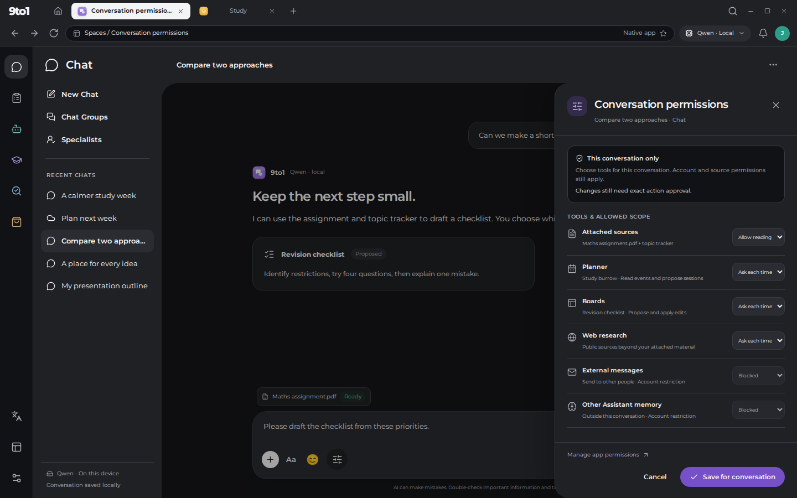

Screen ID: `spaces-permissions`. Source: Owner revision: switch-style permissions icon; Home App API permission broker; UX27-SPACES-005–007; LE-06 approval policy.

- The separate SlidersHorizontal icon opens this drawer. Spaces does not show the editor Read-only/Write segmented control; the action stack remains separate and icon-only.
- These controls apply to the current conversation and can narrow inherited account/tool grants. They cannot widen blocked account grants, source ACLs, delegated roles or device policy.
- Each tool exposes its effective allowed scope. Read access, proposal generation and mutation permission remain distinct; a model’s prose or attachment cannot authorise an action.
- Consequential work still uses exact per-action approval and Home’s permission broker. Existing scoped caller trust is managed in Settings, not silently created here.
- Cancel leaves scope unchanged. Save applies only to future requests in this conversation. Focus is contained in the drawer; Escape or Close restores focus to the permission icon.

## Spaces · Native emoji picker

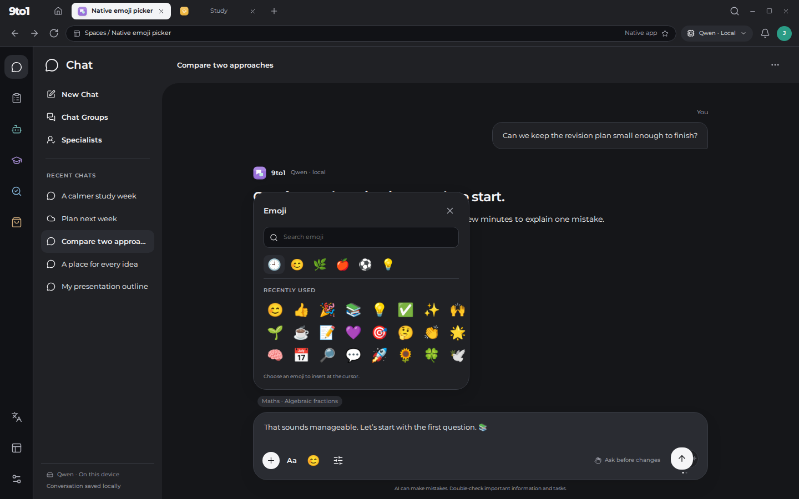

Screen ID: `spaces-emoji`. Source: Owner revision: native device emoji; PPT slides 11–13 focused composer; UX27-SPACES-005.

- Emoji are Unicode text rendered by the device font stack: Apple Color Emoji, Segoe UI Emoji and Noto Color Emoji. No custom-drawn glyphs, sprite sheets or embedded emoji artwork are used.
- The emoji button appears only while the composer is focused and expanded. Insertion edits the retained draft at its selection; it does not send a message.
- Search, category controls and emoji cells have accessible names. Native OS emoji-picker integration may be offered without changing the stored Unicode sequence.
- The separate permissions icon and rounded icon-only action stack remain in fixed positions. Emoji selection must not shift or activate Send.
- Escape dismisses the picker and restores the draft selection; native variation selectors and skin-tone sequences round-trip unchanged.

## Spaces · Conversation

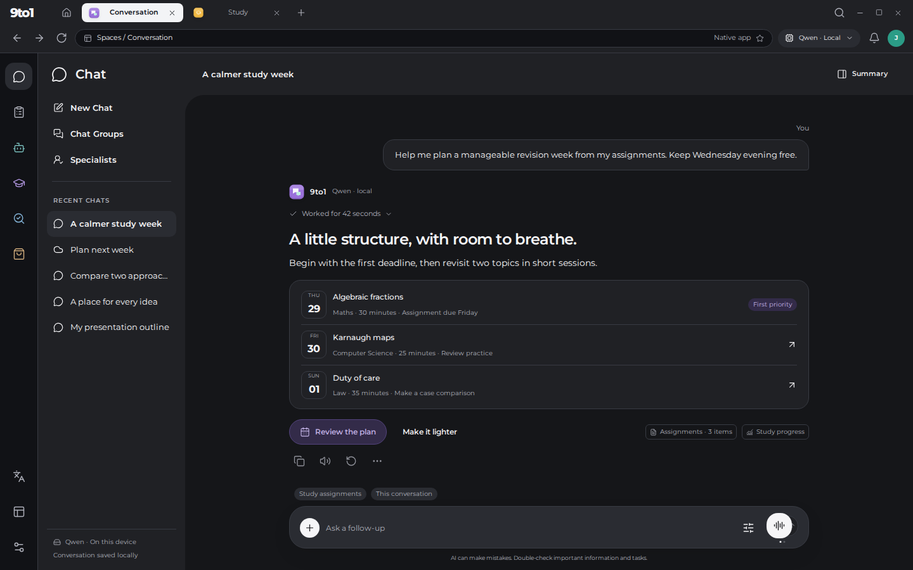

Screen ID: `spaces-chat`. Source: PPT slides 8, 10–14; UX27-SPACES-001, 005–006; LE-03–06.

- The mini-rail selects a Space directly and preserves its contextual sidebar and draft. The permanent chat area follows current slide 10, not the older blue-gradient shell.
- Normal messages, completed work, source links and per-message actions have distinct hierarchy. A deliberate scroll-up must survive streaming.
- The compact composer has a separate switch-style Conversation permissions icon. Aa and native device emoji appear only while focused and expanded. The rounded action stack is icon-only, labelled accessibly, and browses without executing.
- Selected model effort is distinct from allowance. A local model has no provider allowance meter.
- All documents and progress figures here are illustrative mock-up content.

## Spaces · Draft and contextual shelf

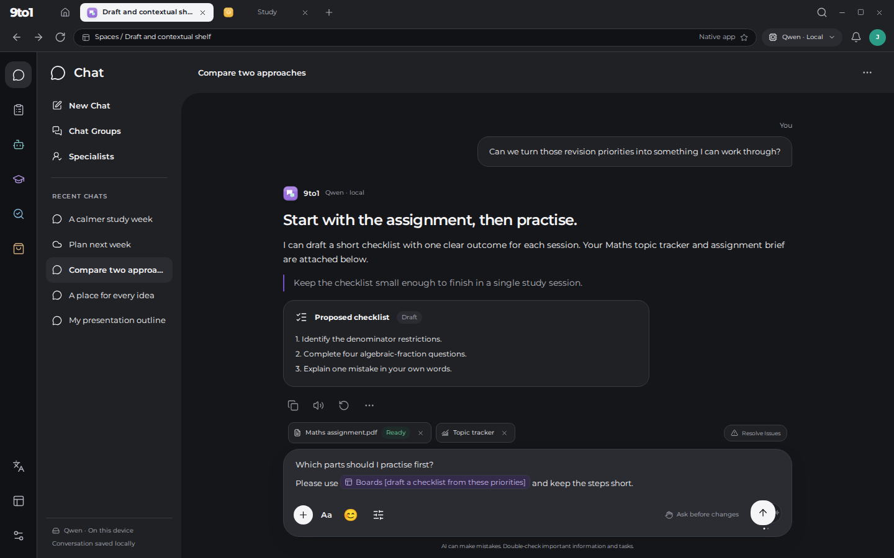

Screen ID: `spaces-compose`. Source: PPT slides 11–13; UX27-SPACES-002–005; UX27-SPACES-010; structured inline command amendment.

- A nonempty draft expands upward and retains the same editable text across Space changes. Attachments have readiness and remove controls.
- Only the bounded app mention and its instruction use the inline command treatment. Surrounding prose remains ordinary text. A mention alone does not execute.
- Idle nonempty shelf contains Send and Voice. The visible item, peeking next item and position dots describe browsing, not queued work.
- Conversation permissions expose effective tools and scope. They cannot widen account grants or replace explicit approval for a consequential action.
- This screen shows the focused, expanded state. Aa and emoji appear only in that state; attachments and the separate permissions icon remain available when compact. Emoji use the device font, not an image pack.

## Spaces · Attach menu

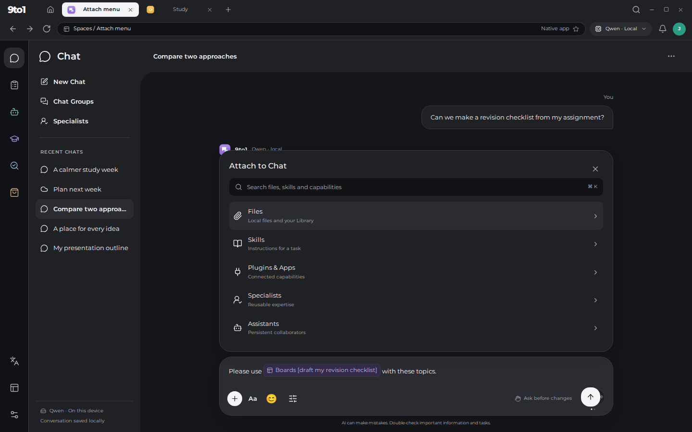

Screen ID: `spaces-attachments`. Source: PPT slide 14; UX27-SPACES-005; UX27-SHARED-009–010.

- The popover is anchored above the focused, expanded composer. Aa and emoji are shown for that state, and current draft and attachment context are retained.
- Files, Skills, Plugins & Apps, Specialists and Assistants are distinct categories, matching current slide 14.
- Search supports capability discovery. Browsing and attaching are separate from execution; choosing a capability does not activate it.
- Escape, outside click and Space navigation dismiss the popover and return focus appropriately.
- On narrow screens the menu stays within the viewport, with vertical internal scrolling and reachable Close.

## Tasks · Run summary and approval

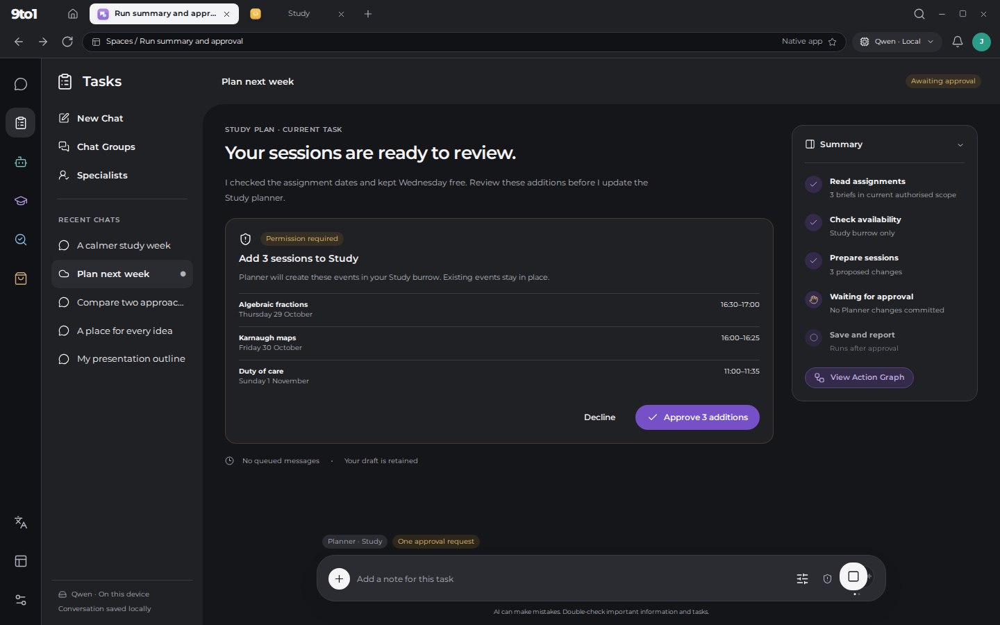

Screen ID: `spaces-running`. Source: UX27-SPACES-002–004, 007; Tasks built-in Space contract; canonical Action Graph and approval rules.

- Tasks is a structured Space, distinct from recurring Automations. Summary stays at the top right and accesses the same canonical Action Graph.
- The three sessions are proposed changes. The run is held pending the exact Planner approval; no task is marked committed yet.
- Approval is confined to this request and preview. Decline, inspect and stop remain visible. A composer shelf control cannot implicitly approve.
- Working, completed preparation, permission hold and saved output use distinct labels. A completed research step is not accepted output.
- The queue count is admission state, distinct from the visible action shelf.

## Spaces · Specialists

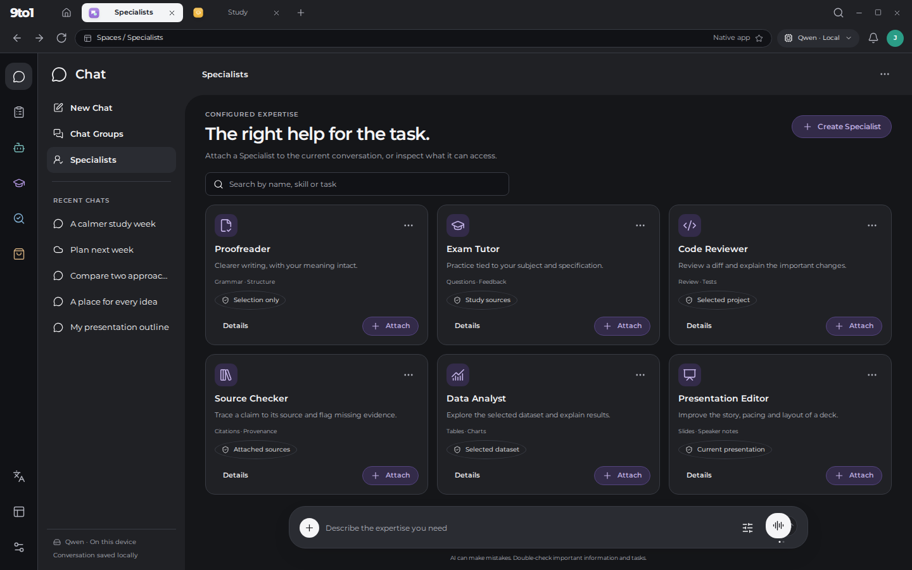

Screen ID: `spaces-specialists`. Source: PPT slide 15 selected state; Specialists scope amendment; UX27-SPACES-005, 008, 013.

- Specialists are job-defined reusable configured expertise, separate from persistent Assistants and generic delegated workers.
- This screen completes the content area left blank by slide 15 while preserving its selected local-sidebar row.
- Each Specialist exposes intended use, scope and permission policy before attaching. Attachment alone does not run a job.
- Configuration is owned by the corresponding AI Studio definition; do not manufacture a parallel agent runtime.
- Search and capability chips remain useful at narrow widths.

## Assistants · Persistent collaborators

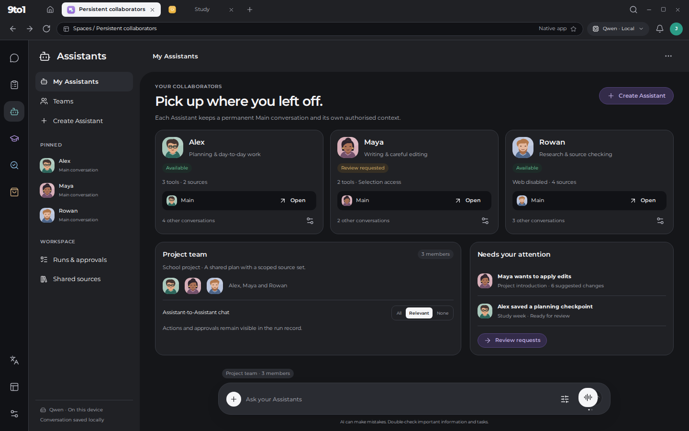

Screen ID: `spaces-assistants`. Source: Owner revision: persistent illustrated identity; UX27-AUTH-002; UX27-SPACES-013; Assistant thread and team contracts.

- This Space is a conversation view of the global Assistants system. Each sidebar row, roster card and Main conversation repeats the same persistent Assistant portrait, name and identity. These three illustrated portraits are original mock-up identities.
- Main is visually distinct from secondary threads. Spaces and Assistant views open the same canonical conversation; renaming never replaces the identity.
- Team chat visibility offers All, Relevant and None. This filters presentation, not consequential audit records or permissions.
- Tools, sources and memory belong to the selected Assistant and authorised scope. Membership grants no blanket context access.
- Build/configuration actions route to AI Studio. The separate composer permissions icon opens conversation scope; it is not an editor Read-only/Write control.

## Assistants · Alex Main

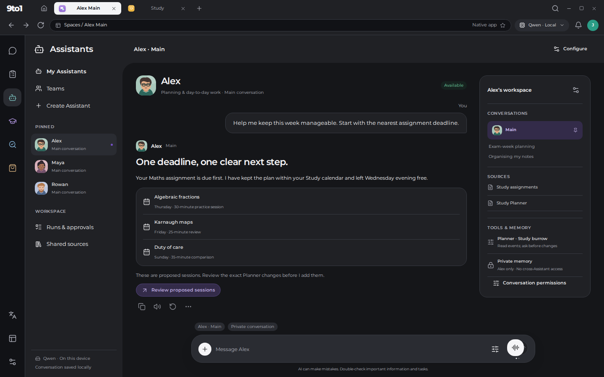

Screen ID: `spaces-assistant-alex`. Source: Owner revision: distinct Assistant avatars; UX27-SPACES-013; canonical AgentID and Main conversation contract.

- The selected Assistant has the same authored portrait in pinned navigation, header, response attribution and team roster. The avatar is an identity asset, not the app icon or a generic chat symbol.
- Main is permanent; secondary threads retain independent conversations under the same Agent identity. Names and artwork can change without replacing canonical IDs.
- The scope inspector exposes this Assistant’s sources, tool access and memory boundary. Conversation membership does not expose other Assistants’ private memory.
- Proposals, saved checkpoints and approvals remain distinct. Opening a review does not approve the proposed changes.
- Composer permissions are conversation-scoped; lasting Assistant configuration opens in AI Studio.

## Assistants · Maya Main

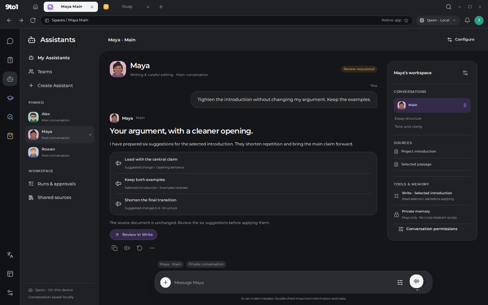

Screen ID: `spaces-assistant-maya`. Source: Owner revision: distinct Assistant avatars; UX27-SPACES-013; canonical AgentID and Main conversation contract.

- The selected Assistant has the same authored portrait in pinned navigation, header, response attribution and team roster. The avatar is an identity asset, not the app icon or a generic chat symbol.
- Main is permanent; secondary threads retain independent conversations under the same Agent identity. Names and artwork can change without replacing canonical IDs.
- The scope inspector exposes this Assistant’s sources, tool access and memory boundary. Conversation membership does not expose other Assistants’ private memory.
- Proposals, saved checkpoints and approvals remain distinct. Opening a review does not approve the proposed changes.
- Composer permissions are conversation-scoped; lasting Assistant configuration opens in AI Studio.

## Assistants · Rowan Main

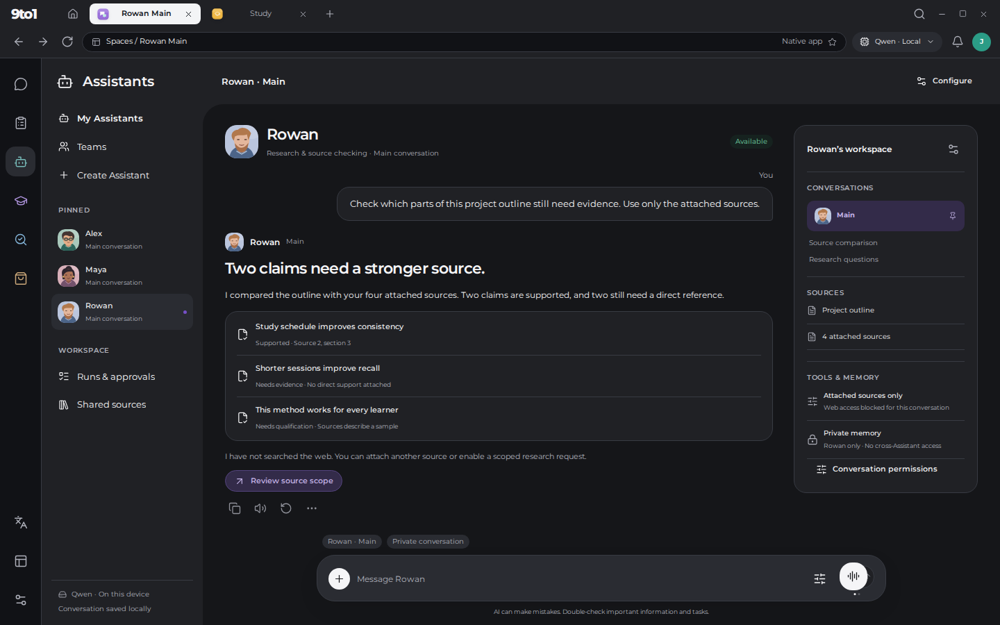

Screen ID: `spaces-assistant-rowan`. Source: Owner revision: distinct Assistant avatars; UX27-SPACES-013; canonical AgentID and Main conversation contract.

- The selected Assistant has the same authored portrait in pinned navigation, header, response attribution and team roster. The avatar is an identity asset, not the app icon or a generic chat symbol.
- Main is permanent; secondary threads retain independent conversations under the same Agent identity. Names and artwork can change without replacing canonical IDs.
- The scope inspector exposes this Assistant’s sources, tool access and memory boundary. Conversation membership does not expose other Assistants’ private memory.
- Proposals, saved checkpoints and approvals remain distinct. Opening a review does not approve the proposed changes.
- Composer permissions are conversation-scoped; lasting Assistant configuration opens in AI Studio.

## Study · Learning dashboard

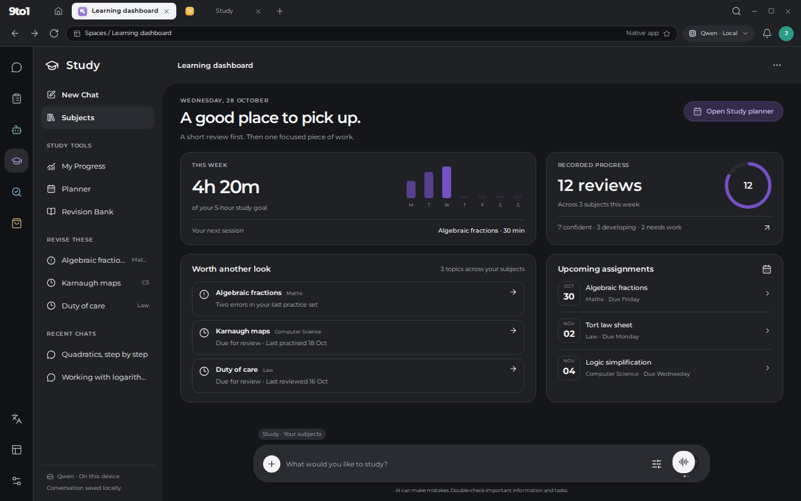

Screen ID: `spaces-study`. Source: UX27-SPACES-012; LE-08–09; older PPT slides 24–28 authorised for Study concepts only.

- The default Study sidebar has New Chat, Subjects, My Progress, Planner, Revision Bank, three shared Revise These slots and recent chats.
- Weekly time and streak-like engagement measures are not mastery. Proficiency comes from attributed answers and card ratings.
- Revise These contains at most three topics across all subjects, ranked from recorded difficulty and review dates with reasons.
- Planner opens the canonical Study burrow. Revision materials reference owning-app artifacts and open in their real viewer.
- The older Study dashboard contributes information architecture only; all chrome and treatments use the current theme.

## Study · Maths topic tracker

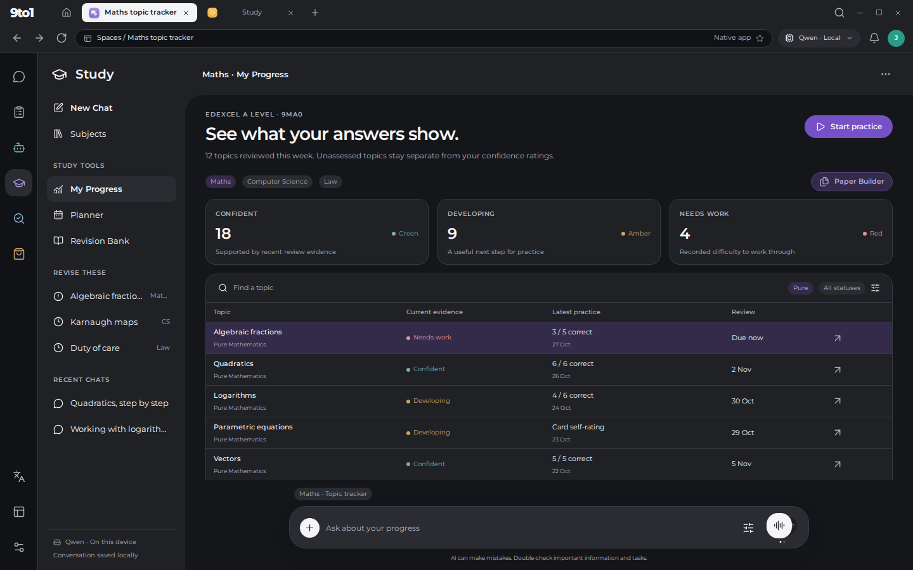

Screen ID: `study-subject`. Source: STUDY-UI-217–220; UX27-SPACES-012; LE-08; older PPT slides 26–27 authorised for Study concepts only.

- RAG values describe recorded review evidence. Never label an unassessed topic weak or mastered.
- Subject, topic and paper/specification links remain stable when labels change. The row opens a topic-bound chat.
- Progress and review dates remain separate columns. Evidence is accessible rather than implied by a coloured dot alone.
- The subject dashboard retains topic navigation, practice and paper-builder access without creating a second content store.
- Topic scores shown are illustrative attributed practice results.

## Study · Lesson and Revision Bank

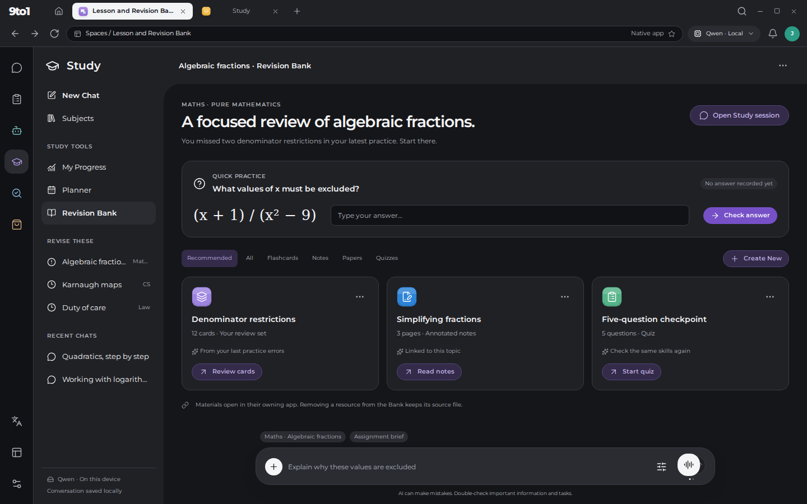

Screen ID: `study-topic`. Source: UX27-SPACES-012; LE-08–10; Revision Bank; older PPT slide 28 conceptual reference.

- The Revision Bank category row has Recommended, All, Flashcards, Notes, Papers, Quizzes and right-aligned + Create New.
- Resource cards reference canonical Cards, Forms and Write artifacts. View/interact is the default; editing and Open in App are explicit.
- Recommended resources state the evidence-based reason and do not reveal unrelated private artifacts.
- Practice feedback only changes progress after the user submits an actual answer. Displaying a lesson does not record mastery.
- Source-linked topic context is carried into chat and the AI composer.

## Study · Session modes and source policy

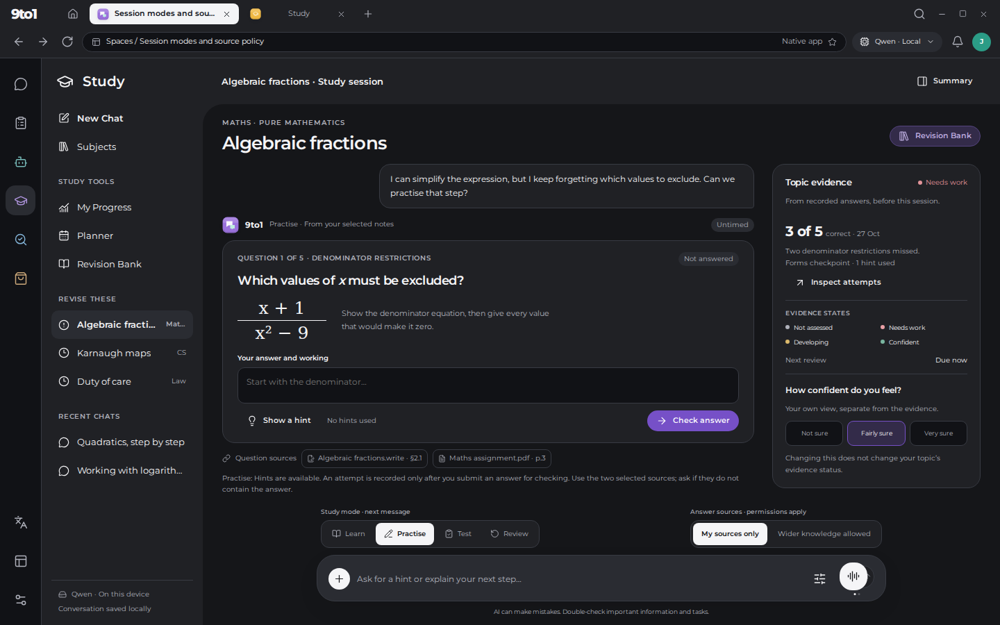

Screen ID: `study-session`. Source: Study Space detailed interface specification, effective 13 October 2026: STUDY-UI-202, 205, 210–220; LE-08–10; UX27-SPACES-005–007.

- The contextual Learn / Practise / Test / Review selector changes the next request in this same Study session. Preserve ConversationID, message history, TopicID, selected sources, answer draft and meaningful mode-transition provenance.
- Practise records a real submitted attempt with question/source reference, working, feedback, marking provenance and hint conditions. This displayed question is unanswered; no new proficiency or completed review is implied. Learn worked examples and Review page opens or card flips are not assessed evidence.
- Test uses the canonical Forms Test/Quiz assessment engine with inspectable rules, rubric and supported marking policy. Choosing Test alone does not start a timer, fabricate a grade or copy the assessment into a private Study database.
- My sources only applies the configured closed-corpus policy. Wider knowledge allowed distinguishes authorised supplied material, external research and general explanation; citations cannot be fabricated and higher-priority web/account permissions still apply. Switching cannot rewrite the provenance of earlier answers.
- Topic proficiency uses Not assessed, Needs work, Developing and Confident. It derives from attributed evidence and review rules. The separate self-reported confidence control never silently changes demonstrated proficiency or another learner’s private records.
- The current Study wrapper, shared model/effort route, conversation-permissions icon and rounded icon-only Send/Voice shelf remain in place. Voice and multimodal capture use the shared Vision & Voice APIs. Local selectors in this reference preserve the draft and do not execute or mark an answer.

## Research · Plan, sources and outputs

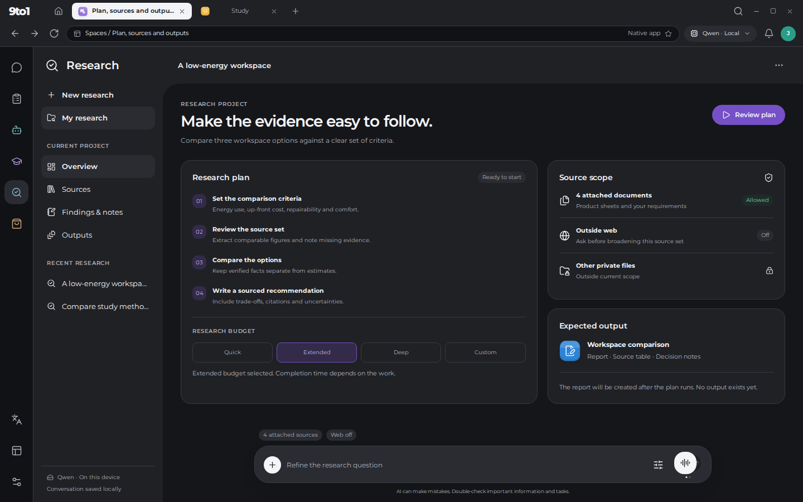

Screen ID: `spaces-research`. Source: UX27-SPACES-012; Research built-in Space contract; canonical source and artifact model.

- Research is a typed environment with plan, source scope, run status and outputs alongside conversation.
- Quick, Extended, Deep and Custom are supported budget choices. Duration is a budget, not an execution-time promise.
- Outside-web access is explicit and separate from attached sources. Research cannot silently broaden permission scope.
- A report is a canonical Write artifact, not a private copy of its content. Source citations and missing evidence survive export.
- Plan steps and status reflect the actual run; no decorative fake progress.

## Shopping · Requirements and comparison

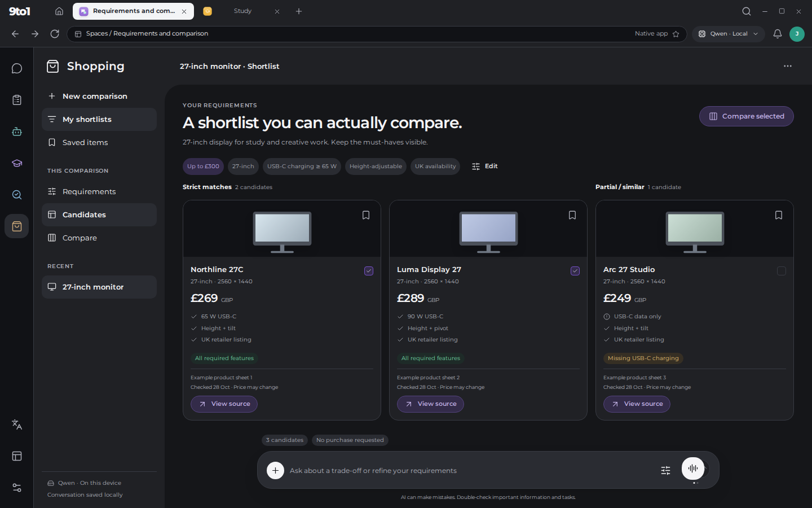

Screen ID: `spaces-shopping`. Source: UX27-SPACES-012; Shopping built-in Space contract; source/provenance rules.

- Strict matches, partial/similar matches and contextual suggestions are separate categories with explicit reasons.
- Each candidate retains currency, source and last-check state. Fictional products and example prices here are mock-up content, not live recommendations.
- Constraint mismatches remain visible. An adjacent or promoted product cannot silently replace a strict match.
- Saving, comparing and purchasing have separate actions. No selection or AI response authorises a purchase.
- The Shopping Space has requirements, shortlists and comparison workflows, not a copied Study dashboard.

## Spaces · Settings and permission scope

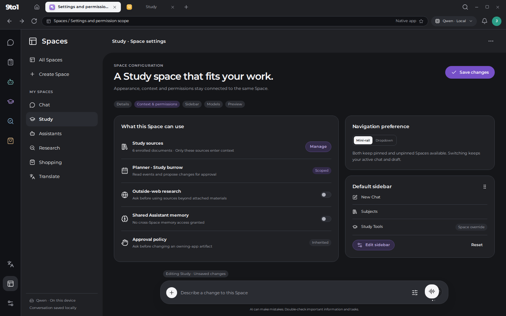

Screen ID: `spaces-manage`. Source: UX27-SPACES-001, 008; LE-03, LE-05; Space override and permission precedence.

- Space configuration is reached deliberately. Selecting a Space still opens its actual conversation directly.
- Configuration precedence is Space Override, User Preference, Default; policy limits every level. Locked values show their source.
- The sidebar editor references stable sections and targets. Removing organisation never deletes chats or source documents.
- Source visibility and actual permission remain separate. Scope editing does not grant arbitrary action execution.
- Preview and edit address the same SpaceID; changing names or rail position preserves identity.

## Translate · Conversational localisation

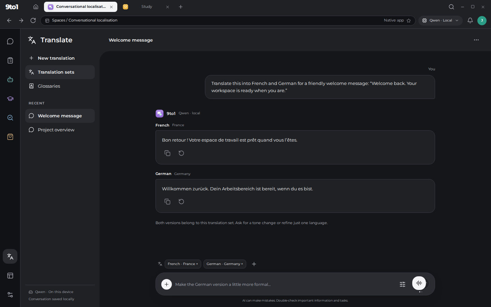

Screen ID: `spaces-translate`. Source: Translate built-in Space contract; TranslationSet and variants; Dulche Translate amendment.

- Translate uses the normal Space conversation. It is not a two-box translator app.
- The persistent target-language set sits immediately above the standard composer. Do not add a separate Translate context row.
- Each target language has a separate assistant bubble labelled directly above it. Variants remain siblings of one canonical TranslationSet.
- A refinement targets a language variant without discarding the others. Publishing or replacing a source is a separate authorised owning-app action.
- Target-language changes persist with the conversation and draft.

## Spaces · Generated interactive planner

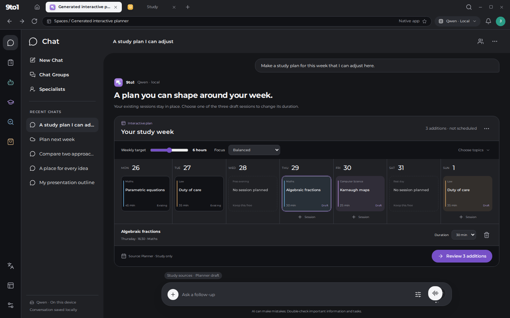

Screen ID: `spaces-generative-ui`. Source: Owner revision 28 October; Dulche generative UI and delegation; UX27-SPACES-001–014; CUI typed components and artifact ownership.

- An interactive generated result stays inline with its conversation and exposes its current data source and unsaved draft state. Monday and Tuesday are existing past sessions, read-only in this proposal; only Thursday, Friday and Sunday are additions.
- Changing a slider or selecting a session edits a local proposal. Save to Planner opens the exact change review and does not imply approval.
- Generated controls have accessible labels, keyboard focus, empty/loading/failure states and a stable UI schema for restoration.
- Generated interfaces use the CUI typed component and command model. The model cannot inject arbitrary executable UI or bypass app permissions.
- Generated views bind to canonical owning-app entities. A chart, form, calendar or artifact preview never becomes an independent hidden copy.
- State transitions, elapsed time, completed work and created file results are supplied by the real runtime. The values here are fixtures.

## Spaces · Thinking and visible activity

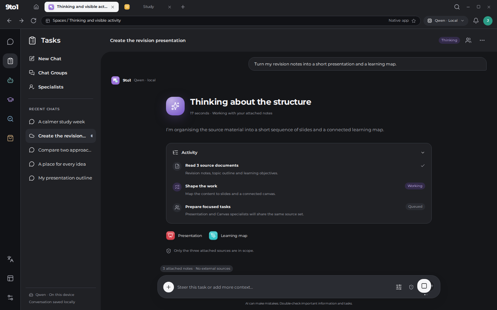

Screen ID: `spaces-thinking`. Source: Owner revision 28 October; Dulche generative UI and delegation; UX27-SPACES-001–014; CUI typed components and artifact ownership.

- Thinking has a clear active state, elapsed time and interrupt controls. It never displays a fabricated answer or completed artifact while work is pending.
- The expandable activity area shows a concise task summary and tool/status events. Private internal reasoning is not part of the UI contract.
- A retained composer supports steer, queue and stop; stopping preserves committed work and a resumable record where supported.
- Generated interfaces use the CUI typed component and command model. The model cannot inject arbitrary executable UI or bypass app permissions.
- Generated views bind to canonical owning-app entities. A chart, form, calendar or artifact preview never becomes an independent hidden copy.
- State transitions, elapsed time, completed work and created file results are supplied by the real runtime. The values here are fixtures.

## Spaces · Coordinated subagents

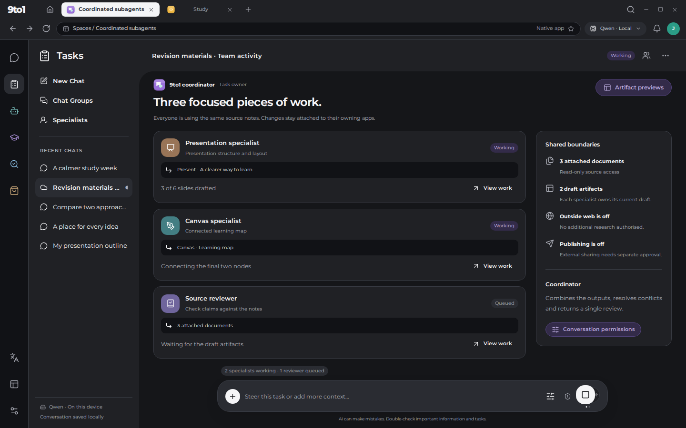

Screen ID: `spaces-subagents`. Source: Owner revision 28 October; Dulche generative UI and delegation; UX27-SPACES-001–014; CUI typed components and artifact ownership.

- The coordinator and each subagent have visible identity, responsibility, scope, state and owned output. A subagent is a real run with a stable parent relationship.
- Delegated permissions are the intersection of the parent grant, agent capability and current app policy. Delegation cannot widen access.
- Independent work can progress in parallel. Cancel, retry and review are scoped to the selected agent; completed sibling work remains intact.
- Visible activity summaries report work and tool events rather than private reasoning traces.
- Generated interfaces use the CUI typed component and command model. The model cannot inject arbitrary executable UI or bypass app permissions.
- Generated views bind to canonical owning-app entities. A chart, form, calendar or artifact preview never becomes an independent hidden copy.
- State transitions, elapsed time, completed work and created file results are supplied by the real runtime. The values here are fixtures.

## Spaces · Subagent scope and activity

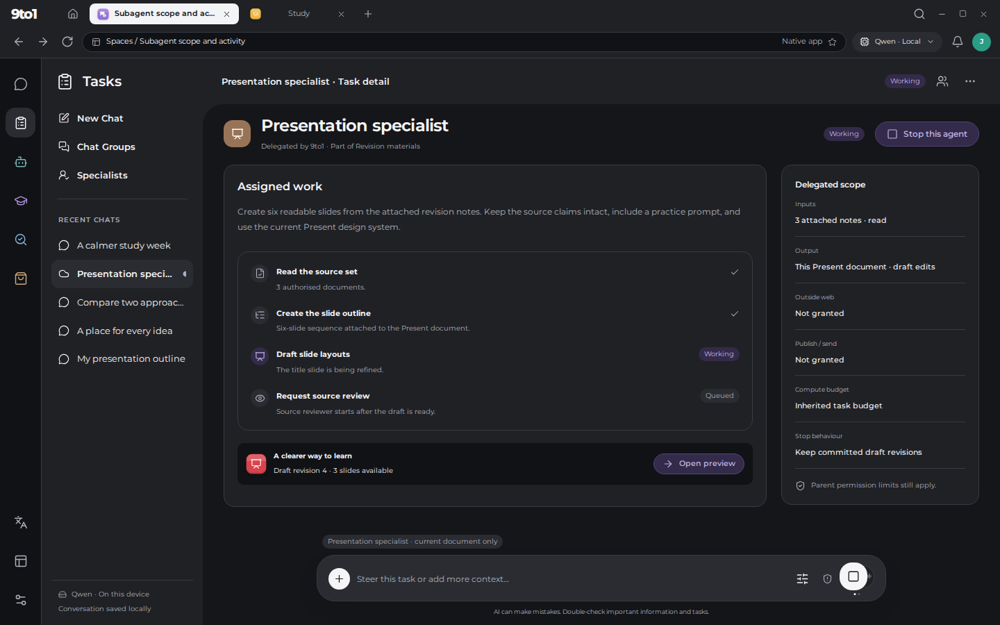

Screen ID: `spaces-subagent-detail`. Source: Owner revision 28 October; Dulche generative UI and delegation; UX27-SPACES-001–014; CUI typed components and artifact ownership.

- Agent detail exposes the delegated brief, granted inputs, allowed outputs, budget and public activity events.
- The user can stop this agent without stopping unrelated sibling work. Retry is attached to the same task with an explicit new run record.
- Artifacts and source references use canonical IDs; the agent may not acquire another agent’s write scope silently.
- Generated interfaces use the CUI typed component and command model. The model cannot inject arbitrary executable UI or bypass app permissions.
- Generated views bind to canonical owning-app entities. A chart, form, calendar or artifact preview never becomes an independent hidden copy.
- State transitions, elapsed time, completed work and created file results are supplied by the real runtime. The values here are fixtures.

## Spaces · Presentation work in progress

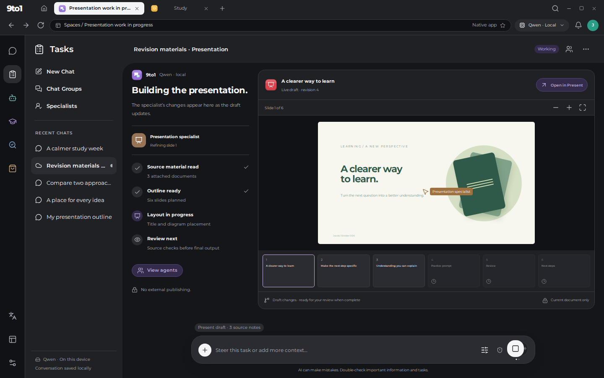

Screen ID: `spaces-present-working`. Source: Owner revision 28 October; Dulche generative UI and delegation; UX27-SPACES-001–014; CUI typed components and artifact ownership.

- Spaces displays the actual Present scene as a live canonical artifact preview, including slide count, revision, selection and responsible collaborator.
- Preview updates stream committed draft revisions; an in-progress frame is not a claim that the entire presentation is complete.
- Open in Present retains the same document and work session. Steer/Stop affects the current run while preserving durable edits.
- Pending slides remain visibly pending. Reviewer activity and completed output are distinct stages.
- Generated interfaces use the CUI typed component and command model. The model cannot inject arbitrary executable UI or bypass app permissions.
- Generated views bind to canonical owning-app entities. A chart, form, calendar or artifact preview never becomes an independent hidden copy.
- State transitions, elapsed time, completed work and created file results are supplied by the real runtime. The values here are fixtures.

## Spaces · Canvas work in progress

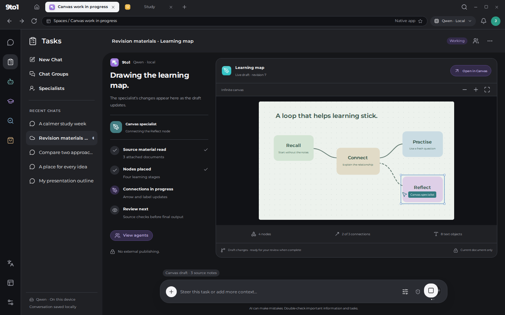

Screen ID: `spaces-canvas-working`. Source: Owner revision 28 October; Dulche generative UI and delegation; UX27-SPACES-001–014; CUI typed components and artifact ownership.

- Canvas work uses the same scene, object IDs, coordinates and undo history as the canonical Canvas artifact.
- The preview shows the specialist’s active object and cursor identity, as well as partial connections and object counts.
- Other users can observe and steer without taking over the same object implicitly. Concurrent edits require clear ownership and conflict handling.
- Generated interfaces use the CUI typed component and command model. The model cannot inject arbitrary executable UI or bypass app permissions.
- Generated views bind to canonical owning-app entities. A chart, form, calendar or artifact preview never becomes an independent hidden copy.
- State transitions, elapsed time, completed work and created file results are supplied by the real runtime. The values here are fixtures.

## Spaces · Generated files and outputs

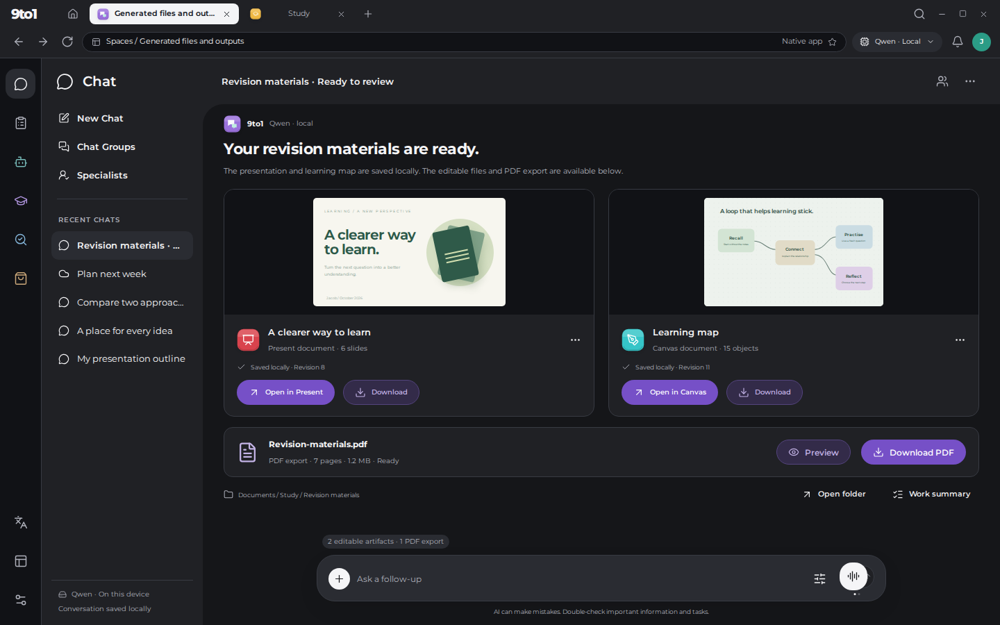

Screen ID: `spaces-generated-files`. Source: Owner revision 28 October; Dulche generative UI and delegation; UX27-SPACES-001–014; CUI typed components and artifact ownership.

- A completed file result appears only after the owning app returns a durable artifact and a verified output receipt.
- Each result includes identity, type, revision, local/sync state and Open/Download actions. Exported files and editable native artifacts remain distinct.
- Open delegates to the owning app; Download addresses the existing bytes. Neither action generates a new artifact silently.
- If export is pending or fails, its card keeps that state and recovery action rather than claiming Ready.
- Generated interfaces use the CUI typed component and command model. The model cannot inject arbitrary executable UI or bypass app permissions.
- Generated views bind to canonical owning-app entities. A chart, form, calendar or artifact preview never becomes an independent hidden copy.
- State transitions, elapsed time, completed work and created file results are supplied by the real runtime. The values here are fixtures.

## Spaces · Export failure and recovery

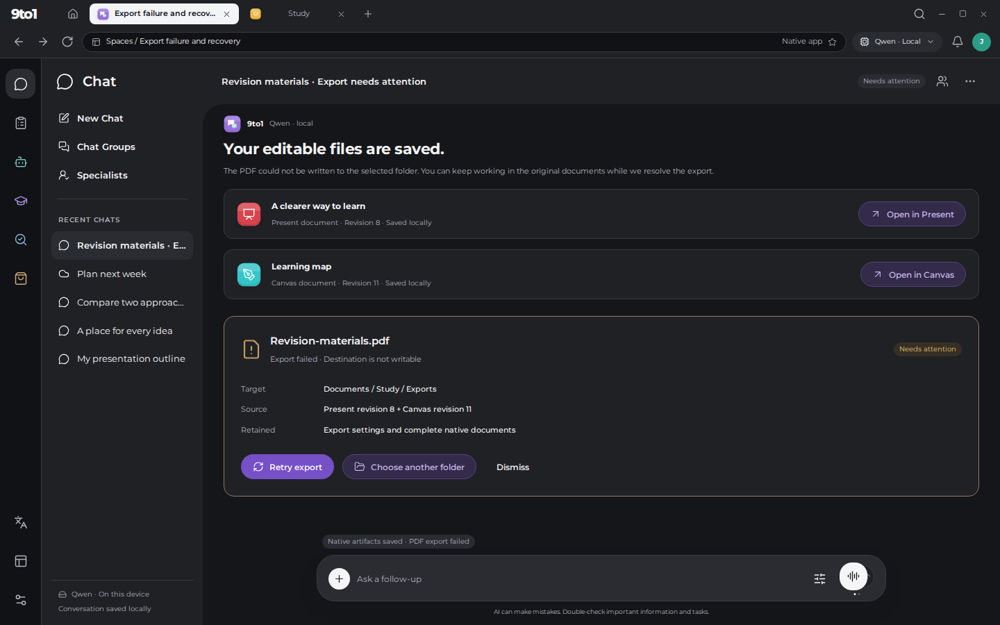

Screen ID: `spaces-export-recovery`. Source: Owner revision 28 October; Dulche generative UI and delegation; UX27-SPACES-001–014; CUI typed components and artifact ownership.

- An export failure is scoped to the export. The successfully saved native artifacts remain available and unchanged.
- The failed result retains format, target path, error and retry/save-copy actions. Retry operates on the same chosen document revision.
- An action receipt reports real status. The interface must never show Download ready for missing or incomplete bytes.
- Generated interfaces use the CUI typed component and command model. The model cannot inject arbitrary executable UI or bypass app permissions.
- Generated views bind to canonical owning-app entities. A chart, form, calendar or artifact preview never becomes an independent hidden copy.
- State transitions, elapsed time, completed work and created file results are supplied by the real runtime. The values here are fixtures.

## Spaces · Experiences

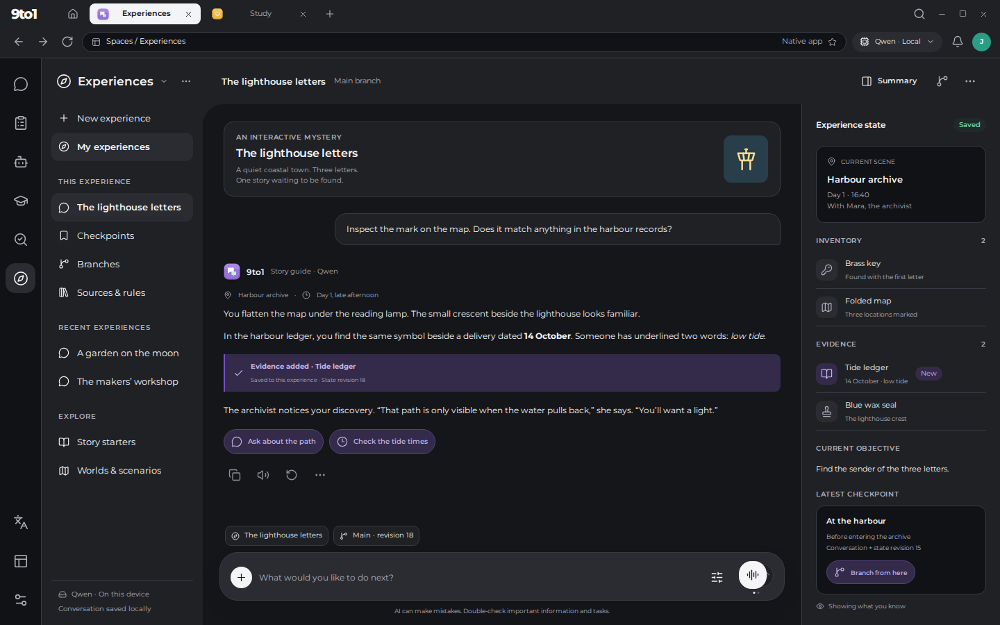

Screen ID: `spaces-experiences`. Source: Spaces / First-party Spaces / Experiences (canonical experience state, checkpoints and branching); UX27-SPACES-001–014; UX27-OTHER-016; PPT slides 8–15 (conversation shell).

- The normal Space conversation remains the primary interaction surface. Inventory, evidence and scene panels represent canonical Experience state rather than a separate hidden game runtime.
- Narrated state changes become usable only after the corresponding structured transition commits. The evidence-added event and State revision 18 indicate the same committed transition.
- Checkpoint branching preserves both conversation history and matching Experience-state revision; the original timeline remains intact. Rewind cannot undo already completed external actions.
- Visible state follows the experience and character visibility policy. Private clues, unknown character knowledge and hidden outcomes must not leak through side panels or generated UI.
- Experiences supports open-ended stories, roleplay, simulations and mysteries. Formal contestant, round and scoring state belongs to Play; age-appropriate controls and normal Space permissions remain in force.
- The shared Spaces composer uses the separate conversation-permissions switch and rounded icon-only action stack. It retains the same draft and current experience context.

## Mobile · Spaces conversation

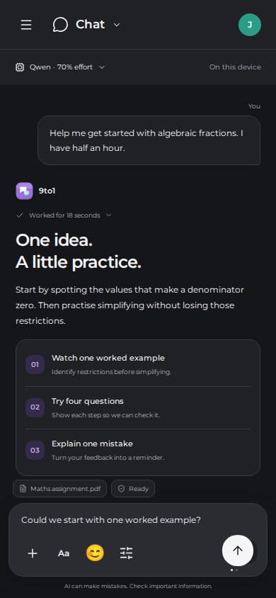

Screen ID: `mobile-chat`. Source: PPT slides 10–14 adapted to narrow viewport; UX27-SPACES-001–006, 010; UX27-SHARED-003, 010.

- This is a narrow layout, not a scaled desktop canvas. Space navigation moves to a named drawer while the conversation uses the full width.
- Header shows a model and explicitly labelled effort. Provider allowance remains separate; this local route has no allowance meter.
- This composer is focused and expanded, so Aa and emoji are visible. The separate Conversation permissions icon opens tool scope. The rounded Send/Voice stack is icon-only and labelled accessibly; browsing never activates it. Emoji use the device font.
- Touch controls have a 44-pixel effective target. Composer docking respects the visual viewport, on-screen keyboard and safe area; it must not cover the active caret or send control.
- Opening navigation retains the draft and selected context. Closing it returns focus to the initiating control.

## Mobile · Study dashboard

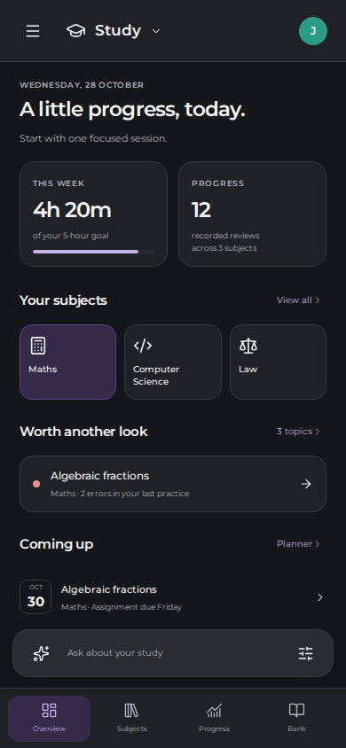

Screen ID: `mobile-study`. Source: LE-08–09; UX27-SPACES-012; older Study slides 24–28 authorised as conceptual inspiration only.

- Narrow navigation exposes Overview, Subjects, Progress and Bank as touch targets; Planner and the full context sidebar remain available through the menu.
- Subject cards open their subject tracker, whose topic rows open topic-bound practice. These links preserve canonical SubjectID and TopicID.
- Study time is separate from recorded progress. Recommendations retain their evidence and there are at most three across all subjects.
- The composer opens above the on-screen keyboard with a resizable scroll area and safe-area padding. The bottom navigation must not overlap the composer.
- Assignments open the canonical Study Planner burrow; Revision Bank resources open in their owning app.

## Mobile · Conversation permissions

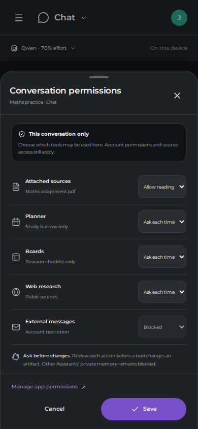

Screen ID: `mobile-permissions`. Source: Owner revision: Spaces permissions icon; Home App API permissions; UX27-SPACES-005–007; UX27-SHARED-010.

- The separate switch-style composer icon opens a bottom sheet on narrow screens. Spaces has no Read-only/Write segmented control; editor AI modes are unaffected.
- The sheet exposes per-tool effective scope and only narrows inherited account grants. Blocked external-send and private-memory access cannot be silently enabled by a conversation override.
- Changes still require exact action approval before execution. Save applies conversation preferences to future requests; it is separate from granting a lasting caller trust level.
- Touch controls and selects have at least 44-pixel targets. The body scrolls independently while Close, Cancel and Save remain reachable; safe-area padding applies at the bottom.
- Dismiss restores the same draft, context and focus. This phone state and the desktop drawer represent the same permission model.
