# Spaces — conversations, workspaces and custom Space Builder

Module ID: `spaces` · 9to1 Development Specification v3

## Prerequisites

- **CUI, themes and shared interaction system** — Typed UI components, theme tokens/materials, layout, focus, motion, accessibility and shared control states.
- **Dulche runtime, requests and execution services** — Canonical AI broker, capability-aware routing, durable Task/Runs, action execution and lifecycle.
- **Node Editor — shared graph framework** — Shared typed graph schemas, editing/validation, draft activation and runtime presentation.
- **Global Assistants, Specialists and collaborators** — Persistent global Assistant/Specialist identities, Teams, canonical conversations and editor collaboration.
- **Subagents, delegation and task trees** — Durable delegated task trees, inherited scope, bounded budgets, joins and recovery.
- **Generative UI and live artifact output** — Safe typed generated components, canonical live artifacts and verified durable output/export cards.
- **Artifacts, local persistence and recovery** — Canonical artifacts, revisions, typed edits, local saves, derived exports, sync and recovery.
- **Permissions, approvals and execution scope** — Effective scoped grants, action approvals, policy intersections, revocation and audit.
- **Models, discovery and universal model routing** — Model discovery/lifecycle, stable provider capabilities, ordered routing and truthful usage/effort metadata.
- **Vision & Voice — shared live session system** — Vision & Voice owns real conversational speech, visual context and live translation services, reused by the in-chat Voice pill. Multiple surfaces attach to the same session rather than creating a second speech/capture stack.

## Overview

Spaces is the conversation and task workspace for Chat, Tasks, Study, Assistant conversation views, Research, Shopping, Translate and Experiences, plus user-created Spaces. Each Space has a real domain workflow. Global Assistants/Specialists retain canonical identities outside Spaces, while their conversation views and work remain accessible here. This chapter is a copyable implementation unit; its prerequisite contracts define shared services, and the retained technical chunks preserve the full baseline and confirmed companion.

Current owner overrides: V3-OWNER-001, V3-OWNER-002, V3-OWNER-006, V3-OWNER-008, V3-OWNER-017.

## Layouts & visible states

- **V3-SPACES-LAY-01** — The far-left rail switches stable Space destinations and includes Manage Spaces; support the existing rail/dropdown preference, pinning, reorder and discovery. The contextual sidebar is independently collapsible/customisable with Space Overrides > User Preferences > Default precedence.
- **V3-SPACES-LAY-02** — Preserve active conversation, draft, selection, scroll, voice/session and Task/Run across Space switching. On narrow screens use responsive drawers with a durable reopen affordance rather than squeezing desktop columns.
- **V3-SPACES-LAY-03** — Chat is a Space, not a separate app. Default Chat sidebar sections may include New Chat, Chat Groups, Specialists and Recent Chats; they are defaults, not a fixed mandatory ordering.
- **V3-SPACES-LAY-04** — Keep conversation readable with distinct user/AI provenance. Plain Text/Speech Bubbles and alignment remain preferences. The current Professional wrapper and authoritative slides govern current chrome, not the older later-slide diagrams.
- **V3-SPACES-LAY-05** — The compact/expanded composer has + attachment/resource access, editable draft, focus-aware Aa and native emoji, model/effort context and state-appropriate send/voice controls. Keep attachment/plugin chips identity-backed, inspectable and scoped.
- **V3-SPACES-LAY-06** — Place a Conversation permissions icon in the composer; it is not the editor Read-only/Write switch. Its panel shows files/apps/web/memory scope and links to Manage app permissions.
- **V3-SPACES-LAY-07** — The contextual option shelf shows at most five current choices plus a peek, navigation/dots and truthful selection; browsing choices does not submit the draft.
- **V3-SPACES-LAY-08** — Idle controls expose Send/Voice; an empty disabled Send still permits Voice. Running work exposes Steer, Stop, Queue and Voice as supported; paused work exposes Resume/End Pass and approval-held work shows the actual pending decision.
- **V3-SPACES-LAY-09** — Summary is an optional floating top-right widget with Activity, Outputs and Sources. It must not become a permanent fourth column or shrink the conversation; keep required controls uncovered.
- **V3-SPACES-LAY-10** — Voice mode is a floating icon-first pill within Chat over the same canonical Vision & Voice session. Include mute, screen sharing, camera, captions, pause/resume, end, current voice/mode and more settings with permission indicators.
- **V3-SPACES-LAY-11** — Optional Tab View hosts actual conversations, Browse pages, CUI apps, artifacts and safe GenUI. Spaces itself remains a tab; hiding the strip does not destroy tabs.
- **V3-SPACES-LAY-12** — Show high-level thinking/work summaries, subagent task tree/detail, typed interactive output and live semantic Present/Canvas work. Completed/failed/approval-held states need their own truthful controls and artifact receipts.
- **V3-SPACES-LAY-13** — Generated-file cards show name, owning app, revision, format and durable availability, with Open and eligible Download. Failed export shows the saved native artifacts and targeted retry.
- **V3-SPACES-LAY-14** — Custom Space Builder has freely switchable Basic, Advanced and Expert tabs of one canonical Space. Basic/Advanced use a cohesive borderless configuration document; Expert uses Boards-style navigation for Details, Harness Logic, Model Logic, User Message Logic and Files.
- **V3-SPACES-LAY-15** — Study Home, Subject Workspace and Study Session are separate active views within one Space/navigation scope. Restore the actual conversation/workspace when appropriate; do not stack a dashboard over an inactive editor. The default sidebar is New Chat; Subjects; Study Tools (My Progress, Planner, Revision Bank); Revise These; Recent Chats, under the shared customisation precedence.
- **V3-SPACES-LAY-16** — Study Session exposes the four exact modes Learn, Practise, Test and Review near the standard composer, and a visible source-policy selector: My sources only / Wider knowledge allowed. Subject/topic, mode and policy remain legible without overwhelming the header. Switching mode preserves ConversationID, topic, sources, draft and voice/session state.

## Features & behaviour

- **V3-SPACES-FEA-01** — Submit only after admission succeeds; keep the draft when validation/admission fails. Steer affects future work, Queue preserves the queued message, and Stop reports actual stop acknowledgement rather than rewriting past outputs.
- **V3-SPACES-FEA-02** — Respect per-Space default Steer/Queue policy and Alt+Enter inversion where the companion specifies it. A queued message must not be silently interpreted as a retroactive edit or immediate tool invocation.
- **V3-SPACES-FEA-03** — Resolve +, @ and slash commands through canonical registered resource/invocation inventories. Passive mentions are references; explicit bounded commands execute only through real permission-aware APIs. Rich formatting and per-message Canvas composition preserve original message history.
- **V3-SPACES-FEA-04** — Model effort labels bind directly to supported provider level IDs; they are neither quota nor confidence. Separate context and provider usage metrics, show unknown values honestly and hide inapplicable cloud allowance for local routes.
- **V3-SPACES-FEA-05** — Chat Type and Chat Location are independent dimensions. Types are Normal, Multi-Agent and Temporary; locations are Local, Mesh and Cloud. Model execution location is separately governed from conversation storage.
- **V3-SPACES-FEA-06** — Support approved conversions Temporary→Normal, Temporary→Multi-Agent and Normal→Multi-Agent without replaying tools or fabricating past participant replies. Temporary first becomes a durable local chat; Mesh/Cloud promotion is a separate authorised action. Unapproved reverse conversions are not silently added.
- **V3-SPACES-FEA-07** — Chat Groups contains Group and Project organisation containers, not multi-agent chats and not new Spaces. Both reference canonical member conversations; Group adds shared instructions/relevant authorised context; Project additionally adds Sources, Rules and local/server/remote/cloud resource connections.
- **V3-SPACES-FEA-08** — Group→Project is a one-way supported conversion preserving identity/history/members where safe; Project→Group is rejected. Removing a container does not silently delete its member chats.
- **V3-SPACES-FEA-09** — Tasks defaults to the user’s own relevant task scope with explicit All Tasks filtering. Show objective, plan, steps, dependencies, blockers, approvals, source/outputs, real state and canonical task badges with accessible detail.
- **V3-SPACES-FEA-10** — Study provides dashboard→subjects→subject/topics, source-backed tutor/practice and recorded progress. Revision Bank exposes Recommended, All, Flashcards, Notes, Papers and Quizzes, using Cards and Forms canonical artifacts. The older concept is a rough approved behaviour/layout reference under the current wrapper.
- **V3-SPACES-FEA-11** — Assistant views open the global system’s permanent Main thread, additional conversations, Teams and work. Specialists launch the correct owned/available configured identity. These views do not replace Home/editor access to the global systems.
- **V3-SPACES-FEA-12** — Research moves from initial conversation to reviewable plan, scope, sources and selected deliverables before Start. Quick/Extended/Deep/Custom modes use actual supported budgets; active execution time excludes waiting/paused periods and is not a completion guarantee.
- **V3-SPACES-FEA-13** — Shopping combines natural-language control and conventional filters, distinguishes Required from Preferred constraints and exposes strict matches, alternatives/near matches and contextual recommendations with explicit reasons. Keep products separate from merchant offers, currency/price/freshness/source provenance visible, and purchase actions external and authorised.
- **V3-SPACES-FEA-14** — Translate keeps language chips above the standard composer and one response bubble per target language, linked as sibling outputs in a TranslationSet. Route through real translation/model capabilities.
- **V3-SPACES-FEA-15** — Experiences owns persistent world/scene, character, inventory, evidence, objectives, flags, checkpoints and branching state. Commit validated canonical state before narrating its outcome, enforce hidden-state visibility and retain recoverable checkpoints. Formal competition remains Play’s domain.
- **V3-SPACES-FEA-16** — Basic configures name, description, icon, instructions, supported category availability and resources. Advanced adds Mandatory/Allowed/Blocked/Inherited capabilities, memory, genuine model parameters, Assistant/Specialist defaults, canonical Automations, theme/sidebar/message-control overrides and prompts.
- **V3-SPACES-FEA-17** — Expert reuses the Home-owned Node Editor. Harness Logic configures permitted lifecycle/composer/sidebar/GenUI behaviour; Model Logic configures authorised routes/prompts/parameters; User Message Logic operates on derived representations without rewriting the immutable original message; Files is a real nested resource system.
- **V3-SPACES-FEA-18** — Switching Builder tabs must preserve Expert-only nodes/behaviour and show Expert configurations active where simplified views cannot express it. Preview, Validate and Activate/Create are distinct; invalid drafts never replace the valid active graph. Templates and AI-assisted edits are inspectable starter changes, not implicit installed connections or automatic publication.
- **V3-SPACES-FEA-19** — Typed GenUI is safely schema-bound and stateful. Open in App retains canonical identity. Live artifact work uses the owning app’s semantic edit APIs and any required review/approval rather than raw pointer simulation.
- **V3-SPACES-FEA-20** — Subagent activity exposes delegation objective, current state, scope, blockers, outputs and high-level work events. Useful thinking summaries may show observed steps/tools/evidence but never private internal reasoning.
- **V3-SPACES-FEA-21** — Study proficiency uses the four explicit labels Not assessed (neutral), Needs work (red), Developing (amber) and Confident (green), backed by attributable attempts and documented rules. Keep self-reported confidence separate from demonstrated proficiency; opening a lesson or flipping a card is not mastery evidence. Revise These ranks at most three distinct topics across all subjects using weak-first, then overdue/oldest-reviewed and stable TopicID ties, with an intelligible reason; unassessed is not weak.
- **V3-SPACES-FEA-22** — Learn provides guided explanation; Practise records actual answers/working, hints and feedback; Test uses canonical Forms assessments with rubric/timing/provenance; Review uses recorded due/weak topics and Cards attempts. My sources only enforces the configured closed corpus and never fabricates citations. Revision Bank opens the real owning-app viewer/interactor with explicit Edit/Open in App; Study scheduling uses one canonical Planner Study burrow and proposes authorised review events rather than silently creating them.

## Canonical entities & persistence

- **V3-SPACES-ENT-01** — Persist SpaceID, configuration Draft/Active revisions, sidebar item IDs, ConversationID, immutable MessageID/history, group/project IDs and memberships, TabIDs, TaskID/RunID and attachment/source references.
- **V3-SPACES-ENT-02** — Temporary chats remain local and do not automatically create/reinforce durable memory or transfer to Mesh/Cloud. Explicit conversion preserves history where safe. Open questions about optional existing-memory reads remain explicit until the owner resolves them.
- **V3-SPACES-ENT-03** — Storage Local/Mesh/Cloud uses canonical LE-07 entitlement, quota, encryption, device, replication and conflict contracts. Choosing Local storage does not assert local inference.
- **V3-SPACES-ENT-04** — Keep original full conversation history when context is compacted; summaries are derived with source provenance and eligibility. A context-window optimisation must not silently delete messages or output history.
- **V3-SPACES-ENT-05** — Domain records remain owned by their actual apps/services: Cards/Forms study assets, Planner scheduling, Present/Canvas documents, Files resources, Automations triggers and global Assistant identities. Space folders/reference cards do not clone or move those objects.
- **V3-SPACES-ENT-06** — Persist generated output artifacts and verified export manifests by canonical revision. A preview or completion sentence cannot create a downloadable file.
- **V3-SPACES-ENT-07** — User-created Space settings and all three Builder projections share one SpaceID, graph, permissions, resources and history. Source references and imported packages retain canonical owner/version/trust metadata.

## Permissions & recovery

- **V3-SPACES-PER-01** — Conversation permissions narrow current use within durable grants; they cannot elevate app/org policy. Every consequential action still requires its applicable action approval, even if a category is available.
- **V3-SPACES-PER-02** — Voice toggle never silently enables camera/screen sharing. Persistent indicators reflect actual capture; Stop sharing must stop frames reaching the runtime. Open in Vision & Voice preserves the same session.
- **V3-SPACES-PER-03** — Group/Project sharing, multi-agent participation and context retrieval preserve provenance and participant/source permissions. Do not assume detailed turn-taking/human participation policy from the mere presence of a Multi-Agent label where source decisions remain open.
- **V3-SPACES-PER-04** — Builder validates mandatory-but-blocked conflicts, unavailable dependencies, typed ports, cycles/budgets, model capability, CUI safety and effective policy. Imported Skills/Plugins/MCP/models/mini apps are validated through their owners, never auto-trusted by folder membership.
- **V3-SPACES-PER-05** — An invalid generated component preserves prior valid content and offers repair. A failed PDF/export preserves the saved native artifact and retries only that export from the selected revision; repeated retry must not duplicate earlier external effects.
- **V3-SPACES-PER-06** — Tab close/back respects dirty state and preserves background runs. Revoked resources are redacted from cached display/retrieval; unavailable contexts show recoverable state without discarding drafts.
- **V3-SPACES-PER-07** — Peer Review limits count aggregate reviewer active time against measured productive worker active time, not wall-clock waiting or duplicated simultaneous worker clocks. Exhaustion never bypasses a required permission/review gate.

## Acceptance checks

- **V3-SPACES-ACC-01** — Create a Chat, attach a permitted canonical source, type rich content, switch Space/sidebar/tab and return with the same draft/focus. Verify failed admission retains the draft and queued/steered work follows the configured semantics.
- **V3-SPACES-ACC-02** — Test Normal/Multi-Agent/Temporary, all approved conversions, denied reverse conversion, Local/Mesh/Cloud eligibility, temporary memory/transfer restrictions and no tool replay.
- **V3-SPACES-ACC-03** — Create Group and Project containers, share scoped context, convert Group→Project and reject downgrade; remove a container without losing member conversations.
- **V3-SPACES-ACC-04** — Exercise Study topic→tutor/practice→Revision Bank/Cards/Forms, Research review/start/results, Shopping Required/Preferred filtering, Translate sibling language outputs and Experiences checkpoint recovery.
- **V3-SPACES-ACC-05** — Open global Assistant Main work in Spaces and an editor; verify identity, grants and task references match. Exercise a child task blocked on approval, parent cancellation and partial sibling outputs.
- **V3-SPACES-ACC-06** — Interact with a typed GenUI control, watch actual semantic Present/Canvas changes, open the same saved artifact and download only verified bytes. Force export failure and recover without losing native content.
- **V3-SPACES-ACC-07** — Test the floating Summary and Voice pill together with no blocked controls; camera/screen sharing require explicit grant and ending them stops runtime capture. Verify accessible keyboard/touch/narrow layouts and reduced motion.
- **V3-SPACES-ACC-08** — Switch Basic/Advanced/Expert repeatedly after creating Expert-only logic; verify the same SpaceID, graph and draft/active revision, inspectable conflicts, genuine nested resources and safe preview/activation.
- **V3-SPACES-ACC-09** — Use independent real runtime evidence for acceptance. These mock-ups and primary rules do not assert that any Space is complete or that backend acceptance has passed.
- **V3-SPACES-ACC-10** — Exercise all four Study modes in the same conversation, enforce both source policies, inspect Not assessed/Needs work/Developing/Confident evidence, and verify self-confidence does not itself change demonstrated proficiency. Across multiple subjects show no more than three ranked recommendations; open a canonical Forms/Cards resource and a Planner Study-burrow event without duplicate stores or false mastery.

## Exact mock-up and state map

- **Spaces · Conversation permissions** — screen `spaces-permissions`. Scoped permissions drawer.
- **Spaces · Native emoji picker** — screen `spaces-emoji`. Composer edit state.
- **Spaces · Conversation** — screen `spaces-chat`. Core conversation.
- **Spaces · Draft and contextual shelf** — screen `spaces-compose`. Composer.
- **Spaces · Attach menu** — screen `spaces-attachments`. Popover.
- **Tasks · Run summary and approval** — screen `spaces-running`. Run state.
- **Spaces · Specialists** — screen `spaces-specialists`. Configured expertise.
- **Assistants · Persistent collaborators** — screen `spaces-assistants`. Assistant Space.
- **Assistants · Alex Main** — screen `spaces-assistant-alex`. Persistent Main thread.
- **Assistants · Maya Main** — screen `spaces-assistant-maya`. Persistent Main thread.
- **Assistants · Rowan Main** — screen `spaces-assistant-rowan`. Persistent Main thread.
- **Study · Learning dashboard** — screen `spaces-study`. Study overview.
- **Study · Maths topic tracker** — screen `study-subject`. Topics and evidence.
- **Study · Lesson and Revision Bank** — screen `study-topic`. Practice and resources.
- **Study · Session modes and source policy** — screen `study-session`. Learn / Practise / Test / Review.
- **Research · Plan, sources and outputs** — screen `spaces-research`. Research workflow.
- **Shopping · Requirements and comparison** — screen `spaces-shopping`. Product comparison.
- **Spaces · Settings and permission scope** — screen `spaces-manage`. Space management.
- **Translate · Conversational localisation** — screen `spaces-translate`. Translation Space.
- **Spaces · Generated interactive planner** — screen `spaces-generative-ui`. Generative UI.
- **Spaces · Thinking and visible activity** — screen `spaces-thinking`. Thinking state.
- **Spaces · Coordinated subagents** — screen `spaces-subagents`. Delegation.
- **Spaces · Subagent scope and activity** — screen `spaces-subagent-detail`. Agent detail.
- **Spaces · Presentation work in progress** — screen `spaces-present-working`. Live artifact.
- **Spaces · Canvas work in progress** — screen `spaces-canvas-working`. Live artifact.
- **Spaces · Generated files and outputs** — screen `spaces-generated-files`. Output state.
- **Spaces · Export failure and recovery** — screen `spaces-export-recovery`. Output recovery.
- **Spaces · Experiences** — screen `spaces-experiences`. Story · state.
- **Mobile · Spaces conversation** — screen `mobile-chat`. 390 × 844.
- **Mobile · Study dashboard** — screen `mobile-study`. 390 × 844.
- **Mobile · Conversation permissions** — screen `mobile-permissions`. 390 × 844.

## Source clause IDs

SECTION-05, UX27-SPACES-001, UX27-SPACES-002, UX27-SPACES-003, UX27-SPACES-004, UX27-SPACES-005, UX27-SPACES-006, UX27-SPACES-007, UX27-SPACES-008, DEC-014, UX27-SPACES-009, UX27-SPACES-010, UX27-SPACES-011, UX27-SPACES-012, UX27-SPACES-013, UX27-SPACES-014, LE-03, LE-04, LE-05, LE-07, LE-08, LE-09, LE-02, STUDY-UI-201, STUDY-AC-201, SECTION-13, UX27-TEST-063, UX27-TEST-064, UX27-TEST-065, UX27-TEST-066, UX27-TEST-067, UX27-TEST-068, UX27-TEST-069, UX27-TEST-070, UX27-TEST-071, SPUI-147, SPUI-148, SPUI-149, SPUI-150, SPUI-151, SPUI-152, SPUI-153, SPUI-164, SPUI-165, SPUI-166, SPUI-167, SPUI-168, SPUI-169, SPUI-170, SPUI-171, SPUI-172, SPUI-173, SPUI-174, SPUI-175, SPUI-176, SPUI-177, SPUI-178, SPUI-179, SPUI-180, SPUI-181, SPUI-182, SPUI-183, SPUI-184, SPUI-185, SPUI-133, SPUI-186, SPUI-187, SPUI-188, SPUI-200, SPUI-189, SPUI-190, SPUI-191, SPUI-192, SPUI-193, SPUI-201, SPUI-202, SPUI-203, SPUI-204, SPUI-205, SPUI-206, SPUI-207, SPUI-208, SPUI-209, SPUI-210, SPUI-211, LE-10, LE-11, LE-12, STUDY-UI-202, STUDY-UI-203, STUDY-UI-204, STUDY-UI-205, STUDY-UI-206, STUDY-UI-207, STUDY-UI-208, STUDY-UI-209, STUDY-UI-210, STUDY-UI-211, STUDY-UI-212, STUDY-UI-213, STUDY-UI-214, STUDY-UI-215, STUDY-UI-216, STUDY-UI-217, STUDY-UI-218, STUDY-UI-219, STUDY-UI-220, STUDY-UI-221, STUDY-UI-222, STUDY-UI-223, STUDY-UI-224, STUDY-UI-225, STUDY-UI-226, STUDY-UI-227, STUDY-UI-228, STUDY-UI-229, STUDY-UI-230, STUDY-UI-231, STUDY-UI-232, STUDY-UI-233, STUDY-UI-234, STUDY-UI-235, STUDY-AC-202, STUDY-AC-203, STUDY-AC-204, STUDY-AC-205, STUDY-AC-206, STUDY-AC-207, STUDY-AC-208, STUDY-AC-209, STUDY-AC-210, STUDY-AC-211, STUDY-AC-212, STUDY-AC-213, STUDY-AC-214, STUDY-AC-215, STUDY-AC-216, STUDY-AC-217, STUDY-AC-218, STUDY-AC-219

## Technical reading map

- Spaces — conversations, workspaces and custom Space Builder — Spaces, composer, models and agent visibility; Space entry and retained sidebars (part 01) — `technical/spaces-01.md` (2,353 words; V2-B0749, V2-B0750, V2-B0751…).
- Spaces — conversations, workspaces and custom Space Builder — User-created Spaces and nesting; Sidebar and navigation (part 02) — `technical/spaces-02.md` (2,375 words; V2-B0806, V2-B0807, V2-B0808…).
- Spaces — conversations, workspaces and custom Space Builder — Custom sidebar surfaces; Long-running work and Action Graph (part 03) — `technical/spaces-03.md` (2,398 words; V2-B0869, V2-B0870, V2-B0871…).
- Spaces — conversations, workspaces and custom Space Builder — Usage; Local/Cloud Chats (part 04) — `technical/spaces-04.md` (2,392 words; V2-B2202, V2-B2204, V2-B2205…).
- Spaces — conversations, workspaces and custom Space Builder — Specialised Spaces retain their own workflows; 9to1 V2 — SPACES UI DECISIONS & WORKING SPECIFICATION (part 05) — `technical/spaces-05.md` (2,374 words; V2-B2744, V2-B2745, V2-B2746…).
- Spaces — conversations, workspaces and custom Space Builder — CANONICAL TASK TILE BADGES (OWNER CONFIRMED); BADGE DETAIL AND ACCESSIBILITY (OWNER CONFIRMED) (part 06) — `technical/spaces-06.md` (2,276 words; COMPANION-B0035, COMPANION-B0036, COMPANION-B0037…).
- Spaces — conversations, workspaces and custom Space Builder — UNIVERSAL SPACES STEER / QUEUE WITH PER-SPACE DEFAULT (OWNER CONFIRMED) (part 07) — `technical/spaces-07.md` (2,379 words; COMPANION-B0057, COMPANION-B0058, COMPANION-B0059…).
- Spaces — conversations, workspaces and custom Space Builder — CONFIGURABLE PER-MESSAGE ACTION TOOLBARS; DEFAULT AI RESPONSE ACTION SEMANTICS (part 08) — `technical/spaces-08.md` (2,308 words; COMPANION-B0069, COMPANION-B0070, COMPANION-B0071…).
- Spaces — conversations, workspaces and custom Space Builder — PLAN PLUGIN; EXPANDED Aa FORMATTING IN THE SHARED COMPOSER (part 09) — `technical/spaces-09.md` (2,281 words; COMPANION-B0081, COMPANION-B0082, COMPANION-B0083…).
- Spaces — conversations, workspaces and custom Space Builder — BUILDER REAL-RUNTIME ACCEPTANCE; OPEN VISUAL DETAILS; 9to1 V2 — STUDY SPACE DETAILED INTERFACE SPECIFICATION (part 10) — `technical/spaces-10.md` (2,179 words; COMPANION-B0102, STUDY-B0001, STUDY-B0002…).
- Spaces — conversations, workspaces and custom Space Builder — F. REVISION BANK — A UNIFIED RESOURCE EXPERIENCE OVER ACTUAL APPS (part 11) — `technical/spaces-11.md` (1,798 words; STUDY-B0009, STUDY-B0010, STUDY-B0011…).

Technical clauses retain APIs, data models, platform, recovery, donor and acceptance details. The technical files are part of this module, not optional background reading. Shared prerequisites mean stable service/interface contracts must be available; they do not require every dependent app UI to be complete. Use the named chunk for the relevant subtask or the complete module file for its full retained contract.

# Exact designs and implementation rules

These figures are the exact current atlas compositions. Their stable screen IDs match the Word specification and editable source. Open the atlas for full-size theme and interaction inspection.

## Spaces · Conversation permissions

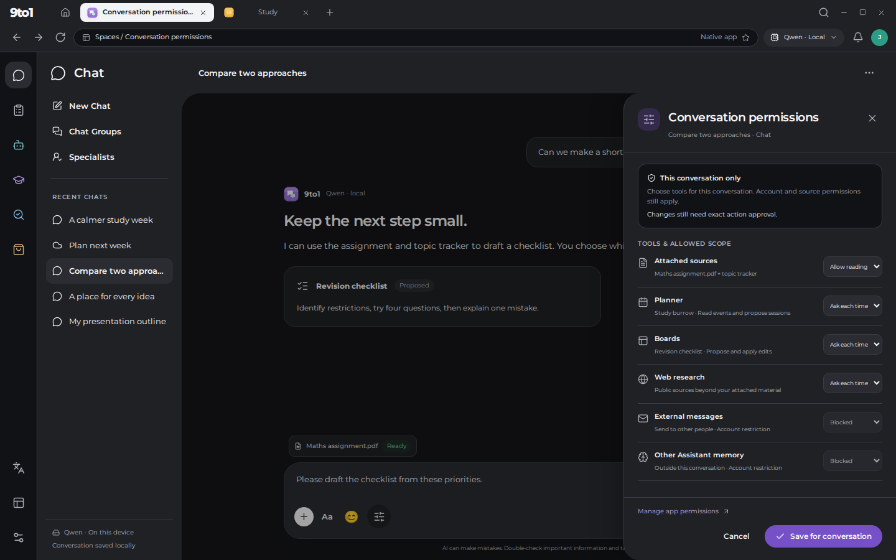

Screen ID: `spaces-permissions`. Source: Owner revision: switch-style permissions icon; Home App API permission broker; UX27-SPACES-005–007; LE-06 approval policy.

- The separate SlidersHorizontal icon opens this drawer. Spaces does not show the editor Read-only/Write segmented control; the action stack remains separate and icon-only.
- These controls apply to the current conversation and can narrow inherited account/tool grants. They cannot widen blocked account grants, source ACLs, delegated roles or device policy.
- Each tool exposes its effective allowed scope. Read access, proposal generation and mutation permission remain distinct; a model’s prose or attachment cannot authorise an action.
- Consequential work still uses exact per-action approval and Home’s permission broker. Existing scoped caller trust is managed in Settings, not silently created here.
- Cancel leaves scope unchanged. Save applies only to future requests in this conversation. Focus is contained in the drawer; Escape or Close restores focus to the permission icon.

## Spaces · Native emoji picker

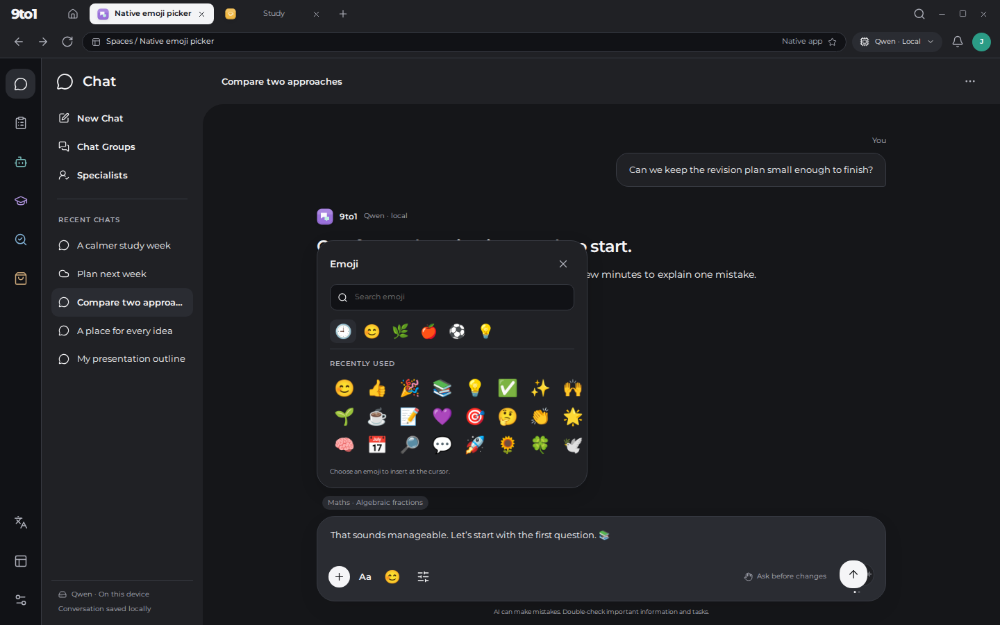

Screen ID: `spaces-emoji`. Source: Owner revision: native device emoji; PPT slides 11–13 focused composer; UX27-SPACES-005.

- Emoji are Unicode text rendered by the device font stack: Apple Color Emoji, Segoe UI Emoji and Noto Color Emoji. No custom-drawn glyphs, sprite sheets or embedded emoji artwork are used.
- The emoji button appears only while the composer is focused and expanded. Insertion edits the retained draft at its selection; it does not send a message.
- Search, category controls and emoji cells have accessible names. Native OS emoji-picker integration may be offered without changing the stored Unicode sequence.
- The separate permissions icon and rounded icon-only action stack remain in fixed positions. Emoji selection must not shift or activate Send.
- Escape dismisses the picker and restores the draft selection; native variation selectors and skin-tone sequences round-trip unchanged.

## Spaces · Conversation

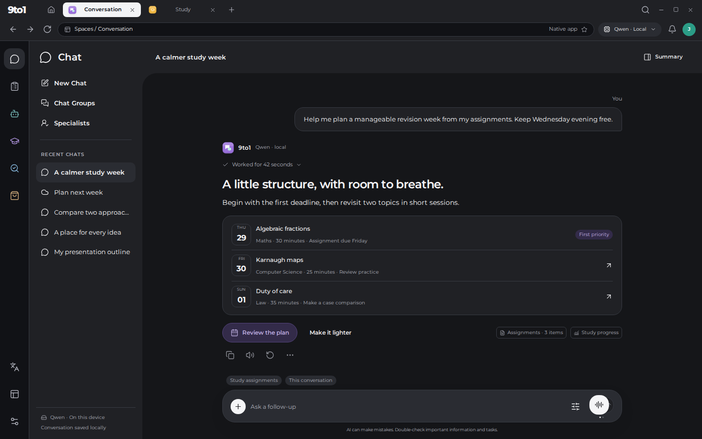

Screen ID: `spaces-chat`. Source: PPT slides 8, 10–14; UX27-SPACES-001, 005–006; LE-03–06.

- The mini-rail selects a Space directly and preserves its contextual sidebar and draft. The permanent chat area follows current slide 10, not the older blue-gradient shell.
- Normal messages, completed work, source links and per-message actions have distinct hierarchy. A deliberate scroll-up must survive streaming.
- The compact composer has a separate switch-style Conversation permissions icon. Aa and native device emoji appear only while focused and expanded. The rounded action stack is icon-only, labelled accessibly, and browses without executing.
- Selected model effort is distinct from allowance. A local model has no provider allowance meter.
- All documents and progress figures here are illustrative mock-up content.

## Spaces · Draft and contextual shelf

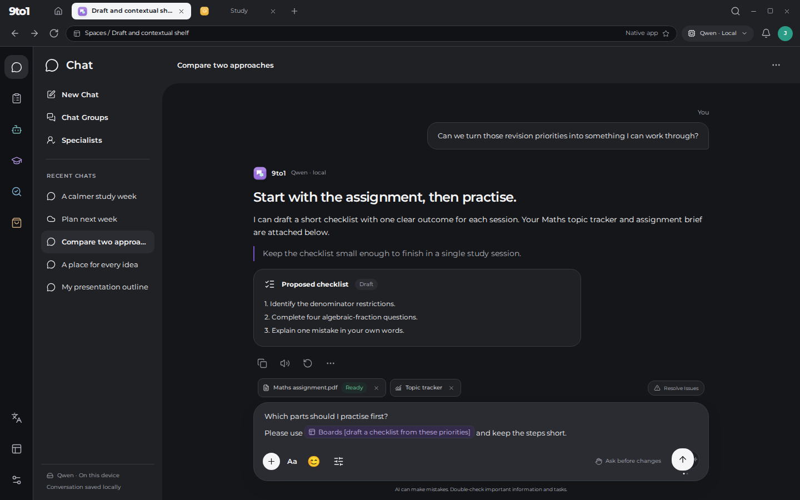

Screen ID: `spaces-compose`. Source: PPT slides 11–13; UX27-SPACES-002–005; UX27-SPACES-010; structured inline command amendment.

- A nonempty draft expands upward and retains the same editable text across Space changes. Attachments have readiness and remove controls.
- Only the bounded app mention and its instruction use the inline command treatment. Surrounding prose remains ordinary text. A mention alone does not execute.
- Idle nonempty shelf contains Send and Voice. The visible item, peeking next item and position dots describe browsing, not queued work.
- Conversation permissions expose effective tools and scope. They cannot widen account grants or replace explicit approval for a consequential action.
- This screen shows the focused, expanded state. Aa and emoji appear only in that state; attachments and the separate permissions icon remain available when compact. Emoji use the device font, not an image pack.

## Spaces · Attach menu

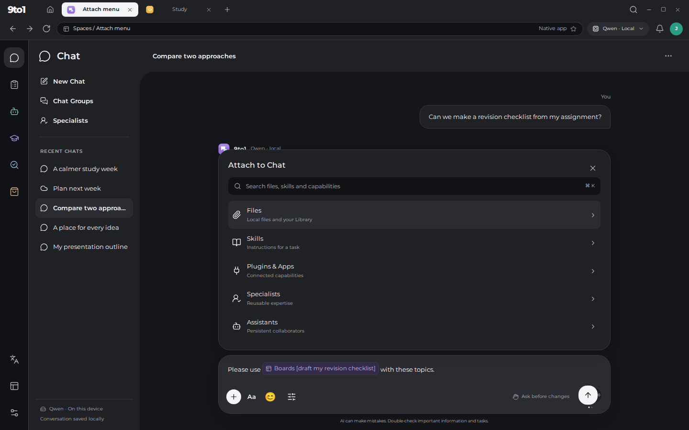

Screen ID: `spaces-attachments`. Source: PPT slide 14; UX27-SPACES-005; UX27-SHARED-009–010.

- The popover is anchored above the focused, expanded composer. Aa and emoji are shown for that state, and current draft and attachment context are retained.
- Files, Skills, Plugins & Apps, Specialists and Assistants are distinct categories, matching current slide 14.
- Search supports capability discovery. Browsing and attaching are separate from execution; choosing a capability does not activate it.
- Escape, outside click and Space navigation dismiss the popover and return focus appropriately.
- On narrow screens the menu stays within the viewport, with vertical internal scrolling and reachable Close.

## Tasks · Run summary and approval

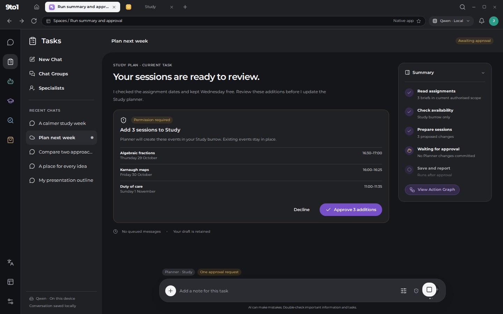

Screen ID: `spaces-running`. Source: UX27-SPACES-002–004, 007; Tasks built-in Space contract; canonical Action Graph and approval rules.

- Tasks is a structured Space, distinct from recurring Automations. Summary stays at the top right and accesses the same canonical Action Graph.
- The three sessions are proposed changes. The run is held pending the exact Planner approval; no task is marked committed yet.
- Approval is confined to this request and preview. Decline, inspect and stop remain visible. A composer shelf control cannot implicitly approve.
- Working, completed preparation, permission hold and saved output use distinct labels. A completed research step is not accepted output.
- The queue count is admission state, distinct from the visible action shelf.

## Spaces · Specialists

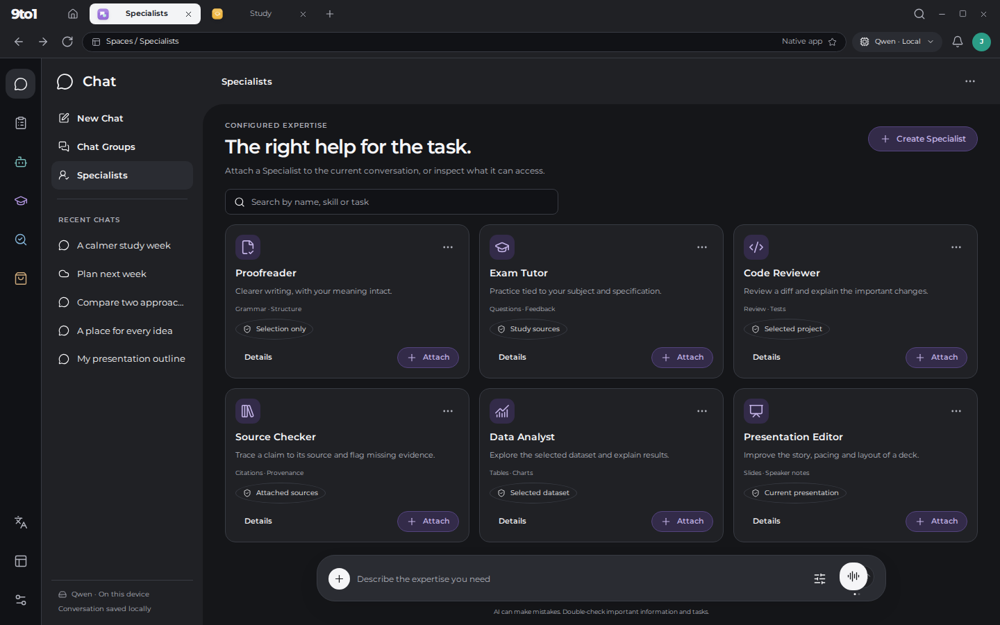

Screen ID: `spaces-specialists`. Source: PPT slide 15 selected state; Specialists scope amendment; UX27-SPACES-005, 008, 013.

- Specialists are job-defined reusable configured expertise, separate from persistent Assistants and generic delegated workers.
- This screen completes the content area left blank by slide 15 while preserving its selected local-sidebar row.
- Each Specialist exposes intended use, scope and permission policy before attaching. Attachment alone does not run a job.
- Configuration is owned by the corresponding AI Studio definition; do not manufacture a parallel agent runtime.
- Search and capability chips remain useful at narrow widths.

## Assistants · Persistent collaborators

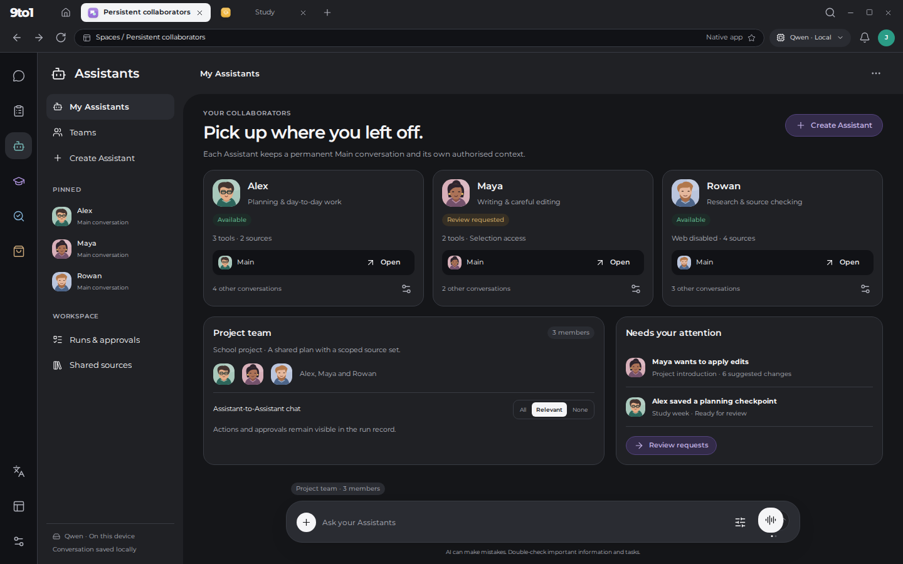

Screen ID: `spaces-assistants`. Source: Owner revision: persistent illustrated identity; UX27-AUTH-002; UX27-SPACES-013; Assistant thread and team contracts.

- This Space is a conversation view of the global Assistants system. Each sidebar row, roster card and Main conversation repeats the same persistent Assistant portrait, name and identity. These three illustrated portraits are original mock-up identities.
- Main is visually distinct from secondary threads. Spaces and Assistant views open the same canonical conversation; renaming never replaces the identity.
- Team chat visibility offers All, Relevant and None. This filters presentation, not consequential audit records or permissions.
- Tools, sources and memory belong to the selected Assistant and authorised scope. Membership grants no blanket context access.
- Build/configuration actions route to AI Studio. The separate composer permissions icon opens conversation scope; it is not an editor Read-only/Write control.

## Assistants · Alex Main

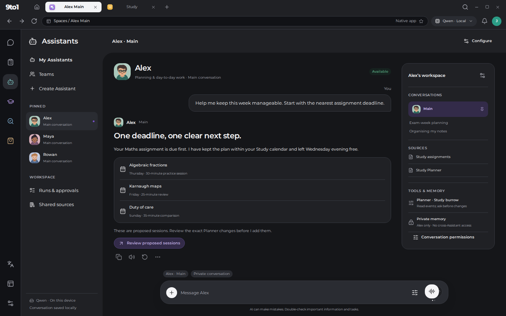

Screen ID: `spaces-assistant-alex`. Source: Owner revision: distinct Assistant avatars; UX27-SPACES-013; canonical AgentID and Main conversation contract.

- The selected Assistant has the same authored portrait in pinned navigation, header, response attribution and team roster. The avatar is an identity asset, not the app icon or a generic chat symbol.
- Main is permanent; secondary threads retain independent conversations under the same Agent identity. Names and artwork can change without replacing canonical IDs.
- The scope inspector exposes this Assistant’s sources, tool access and memory boundary. Conversation membership does not expose other Assistants’ private memory.
- Proposals, saved checkpoints and approvals remain distinct. Opening a review does not approve the proposed changes.
- Composer permissions are conversation-scoped; lasting Assistant configuration opens in AI Studio.

## Assistants · Maya Main

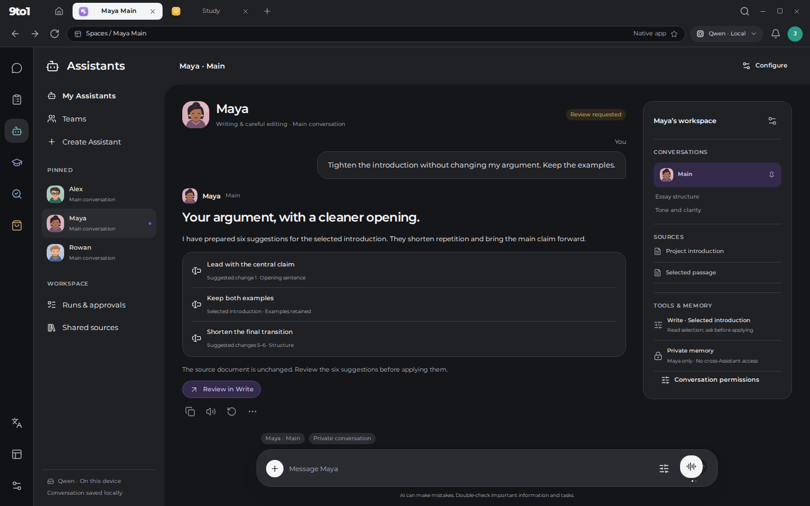

Screen ID: `spaces-assistant-maya`. Source: Owner revision: distinct Assistant avatars; UX27-SPACES-013; canonical AgentID and Main conversation contract.

- The selected Assistant has the same authored portrait in pinned navigation, header, response attribution and team roster. The avatar is an identity asset, not the app icon or a generic chat symbol.
- Main is permanent; secondary threads retain independent conversations under the same Agent identity. Names and artwork can change without replacing canonical IDs.
- The scope inspector exposes this Assistant’s sources, tool access and memory boundary. Conversation membership does not expose other Assistants’ private memory.
- Proposals, saved checkpoints and approvals remain distinct. Opening a review does not approve the proposed changes.
- Composer permissions are conversation-scoped; lasting Assistant configuration opens in AI Studio.

## Assistants · Rowan Main

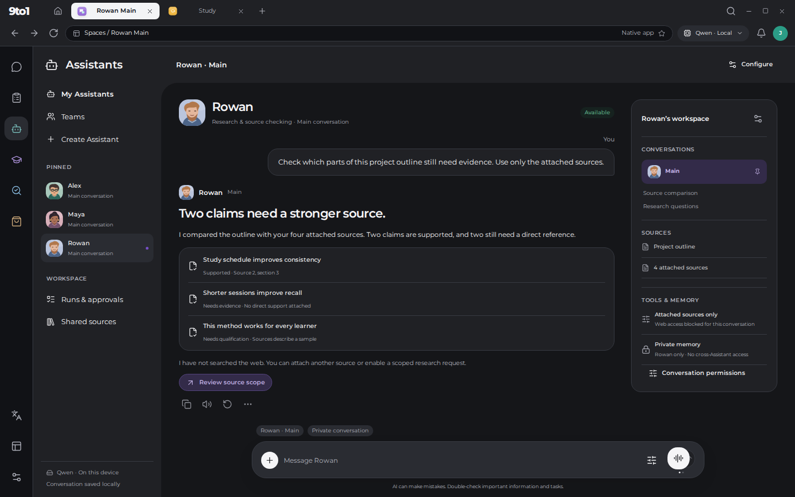

Screen ID: `spaces-assistant-rowan`. Source: Owner revision: distinct Assistant avatars; UX27-SPACES-013; canonical AgentID and Main conversation contract.

- The selected Assistant has the same authored portrait in pinned navigation, header, response attribution and team roster. The avatar is an identity asset, not the app icon or a generic chat symbol.
- Main is permanent; secondary threads retain independent conversations under the same Agent identity. Names and artwork can change without replacing canonical IDs.
- The scope inspector exposes this Assistant’s sources, tool access and memory boundary. Conversation membership does not expose other Assistants’ private memory.
- Proposals, saved checkpoints and approvals remain distinct. Opening a review does not approve the proposed changes.
- Composer permissions are conversation-scoped; lasting Assistant configuration opens in AI Studio.

## Study · Learning dashboard

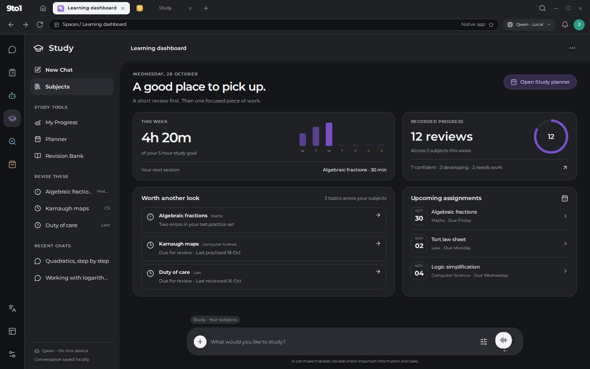

Screen ID: `spaces-study`. Source: UX27-SPACES-012; LE-08–09; older PPT slides 24–28 authorised for Study concepts only.

- The default Study sidebar has New Chat, Subjects, My Progress, Planner, Revision Bank, three shared Revise These slots and recent chats.
- Weekly time and streak-like engagement measures are not mastery. Proficiency comes from attributed answers and card ratings.
- Revise These contains at most three topics across all subjects, ranked from recorded difficulty and review dates with reasons.
- Planner opens the canonical Study burrow. Revision materials reference owning-app artifacts and open in their real viewer.
- The older Study dashboard contributes information architecture only; all chrome and treatments use the current theme.

## Study · Maths topic tracker

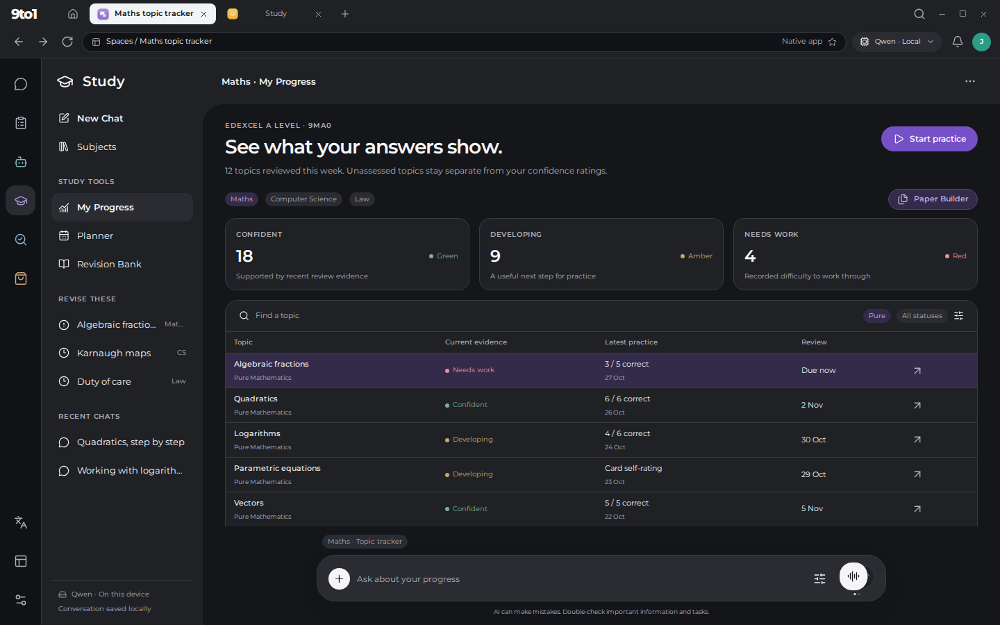

Screen ID: `study-subject`. Source: STUDY-UI-217–220; UX27-SPACES-012; LE-08; older PPT slides 26–27 authorised for Study concepts only.

- RAG values describe recorded review evidence. Never label an unassessed topic weak or mastered.
- Subject, topic and paper/specification links remain stable when labels change. The row opens a topic-bound chat.
- Progress and review dates remain separate columns. Evidence is accessible rather than implied by a coloured dot alone.
- The subject dashboard retains topic navigation, practice and paper-builder access without creating a second content store.
- Topic scores shown are illustrative attributed practice results.

## Study · Lesson and Revision Bank

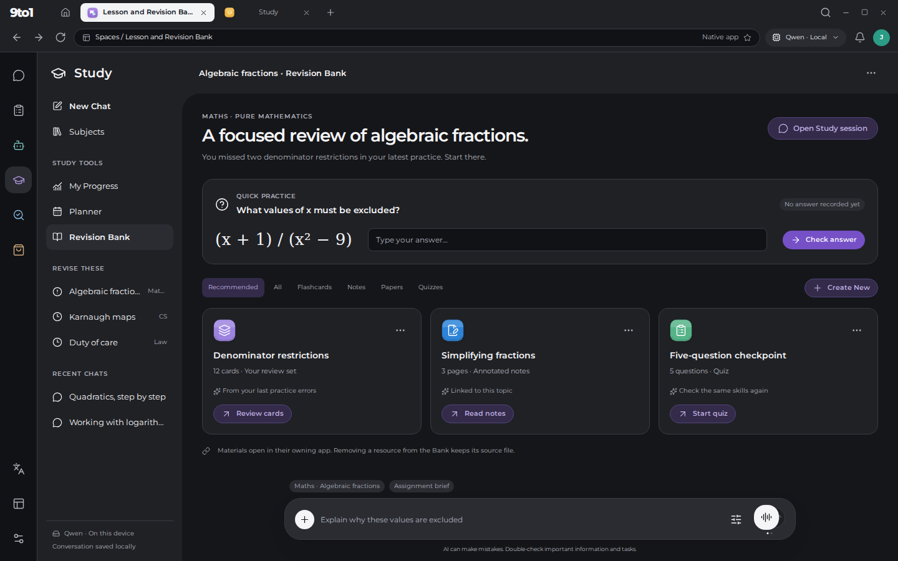

Screen ID: `study-topic`. Source: UX27-SPACES-012; LE-08–10; Revision Bank; older PPT slide 28 conceptual reference.

- The Revision Bank category row has Recommended, All, Flashcards, Notes, Papers, Quizzes and right-aligned + Create New.
- Resource cards reference canonical Cards, Forms and Write artifacts. View/interact is the default; editing and Open in App are explicit.
- Recommended resources state the evidence-based reason and do not reveal unrelated private artifacts.
- Practice feedback only changes progress after the user submits an actual answer. Displaying a lesson does not record mastery.
- Source-linked topic context is carried into chat and the AI composer.

## Study · Session modes and source policy

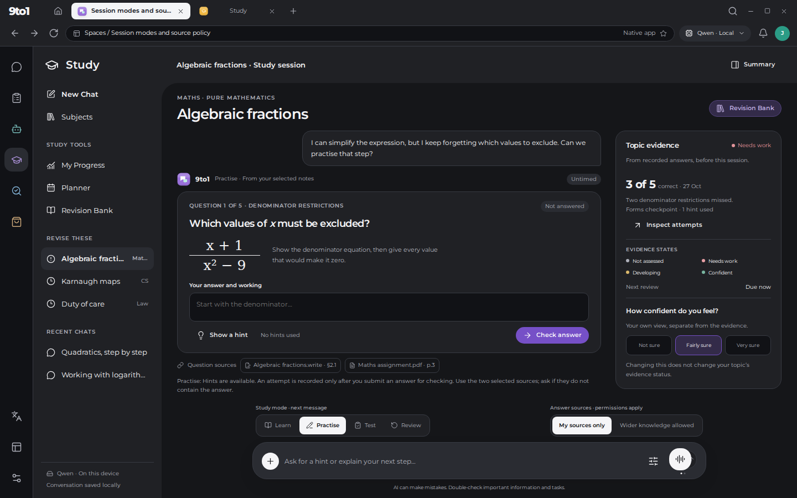

Screen ID: `study-session`. Source: Study Space detailed interface specification, effective 13 October 2026: STUDY-UI-202, 205, 210–220; LE-08–10; UX27-SPACES-005–007.

- The contextual Learn / Practise / Test / Review selector changes the next request in this same Study session. Preserve ConversationID, message history, TopicID, selected sources, answer draft and meaningful mode-transition provenance.
- Practise records a real submitted attempt with question/source reference, working, feedback, marking provenance and hint conditions. This displayed question is unanswered; no new proficiency or completed review is implied. Learn worked examples and Review page opens or card flips are not assessed evidence.
- Test uses the canonical Forms Test/Quiz assessment engine with inspectable rules, rubric and supported marking policy. Choosing Test alone does not start a timer, fabricate a grade or copy the assessment into a private Study database.
- My sources only applies the configured closed-corpus policy. Wider knowledge allowed distinguishes authorised supplied material, external research and general explanation; citations cannot be fabricated and higher-priority web/account permissions still apply. Switching cannot rewrite the provenance of earlier answers.
- Topic proficiency uses Not assessed, Needs work, Developing and Confident. It derives from attributed evidence and review rules. The separate self-reported confidence control never silently changes demonstrated proficiency or another learner’s private records.
- The current Study wrapper, shared model/effort route, conversation-permissions icon and rounded icon-only Send/Voice shelf remain in place. Voice and multimodal capture use the shared Vision & Voice APIs. Local selectors in this reference preserve the draft and do not execute or mark an answer.

## Research · Plan, sources and outputs

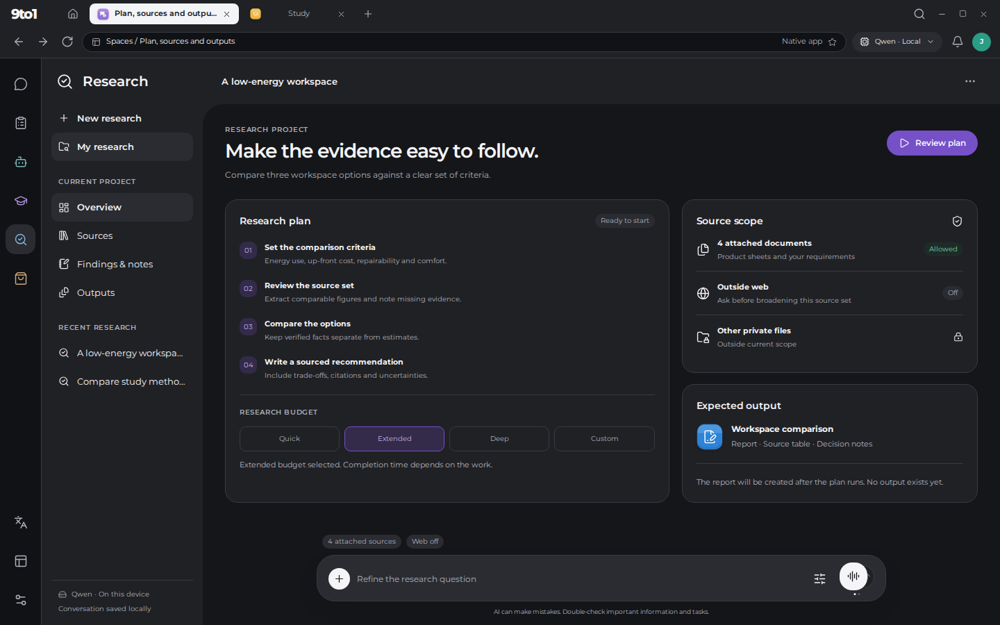

Screen ID: `spaces-research`. Source: UX27-SPACES-012; Research built-in Space contract; canonical source and artifact model.

- Research is a typed environment with plan, source scope, run status and outputs alongside conversation.
- Quick, Extended, Deep and Custom are supported budget choices. Duration is a budget, not an execution-time promise.
- Outside-web access is explicit and separate from attached sources. Research cannot silently broaden permission scope.
- A report is a canonical Write artifact, not a private copy of its content. Source citations and missing evidence survive export.
- Plan steps and status reflect the actual run; no decorative fake progress.

## Shopping · Requirements and comparison

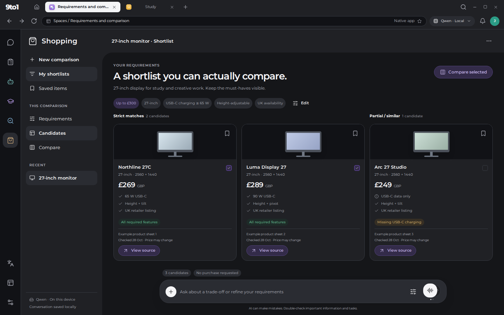

Screen ID: `spaces-shopping`. Source: UX27-SPACES-012; Shopping built-in Space contract; source/provenance rules.

- Strict matches, partial/similar matches and contextual suggestions are separate categories with explicit reasons.
- Each candidate retains currency, source and last-check state. Fictional products and example prices here are mock-up content, not live recommendations.
- Constraint mismatches remain visible. An adjacent or promoted product cannot silently replace a strict match.
- Saving, comparing and purchasing have separate actions. No selection or AI response authorises a purchase.
- The Shopping Space has requirements, shortlists and comparison workflows, not a copied Study dashboard.

## Spaces · Settings and permission scope

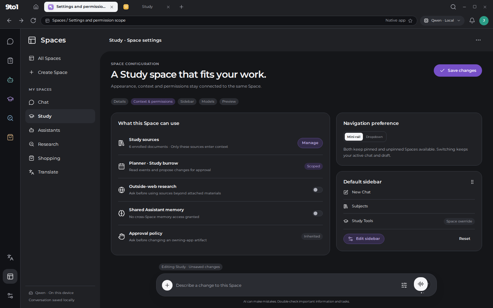

Screen ID: `spaces-manage`. Source: UX27-SPACES-001, 008; LE-03, LE-05; Space override and permission precedence.

- Space configuration is reached deliberately. Selecting a Space still opens its actual conversation directly.
- Configuration precedence is Space Override, User Preference, Default; policy limits every level. Locked values show their source.
- The sidebar editor references stable sections and targets. Removing organisation never deletes chats or source documents.
- Source visibility and actual permission remain separate. Scope editing does not grant arbitrary action execution.
- Preview and edit address the same SpaceID; changing names or rail position preserves identity.

## Translate · Conversational localisation

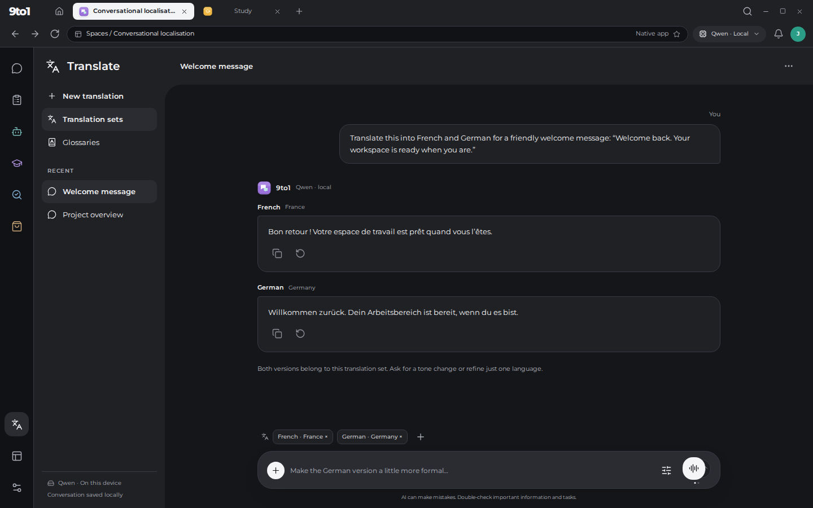

Screen ID: `spaces-translate`. Source: Translate built-in Space contract; TranslationSet and variants; Dulche Translate amendment.

- Translate uses the normal Space conversation. It is not a two-box translator app.
- The persistent target-language set sits immediately above the standard composer. Do not add a separate Translate context row.
- Each target language has a separate assistant bubble labelled directly above it. Variants remain siblings of one canonical TranslationSet.
- A refinement targets a language variant without discarding the others. Publishing or replacing a source is a separate authorised owning-app action.
- Target-language changes persist with the conversation and draft.

## Spaces · Generated interactive planner

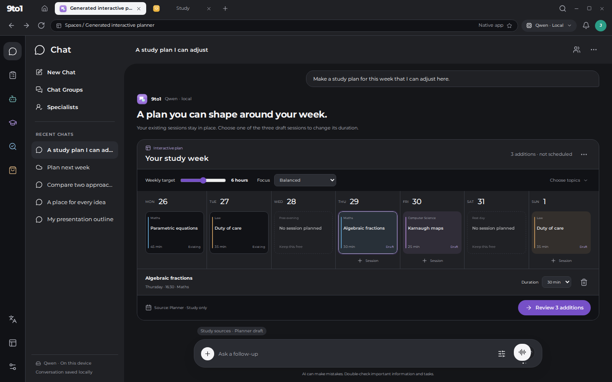

Screen ID: `spaces-generative-ui`. Source: Owner revision 28 October; Dulche generative UI and delegation; UX27-SPACES-001–014; CUI typed components and artifact ownership.

- An interactive generated result stays inline with its conversation and exposes its current data source and unsaved draft state. Monday and Tuesday are existing past sessions, read-only in this proposal; only Thursday, Friday and Sunday are additions.
- Changing a slider or selecting a session edits a local proposal. Save to Planner opens the exact change review and does not imply approval.
- Generated controls have accessible labels, keyboard focus, empty/loading/failure states and a stable UI schema for restoration.
- Generated interfaces use the CUI typed component and command model. The model cannot inject arbitrary executable UI or bypass app permissions.
- Generated views bind to canonical owning-app entities. A chart, form, calendar or artifact preview never becomes an independent hidden copy.
- State transitions, elapsed time, completed work and created file results are supplied by the real runtime. The values here are fixtures.

## Spaces · Thinking and visible activity

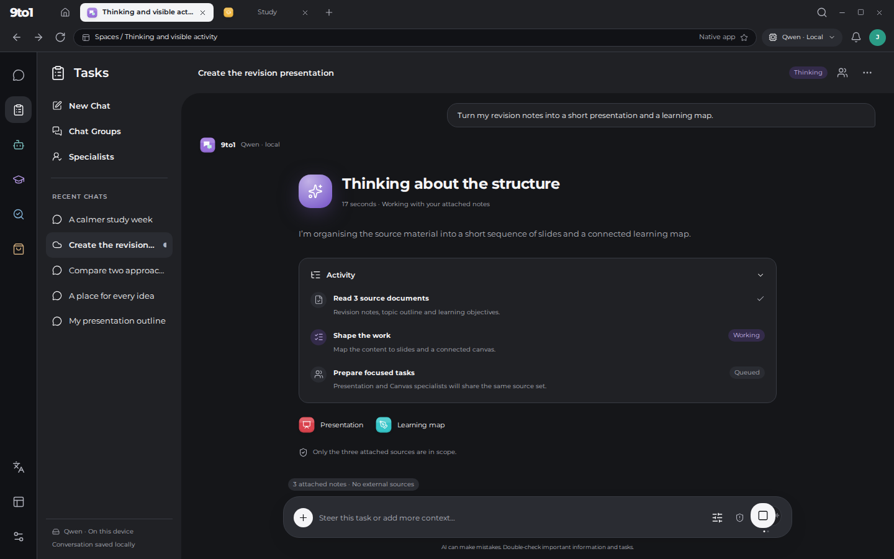

Screen ID: `spaces-thinking`. Source: Owner revision 28 October; Dulche generative UI and delegation; UX27-SPACES-001–014; CUI typed components and artifact ownership.

- Thinking has a clear active state, elapsed time and interrupt controls. It never displays a fabricated answer or completed artifact while work is pending.
- The expandable activity area shows a concise task summary and tool/status events. Private internal reasoning is not part of the UI contract.
- A retained composer supports steer, queue and stop; stopping preserves committed work and a resumable record where supported.
- Generated interfaces use the CUI typed component and command model. The model cannot inject arbitrary executable UI or bypass app permissions.
- Generated views bind to canonical owning-app entities. A chart, form, calendar or artifact preview never becomes an independent hidden copy.
- State transitions, elapsed time, completed work and created file results are supplied by the real runtime. The values here are fixtures.

## Spaces · Coordinated subagents

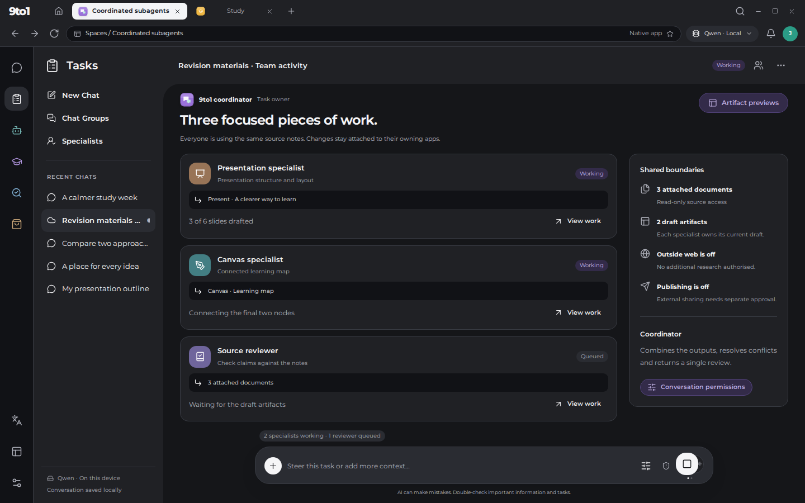

Screen ID: `spaces-subagents`. Source: Owner revision 28 October; Dulche generative UI and delegation; UX27-SPACES-001–014; CUI typed components and artifact ownership.

- The coordinator and each subagent have visible identity, responsibility, scope, state and owned output. A subagent is a real run with a stable parent relationship.
- Delegated permissions are the intersection of the parent grant, agent capability and current app policy. Delegation cannot widen access.
- Independent work can progress in parallel. Cancel, retry and review are scoped to the selected agent; completed sibling work remains intact.
- Visible activity summaries report work and tool events rather than private reasoning traces.
- Generated interfaces use the CUI typed component and command model. The model cannot inject arbitrary executable UI or bypass app permissions.
- Generated views bind to canonical owning-app entities. A chart, form, calendar or artifact preview never becomes an independent hidden copy.
- State transitions, elapsed time, completed work and created file results are supplied by the real runtime. The values here are fixtures.

## Spaces · Subagent scope and activity

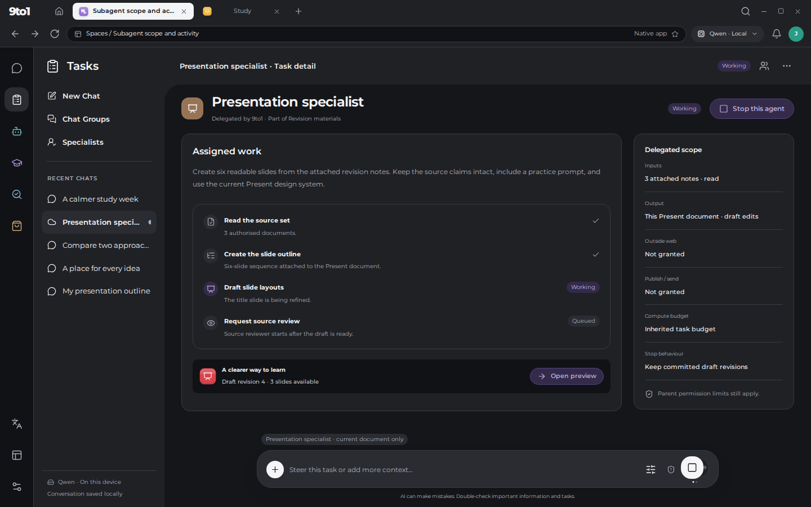

Screen ID: `spaces-subagent-detail`. Source: Owner revision 28 October; Dulche generative UI and delegation; UX27-SPACES-001–014; CUI typed components and artifact ownership.

- Agent detail exposes the delegated brief, granted inputs, allowed outputs, budget and public activity events.
- The user can stop this agent without stopping unrelated sibling work. Retry is attached to the same task with an explicit new run record.
- Artifacts and source references use canonical IDs; the agent may not acquire another agent’s write scope silently.
- Generated interfaces use the CUI typed component and command model. The model cannot inject arbitrary executable UI or bypass app permissions.
- Generated views bind to canonical owning-app entities. A chart, form, calendar or artifact preview never becomes an independent hidden copy.
- State transitions, elapsed time, completed work and created file results are supplied by the real runtime. The values here are fixtures.

## Spaces · Presentation work in progress

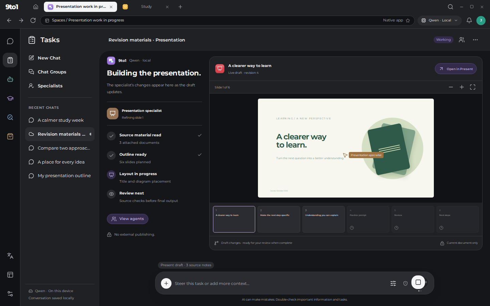

Screen ID: `spaces-present-working`. Source: Owner revision 28 October; Dulche generative UI and delegation; UX27-SPACES-001–014; CUI typed components and artifact ownership.

- Spaces displays the actual Present scene as a live canonical artifact preview, including slide count, revision, selection and responsible collaborator.
- Preview updates stream committed draft revisions; an in-progress frame is not a claim that the entire presentation is complete.
- Open in Present retains the same document and work session. Steer/Stop affects the current run while preserving durable edits.
- Pending slides remain visibly pending. Reviewer activity and completed output are distinct stages.
- Generated interfaces use the CUI typed component and command model. The model cannot inject arbitrary executable UI or bypass app permissions.
- Generated views bind to canonical owning-app entities. A chart, form, calendar or artifact preview never becomes an independent hidden copy.
- State transitions, elapsed time, completed work and created file results are supplied by the real runtime. The values here are fixtures.

## Spaces · Canvas work in progress

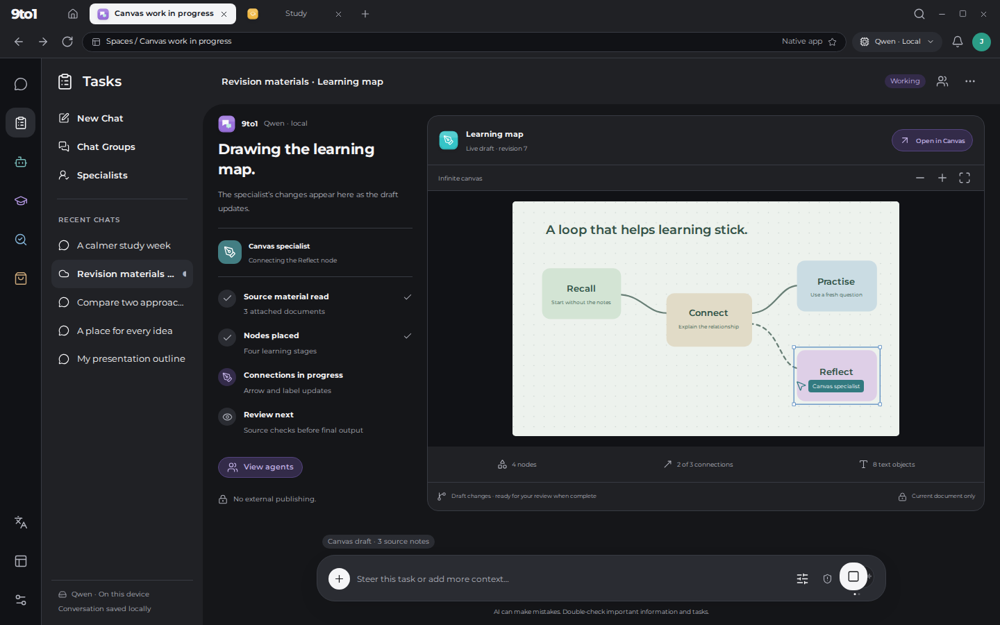

Screen ID: `spaces-canvas-working`. Source: Owner revision 28 October; Dulche generative UI and delegation; UX27-SPACES-001–014; CUI typed components and artifact ownership.

- Canvas work uses the same scene, object IDs, coordinates and undo history as the canonical Canvas artifact.
- The preview shows the specialist’s active object and cursor identity, as well as partial connections and object counts.
- Other users can observe and steer without taking over the same object implicitly. Concurrent edits require clear ownership and conflict handling.
- Generated interfaces use the CUI typed component and command model. The model cannot inject arbitrary executable UI or bypass app permissions.
- Generated views bind to canonical owning-app entities. A chart, form, calendar or artifact preview never becomes an independent hidden copy.
- State transitions, elapsed time, completed work and created file results are supplied by the real runtime. The values here are fixtures.

## Spaces · Generated files and outputs

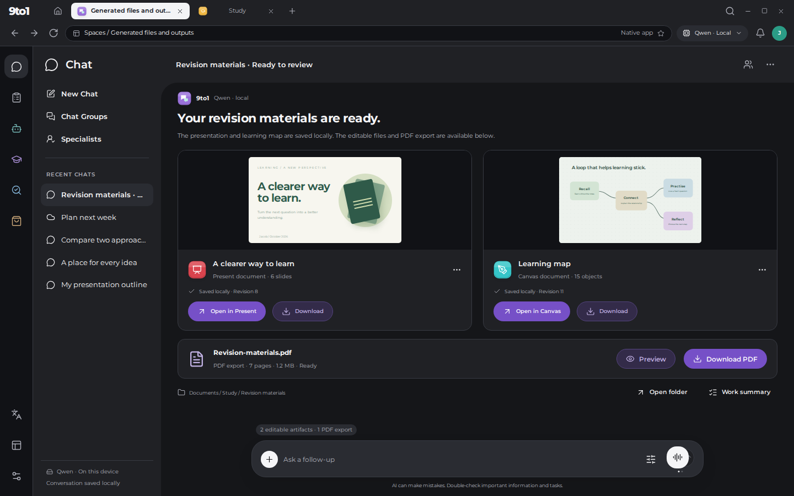

Screen ID: `spaces-generated-files`. Source: Owner revision 28 October; Dulche generative UI and delegation; UX27-SPACES-001–014; CUI typed components and artifact ownership.

- A completed file result appears only after the owning app returns a durable artifact and a verified output receipt.
- Each result includes identity, type, revision, local/sync state and Open/Download actions. Exported files and editable native artifacts remain distinct.
- Open delegates to the owning app; Download addresses the existing bytes. Neither action generates a new artifact silently.
- If export is pending or fails, its card keeps that state and recovery action rather than claiming Ready.
- Generated interfaces use the CUI typed component and command model. The model cannot inject arbitrary executable UI or bypass app permissions.
- Generated views bind to canonical owning-app entities. A chart, form, calendar or artifact preview never becomes an independent hidden copy.
- State transitions, elapsed time, completed work and created file results are supplied by the real runtime. The values here are fixtures.

## Spaces · Export failure and recovery

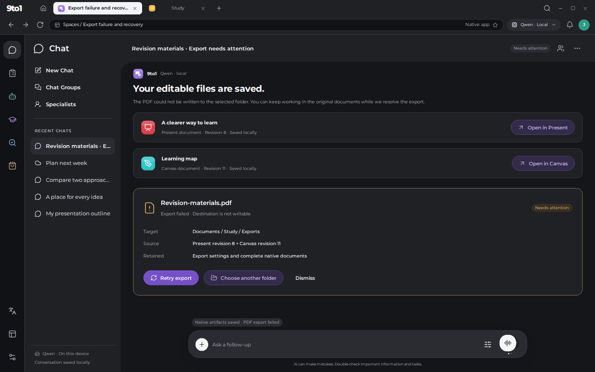

Screen ID: `spaces-export-recovery`. Source: Owner revision 28 October; Dulche generative UI and delegation; UX27-SPACES-001–014; CUI typed components and artifact ownership.

- An export failure is scoped to the export. The successfully saved native artifacts remain available and unchanged.
- The failed result retains format, target path, error and retry/save-copy actions. Retry operates on the same chosen document revision.
- An action receipt reports real status. The interface must never show Download ready for missing or incomplete bytes.
- Generated interfaces use the CUI typed component and command model. The model cannot inject arbitrary executable UI or bypass app permissions.
- Generated views bind to canonical owning-app entities. A chart, form, calendar or artifact preview never becomes an independent hidden copy.
- State transitions, elapsed time, completed work and created file results are supplied by the real runtime. The values here are fixtures.

## Spaces · Experiences

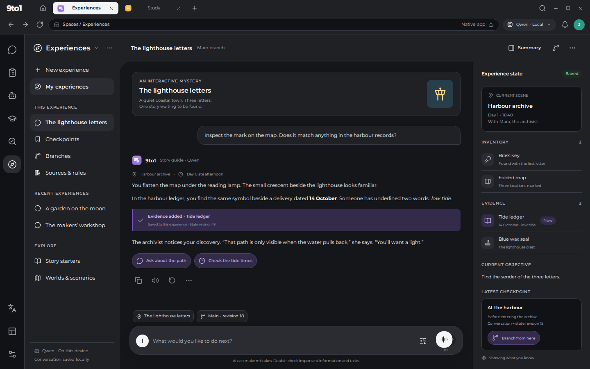

Screen ID: `spaces-experiences`. Source: Spaces / First-party Spaces / Experiences (canonical experience state, checkpoints and branching); UX27-SPACES-001–014; UX27-OTHER-016; PPT slides 8–15 (conversation shell).

- The normal Space conversation remains the primary interaction surface. Inventory, evidence and scene panels represent canonical Experience state rather than a separate hidden game runtime.
- Narrated state changes become usable only after the corresponding structured transition commits. The evidence-added event and State revision 18 indicate the same committed transition.
- Checkpoint branching preserves both conversation history and matching Experience-state revision; the original timeline remains intact. Rewind cannot undo already completed external actions.
- Visible state follows the experience and character visibility policy. Private clues, unknown character knowledge and hidden outcomes must not leak through side panels or generated UI.
- Experiences supports open-ended stories, roleplay, simulations and mysteries. Formal contestant, round and scoring state belongs to Play; age-appropriate controls and normal Space permissions remain in force.
- The shared Spaces composer uses the separate conversation-permissions switch and rounded icon-only action stack. It retains the same draft and current experience context.

## Mobile · Spaces conversation

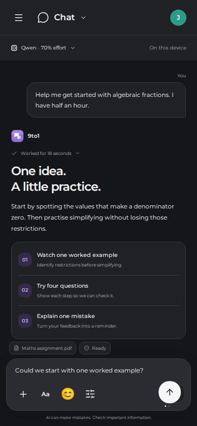

Screen ID: `mobile-chat`. Source: PPT slides 10–14 adapted to narrow viewport; UX27-SPACES-001–006, 010; UX27-SHARED-003, 010.

- This is a narrow layout, not a scaled desktop canvas. Space navigation moves to a named drawer while the conversation uses the full width.
- Header shows a model and explicitly labelled effort. Provider allowance remains separate; this local route has no allowance meter.
- This composer is focused and expanded, so Aa and emoji are visible. The separate Conversation permissions icon opens tool scope. The rounded Send/Voice stack is icon-only and labelled accessibly; browsing never activates it. Emoji use the device font.
- Touch controls have a 44-pixel effective target. Composer docking respects the visual viewport, on-screen keyboard and safe area; it must not cover the active caret or send control.
- Opening navigation retains the draft and selected context. Closing it returns focus to the initiating control.

## Mobile · Study dashboard

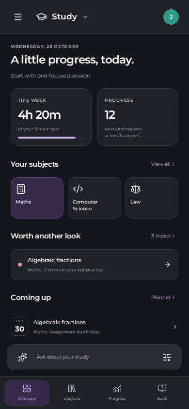

Screen ID: `mobile-study`. Source: LE-08–09; UX27-SPACES-012; older Study slides 24–28 authorised as conceptual inspiration only.

- Narrow navigation exposes Overview, Subjects, Progress and Bank as touch targets; Planner and the full context sidebar remain available through the menu.
- Subject cards open their subject tracker, whose topic rows open topic-bound practice. These links preserve canonical SubjectID and TopicID.
- Study time is separate from recorded progress. Recommendations retain their evidence and there are at most three across all subjects.
- The composer opens above the on-screen keyboard with a resizable scroll area and safe-area padding. The bottom navigation must not overlap the composer.
- Assignments open the canonical Study Planner burrow; Revision Bank resources open in their owning app.

## Mobile · Conversation permissions

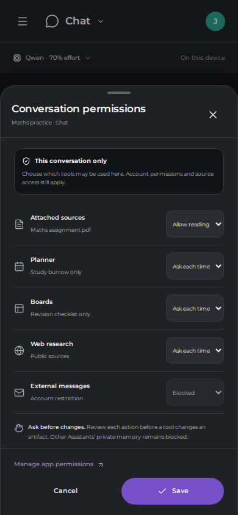

Screen ID: `mobile-permissions`. Source: Owner revision: Spaces permissions icon; Home App API permissions; UX27-SPACES-005–007; UX27-SHARED-010.

- The separate switch-style composer icon opens a bottom sheet on narrow screens. Spaces has no Read-only/Write segmented control; editor AI modes are unaffected.
- The sheet exposes per-tool effective scope and only narrows inherited account grants. Blocked external-send and private-memory access cannot be silently enabled by a conversation override.
- Changes still require exact action approval before execution. Save applies conversation preferences to future requests; it is separate from granting a lasting caller trust level.
- Touch controls and selects have at least 44-pixel targets. The body scrolls independently while Close, Cancel and Save remain reachable; safe-area padding applies at the bottom.
- Dismiss restores the same draft, context and focus. This phone state and the desktop drawer represent the same permission model.
