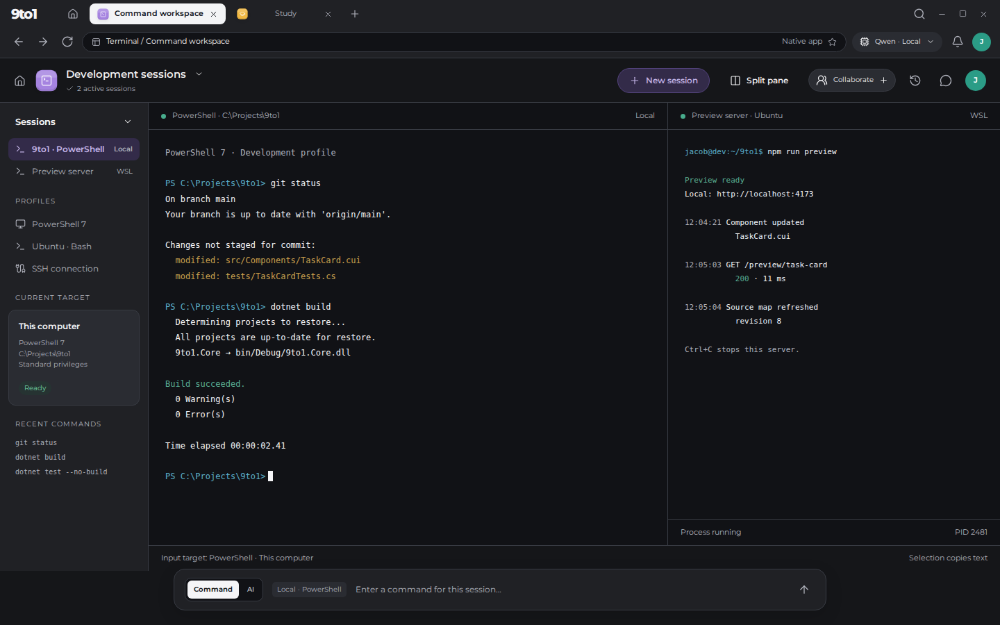
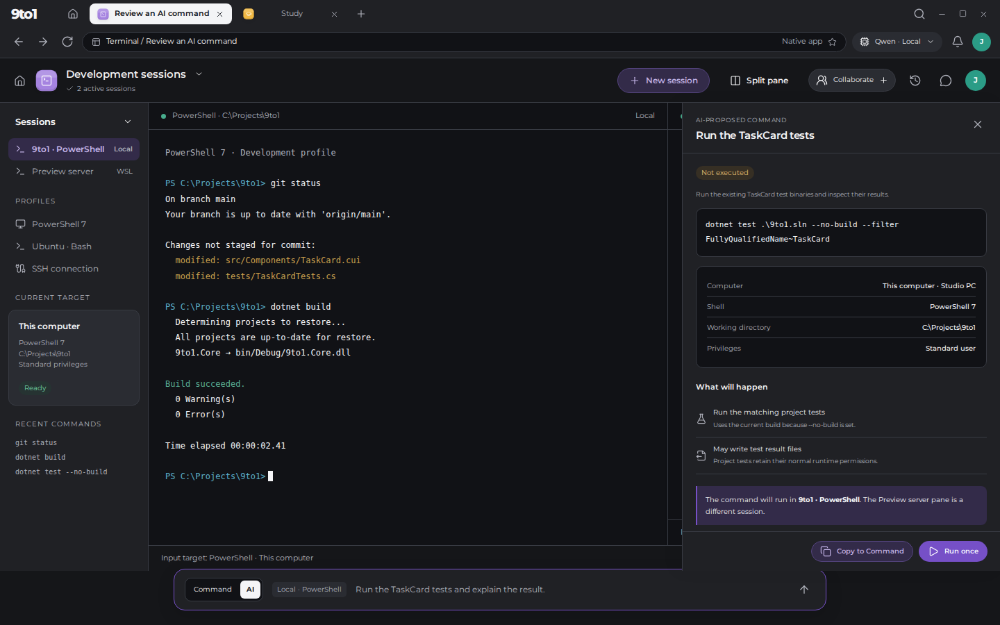

# Terminal — Command and AI modes

Module ID: `terminal` · 9to1 Development Specification v3

## Prerequisites

- **CUI, themes and shared interaction system** — Typed UI components, theme tokens/materials, layout, focus, motion, accessibility and shared control states.
- **Permissions, approvals and execution scope** — Effective scoped grants, action approvals, policy intersections, revocation and audit.
- **Artifacts, local persistence and recovery** — Canonical artifacts, revisions, typed edits, local saves, derived exports, sync and recovery.
- **Dulche runtime, requests and execution services** — Canonical AI broker, capability-aware routing, durable Task/Runs, action execution and lifecycle.

## Overview

Terminal is a real terminal/PTY application with explicit target, session and Command/AI mode. AI proposals are reviewable commands, not automatically executed prose.

## Layouts & visible states

- **V3-TERMINAL-LAY-01** — Keep Command/AI switch, selected shell/profile, target/device and working directory visible. Use authentic terminal output, cursor/input and session/tab/pane controls.
- **V3-TERMINAL-LAY-02** — Command review shows the exact executable text, target, directory, proposed effect and explicit run/cancel controls. Visually wrapped text must not change command syntax.

## Features & behaviour

- **V3-TERMINAL-FEA-01** — Retain real PTY, process, shell/profile, panes/sessions and source-defined remote capabilities. Copying selected text is not input to the shell.
- **V3-TERMINAL-FEA-02** — AI mode explains/proposes within scope; execution requires the actual action authority and target session. Paste/multiline policy remains explicit.
- **V3-TERMINAL-FEA-03** — Reconnect opens or attaches according to real session capability; do not pretend a lost remote process has resumed if it has not.

## Canonical entities & persistence

- **V3-TERMINAL-ENT-01** — Persist terminal profile/configuration and authorised session references; command/output history follows privacy policy and shell/runtime truth.
- **V3-TERMINAL-ENT-02** — Task/action receipts reference exact target/session/command and outcome where available; no invented exit code.

## Permissions & recovery

- **V3-TERMINAL-PER-01** — Check target/cwd and command approval when running. Protect secrets in logs and review surfaces.
- **V3-TERMINAL-PER-02** — Show disconnected, exited, denied, uncertain and failed states distinctly; retry must not duplicate an already-applied external effect.

## Acceptance checks

- **V3-TERMINAL-ACC-01** — Test Command versus AI, select/copy/paste, proposed command review and execution into the correct real session.
- **V3-TERMINAL-ACC-02** — Verify multiline quoting, local/remote target changes, process exit and reconnect truthfulness.

## Exact mock-up and state map

- **Terminal · Command workspace** — screen `terminal`. Command.
- **Terminal · Review an AI command** — screen `terminal-command-review`. AI proposal · local target.

## Source clause IDs

UX27-OTHER-012

## Technical reading map

- Terminal — Command and AI modes — Terminal; Product role and core invariant (part 01) — `technical/terminal-01.md` (3,924 words; V2-B1817).
- Terminal — Command and AI modes — Terminal sessions and process state (part 02) — `technical/terminal-02.md` (103 words; V2-B2318, V2-B2319, V2-B2320).

Technical clauses retain APIs, data models, platform, recovery, donor and acceptance details. The technical files are part of this module, not optional background reading. Shared prerequisites mean stable service/interface contracts must be available; they do not require every dependent app UI to be complete. Use the named chunk for the relevant subtask or the complete module file for its full retained contract.

# Retained technical requirements

# Terminal — Command and AI modes — Terminal; Product role and core invariant (part 01)

Reading status: active retained clauses, subject to the v3 owner overrides listed in the primary module. Historical process instructions and replaced original wording are stored separately.

### V2-B1817 · v2 lines 10004–10233

Terminal
Product role and core invariant
9-1 Terminal is the shared first-party terminal runtime and terminal application for 9to1. It provides genuine interactive shell/PTY behaviour plus a distinct natural-language AI execution mode, while preserving the exact security, permission and side-effect boundaries of the underlying action.
Terminal is not an AI chatbot styled as a command prompt. Command Mode remains a normal terminal capable of running existing shell applications unchanged; AI Mode is an additional semantic command/action surface.
Natural-language phrasing MUST NOT lower safety. An operation that is destructive, privileged, externally consequential, credential-sensitive or otherwise high-risk remains equally protected when requested in natural language.
Canonical session model
TerminalSession has stable TerminalSessionID, EnvironmentID, ShellProfileID, mode, process/PTY binding, working directory, title, tab/pane location, command history references, running process/job state, Stack/Dev context where applicable, creation/reconnect metadata and Revision.
Environment identity is explicit. A session always knows whether it targets the local host, WSL, container, SSH host, VM, Dev environment, 9to1-OS host or another registered execution provider.
Display names, tab order and current path are not used as durable session identity.
Persistent AI / Command mode switcher
Terminal provides an always-visible mode switcher comparable to Data's AI / SQL switcher. The two first-party states are AI and Command.
Command Mode sends ordinary terminal input to the selected shell/PTY with normal shell semantics, except for explicitly reserved Terminal meta-commands such as $Ask. It MUST NOT route ordinary recognised shell commands through an LLM merely because AI is available.
AI Mode interprets user input as natural-language intent, resolves the appropriate typed 9to1/system action or shell operation, presents verification when required and then executes through the owning supported APIs/runtime.
Switching modes does not create a new terminal session or lose working directory/environment context. The current mode is visibly obvious and included in accessibility state.
Command Mode
Command Mode behaves as a conventional professional terminal. Input supports the active shell's quoting, variables, pipes, redirection, chaining, job control, scripts, aliases/functions and interactive programs without Terminal rewriting command semantics.
Examples such as git status, dotnet build, python, ssh, vim or a project's CLI run directly through the selected environment rather than requiring AI interpretation.
Terminal may enrich recognised output with clickable links or structured metadata, but the original output stream remains faithful and recoverable.
$Ask non-executing AI assistance
Command Mode reserves the Terminal meta-command $Ask for conversational AI assistance that has no authority to execute a shell command or mutate the environment.
Examples include $Ask "why didn't this command work?", $Ask "what does this error mean?" and $Ask "what command lists processes on this shell?".
$Ask may receive permission-scoped context such as the immediately preceding command, exit status, selected/recent relevant output, shell/profile, environment type, working directory and registered project context. It MUST NOT indiscriminately send the whole terminal history or detected secrets.
$Ask returns explanation, troubleshooting steps and/or suggested command text. Suggested commands are not executed. The user may copy or insert a suggestion into Command Mode, after which it is treated as ordinary user-entered command input.
$Ask itself MUST NOT invoke a hidden command, app mutation, package install, process kill or external side effect. An explicit transition to AI Mode or separate Run/Insert action is required for execution.
AI Mode natural-language execution
AI Mode accepts natural-language requests such as "turn off my PC in 10 minutes", "find every PNG over 10 MB", "install the missing .NET SDK", "open the Data project for this CSV" or "show me what changed in this Stack Twig".
The resolver prefers the owning typed 9to1/system API when one exists. Shell command synthesis is used when a shell command is genuinely the appropriate supported operation, not as a shortcut around a semantic API.
Before execution Terminal produces an inspectable resolved action/plan containing target environment/app, operation, affected objects where knowable, risk level, whether it is reversible, scheduled/external effects and any shell commands that will actually run.
AI execution verification and dangerous-command protection
AI Mode may execute low-risk, clearly resolved actions according to the user's existing trust/permission policy. Potentially dangerous or ambiguous operations require explicit verification before execution.
Verification is mandatory for destructive/bulk-destructive filesystem operations, shutdown/restart, privilege/security changes, process termination with material impact, package/system changes, credential access, permission changes, remote/external mutations and other actions classified as elevated by the owning app/system action.
The verification view states what will run, where it will run, what is expected to change, affected object counts/scopes where determinable and what cannot be predicted. Unknown impact is displayed as unknown rather than omitted.
Ambiguous natural-language requests that could resolve to materially different consequential actions MUST pause for clarification/selection rather than choosing the more destructive interpretation.
AI Mode cannot split one dangerous request into many nominally lower-risk commands to evade Home risk aggregation or approval.
Home permission-broker integration
Protected AI Mode actions use the global Home permission broker. Terminal supplies stable caller/action identity, target app/environment, resolved scopes and risk metadata; it does not implement a weaker private approval system.
Manual Command Mode execution remains ordinary shell execution subject to OS/shell permissions and Terminal-specific guards. Where a shell command crosses a 9to1 protected semantic boundary such as Stack managed infrastructure, the owning product guard still applies.
Always Trust or other Home trust grants never bypass OS elevation, provider authentication, 2FA, Stack protections or product-specific safeguards.
Real PTY and shell behaviour
Supported local environments use a real pseudoterminal/conpty/PTY or platform-equivalent terminal backend. Terminal supports interactive stdin/stdout/stderr, ANSI/VT sequences, cursor control, terminal resize, signals, full-screen terminal applications and shell-native prompts/completion.
Closing, resizing or switching UI panes MUST NOT convert an interactive shell into one-shot process execution.
Where the platform cannot expose a local PTY, Terminal uses a declared remote/service terminal provider or reports CapabilityUnavailable; it MUST NOT simulate successful local shell execution.
Shell profiles and discovery
Terminal discovers installed shells and supports explicit ShellProfile objects. Representative profiles include PowerShell, Command Prompt where supported, Bash, Zsh, Fish, WSL distributions and extension/provider-contributed shells.
ShellProfile identifies executable/provider, arguments, environment setup, icon/name, default working-directory behaviour, shell-integration capability and environment compatibility.
Missing configured shells are shown as Missing/Unavailable with a clear reason and remediation path rather than failing with an unexplained spawn error.
Tabs, panes and window layouts
Terminal supports multiple tabs and horizontal/vertical split panes. Each pane hosts a TerminalSession or attachable terminal job and can be renamed, pinned, moved, duplicated or closed.
Workspace/session layout can be restored across restarts. Restoration recreates UI/session context according to policy but MUST NOT blindly rerun previously entered commands or consequential jobs.
Closing a pane with an active process prompts or follows configured safe behaviour indicating whether the process will be terminated, detached or left remote.
Working directory and path semantics
Each session maintains a real working directory appropriate to its environment. Working-directory changes initiated by the shell are tracked through shell integration where available rather than guessed solely from prompt text.
Paths remain native to the environment so existing CLIs work correctly. Files integration adds stable identity/navigation where possible without replacing required filesystem paths.
Drag/drop of a Files item into Command Mode inserts an appropriately escaped native path/reference for the active shell where supported.
Shell integration protocol
Optional first-party shell integration can report command start/end, command text, exit code, working directory, prompt boundaries and other safe semantic state. This allows reliable command/output grouping without fragile ANSI scraping.
Raw PTY operation remains functional when shell integration is unavailable. Terminal MUST NOT require modifying every third-party shell to provide basic terminal behaviour.
Shell integration data is environment-scoped and cannot be trusted as an authorisation signal for privileged operations.
Command and output history
Terminal maintains configurable history for commands and Terminal-native actions, distinguishing user-entered shell commands, AI-executed actions, AI-generated shell commands, $Ask requests, denied/cancelled actions and scheduled actions.
Users can search, filter, copy, rerun eligible commands, pin entries and clear history according to policy. Sensitive commands or outputs can be excluded/redacted.
History records whether an AI suggestion was merely shown, inserted, or actually executed; the UI MUST NOT imply execution from proposal alone.
Streaming output and semantic links
PTY output is rendered as real streaming ANSI/terminal content. Terminal may additionally recognise file:line references, directories, URLs, ports, process IDs, compiler diagnostics, Git/Stack identities and other registered entities.
Recognised entities become optional clickable actions such as Open in Dev, Show in Files or Open in Browse without altering the underlying captured output.
Third-party output remains displayable even when no semantic recogniser understands it.
Rich Terminal-native output
9to1-owned commands/actions and registered extensions MAY emit structured terminal blocks such as tables, progress, diagnostics, file results, images/previews or action cards where the terminal surface supports them.
Structured output always has an accessible text representation and MUST NOT make standard stdout/stderr consumers depend on a proprietary renderer.
Raw shell output and structured Terminal-native result objects remain distinguishable.
Long-running processes and jobs
Terminal supports servers, watchers, builds, log tails, REPLs and other indefinite/interactive processes. Users can send input, interrupt, terminate, detach/reconnect where the environment permits and inspect current process/session state.
Structured AI/system work may use TerminalJob with stable JobID, source request, resolved action, environment, process/provider identity, state, progress where real progress exists, timestamps, result/exit status and cancellation capability.
Terminal MUST NOT fabricate percentage progress for raw commands that do not expose meaningful progress.
Persistent scheduling
Natural-language requests such as "turn off my PC in 10 minutes" or "run this script tomorrow morning" create a persistent scheduled action through the appropriate Automation/OS scheduling capability rather than an in-memory Terminal timer.
The schedule records stable action/task identity, target EnvironmentID, requested action, execution time/rule, permission/trust context and cancellation/edit linkage.
Closing Terminal MUST NOT silently cancel a persistent scheduled action unless that behaviour was explicitly selected.
Consequential scheduled actions require the same verification/permission classification at creation and, where policy requires, revalidation at execution.
Elevation and privileged sessions
Privilege elevation is explicit. When an operation requires Administrator/root/elevated privileges, Terminal identifies the target operation and uses the platform-supported elevation mechanism.
A normal session MUST NOT silently become permanently elevated because one command required elevation. Deliberately created elevated sessions are visually and accessibly distinguished.
AI Mode cannot bypass elevation prompts or OS security boundaries.
Environment providers
Terminal supports environment providers for local host, WSL, containers, SSH/remotes, virtual machines, Dev environments, 9to1-OS systems and extension-contributed execution targets.
Environment has stable EnvironmentID, type, host/provider identity, connection/runtime state, platform/architecture, capabilities and security context.
Every action/command preview in AI Mode states the target environment so users cannot accidentally shut down, delete files from or install packages on the wrong machine.
SSH and remote terminals
SSH support includes host profiles, verified host-key workflow, secure key/credential references, reconnect and supported port-forwarding/tunnel capabilities.
Passwords/private keys are handled by shared secure credential infrastructure where possible and MUST NOT be copied into AI context/history/logs unnecessarily.
A host-key mismatch is a security error requiring explicit resolution; Terminal MUST NOT silently accept changed remote identity.
Container, WSL and VM terminals
Terminal can open or attach to shells inside supported containers/devcontainers, WSL distributions and virtual machines. Environment identity remains visible.
Dev's OS/VM run configurations may expose VM shell/serial/debug consoles through the shared Terminal engine. Reconnecting a VM console does not create a second conflicting VM unless the run provider explicitly requests one.
Provider lifecycle actions such as starting a stopped VM/container remain typed consequential operations rather than being hidden side effects of reading terminal history.
First-class Dev integration
Dev uses the same Terminal engine rather than maintaining a private emulator. Dev can create sessions bound to WorkspaceID/ProjectID, RunConfiguration, toolchain environment and working directory.
Compiler/build/test diagnostics recognised in Terminal link to Dev source and Problems using stable source locations when available.
Dev can host Terminal panes directly while Terminal can Open current directory/project in Dev without copying project state.
First-class Stack integration
When a session is bound to a Stack ProjectID/DomainID, Terminal shows the active source-domain context and can expose Stack-native commands/actions such as status, owned/inherited changes, promotion/check state and Open in Stack.
Raw Git commands remain available in Command Mode, but Stack-managed lineage, protected companion refs, Roots/Subroots/Freezes and other guards cannot be bypassed by invoking Git from Terminal. Unsafe operations are blocked or require Stack's explicit advanced reconciliation path.
AI Mode uses 9to1.Stack.* actions for semantic Stack requests rather than shelling out to Git when Stack is the canonical owner.
First-class Data integration
Terminal can address Data projects, queries and exports through typed Data actions and can open returned tables/results in Data. AI Mode requests such as "run this query against my selected Data project" use Data's target/protection model rather than bypassing it with an arbitrary database CLI.
Command Mode remains free to run installed database/SQL CLIs against user-configured connections, subject to their own credentials and permissions; Terminal clearly distinguishes those raw commands from 9to1 Data actions.
Structured Data results may render as accessible terminal tables and provide Open in Data.
First-class integration with all 9to1 apps
Every 9to1 app MAY register a Terminal integration provider exposing discoverable read/actions, context resolvers, entity links, completion/help metadata and structured renderers through the shared API model. Terminal treats this as a first-class platform capability, not bespoke one-off integrations.
AI Mode can route requests to canonical app APIs such as Files, Boards, Write, Present, Forms, Sites, Browse, Wave, Motion, Pictures, Spaces, Automations, AI Studio and future apps when the requested operation belongs to them.
Command Mode can expose explicit 9to1 command/meta-command tooling for users who want scriptable access, but those commands call the same app APIs and Home permissions rather than private UI automation.
Cross-app results support actions such as Open in <App>, reveal source object, continue in app or pipe/export structured data where the owning API permits.
9to1 command-line bridge
Terminal SHOULD provide a scriptable 9to1 CLI/command bridge for canonical app APIs, with discoverable namespaces/actions, machine-readable output option, stable exit codes and authentication/permission behaviour consistent with Home.
The CLI is not a second business-logic implementation. It dispatches to the owning 9to1 APIs.
Automation/scripting can therefore use explicit commands for Stack, Files, Data and other apps while AI Mode uses the same semantic operations from natural language.
Package and tool installation
AI Mode may resolve requests such as "install numpy" or "install the missing C++ compiler" only after resolving the intended project/environment/package manager/toolchain.
Project-native package managers and Dev Toolchain Manager remain authoritative. A Python project using a selected virtual environment MUST NOT silently install globally.
Package/system installation is a mutating/elevated action classified appropriately and shows target environment, package/tool and provider before execution when verification is required.
Error assistance and diagnostics
Terminal recognises failed commands through shell integration/exit codes where available. $Ask can explain the failure without executing fixes; AI Mode can separately propose and, after required verification, perform remediation.
Terminal can classify common issues such as executable missing, PATH/toolchain mismatch, permission/elevation required, dependency/package failure, working-directory problem, network/SSH failure or Stack guard rejection.
Where another app owns remediation, Terminal links/routs to that app rather than duplicating its configuration system.
Search, scrollback and large output
Terminal supports plain/case/regex search over retained session output and optionally across retained buffers/history according to privacy settings.
Scrollback is configurable and bounded. Huge streams use virtualised rendering and, where configured, disk-backed spooling/truncation rather than unbounded UI memory growth.
When earlier output is discarded due to limits, Terminal visibly records the truncation boundary rather than pretending the full stream is retained.
Clipboard and multiline paste safety
Terminal supports normal copy/paste, copy command, copy output and platform clipboard conventions. Multiline paste is detected and may require review/warning according to security settings and content risk.
Paste protection MUST NOT silently rewrite commands. It either executes the exact accepted paste or cancels/returns it to editable input.
AI-generated multiline scripts are visually distinguished from user-authored pasted scripts until the user accepts execution.
Secrets, privacy and AI-context filtering
Terminal assumes arbitrary third-party processes may print secrets. AI context construction uses scoped recent/selected data and applies configured secret-pattern redaction plus known credential references, but Terminal MUST NOT claim perfect secret detection.
Terminal content is not automatically sent to Dulche merely because a session exists. $Ask/AI Mode specify the context slice they require and honour app/workspace privacy policy.
Credentials, private keys, tokens and secure environment values are excluded from routine history/telemetry/AI prompts unless the operation explicitly and safely requires them.
Command risk metadata and audit
AI-resolved actions record canonical action IDs, target app/environment, risk classification, verification/permission outcome, executed command/API operation, result and affected identities where known.
Manual raw shell commands are not reclassified as if Terminal semantically understood every side effect, but privileged/guarded platform integrations may emit audit events where required.
Denied, cancelled, failed and partially completed AI actions remain auditable rather than disappearing from history.
Completion, aliases and snippets
Terminal supports shell-native completion and may augment it with registered command/app/entity providers. AI is not required for ordinary tab completion.
Users can manage reusable snippets/recipes and organisation-provided command templates. Snippets are inspectable text/structured actions, not opaque macros that bypass permission checks.
AI can draft a snippet from repeated work, but saving or running it remains an explicit user action.
Dulche context and behaviour
Dulche context for Terminal may include current TerminalSessionID, mode, EnvironmentID, shell profile, working directory, selected/recent command groups, exit code, current process, Dev workspace/Stack domain and registered app context subject to permissions.
In AI Mode Dulche performs semantic planning/execution through typed actions; in Command Mode $Ask is constrained to advice/explanation and cannot execute.
AI output MUST distinguish commands it suggests from operations it actually executed, and execution claims must be grounded in real process/API results.
Terminal API
Terminal's first-party API catalogue is exhaustive under the global API-parity rule. Minimum canonical entry points include:
9to1.Terminal.CreateSession(config);
9to1.Terminal.ListSessions(options?);
9to1.Terminal.GetSession(sessionID);
9to1.Terminal.CloseSession(sessionID, options?);
9to1.Terminal.SetMode(sessionID, mode);
9to1.Terminal.Execute(sessionID, command, options?);
9to1.Terminal.SendInput(sessionID, input);
9to1.Terminal.Interrupt(sessionID, options?);
9to1.Terminal.TerminateProcess(sessionID, processID, options?);
9to1.Terminal.Resize(sessionID, columns, rows);
9to1.Terminal.SetWorkingDirectory(sessionID, pathOrFileID);
9to1.Terminal.CreateSplit(sessionID, config);
9to1.Terminal.AttachEnvironment(sessionID, environmentID);
9to1.Terminal.OpenSSH(profileOrConfig);
9to1.Terminal.GetOutput(sessionID, rangeOrCursor, options?);
9to1.Terminal.SearchOutput(sessionID, query, options?);
9to1.Terminal.Ask(sessionID, question, context?);
9to1.Terminal.ResolveNaturalLanguage(sessionID, request, options?);
9to1.Terminal.ExecuteResolvedAction(resolvedActionID, verification?);
9to1.Terminal.ScheduleAction(sessionID, action, schedule, options?);
9to1.Terminal.CancelScheduledAction(scheduledActionID);
9to1.Terminal.ListEnvironments(options?);
9to1.Terminal.ListShellProfiles(environmentID?);
App/business mutations resolved through Terminal use the owning 9to1 namespace; scheduling, Files, Stack, Dev, Data, credentials and other shared domains remain canonical in their own APIs.
Automation and typed events
Terminal emits typed events such as SessionCreated/Closed, ModeChanged, CommandStarted/Completed, ProcessStarted/Exited, WorkingDirectoryChanged, ConnectionLost/Restored, AIActionResolved/Verified/Executed/Denied, ScheduledActionCreated/Cancelled and guarded integration events.
Events expose stable IDs and permission-scoped metadata. Raw terminal output is not automatically attached to every event; consumers request permitted output ranges explicitly.
Extension system
Terminal participates in the shared 9to1 extension system. Extensions may contribute shell profiles, environment providers, completion providers, semantic recognisers, structured renderers, Terminal-native commands, context providers and integrations.
An extension gains only its declared capabilities. Rendering output or adding completion does not automatically grant process execution, filesystem write, network, credential or AI permissions.
Extension failures are isolated/disableable according to the shared extension-host contract and cannot take down unrelated PTY sessions where avoidable.
Accessibility
Terminal provides keyboard-first operation for tabs/panes, mode switching, command input, history, output search, AI verification and structured result controls.
Screen-reader support exposes command/output group boundaries, prompt/mode state, exit status and meaningful structured result text where platform terminal accessibility APIs permit.
Colour is not the sole signal for elevated session, AI/Command mode, failure, warning or protected action state. Text zoom, high contrast and visible focus are supported.
Performance and resilience
PTY rendering is virtualised/batched to remain responsive under sustained output. One noisy process MUST NOT freeze unrelated Terminal panes or the whole 9to1 shell.
AI resolution, remote connection and structured jobs are cancellable where technically possible and do not block raw PTY input in other sessions.
Terminal crash/restart can restore layout/profile/environment references and retained history according to policy; it does not invent process survival. Live remote/process reconnection occurs only when the provider can prove the original process/session remains available.
Recovery and typed failures
Structured failures include SessionNotFound, ShellUnavailable, EnvironmentUnavailable, EnvironmentDisconnected, PTYCreationFailed, ProcessLaunchFailed, ElevationRequired, CommandRejected, AmbiguousAIIntent, VerificationRequired, PermissionRequired, PermissionDenied, StackGuardViolation, ScheduledActionUnavailable, SSHHostKeyMismatch, CredentialUnavailable, OutputTruncated, ExtensionFailed, RevisionConflict and CapabilityUnavailable plus provider/shell-specific errors.
AI multi-step operations report succeeded, failed, skipped and rolled-back stages where relevant. Terminal MUST NOT claim a command/action completed merely because it was proposed or started.
Failed remote reconnect, scheduled-action creation or app integration leaves explicit recoverable state rather than silently falling back to another environment.
Platform capability behaviour
Windows, 9to1-OS and web preserve the same TerminalSession, mode, AI action and integration model while capability-negotiating local PTY implementation, shells, WSL, OS elevation, SSH/provider and process controls.
Web Terminal requires an authorised remote/server environment provider for real shell execution unless the web platform exposes an approved execution environment. It MUST NOT present browser-side simulation as host terminal access.
When Home is absent at process start, Terminal follows the global Install Home/bootstrap contract.
Acceptance requirements
Terminal is implementation-complete only when acceptance coverage verifies at least:
* Command Mode runs representative real interactive PTY applications with ANSI, resize, stdin, signals and full-screen behaviour intact.
* The persistent AI / Command switcher changes interpretation mode without losing the same TerminalSession/environment/working directory.
* An ordinary command such as git status in Command Mode executes directly without unnecessary LLM mediation.
* $Ask "why didn't this command work?" receives scoped failure context and returns advice while performing no process, filesystem, package, app or external mutation.
* A suggested command from $Ask is not marked executed until the user separately runs it.
* AI Mode resolves a natural-language read-only request into an inspectable typed action/command and executes it according to permission policy.
* A dangerous AI request such as shutdown, bulk deletion or privileged configuration displays target, impact/risk and requires the applicable verification/permission before execution.
* An ambiguous dangerous natural-language request does not choose a destructive interpretation silently.
* Turn off this PC in 10 minutes creates a persistent scheduled action with cancel/edit identity that survives closing the Terminal UI.
* Shell/profile discovery shows a missing configured shell/tool with a clear unavailable reason instead of an unexplained spawn failure.
* Multiple tabs/splits maintain isolated shell/process/environment state and restoring layout does not rerun historical commands.
* An elevated session/operation is visibly/accessibly distinct and AI cannot bypass the platform elevation boundary.
* SSH validates host keys, refuses a changed key without explicit resolution and keeps credentials out of routine AI/history output.
* Container/WSL/VM/remote sessions expose explicit EnvironmentID so actions cannot silently target the wrong machine.
* Dev embeds the same Terminal engine and preserves WorkspaceID/project/toolchain/working-directory context.
* A Stack-bound session shows DomainID context; raw Git cannot bypass protected Stack managed refs/Roots/Freezes/lineage.
* An AI Stack request routes through 9to1.Stack.* rather than using Git as a hidden substitute.
* A Data request uses Data target/write protection and can return an accessible structured result/Open in Data action.
* Representative integrations for Files, Boards, Forms, Sites and another registered 9to1 app route through canonical app APIs and Home permission scopes.
* The 9to1 CLI bridge and UI/AI action resolve to the same canonical app business operation rather than divergent implementations.
* Package installation resolves the active environment/project/package manager and does not silently install into the wrong global environment.
* Large output remains responsive with bounded/virtualised scrollback and visibly reports truncation when history is discarded.
* Multiline paste protection does not rewrite the accepted command and can prevent accidental immediate execution according to policy.
* AI context excludes known secure credential values and uses only the permitted relevant terminal context slice.
* History distinguishes proposed, inserted, executed, denied, failed and scheduled AI/shell actions.
* Terminal hyperlinks open representative source paths in Dev, files in Files and URLs in Browse without altering raw output.
* Long-running processes can be interrupted/terminated and pane closure does not silently kill them contrary to configured behaviour.
* Extension-contributed renderer/completion does not implicitly receive process/filesystem/network privileges.
* Keyboard/screen-reader workflows cover tabs/panes, switcher, command input, output, $Ask and dangerous-action verification.
* Windows, 9to1-OS and web/remote configurations preserve the same canonical Terminal model while capability-negotiating shell execution.
* When Home is absent at process start, Terminal follows the global Install Home/bootstrap contract.

# Terminal — Command and AI modes — Terminal sessions and process state (part 02)

Reading status: active retained clauses, subject to the v3 owner overrides listed in the primary module. Historical process instructions and replaced original wording are stored separately.

### V2-B2318 · v2 lines 13469–13469

### UX27-OTHER-012 — Terminal sessions and process state

### V2-B2319 · v2 lines 13471–13471

**B/D.** Tabs/panes show actual session, working directory and process status. Terminal text selection/copy is distinct from sending input; pasting multiline commands follows the configured safety/confirmation policy. Closing an active terminal makes the effect on its owned process clear instead of silently killing unrelated services.

### V2-B2320 · v2 lines 13473–13473

Resize, scrollback, Unicode/colour handling and keyboard routing use the real terminal adapter. A disconnected remote terminal retains its transcript and explains reconnect semantics; a new shell is not falsely presented as continuation of the previous process. Secrets must not be copied into project reports merely because they appear in terminal output.

# Exact designs and implementation rules

These figures are the exact current atlas compositions. Their stable screen IDs match the Word specification and editable source. Open the atlas for full-size theme and interaction inspection.

## Terminal · Command workspace

Screen ID: `terminal`. Source: Terminal: AI / Command mode switcher, PTY sessions, tabs and panes; UX27-OTHER-012.

- Command mode executes in the visible selected shell. AI mode is a separate input route; ordinary commands are not sent to a model.
- Every pane shows its actual session, working directory and process state. Switching panes must not silently retarget pending input.
- A disconnected remote session retains its transcript and explains reconnect semantics.
- Closing a tab must make its effect on the owned process clear. Text selection is distinct from command input.

## Terminal · Review an AI command

Screen ID: `terminal-command-review`. Source: Terminal / AI and Command modes, approval and PTY sessions; UX27-OTHER-012.

- The proposed command is shown before execution with the actual shell, session, working directory and privilege context. This example is configured to review AI-generated commands.
- Command and AI modes remain visible and distinct. Copying a suggestion to the command field does not execute it; Run once is an explicit separate action.
- The transcript is previous terminal output. The new command is clearly Not executed and has no fabricated exit code or result.
- The terminal adapter receives the approved command for the selected session only. Closing the review leaves unrelated processes and the other pane running.
