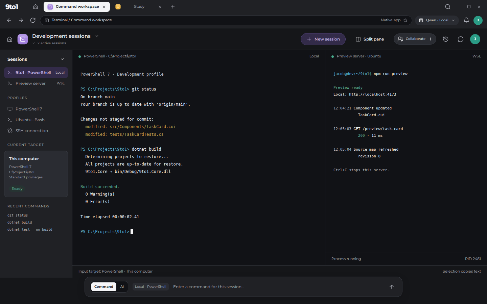
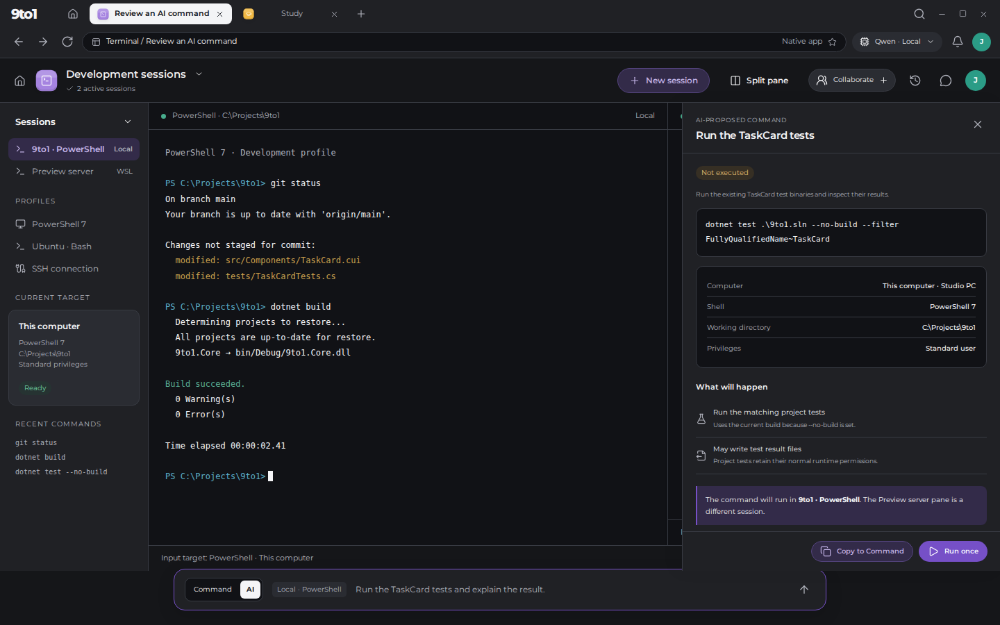

# Terminal — Command and AI modes

Module ID: `terminal` · 9to1 Development Specification v3

## Prerequisites

- **CUI, themes and shared interaction system** — Typed UI components, theme tokens/materials, layout, focus, motion, accessibility and shared control states.
- **Permissions, approvals and execution scope** — Effective scoped grants, action approvals, policy intersections, revocation and audit.
- **Artifacts, local persistence and recovery** — Canonical artifacts, revisions, typed edits, local saves, derived exports, sync and recovery.
- **Dulche runtime, requests and execution services** — Canonical AI broker, capability-aware routing, durable Task/Runs, action execution and lifecycle.

## Overview

Terminal is a real terminal/PTY application with explicit target, session and Command/AI mode. AI proposals are reviewable commands, not automatically executed prose.

## Layouts & visible states

- **V3-TERMINAL-LAY-01** — Keep Command/AI switch, selected shell/profile, target/device and working directory visible. Use authentic terminal output, cursor/input and session/tab/pane controls.
- **V3-TERMINAL-LAY-02** — Command review shows the exact executable text, target, directory, proposed effect and explicit run/cancel controls. Visually wrapped text must not change command syntax.

## Features & behaviour

- **V3-TERMINAL-FEA-01** — Retain real PTY, process, shell/profile, panes/sessions and source-defined remote capabilities. Copying selected text is not input to the shell.
- **V3-TERMINAL-FEA-02** — AI mode explains/proposes within scope; execution requires the actual action authority and target session. Paste/multiline policy remains explicit.
- **V3-TERMINAL-FEA-03** — Reconnect opens or attaches according to real session capability; do not pretend a lost remote process has resumed if it has not.

## Canonical entities & persistence

- **V3-TERMINAL-ENT-01** — Persist terminal profile/configuration and authorised session references; command/output history follows privacy policy and shell/runtime truth.
- **V3-TERMINAL-ENT-02** — Task/action receipts reference exact target/session/command and outcome where available; no invented exit code.

## Permissions & recovery

- **V3-TERMINAL-PER-01** — Check target/cwd and command approval when running. Protect secrets in logs and review surfaces.
- **V3-TERMINAL-PER-02** — Show disconnected, exited, denied, uncertain and failed states distinctly; retry must not duplicate an already-applied external effect.

## Acceptance checks

- **V3-TERMINAL-ACC-01** — Test Command versus AI, select/copy/paste, proposed command review and execution into the correct real session.
- **V3-TERMINAL-ACC-02** — Verify multiline quoting, local/remote target changes, process exit and reconnect truthfulness.

## Exact mock-up and state map

- **Terminal · Command workspace** — screen `terminal`. Command.
- **Terminal · Review an AI command** — screen `terminal-command-review`. AI proposal · local target.

## Source clause IDs

UX27-OTHER-012

## Technical reading map

- Terminal — Command and AI modes — Terminal; Product role and core invariant (part 01) — `technical/terminal-01.md` (3,924 words; V2-B1817).
- Terminal — Command and AI modes — Terminal sessions and process state (part 02) — `technical/terminal-02.md` (103 words; V2-B2318, V2-B2319, V2-B2320).

Technical clauses retain APIs, data models, platform, recovery, donor and acceptance details. The technical files are part of this module, not optional background reading. Shared prerequisites mean stable service/interface contracts must be available; they do not require every dependent app UI to be complete. Use the named chunk for the relevant subtask or the complete module file for its full retained contract.

# Exact designs and implementation rules

These figures are the exact current atlas compositions. Their stable screen IDs match the Word specification and editable source. Open the atlas for full-size theme and interaction inspection.

## Terminal · Command workspace

Screen ID: `terminal`. Source: Terminal: AI / Command mode switcher, PTY sessions, tabs and panes; UX27-OTHER-012.

- Command mode executes in the visible selected shell. AI mode is a separate input route; ordinary commands are not sent to a model.
- Every pane shows its actual session, working directory and process state. Switching panes must not silently retarget pending input.
- A disconnected remote session retains its transcript and explains reconnect semantics.
- Closing a tab must make its effect on the owned process clear. Text selection is distinct from command input.

## Terminal · Review an AI command

Screen ID: `terminal-command-review`. Source: Terminal / AI and Command modes, approval and PTY sessions; UX27-OTHER-012.

- The proposed command is shown before execution with the actual shell, session, working directory and privilege context. This example is configured to review AI-generated commands.
- Command and AI modes remain visible and distinct. Copying a suggestion to the command field does not execute it; Run once is an explicit separate action.
- The transcript is previous terminal output. The new command is clearly Not executed and has no fabricated exit code or result.
- The terminal adapter receives the approved command for the selected session only. Closing the review leaves unrelated processes and the other pane running.
