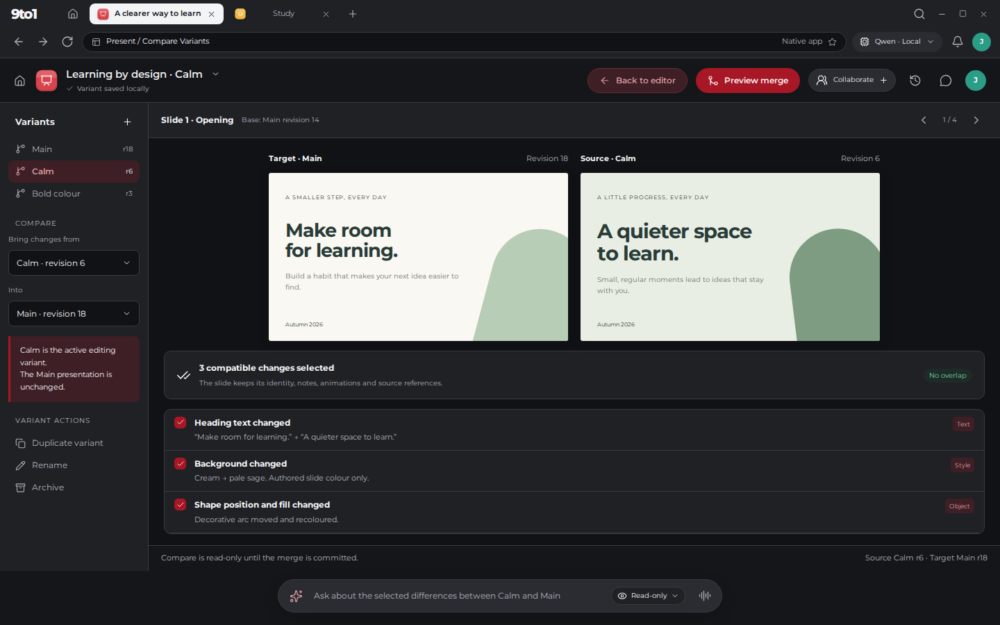

# Variants — integrated comparison and merge

Module ID: `variants` · 9to1 Development Specification v3

## Prerequisites

- **CUI, themes and shared interaction system** — Typed UI components, theme tokens/materials, layout, focus, motion, accessibility and shared control states.
- **Shared productivity engine and canonical embeds** — Real document/object engines, semantic editing, canonical app embedding and donor feature parity.
- **Artifacts, local persistence and recovery** — Canonical artifacts, revisions, typed edits, local saves, derived exports, sync and recovery.
- **Permissions, approvals and execution scope** — Effective scoped grants, action approvals, policy intersections, revocation and audit.

## Overview

Variants is an integrated capability in Write, Data, Present, Canvas, Picture, Prototype and Sites. It is not a separate standalone application. Each owner supplies domain-aware comparison and merge semantics.

## Layouts & visible states

- **V3-VARIANTS-LAY-01** — Open a Variants panel within the active owner app, identifying base/source/target revisions, candidate differences and selected comparison.
- **V3-VARIANTS-LAY-02** — Show merge preview, conflicts and exact apply/reject controls in the owning app context, preserving the canonical artifact canvas/document.

## Features & behaviour

- **V3-VARIANTS-FEA-01** — Compare stable object identities and app semantics rather than only pixels or plain text. Support source-defined creation/naming/selection and history.
- **V3-VARIANTS-FEA-02** — Apply chosen changes through the owner’s typed command/revision/undo contract. A whole-version replacement fallback is explicit when semantic merge is unsupported.
- **V3-VARIANTS-FEA-03** — Preview never mutates source or target. Merge must explain conflicts and preserve unrelated changes.

## Canonical entities & persistence

- **V3-VARIANTS-ENT-01** — Persist variant IDs, ancestry/base, source/target artifact revisions, comparison/change-set IDs, resolution and applied result.
- **V3-VARIANTS-ENT-02** — The owning app remains authoritative; Variants does not create a parallel document format.

## Permissions & recovery

- **V3-VARIANTS-PER-01** — Respect source/target permissions and expected target revision. Stale comparison requires refresh/reconciliation.
- **V3-VARIANTS-PER-02** — Recover failed merge atomically where supported and preserve undo/history; do not silently flatten native content.

## Acceptance checks

- **V3-VARIANTS-ACC-01** — Exercise preview/reject/apply, one semantic conflict, stale target and undo in supported owner apps.
- **V3-VARIANTS-ACC-02** — Verify no standalone Variants destination and no source mutation before explicit application.

## Exact mock-up and state map

- **Present · Compare Variants** — screen `variants`. Variants.

## Source clause IDs

TF-V01, TF-V02, TF-V03

## Technical reading map

- Variants — integrated comparison and merge — Variants; Integrated variant UI and branch identity (part 01) — `technical/variants-01.md` (674 words; V2-B2169).

Technical clauses retain APIs, data models, platform, recovery, donor and acceptance details. The technical files are part of this module, not optional background reading. Shared prerequisites mean stable service/interface contracts must be available; they do not require every dependent app UI to be complete. Use the named chunk for the relevant subtask or the complete module file for its full retained contract.

# Retained technical requirements

# Variants — integrated comparison and merge — Variants; Integrated variant UI and branch identity (part 01)

Reading status: active retained clauses, subject to the v3 owner overrides listed in the primary module. Historical process instructions and replaced original wording are stored separately.

### V2-B2169 · v2 lines 12713–12726

Variants
TF-V01 — Integrated variant UI and branch identity
Variants MUST ship within Write, Data, Present, Canvas, Picture, Prototype and Sites. It is not a separate app or Files organisation type. Version history answers which earlier state to return to; Variants lets users explore multiple directions in parallel without overwriting the starting version merely to experiment.
Each supported app MUST expose a consistent Variants entry near the document/version controls. The panel lists the main/current working line and named alternatives with base/current revision, modified state and useful compare/merge status. Required actions are Create variant, Switch, Rename, Duplicate variant, Compare, Bring changes back/Merge and Archive/remove variant through the owning recovery rules. The active variant MUST remain clearly identified in the editor title/status and save destination. A user MUST not unknowingly type into the main version after switching to an alternative.
Creating a variant records a stable VariantID, parent/base RevisionID and its own revision head. Switching resolves unsaved work through save or an explicit recoverable decision, not silent discard. A variant is a separately addressable branch of the owning artifact, not a manually duplicated filename or Files shortcut. Autosave, undo/redo, collaboration, search/deep links and restart MUST retain the active branch identity. A deep link to a variant MUST not silently open Main.
TF-V02 — Comparison, selective merge and conflicts
Compare MUST allow selection of base/source/target variants and provide content-appropriate side-by-side or change-focused presentation. The interface MUST identify additions, removals, edits and conflicts, offer next/previous change and show what accepting a selected change will affect. Colour alone MUST not convey the difference. An edit to the source or target during comparison invalidates or refreshes the merge preview rather than permitting a stale overwrite.
Merge MUST be an owning-app semantic operation against explicit source, base and expected target revisions. It requires a preview, selected changes or a clearly labelled whole-version choice, validation and a final commit. Compatible independent changes can be combined; overlapping or incompatible changes remain visible for resolution. Resolution must state Keep target, Use source or the supported manual choice. The implementation MUST NOT guess away conflicts or claim a generic byte merge is safe for every artifact type.
If safe selective merge is unavailable for a particular content operation, the app MUST provide a faithful compare-and-choose workflow and explain its scope. Choosing the source creates a new target revision while retaining recoverable history; it MUST NOT erase the target's earlier line. A failed/cancelled merge leaves both branches intact. Retry is idempotent, and a revision mismatch returns a conflict rather than overwriting newer work. Archive/remove MUST not delete the only retained content without the normal recovery/confirmation contract.
TF-V03 — Required owning-app comparison semantics
Write MUST compare stable text/block structure, edits, formatting and referenced objects; text and formatting conflicts remain distinguishable. Data MUST compare sheets/tables, stable rows/columns/cells, values, formulas, schema and named dependencies; it MUST not splice unrelated rows merely because their current indices match. Present MUST compare slide identity/order, objects, content, layout and presentation-level dependencies.
Canvas MUST compare stable objects, geometry, strokes, grouping, connectors and source references. Picture MUST compare layers, masks, transformations, adjustments and image data using the actual supported document structure; incompatible raster edits require a visible choose/manual-resolution path rather than invented pixel-level semantic merging. Prototype MUST compare typed objects/properties, formulas, bindings, component definitions and relationships and validate the resulting model before commit.
Sites MUST compare pages, components, routes, content, assets and settings through Sites' own model. Comparing, switching or merging a site variant MUST NOT publish or change production deployment by itself. Deployment remains an explicit existing Sites operation with its separate permissions and confirmations. Secrets, credentials and live provider state MUST not be copied into a branch merely because project settings are versioned.
Variants acceptance MUST create, edit, switch, compare and bring changes back in all seven apps; retain the starting version; expose an overlapping conflict; exercise the safe whole-version fallback; reject a stale merge; recover after save interruption; and reopen at the selected branch. Test each app's specific content families above. A shared button bar without working per-app comparison/merge is not coverage.

# Exact designs and implementation rules

These figures are the exact current atlas compositions. Their stable screen IDs match the Word specification and editable source. Open the atlas for full-size theme and interaction inspection.

## Present · Compare Variants

Screen ID: `variants`. Source: TF-V01–03: integrated Variants; Present canonical slide/object comparison.

- Variants is integrated into Present, not a separate app. The active branch appears beside document identity.
- Compare names the source, base and target; additions, edits and conflicts use more than colour alone.
- Selected changes are previewed before a semantic merge against explicit revisions. A stale preview must be refreshed.
- Switching or merging variants preserves both branches and does not publish or present the artifact.
