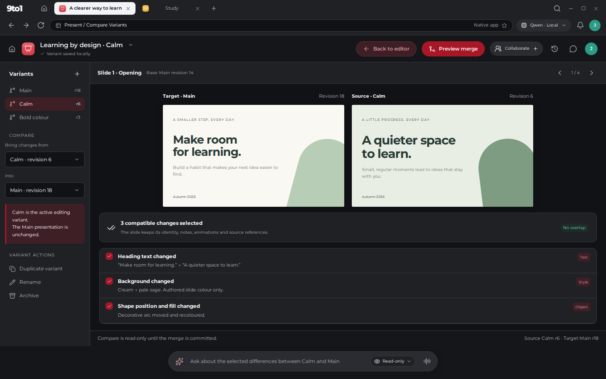

# Variants — integrated comparison and merge

Module ID: `variants` · 9to1 Development Specification v3

## Prerequisites

- **CUI, themes and shared interaction system** — Typed UI components, theme tokens/materials, layout, focus, motion, accessibility and shared control states.
- **Shared productivity engine and canonical embeds** — Real document/object engines, semantic editing, canonical app embedding and donor feature parity.
- **Artifacts, local persistence and recovery** — Canonical artifacts, revisions, typed edits, local saves, derived exports, sync and recovery.
- **Permissions, approvals and execution scope** — Effective scoped grants, action approvals, policy intersections, revocation and audit.

## Overview

Variants is an integrated capability in Write, Data, Present, Canvas, Picture, Prototype and Sites. It is not a separate standalone application. Each owner supplies domain-aware comparison and merge semantics.

## Layouts & visible states

- **V3-VARIANTS-LAY-01** — Open a Variants panel within the active owner app, identifying base/source/target revisions, candidate differences and selected comparison.
- **V3-VARIANTS-LAY-02** — Show merge preview, conflicts and exact apply/reject controls in the owning app context, preserving the canonical artifact canvas/document.

## Features & behaviour

- **V3-VARIANTS-FEA-01** — Compare stable object identities and app semantics rather than only pixels or plain text. Support source-defined creation/naming/selection and history.
- **V3-VARIANTS-FEA-02** — Apply chosen changes through the owner’s typed command/revision/undo contract. A whole-version replacement fallback is explicit when semantic merge is unsupported.
- **V3-VARIANTS-FEA-03** — Preview never mutates source or target. Merge must explain conflicts and preserve unrelated changes.

## Canonical entities & persistence

- **V3-VARIANTS-ENT-01** — Persist variant IDs, ancestry/base, source/target artifact revisions, comparison/change-set IDs, resolution and applied result.
- **V3-VARIANTS-ENT-02** — The owning app remains authoritative; Variants does not create a parallel document format.

## Permissions & recovery

- **V3-VARIANTS-PER-01** — Respect source/target permissions and expected target revision. Stale comparison requires refresh/reconciliation.
- **V3-VARIANTS-PER-02** — Recover failed merge atomically where supported and preserve undo/history; do not silently flatten native content.

## Acceptance checks

- **V3-VARIANTS-ACC-01** — Exercise preview/reject/apply, one semantic conflict, stale target and undo in supported owner apps.
- **V3-VARIANTS-ACC-02** — Verify no standalone Variants destination and no source mutation before explicit application.

## Exact mock-up and state map

- **Present · Compare Variants** — screen `variants`. Variants.

## Source clause IDs

TF-V01, TF-V02, TF-V03

## Technical reading map

- Variants — integrated comparison and merge — Variants; Integrated variant UI and branch identity (part 01) — `technical/variants-01.md` (674 words; V2-B2169).

Technical clauses retain APIs, data models, platform, recovery, donor and acceptance details. The technical files are part of this module, not optional background reading. Shared prerequisites mean stable service/interface contracts must be available; they do not require every dependent app UI to be complete. Use the named chunk for the relevant subtask or the complete module file for its full retained contract.

# Exact designs and implementation rules

These figures are the exact current atlas compositions. Their stable screen IDs match the Word specification and editable source. Open the atlas for full-size theme and interaction inspection.

## Present · Compare Variants

Screen ID: `variants`. Source: TF-V01–03: integrated Variants; Present canonical slide/object comparison.

- Variants is integrated into Present, not a separate app. The active branch appears beside document identity.
- Compare names the source, base and target; additions, edits and conflicts use more than colour alone.
- Selected changes are previewed before a semantic merge against explicit revisions. A stale preview must be refreshed.
- Switching or merging variants preserves both branches and does not publish or present the artifact.
