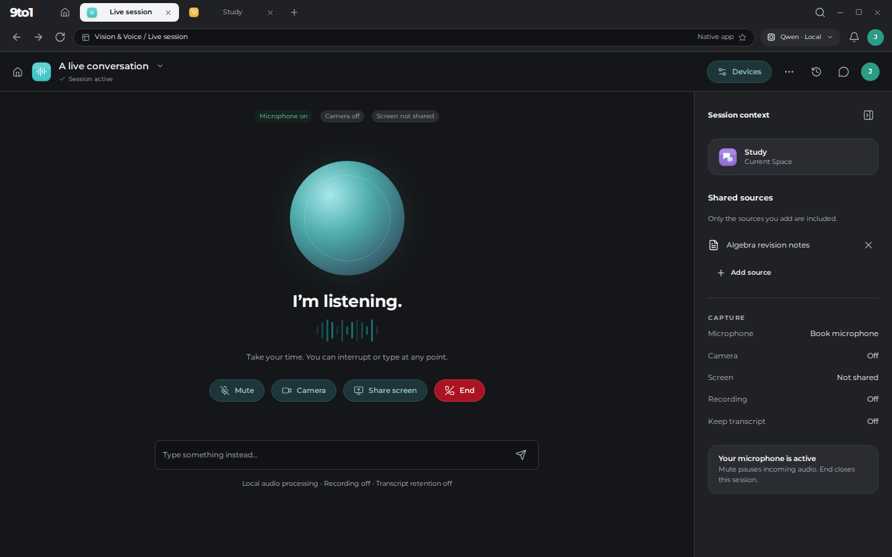
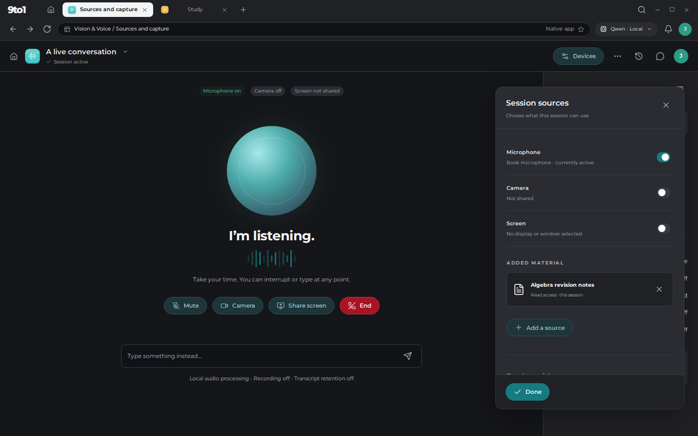

# Vision & Voice — shared live session system

Module ID: `vision-voice` · 9to1 Development Specification v3

## Prerequisites

- **CUI, themes and shared interaction system** — Typed UI components, theme tokens/materials, layout, focus, motion, accessibility and shared control states.
- **Dulche runtime, requests and execution services** — Canonical AI broker, capability-aware routing, durable Task/Runs, action execution and lifecycle.
- **Models, discovery and universal model routing** — Model discovery/lifecycle, stable provider capabilities, ordered routing and truthful usage/effort metadata.
- **Permissions, approvals and execution scope** — Effective scoped grants, action approvals, policy intersections, revocation and audit.
- **Artifacts, local persistence and recovery** — Canonical artifacts, revisions, typed edits, local saves, derived exports, sync and recovery.

## Overview

Vision & Voice owns real conversational speech, visual context and live translation services, reused by the in-chat Voice pill. Multiple surfaces attach to the same session rather than creating a second speech/capture stack.

## Layouts & visible states

- **V3-VISION-VOICE-LAY-01** — Support Conversational, Monologue, Live Listener and Live Translate modes with actual listening/speaking/paused/ended states.
- **V3-VISION-VOICE-LAY-02** — Expose current voice/model, mute, camera, screen/window/region sharing, captions, device/settings and end controls with persistent capture indicators.
- **V3-VISION-VOICE-LAY-03** — Full app and compact Spaces pill keep the same ConversationID/SpaceID/Voice SessionID; Open in Vision & Voice preserves continuity.

## Features & behaviour

- **V3-VISION-VOICE-FEA-01** — Route voice/transcription/vision through real supported models and named voices. Model capability, route locality and account limits remain truthful.
- **V3-VISION-VOICE-FEA-02** — Support typed text with the live conversation, turn-taking/interruption and source-defined tools/visual inputs under current permissions.
- **V3-VISION-VOICE-FEA-03** — Display real latency/connection/failure data when available; do not fabricate a connected call or live waveform from idle state.

## Canonical entities & persistence

- **V3-VISION-VOICE-ENT-01** — Persist canonical session/conversation identities, model/voice route, allowed capture sources, transcripts/outputs and retention policy.
- **V3-VISION-VOICE-ENT-02** — Active capture streams and device handles are ephemeral runtime state, separate from durable transcript/artifact storage.

## Permissions & recovery

- **V3-VISION-VOICE-PER-01** — Camera/screenshare require explicit permission; voice activation alone cannot enable them. Ending sharing stops actual frames/samples at the runtime boundary.
- **V3-VISION-VOICE-PER-02** — Recover unavailable device, network loss, model failure and interrupted speech while preserving permitted conversation content.

## Acceptance checks

- **V3-VISION-VOICE-ACC-01** — Test two-way speech, interruption, captions, camera/share grant and immediate stop of capture.
- **V3-VISION-VOICE-ACC-02** — Switch between Spaces pill/full app without a new session, test each supported mode and verify denied/unsupported capability states.

## Exact mock-up and state map

- **Vision & Voice · Live session** — screen `vision-voice`. Session.
- **Vision & Voice · Sources and capture** — screen `vision-session-sources`. Interaction state.

## Source clause IDs

Named baseline section(s) retained in the technical-source chapters below.

## Technical reading map

- Vision & Voice — shared live session system — Vision & Voice; Product role (part 01) — `technical/vision-voice-01.md` (2,387 words; V2-B0904, V2-B0905, V2-B0906…).
- Vision & Voice — shared live session system — Overlay continuity; Voice tools and consequential actions (part 02) — `technical/vision-voice-02.md` (1,043 words; V2-B0989, V2-B0990, V2-B0991…).

Technical clauses retain APIs, data models, platform, recovery, donor and acceptance details. The technical files are part of this module, not optional background reading. Shared prerequisites mean stable service/interface contracts must be available; they do not require every dependent app UI to be complete. Use the named chunk for the relevant subtask or the complete module file for its full retained contract.

# Retained technical requirements

# Vision & Voice — shared live session system — Vision & Voice; Product role (part 01)

Reading status: active retained clauses, subject to the v3 owner overrides listed in the primary module. Historical process instructions and replaced original wording are stored separately.

### V2-B0904 · v2 lines 4202–4203

Vision & Voice
Product role

### V2-B0905 · v2 lines 4206–4206

Vision & Voice is the dedicated user-facing multimodal AI surface for live voice, text-with-voice, images, screenshots, camera input, screen-aware interaction and contextual ambient listening. The underlying realtime/audio model runtime lives in Dulche; Vision & Voice owns user-facing session controls, capture sources, privacy state, presentation and Overlay integration.

### V2-B0906 · v2 lines 4209–4209

Vision & Voice MUST use the same canonical conversations, Spaces, model/provider state, Plugins, Skills, Agents, permissions, Action Graph and Dulche Den context as the rest of 9to1. Starting Voice MUST NOT create an isolated voice-only conversation database.

### V2-B0907 · v2 lines 4212–4212

Session-first modern interface

### V2-B0908 · v2 lines 4215–4215

The full Vision & Voice app MUST use a modern session-first CUI interface focused on the active interaction rather than a conventional text-chat layout. The centre of the UI shows session state and current multimodal activity, with compact Mic, Camera, Screen and more controls plus an explicit End session action.

### V2-B0909 · v2 lines 4218–4218

Transcript, current visual sources, model/voice, Space/conversation, tools/actions, Action Graph and device/session details SHOULD be available through collapsible secondary surfaces so the primary experience remains uncluttered.

### V2-B0910 · v2 lines 4221–4221

Starting and continuing sessions

### V2-B0911 · v2 lines 4224–4224

A multimodal session may start from Vision & Voice, the global AI bar, Spaces, AI Overlay or another app's contextual AI controls. Callers MAY supply SpaceID, ConversationID, current artifact/entity references, selected objects and suggested mode. Supplied semantic context MUST be preferred over redundant visual capture.

### V2-B0912 · v2 lines 4227–4227

If no conversation is supplied, Vision & Voice creates or selects an appropriate conversation under the applicable Space policy. Moving between full Vision & Voice, floating voice pill, Overlay and Spaces MUST preserve the same canonical session/conversation where the user is continuing the same interaction.

### V2-B0913 · v2 lines 4230–4230

Multimodal session model

### V2-B0914 · v2 lines 4233–4233

MultimodalSession MUST contain at least SessionID, ConversationID, SpaceID, VoiceMode, Voice runtime/session reference, effective model policy, selected VoiceModelID/VoiceID where applicable, microphone/camera/screen states, active visual sources, input/output devices, status, created timestamp and revision/state metadata. Live Translate sessions additionally bind a LiveTranslateLanguageSet containing one or more selected languages/locales, direction mode (one-way, bidirectional or multilingual), per-output caption/speech preferences and selected glossary/terminology references where present.

### V2-B0915 · v2 lines 4236–4236

Required session states include Starting, Listening, UserSpeaking, Processing, AssistantSpeaking, Paused, Reconnecting, Stopped, Ended and Failed or equivalent explicit states. The UI MUST make microphone/capture/listening state unambiguous and MUST NOT rely on a purely decorative animation.

### V2-B0916 · v2 lines 4239–4239

Voice modes

### V2-B0917 · v2 lines 4242–4242

Voice MUST support four first-class modes: Conversational, Monologue, Live Listener and Live Translate. They share Dulche/session infrastructure but have distinct turn-taking, execution and retention behaviour.

### V2-B0918 · v2 lines 4245–4245

Conversational mode

### V2-B0919 · v2 lines 4248–4248

Conversational mode is optimised for low-latency back-and-forth dialogue, natural interruption, normal questions/follow-ups, mixed speech/text input, tools/actions and moderate assistant turns. The assistant expects turn exchange rather than uninterrupted long-form narration.

### V2-B0920 · v2 lines 4251–4251

Monologue mode

### V2-B0921 · v2 lines 4254–4254

Monologue mode is optimised for sustained AI speech such as podcasts, lectures, project briefings or long-form explanations. It MUST support substantially longer uninterrupted output, section/chapter planning, pause/resume, user interruption and continuation from the prior position without losing the planned structure.

### V2-B0922 · v2 lines 4257–4257

Monologue MAY expose optional target duration and style controls such as briefing, podcast, lecture or explanation while still inferring these settings from the user's request when clear. A MonologueRun SHOULD retain Objective, optional TargetDuration, ordered Sections, CurrentSection, playback/progress state and SourceRefs so Resume has deterministic semantics.

### V2-B0923 · v2 lines 4260–4260

Live Listener mode

### V2-B0924 · v2 lines 4263–4263

Live Listener is a contextual ambient-listening mode for lessons, lectures, meetings, presentations, workshops and similar environments. It MUST continuously derive relevant semantic information and permitted actions without behaving as a default permanent recorder/transcriber.

### V2-B0925 · v2 lines 4266–4266

Live Listener MUST be capable of extracting useful structured information such as current topic, important points, key dates, homework/tasks, decisions, questions, referenced resources and potential actions. It MAY react to contextual cues through typed actions, for example opening Canvas when a lesson moves to whiteboard work or creating a Planner item when homework/deadline information is clearly detected and authorised.

### V2-B0926 · v2 lines 4269–4269

Live Listener MUST contextually distinguish likely primary relevant speech from background conversation, incidental noise, repeated information, action cues and uncertain material using available audio characteristics, continuity, current Space/topic and semantic relevance. It MUST represent uncertainty rather than treating every audible statement as authoritative/relevant.

### V2-B0927 · v2 lines 4272–4272

Live Listener ephemeral audio and privacy

### V2-B0928 · v2 lines 4275–4275

Live Listener MUST NOT persist a room conversation as a transcript or permanent audio recording by default. Ambient audio is processed through a short-lived ephemeral rolling buffer required for understanding; once no longer needed for semantic extraction/runtime continuity, raw audio is discarded.

### V2-B0929 · v2 lines 4278–4278

Durable Live Listener output should be the useful derived result such as notes, tasks, dates, decisions, references or explicit user-approved retained snippets, not a verbatim transcript of everyone in the room.

### V2-B0930 · v2 lines 4281–4281

Explicit recording/transcription is a separate opt-in retention mode with clear persistent UI indication and applicable legal/privacy warnings. Live Listener MUST NOT silently enable recording merely because retaining audio would improve later processing.

### V2-B0931 · v2 lines 4284–4284

The Live Listener surface MUST clearly show Listening state, current Space/context, extraction categories/actions enabled, Recording audio state and Transcript retention state, with Pause and Stop controls. A compact activity feed MAY show semantic events/actions without reproducing ambient speech verbatim.

### V2-B0932 · v2 lines 4287–4287

Live Listener notes and actions

### V2-B0933 · v2 lines 4290–4290

Users MUST be able to choose where Live Listener writes durable notes/results, including temporary session notes or supported canonical destinations such as a Write document, Board page or Study Space notes. Updates MUST use the destination app's typed API and revision semantics.

### V2-B0934 · v2 lines 4293–4293

Automatic Live Listener action policy MUST be configurable through normal Home permissions/trust. Low-risk actions such as adding notes, recording homework, opening relevant 9to1 apps or adding authorised Planner dates MAY run automatically where trusted; consequential external communication, submission, deletion, purchase or similarly high-risk actions retain their normal confirmation/trust requirements.

### V2-B0935 · v2 lines 4296–4296

Live Listener integrates with Spaces. Starting it from a Study/Research/Agent/user-created Space supplies that Space's authorised sources, tools, Skills, Plugins, Agents, memory and model policy. Space graphs may subscribe to safe Live Listener events and invoke typed actions within their capability profile.

### V2-B0936 · v2 lines 4299–4299

Live Translate mode

### V2-B0937 · v2 lines 4302–4302

Live Translate is a first-class realtime interpretation mode backed jointly by Dulche Voice and Dulche Translate. Vision & Voice owns the live session UI/capture/output presentation; Dulche Voice owns realtime audio/session streaming; Dulche Translate owns language detection, translation, terminology/glossaries, translation context and multi-language variant generation.

### V2-B0938 · v2 lines 4305–4305

Live Translate MUST support one-way, bidirectional and multilingual interpretation. A one-way session may translate one source language into one or more output languages. Bidirectional mode interprets between selected languages based on turn/language context. Multilingual mode may contain more than two active languages and MUST support multiple simultaneous target outputs when the active model/runtime can do so.

### V2-B0939 · v2 lines 4308–4308

A Live Translate session MUST expose the selected language/locale set clearly and allow languages to be added or removed without ending the session where supported. Source language MAY be Auto Detect, but an explicit expected language set SHOULD be used to improve reliability in noisy multilingual environments.

### V2-B0940 · v2 lines 4311–4311

Translated speech, translated captions and original-language captions MUST be independently controllable where supported. One source utterance MAY produce simultaneous caption/output streams in multiple target languages. Each connected/authorised output client MAY choose its preferred target language when platform/session architecture supports per-client outputs.

### V2-B0941 · v2 lines 4314–4314

Live Translate SHOULD preserve short-lived conversational translation context so pronouns, corrections, terminology and follow-up statements remain coherent. It MUST represent uncertainty rather than inventing a confident translation when language/speaker/meaning is materially ambiguous.

### V2-B0942 · v2 lines 4317–4317

Live Translate MUST handle natural corrections and partial speech without prematurely treating unstable hypotheses as final durable content. For example, a speaker correcting a date within the same turn should yield a coherent corrected translation rather than two contradictory final statements.

### V2-B0943 · v2 lines 4320–4320

Live Translate MAY use Vision sources to translate signs, menus, presentation slides, shared screens and other visible text during the same session. When structured semantic text is available from a 9to1 app, that semantic text is preferred over OCR/pixels.

### V2-B0944 · v2 lines 4323–4323

Live Translate supports normal Voice tools, Dulche Agents and authorised typed actions. A user may ask for an action based on translated context, such as saving translated notes, sending an approved translated message or applying translated content to an owning artifact. Agentic actions MUST use the normal owning-app APIs, permissions, approvals, idempotency and Action Graph; translation does not grant broader authority.

### V2-B0945 · v2 lines 4326–4326

Live Translate MAY use selected Dulche Translate glossaries/protected-term rules so product names, legal terms, code identifiers or domain terminology remain consistent across speech and captions.

### V2-B0946 · v2 lines 4329–4329

Live Translate raw audio and ordinary conversation transcript MUST be ephemeral by default. The runtime may retain a short-lived rolling audio/translation-context buffer required for realtime interpretation and then discard it. Saving a transcript or audio recording is a separate explicit opt-in with visible state and applicable privacy/legal warnings.

### V2-B0947 · v2 lines 4332–4332

Live Translate is distinct from Live Listener: Live Translate's primary purpose is realtime cross-language interpretation, whereas Live Listener's primary purpose is ambient understanding, derived notes and contextual actions. Either may use normal Agents/tools, but one mode MUST NOT silently change into the other.

### V2-B0948 · v2 lines 4335–4335

Text input during Voice

### V2-B0949 · v2 lines 4338–4338

Every active Voice session MUST support typed text input without ending the session. Spoken and typed user messages share the same ConversationID and session context. Text input is required for precise names, URLs/code, private instructions, corrections, attachments and situations where the user wants speech output without speaking aloud.

### V2-B0950 · v2 lines 4341–4341

Voice MUST support modality combinations including Voice in + Voice out, Voice in + Text out, Text in + Voice out and Voice with captions where the active model/configuration supports them.

### V2-B0951 · v2 lines 4344–4344

Interruption, stop and resume

### V2-B0952 · v2 lines 4347–4347

Users MUST be able to interrupt assistant speech naturally. Dulche should stop/duck current speech output and process the new input without requiring a manual Stop first, subject to runtime capability.

### V2-B0953 · v2 lines 4350–4350

Explicit Pause, Resume, Mute and End controls remain available. If a generated response/run is manually stopped but resumable, Vision & Voice uses the same Stop → Play/Resume semantics as Spaces and MUST NOT repeat already-completed consequential actions.

### V2-B0954 · v2 lines 4353–4353

Floating voice pill

### V2-B0955 · v2 lines 4356–4356

When the full Vision & Voice app is not foregrounded, an active session MAY collapse to a lightweight floating voice pill. The pill MUST expose true listening/speaking/status indication, mute/unmute, pause/resume where applicable, return to full Vision & Voice and End session.

### V2-B0956 · v2 lines 4359–4359

Opening the pill/full app returns to the same SessionID and MUST NOT silently start a second Voice session.

### V2-B0957 · v2 lines 4362–4362

Transcript and captions

### V2-B0958 · v2 lines 4365–4365

Conversational/Monologue sessions MAY expose a live transcript as an optional/collapsible conversation view distinguishing user, assistant and tool/action events. Partial speech-recognition hypotheses may update live, but only stable/final user content should enter durable conversation history unless a revision model explicitly supports corrections.

### V2-B0959 · v2 lines 4368–4368

Live Listener and Live Translate do not use ordinary transcript retention by default as defined above. Live captions may be enabled independently of durable transcript retention. In Live Translate, original-language and translated captions are independently controllable where supported; caption display alone MUST NOT imply that a permanent transcript is being saved.

### V2-B0960 · v2 lines 4371–4371

Audio devices and processing

### V2-B0961 · v2 lines 4374–4374

Vision & Voice MUST support input microphone selection, output device selection, default/automatic device, hot-switching during a session, permission/unavailable/disconnected states and appropriate input/output level feedback. Device loss MUST degrade/recover gracefully rather than corrupt the conversation.

### V2-B0962 · v2 lines 4377–4377

Noise suppression, echo cancellation, automatic gain and voice-activity detection MAY be provided when supported by the platform/runtime, with sensible defaults and inspectable advanced settings.

### V2-B0963 · v2 lines 4380–4380

Universal Model Picker integration and named voices

### V2-B0964 · v2 lines 4383–4383

Vision & Voice uses Home's Universal Model Picker. The selected Voice Model/configuration MUST be capability-checked for the requested mode and modalities, including realtime audio, Monologue, Live Listener, Live Translate, vision, tools/actions, required language/translation support and interruption where relevant.

### V2-B0965 · v2 lines 4386–4386

If the selected Voice Model exposes multiple named voices, the user-facing picker field is Voice and shows the available voices, with the underlying Voice Model shown as secondary metadata. Internally VoiceModelID and VoiceID remain separate. If no separate voices are exposed, the field is Voice Model.

### V2-B0966 · v2 lines 4389–4389

Discover/Home SHOULD recommend the highest-quality compatible Voice Model/configuration for the requested mode/constraints when the user has not explicitly overridden it. Switching named Voice MUST NOT be misrepresented as changing the underlying model.

### V2-B0967 · v2 lines 4392–4392

Vision sources

### V2-B0968 · v2 lines 4395–4395

Supported explicit visual-source families include UploadedImage, Screenshot, ScreenRegion, WindowShare, DisplayShare, Camera and AppProvidedVisualContext. Every active source MUST have session-local stable identity, provenance/source type and visible active/paused state.

### V2-B0969 · v2 lines 4398–4398

The UI MUST make clear what AI can currently see. Continuous sharing is distinct from a single screenshot and must expose source, pause, change source and stop-sharing controls.

### V2-B0970 · v2 lines 4401–4401

Screenshots, screen sharing and camera

### V2-B0971 · v2 lines 4404–4404

Screenshot capture SHOULD support full display, selected window and selected region, with easy region capture from Overlay. Captures MAY be cropped/annotated before submission where supported.

### V2-B0972 · v2 lines 4407–4407

Continuous screen sharing MUST show an unmistakable persistent capture indicator and source identity. Pausing/stopping sharing MUST stop new visual frames from reaching the runtime.

### V2-B0973 · v2 lines 4410–4410

Camera mode MUST support available camera selection, snapshot, supported continuous camera context, pause and camera switching. Microphone/camera/screen capture MUST never activate solely because the model decides additional context would help.

### V2-B0974 · v2 lines 4413–4413

Adaptive visual sampling

### V2-B0975 · v2 lines 4416–4416

For continuous camera/screen input, Dulche MAY use adaptive frame sampling/change detection and model/provider limits to reduce redundant processing. Sampling is an optimisation only; stale visual state MUST NOT be represented as current.

### V2-B0976 · v2 lines 4419–4419

Semantic context before pixels

### V2-B0977 · v2 lines 4422–4422

When a 9to1 app exposes semantic context such as ArtifactID, selection/object IDs, structured document context and available typed actions, Vision & Voice MUST prefer that structured context over screenshot/OCR/screen scraping. Vision supplements semantic APIs rather than replacing them.

### V2-B0978 · v2 lines 4425–4425

Deliberately attached images/screenshots may persist as conversation sources. Continuous camera/screen frames MUST remain ephemeral by default and MUST NOT all become permanent attachments.

### V2-B0979 · v2 lines 4428–4428

Privacy and local/cloud boundaries

### V2-B0980 · v2 lines 4431–4431

Vision & Voice MUST visibly indicate active microphone, camera and screen/window sharing plus relevant cloud-model use when required by privacy policy. Pausing/stopping a source must actually stop new data delivery.

### V2-B0981 · v2 lines 4434–4434

Local-only/private model policy MUST NOT silently fall back to a cloud model for audio, camera or screen processing. Any local-to-cloud fallback follows the Universal Model Picker's explicit fallback/privacy rules.

### V2-B0982 · v2 lines 4437–4437

AI Overlay

### V2-B0983 · v2 lines 4440–4440

AI Overlay is a global lightweight contextual entry point owned by Vision & Voice and invoked through a configured keyboard shortcut, floating button and/or supported contextual selection action. It is not a normal page opened inside the Vision & Voice app.

### V2-B0984 · v2 lines 4443–4443

Overlay combines authorised semantic context from the foreground 9to1 app, selected text/objects, explicit screenshot/window/region capture and manually attached files/images. For non-9to1 apps or unavailable semantic APIs, explicit Vision capture may provide visual context.

### V2-B0985 · v2 lines 4446–4446

Overlay MUST be fast, compact and capable of rendering CUI/Generative UI result/action cards. Overlay actions MUST invoke typed 9to1 APIs/Automations rather than arbitrary mouse/keyboard automation.

### V2-B0986 · v2 lines 4449–4449

Overlay automation execution

### V2-B0987 · v2 lines 4452–4452

Overlay MUST be able to discover and execute existing Automations relevant to the current typed selection/context. For example, selecting text and invoking an Automation named Send to my Boss supplies the selected text plus source metadata through the Automation's declared input schema.

### V2-B0988 · v2 lines 4455–4455

Overlay passes typed inputs such as selected Text/File/Artifact references, AppID, ArtifactID/ObjectID and additional authorised context. Missing required Automation inputs MUST be requested from the user rather than guessed when unsafe.

# Vision & Voice — shared live session system — Overlay continuity; Voice tools and consequential actions (part 02)

Reading status: active retained clauses, subject to the v3 owner overrides listed in the primary module. Historical process instructions and replaced original wording are stored separately.

### V2-B0989 · v2 lines 4458–4458

Automation execution from Overlay uses the canonical Automation definition, permissions, approvals, Action Graph, logging, idempotency and error handling. Overlay MUST NOT independently emulate the Automation's actions or use it to bypass consequential-action confirmation.

### V2-B0990 · v2 lines 4461–4461

Overlay continuity

### V2-B0991 · v2 lines 4464–4464

Overlay MUST support Continue in Spaces, preserving the same conversation/request context and retained explicit sources. Closing the transient Overlay closes only the overlay UI; ephemeral captures are discarded according to retention policy unless deliberately retained.

### V2-B0992 · v2 lines 4467–4467

If a Voice session is already active, invoking Overlay MAY augment the same session, for example allowing the user to select a screen region while saying 'look at this bit' without spawning a second assistant.

### V2-B0993 · v2 lines 4470–4470

Voice tools and consequential actions

### V2-B0994 · v2 lines 4473–4473

Spoken or typed Voice requests may execute normal authorised 9to1 app/tool actions. Voice does not reduce permission requirements. High-risk confirmation prompts MUST identify the concrete target/action rather than relying on ambiguous verbal confirmation.

### V2-B0995 · v2 lines 4476–4476

AI-assisted dictation

### V2-B0996 · v2 lines 4479–4479

Dictation is a separate reusable speech-to-text editing capability, not a full Voice conversation mode. It MUST be available to supported editable text surfaces such as Write, Spaces, Mail, Boards, Present speaker notes, Planner descriptions, Sites, AI Studio and other CUI text editors through the shared platform capability.

### V2-B0997 · v2 lines 4482–4482

During Dictation the AI does not respond conversationally or speak back. It converts speech into editable text/actions in the host app. Dictation SHOULD support Raw, Clean and Polished modes or equivalent: Raw remains close to literal transcription; Clean removes filler/repetition/false starts and adds punctuation; Polished may lightly restructure rambling speech into well-written prose while preserving intended meaning.

### V2-B0998 · v2 lines 4485–4485

Dictation MUST support contextual correction/commands such as new paragraph, bullet list, heading changes, delete/replace recent text and spoken self-corrections, applied through the host app/shared productivity engine rather than being inserted literally when recognised as commands.

### V2-B0999 · v2 lines 4488–4488

Dictation MAY use limited authorised current-editor context to improve terminology, names and punctuation. It MUST NOT use unrelated private context merely to improve transcription.

### V2-B1000 · v2 lines 4491–4491

Background/session continuity

### V2-B1001 · v2 lines 4494–4494

An explicitly active Voice session may continue when the Vision & Voice window loses focus according to platform permission/background rules. Camera/screen sharing continues only while its visible capture state remains active; OS/session lock must suspend/stop sensitive capture according to platform policy.

### V2-B1002 · v2 lines 4497–4497

If Home/Dulche temporarily restarts, Vision & Voice MUST preserve durable conversation/session metadata, show truthful Reconnecting/failed state and reconnect where supported. It MUST NOT indicate that microphone/model processing is active while disconnected.

### V2-B1003 · v2 lines 4500–4500

Accessibility

### V2-B1004 · v2 lines 4503–4503

Vision & Voice MUST support captions, keyboard-only controls, screen-reader-labelled session/capture states, visual equivalents for audio state, adjustable caption/text sizing where applicable, reduced motion and non-colour-only state indication. No required action may be voice-only.

### V2-B1005 · v2 lines 4506–4506

Platform capability behaviour

### V2-B1006 · v2 lines 4509–4509

Native Windows/9to1-OS may provide the full OS-global Overlay, native window/display capture and background voice capabilities. Web may provide microphone, camera and browser-authorised screen sharing but MUST NOT claim an OS-global Overlay outside the browser. Mobile uses supported camera/microphone/share-sheet/screen-capture capabilities. All surfaces capability-negotiate rather than assuming parity.

### V2-B1007 · v2 lines 4512–4512

Vision & Voice API

### V2-B1008 · v2 lines 4515–4540

9to1.VisionVoice.Start(config);
9to1.VisionVoice.GetSession(sessionID);
9to1.VisionVoice.End(sessionID);
9to1.VisionVoice.SetMode(sessionID, mode);
9to1.VisionVoice.SendText(sessionID, text);
9to1.VisionVoice.SetMicrophone(sessionID, enabled);
9to1.VisionVoice.SetCamera(sessionID, source?);
9to1.VisionVoice.SetScreenShare(sessionID, source?);
9to1.VisionVoice.CaptureScreenshot(config);
9to1.VisionVoice.AddVisualSource(sessionID, source);
9to1.VisionVoice.RemoveVisualSource(sessionID, sourceID);
9to1.VisionVoice.SetTranscriptVisible(sessionID, visible);
9to1.VisionVoice.SetCaptions(sessionID, enabled);
9to1.VisionVoice.SetLiveTranslateLanguages(sessionID, languages);
9to1.VisionVoice.SetLiveTranslateDirection(sessionID, direction);
9to1.VisionVoice.SetLiveTranslateOutput(sessionID, config);
9to1.VisionVoice.SetLiveTranslateGlossaries(sessionID, glossaryIDs);
9to1.VisionVoice.Overlay.Open(context?);
9to1.VisionVoice.Overlay.Close();
9to1.VisionVoice.Overlay.CaptureRegion();
9to1.VisionVoice.Overlay.RunAutomation(automationID, context);
9to1.VisionVoice.ContinueInSpaces(sessionID);
9to1.Dictation.Start(context, mode);
9to1.Dictation.Stop(sessionID);
9to1.Dictation.GetState(sessionID);
9to1.Dictation.SetMode(sessionID, mode);

### V2-B1009 · v2 lines 4543–4543

Dulche remains execution authority for realtime audio/model streaming and exposes the corresponding Voice runtime APIs. Vision & Voice APIs own user-facing session/capture/presentation state and MUST NOT duplicate the Dulche runtime as a second incompatible engine.

### V2-B1010 · v2 lines 4546–4546

Failure behaviour

### V2-B1011 · v2 lines 4549–4549

Vision & Voice MUST return structured failures including MicrophonePermissionDenied, CameraPermissionDenied, ScreenCapturePermissionDenied, InputDeviceUnavailable, OutputDeviceUnavailable, CameraUnavailable, CaptureSourceUnavailable, VoiceModelUnavailable, VisionCapabilityUnavailable, ModelCapabilityMismatch, SessionDisconnected, SessionNotFound, VisualSourceUnavailable, CaptureStopped, ProviderUnavailable, PrivacyPolicyDenied, AutomationInputMissing, DictationUnavailable, LiveTranslateLanguageUnsupported, LiveTranslateLanguageAmbiguous, LiveTranslateCapabilityUnavailable and LiveTranslateOutputUnavailable in addition to normal Dulche/Translate/tool/action errors.

### V2-B1012 · v2 lines 4552–4552

Acceptance requirements

### V2-B1013 · v2 lines 4555–4585

Vision & Voice is implementation-complete only when acceptance coverage verifies at least:
* Conversational, Monologue, Live Listener and Live Translate operate as distinct modes on shared canonical session/conversation infrastructure.
* Typed text can be submitted during an active Voice session without ending it.
* Conversational Voice supports natural interruption plus explicit pause/mute/end state.
* Monologue preserves outline/progress and can resume after interruption/stopping without restarting completed content/actions.
* Live Listener extracts structured lesson/meeting information while raw ambient audio/transcript is not persisted by default.
* Explicit recording/transcription opt-in is visibly distinct from default Live Listener.
* Live Listener can create authorised notes/homework/date actions and trigger a low-risk contextual app action such as opening Canvas.
* Live Translate supports one-way, bidirectional and more-than-two-language sessions, including simultaneous target captions/output where supported.
* Live Translate uses Dulche Translate for language/glossary/context handling and does not create a second translation engine.
* Live Translate raw audio and ordinary transcript are ephemeral by default unless the user explicitly enables retention.
* Live Translate can use normal Agents/tools and perform authorised translated-context actions only through owning typed APIs and normal approval rules.
* Background/irrelevant speech is not indiscriminately written into notes and uncertain action cues do not silently cause consequential actions.
* Floating voice pill controls the same SessionID as the full app.
* Microphone/output device can hot-switch and device loss produces a recoverable truthful state.
* Voice named-voice selection stores VoiceID separately from VoiceModelID and the UI label becomes Voice when multiple voices exist.
* Discover/Universal Model Picker can recommend/select a compatible high-quality Voice Model without burying Voice under Audio.
* Voice + screenshot, Voice + continuous screen share and camera input work with visible capture state.
* Stopping camera/screen sharing immediately stops delivery of new frames.
* Semantic app context is preferred over screen scraping when available.
* Local-only/privacy policy cannot silently route audio/visual input to cloud.
* Overlay can capture selected context and use typed APIs rather than arbitrary input simulation.
* Overlay can execute an existing Automation using typed selected-text/context input and preserves the Automation's permission/Action Graph contract.
* Continue in Spaces preserves the active conversation/context.
* A high-risk spoken action still requires the correct explicit target-aware confirmation.
* Dictation works in at least Write, Spaces and Mail as non-conversational speech-to-text with Raw/Clean/Polished behaviour.
* Dictation removes filler/false starts in Clean/Polished modes without changing intended meaning and applies supported editing commands through host APIs.
* Home/Dulche restart produces a truthful reconnect/failed state without losing durable conversation state.
* Continuous capture frames remain ephemeral rather than being permanently attached by default.
* Web/native capability differences are reported accurately, including no false claim of OS-global Overlay on web.
* Mic/camera/screen/listening states and all required controls are accessible and not communicated by colour alone.

# Exact designs and implementation rules

These figures are the exact current atlas compositions. Their stable screen IDs match the Word specification and editable source. Open the atlas for full-size theme and interaction inspection.

## Vision & Voice · Live session

Screen ID: `vision-voice`. Source: UX27-SPACES-014; Vision & Voice/Live Listener ephemeral audio baseline.

- Listening, audio recording, camera and screen sharing are separate visibly controlled states.
- Source and processing location are explicit. This session shows microphone only, local audio processing and recording off.
- Typed input remains available without ending the voice session. Captions do not become commands automatically.
- Ambient audio uses ephemeral buffering by default. Saving audio/transcript is an explicit retention choice.

## Vision & Voice · Sources and capture

Screen ID: `vision-session-sources`. Source: Owner revision 28 October; UX27-SPACES-014; explicit capture and retention.

- The source sheet separates camera, screen, microphone and retained transcript permissions.
- A source must be explicitly selected before it becomes live context. Disabled capture is never inferred from an active microphone.
- Stopping capture removes that live source; transcript retention remains a separate choice.
