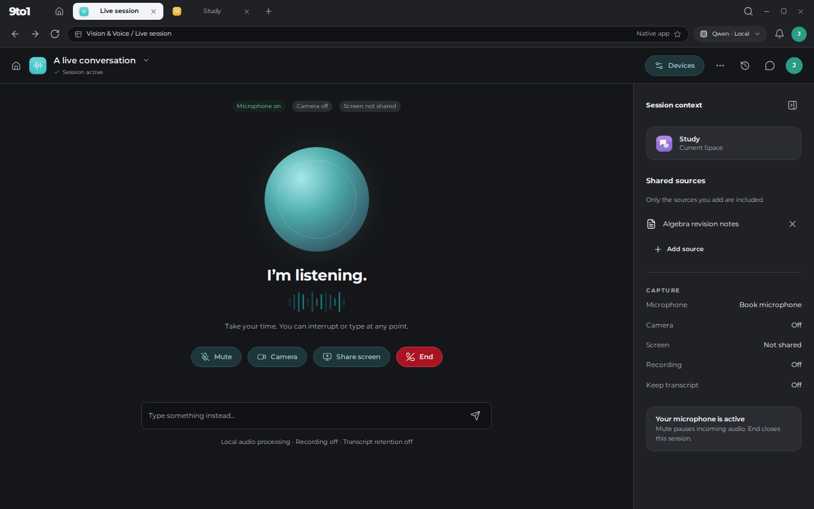
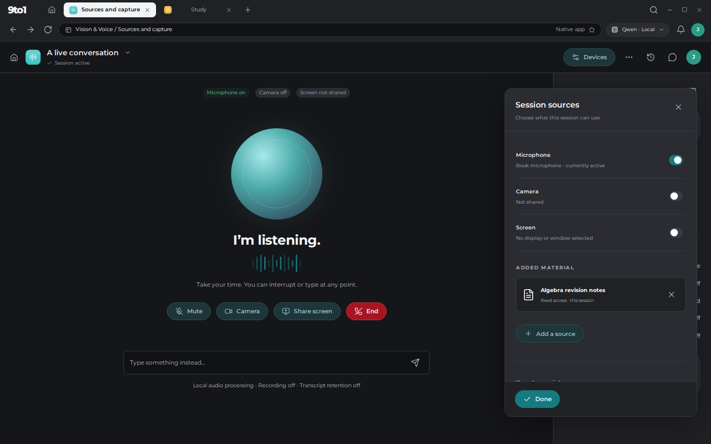

# Vision & Voice — shared live session system

Module ID: `vision-voice` · 9to1 Development Specification v3

## Prerequisites

- **CUI, themes and shared interaction system** — Typed UI components, theme tokens/materials, layout, focus, motion, accessibility and shared control states.
- **Dulche runtime, requests and execution services** — Canonical AI broker, capability-aware routing, durable Task/Runs, action execution and lifecycle.
- **Models, discovery and universal model routing** — Model discovery/lifecycle, stable provider capabilities, ordered routing and truthful usage/effort metadata.
- **Permissions, approvals and execution scope** — Effective scoped grants, action approvals, policy intersections, revocation and audit.
- **Artifacts, local persistence and recovery** — Canonical artifacts, revisions, typed edits, local saves, derived exports, sync and recovery.

## Overview

Vision & Voice owns real conversational speech, visual context and live translation services, reused by the in-chat Voice pill. Multiple surfaces attach to the same session rather than creating a second speech/capture stack.

## Layouts & visible states

- **V3-VISION-VOICE-LAY-01** — Support Conversational, Monologue, Live Listener and Live Translate modes with actual listening/speaking/paused/ended states.
- **V3-VISION-VOICE-LAY-02** — Expose current voice/model, mute, camera, screen/window/region sharing, captions, device/settings and end controls with persistent capture indicators.
- **V3-VISION-VOICE-LAY-03** — Full app and compact Spaces pill keep the same ConversationID/SpaceID/Voice SessionID; Open in Vision & Voice preserves continuity.

## Features & behaviour

- **V3-VISION-VOICE-FEA-01** — Route voice/transcription/vision through real supported models and named voices. Model capability, route locality and account limits remain truthful.
- **V3-VISION-VOICE-FEA-02** — Support typed text with the live conversation, turn-taking/interruption and source-defined tools/visual inputs under current permissions.
- **V3-VISION-VOICE-FEA-03** — Display real latency/connection/failure data when available; do not fabricate a connected call or live waveform from idle state.

## Canonical entities & persistence

- **V3-VISION-VOICE-ENT-01** — Persist canonical session/conversation identities, model/voice route, allowed capture sources, transcripts/outputs and retention policy.
- **V3-VISION-VOICE-ENT-02** — Active capture streams and device handles are ephemeral runtime state, separate from durable transcript/artifact storage.

## Permissions & recovery

- **V3-VISION-VOICE-PER-01** — Camera/screenshare require explicit permission; voice activation alone cannot enable them. Ending sharing stops actual frames/samples at the runtime boundary.
- **V3-VISION-VOICE-PER-02** — Recover unavailable device, network loss, model failure and interrupted speech while preserving permitted conversation content.

## Acceptance checks

- **V3-VISION-VOICE-ACC-01** — Test two-way speech, interruption, captions, camera/share grant and immediate stop of capture.
- **V3-VISION-VOICE-ACC-02** — Switch between Spaces pill/full app without a new session, test each supported mode and verify denied/unsupported capability states.

## Exact mock-up and state map

- **Vision & Voice · Live session** — screen `vision-voice`. Session.
- **Vision & Voice · Sources and capture** — screen `vision-session-sources`. Interaction state.

## Source clause IDs

Named baseline section(s) retained in the technical-source chapters below.

## Technical reading map

- Vision & Voice — shared live session system — Vision & Voice; Product role (part 01) — `technical/vision-voice-01.md` (2,387 words; V2-B0904, V2-B0905, V2-B0906…).
- Vision & Voice — shared live session system — Overlay continuity; Voice tools and consequential actions (part 02) — `technical/vision-voice-02.md` (1,043 words; V2-B0989, V2-B0990, V2-B0991…).

Technical clauses retain APIs, data models, platform, recovery, donor and acceptance details. The technical files are part of this module, not optional background reading. Shared prerequisites mean stable service/interface contracts must be available; they do not require every dependent app UI to be complete. Use the named chunk for the relevant subtask or the complete module file for its full retained contract.

# Exact designs and implementation rules

These figures are the exact current atlas compositions. Their stable screen IDs match the Word specification and editable source. Open the atlas for full-size theme and interaction inspection.

## Vision & Voice · Live session

Screen ID: `vision-voice`. Source: UX27-SPACES-014; Vision & Voice/Live Listener ephemeral audio baseline.

- Listening, audio recording, camera and screen sharing are separate visibly controlled states.
- Source and processing location are explicit. This session shows microphone only, local audio processing and recording off.
- Typed input remains available without ending the voice session. Captions do not become commands automatically.
- Ambient audio uses ephemeral buffering by default. Saving audio/transcript is an explicit retention choice.

## Vision & Voice · Sources and capture

Screen ID: `vision-session-sources`. Source: Owner revision 28 October; UX27-SPACES-014; explicit capture and retention.

- The source sheet separates camera, screen, microphone and retained transcript permissions.
- A source must be explicitly selected before it becomes live context. Disabled capture is never inferred from an active microphone.
- Stopping capture removes that live source; transcript retention remains a separate choice.
