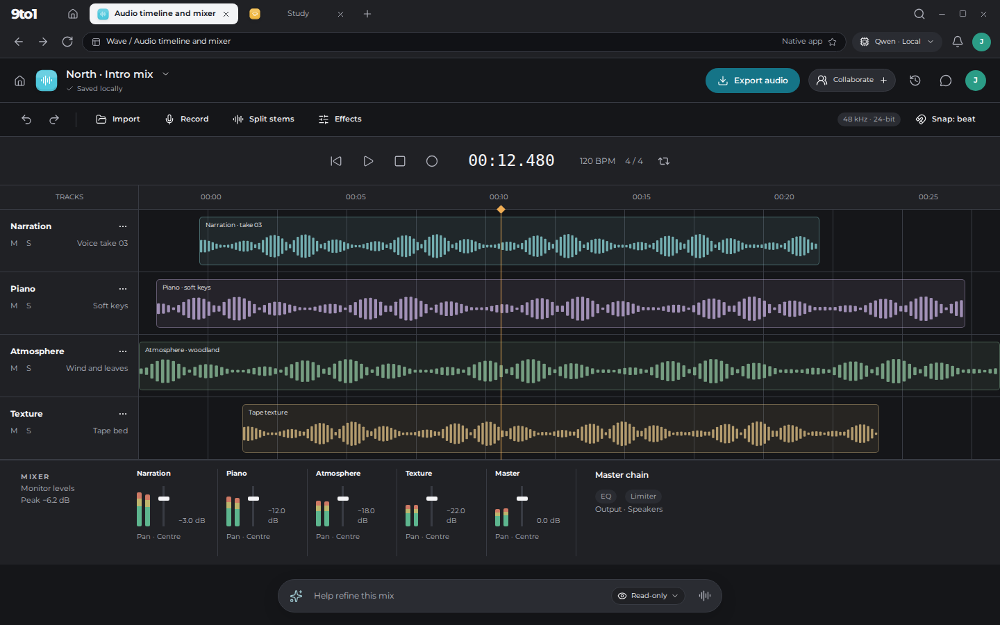
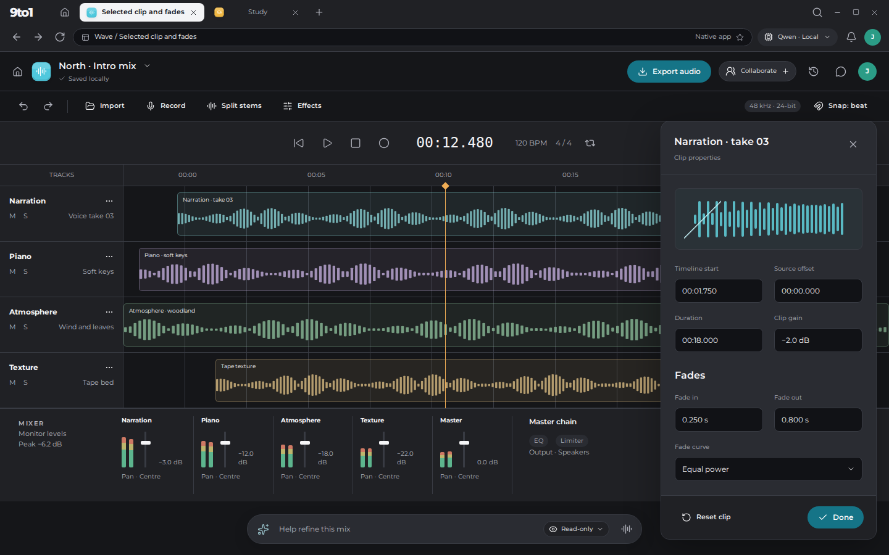
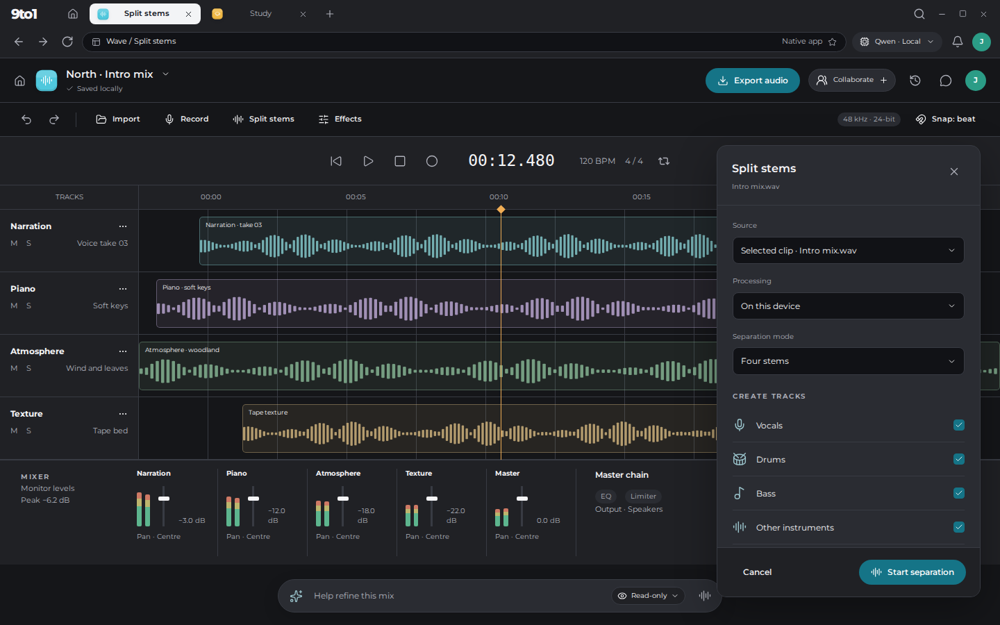

# Wave — multitrack audio production

Module ID: `wave` · 9to1 Development Specification v3

## Prerequisites

- **CUI, themes and shared interaction system** — Typed UI components, theme tokens/materials, layout, focus, motion, accessibility and shared control states.
- **Artifacts, local persistence and recovery** — Canonical artifacts, revisions, typed edits, local saves, derived exports, sync and recovery.
- **Permissions, approvals and execution scope** — Effective scoped grants, action approvals, policy intersections, revocation and audit.
- **Shared AI controls and artifact collaboration** — Contextual AI bars, shared model/permission controls, global collaborators and typed artifact proposals.

## Overview

Wave provides real multitrack audio recording/editing, effects and mixing. The UI’s waveform, meters, transport and rendered outputs must reflect the actual audio engine.

## Layouts & visible states

- **V3-WAVE-LAY-01** — Use multitrack timeline, track headers, clip waveforms, playhead/time ruler, transport, selected clip properties and effect/mixer context.
- **V3-WAVE-LAY-02** — Show recording permission/device state, armed tracks, actual levels and pending/failed rendering. Range, playhead and whole-project actions remain distinct.

## Features & behaviour

- **V3-WAVE-FEA-01** — Retain source-defined audio import, record, trim/split/move, fades, automation, effect/bus routing and mixing capabilities.
- **V3-WAVE-FEA-02** — Coordinate timeline units, sample rate and selection ranges precisely. Playback/recording does not silently commit source edits.
- **V3-WAVE-FEA-03** — Export/render uses a known time range and project revision; unknown duration or processing time must not be fabricated.

## Canonical entities & persistence

- **V3-WAVE-ENT-01** — Persist ProjectID, track/clip/resource IDs, time offsets, automation/effects/bus graph, routing, sample metadata and revisions.
- **V3-WAVE-ENT-02** — Source media, editable arrangement, playback state and rendered output are separate records.

## Permissions & recovery

- **V3-WAVE-PER-01** — Microphone/device capture requires explicit permission and persistent indicators. End recording stops the actual engine capture.
- **V3-WAVE-PER-02** — Recover missing media/devices, interrupted recording and failed render while preserving usable source clips and project state.

## Acceptance checks

- **V3-WAVE-ACC-01** — Test record/import→edit range→effects/automation→play→render, clip/time alignment and undo.
- **V3-WAVE-ACC-02** — Verify capture shutdown, missing-device recovery and export receipts matching the selected range/revision.

## Exact mock-up and state map

- **Wave · Audio timeline and mixer** — screen `wave`. Timeline.
- **Wave · Selected clip and fades** — screen `wave-clip`. Interaction state.
- **Wave · Split stems** — screen `wave-stems`. Interaction state.

## Source clause IDs

UX27-OTHER-008

## Technical reading map

- Wave — multitrack audio production — Wave; Product role and native-generation principle (part 01) — `technical/wave-01.md` (3,204 words; V2-B1668).
- Wave — multitrack audio production — Wave audio timeline (part 02) — `technical/wave-02.md` (92 words; V2-B2306, V2-B2307, V2-B2308).

Technical clauses retain APIs, data models, platform, recovery, donor and acceptance details. The technical files are part of this module, not optional background reading. Shared prerequisites mean stable service/interface contracts must be available; they do not require every dependent app UI to be complete. Use the named chunk for the relevant subtask or the complete module file for its full retained contract.

# Exact designs and implementation rules

These figures are the exact current atlas compositions. Their stable screen IDs match the Word specification and editable source. Open the atlas for full-size theme and interaction inspection.

## Wave · Audio timeline and mixer

Screen ID: `wave`. Source: UX27-OTHER-008–009; Wave multitrack, stem separation and source preservation baseline.

- Waveform and transport share one timebase. The display is an illustrative audio fixture, not a rendered source file.
- Trims, fades, gain and effects remain nondestructive and preserve original media.
- Split Stems is a first-class tool with supported backend modes, not only a chat command.
- Export uses the selected actual range; missing source media remains visible with a recoverable relink action.

## Wave · Selected clip and fades

Screen ID: `wave-clip`. Source: Owner revision 28 October; UX27-OTHER-008–009; nondestructive clip edits.

- The selected clip retains source offset, timeline start, duration and gain as separate values.
- Fade handles and numeric fade fields operate on the same clip envelope. Split and trim preserve the source media.
- Level metering and effects use the same playback timebase. The waveform shown is an illustrative fixture.

## Wave · Split stems

Screen ID: `wave-stems`. Source: Owner revision 28 October; Wave first-class stem separation.

- Split Stems is a tool with selected source, backend, output tracks and resource state. It is not only an AI chat instruction.
- The original source remains on its track. Outputs become separate clips with provenance and shared alignment.
- A separation job has Pending, Running, Failed and Complete states; no generated tracks appear before successful completion.
