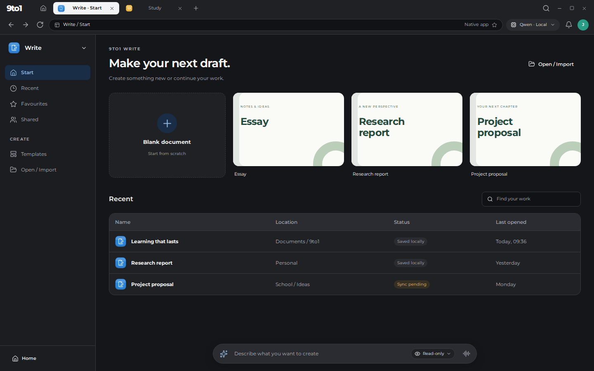
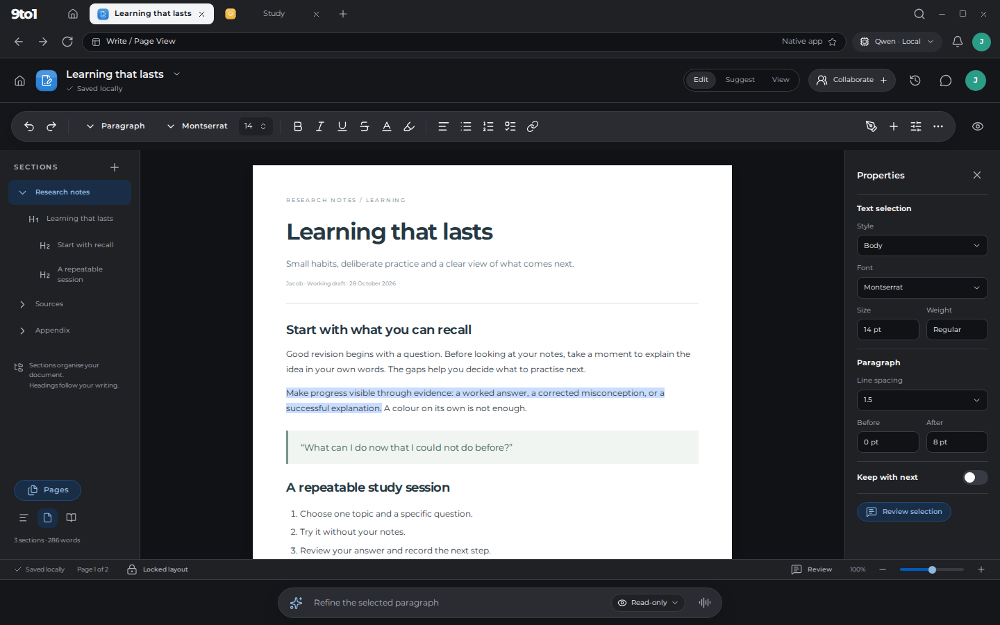
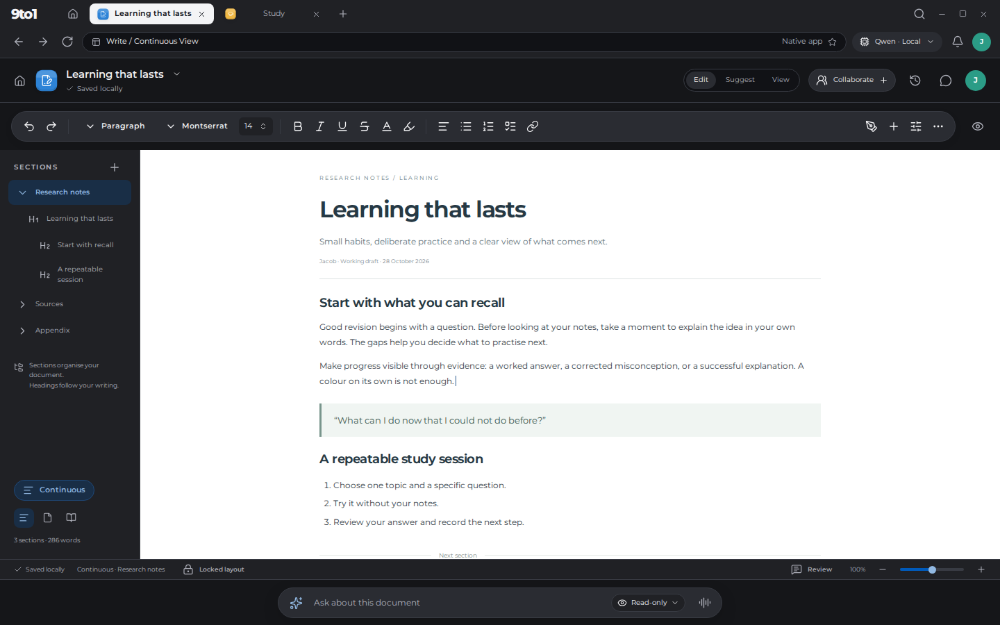
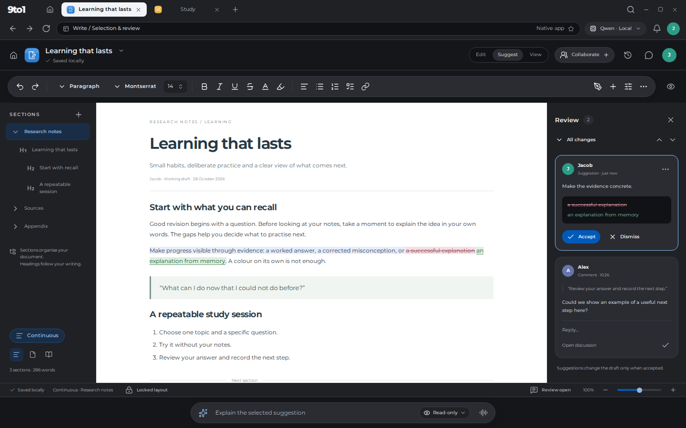
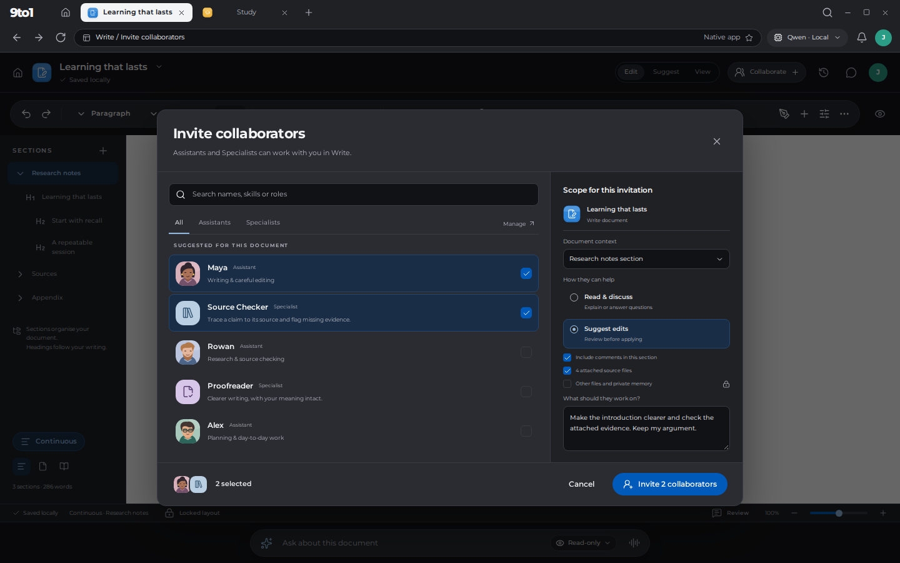
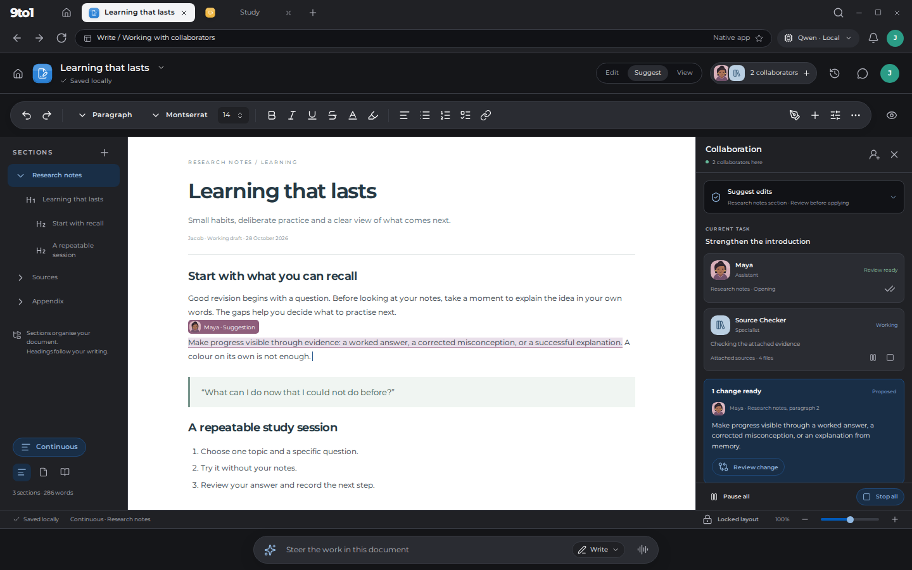

# Write — document authoring

Module ID: `write` · 9to1 Development Specification v3

## Prerequisites

- **CUI, themes and shared interaction system** — Typed UI components, theme tokens/materials, layout, focus, motion, accessibility and shared control states.
- **Shared productivity engine and canonical embeds** — Real document/object engines, semantic editing, canonical app embedding and donor feature parity.
- **Shared AI controls and artifact collaboration** — Contextual AI bars, shared model/permission controls, global collaborators and typed artifact proposals.
- **Artifacts, local persistence and recovery** — Canonical artifacts, revisions, typed edits, local saves, derived exports, sync and recovery.

## Overview

Write is a full document editor with a restrained contextual shell. Continuous, Pages and Book are genuine presentations of the same document, retaining substantive Writer/donor capability and canonical document semantics.

Current owner overrides: V3-OWNER-012.

## Layouts & visible states

- **V3-WRITE-LAY-01** — Use Home/title/save-state header, nested Sections outline and one contextual floating formatting toolbar. Persistent insert, view/eye and more controls remain discoverable; do not add an Office-style ribbon.
- **V3-WRITE-LAY-02** — Continuous is the default flowing document view. Pages shows real page boundaries and pagination; Book shows the supported facing-page reading/editing arrangement. Selecting a layout does not create a different document.
- **V3-WRITE-LAY-03** — Provide selected text/object, insertion picker, typing, comments/history, formatting/property and collaborator review states. Keep the AI bar separate from page content and bottom controls.

## Features & behaviour

- **V3-WRITE-FEA-01** — Support rich text/styles, structured sections, tables, objects, references, fields, comments, tracked suggestions, pagination and exports through the retained full engine contract.
- **V3-WRITE-FEA-02** — Edit/Suggest/View, layout lock and AI Read-only/Write are independent controls. A locked layout is not necessarily a read-only document, and AI Write does not bypass suggestions or document permission.
- **V3-WRITE-FEA-03** — Paragraph/character formatting acts on the actual selection with inspectable defaults. Caret/focus and undo survive toolbar/menu use.
- **V3-WRITE-FEA-04** — Global Assistant/Specialist collaborators create typed revision-bound changes with review, accept/reject and clear authorship.

## Canonical entities & persistence

- **V3-WRITE-ENT-01** — Persist DocumentID, section/block/object IDs, text ranges, styles, revision, comments/suggestions and layout configuration. Layout view state is separate from authored content.
- **V3-WRITE-ENT-02** — Keep native document content authoritative; previews and exported PDF/other formats are derived from a known revision.

## Permissions & recovery

- **V3-WRITE-PER-01** — Respect document and source permissions. A stale collaborator proposal requires reconciliation rather than overwriting intervening edits.
- **V3-WRITE-PER-02** — Autosave/reopen and failed export preserve the native document and meaningful undo/history.

## Acceptance checks

- **V3-WRITE-ACC-01** — Test typing/selection/formatting/insertion, nested Sections and switching Continuous/Pages/Book with unchanged content.
- **V3-WRITE-ACC-02** — Verify Edit/Suggest/View versus AI scope, locked layout, collaborator review, page/export correctness and recovery.

## Exact mock-up and state map

- **Write · Start** — screen `write-launch`. Launch.
- **Write · Page View** — screen `write-editor`. Pages & properties.
- **Write · Continuous View** — screen `write-continuous`. Pageless writing.
- **Write · Selection & review** — screen `write-review`. Suggested change.
- **Write · Invite collaborators** — screen `write-collaborators-picker`. Assistant & Specialist picker.
- **Write · Working with collaborators** — screen `write-collaborators`. Presence & scoped work.

## Source clause IDs

UX27-WRITE-001, UX27-WRITE-002, UX27-WRITE-003, UX27-WRITE-004, UX27-WRITE-005, UX27-WRITE-006, UX27-WRITE-007, SECTION-08, APP-AC-004, LAUNCH-001, LAUNCH-004, WRITE-AC-001, WRITE-AC-002, WRITE-AC-003, APP-AC-009, WRITE-UX-101, WRITE-AC-101, CUI-EDITOR-101, WRITE-UX-102, WRITE-UX-103, WRITE-UX-104, WRITE-UX-105, WRITE-UX-106, WRITE-UX-107, WRITE-UX-108, WRITE-UX-109, WRITE-UX-110, WRITE-UX-111, WRITE-UX-112, WRITE-UX-113, WRITE-UX-114, WRITE-UX-115, WRITE-UX-116, WRITE-UX-117, WRITE-UX-118, WRITE-UX-119, WRITE-UX-120, WRITE-AC-102, WRITE-AC-103, WRITE-AC-104, WRITE-AC-105, WRITE-AC-106, WRITE-AC-107, WRITE-AC-108, WRITE-AC-109, UX27-TEST-079, UX27-TEST-080, UX27-TEST-081, UX27-DATAFLOW-005, WRITE-SCALE-201

## Technical reading map

- Write — document authoring — Write — mature document editing through the actual engine; Real document, page and caret (part 01) — `technical/write-01.md` (2,384 words; V2-B1223, V2-B1224, V2-B1225…).
- Write — document authoring — Styles and custom styles; Tables (part 02) — `technical/write-02.md` (1,637 words; V2-B1291, V2-B1292, V2-B1293…).
- Write — document authoring — Non-substitutable word processor; Authentic integrated workflow and artifact inspection (part 03) — `technical/write-03.md` (3,084 words; V2-B1347).
- Write — document authoring — Write; Real document caret and multi-page editing (part 04) — `technical/write-04.md` (320 words; V2-B1348, V2-B2789, V2-B2790…).

Technical clauses retain APIs, data models, platform, recovery, donor and acceptance details. The technical files are part of this module, not optional background reading. Shared prerequisites mean stable service/interface contracts must be available; they do not require every dependent app UI to be complete. Use the named chunk for the relevant subtask or the complete module file for its full retained contract.

# Retained technical requirements

# Write — document authoring — Write — mature document editing through the actual engine; Real document, page and caret (part 01)

Reading status: active retained clauses, subject to the v3 owner overrides listed in the primary module. Historical process instructions and replaced original wording are stored separately.

### V2-B1223 · v2 lines 5297–5297

## 8. Write — mature document editing through the actual engine

### V2-B1224 · v2 lines 5299–5299

### UX27-WRITE-001 — Real document, page and caret

### V2-B1225 · v2 lines 5301–5301

**B/D.** Write remains a mature Writer/LibreOfficeKit-backed word processor, not a block-based web editor. Show actual pages, margins, pagination, text flow and a caret positioned by the document engine. Clicking a line sets the correct insertion position; dragging selects text rather than moving a page container. Text entry, selection and paragraph creation must work across page boundaries without a separate input box detached from the visible document.

### V2-B1226 · v2 lines 5303–5303

Use the same canonical document for the canvas, outline, inspector, AI actions and exports. A page image with an invisible unrelated text field cannot satisfy editable-document behaviour. Test multi-page text, tables and mixed formatting through the real routed app and standalone entry point.

### V2-B1227 · v2 lines 5305–5305

### UX27-WRITE-002 — Contextual toolbar and persistent actions

### V2-B1228 · v2 lines 5307–5307

**B.** Preserve the original Home/backstage, persistent +/Eye/overflow controls and no-permanent-ribbon rule, together with the 12 October rich floating-toolbar amendment. Daily font/style, size, emphasis, alignment, list, colour and link actions are directly reachable. The contextual toolbar is one coherent surface, not several unrelated strips added by each selection type.

### V2-B1229 · v2 lines 5309–5309

Selecting text, a table or an image changes only relevant groups and retains selection. Disabled/mixed states reflect the real engine. Do not hide ordinary Bold/size/style behind a long Properties inspector or turn the entire app into a menu of diagnostic commands.

### V2-B1230 · v2 lines 5311–5311

### UX27-WRITE-003 — Styles and paragraph formatting

### V2-B1231 · v2 lines 5313–5313

**B/D.** The style selector shows the paragraph/character style currently effective at the caret, including mixed selection. Applying a paragraph style updates the intended paragraphs without deleting inline content or replacing document identity. Direct formatting and named-style changes remain distinguishable; changing a style definition updates its references through the engine rather than rewriting each paragraph to an unrelated local style.

### V2-B1232 · v2 lines 5315–5315

Indentation, line spacing, before/after spacing, lists, tabs and page/section breaks have real layout effects. Undo/Redo and save/reopen preserve them. The app theme does not alter authored document colours/fonts or turn a dark document preview into an exported dark page without explicit document styling.

### V2-B1233 · v2 lines 5317–5317

### UX27-WRITE-004 — Sections and navigation

### V2-B1234 · v2 lines 5319–5319

**B/D.** The Sections/outline sidebar reflects semantic document headings/sections with stable targets, nested disclosure and meaningful selection. Clicking navigates to the correct region and reveals it without losing the caret unnecessarily. Renaming a heading from an approved outline action edits the actual text; reordering a section moves its defined content range with preview/undo, not just the sidebar row.

### V2-B1235 · v2 lines 5321–5321

Search shows matches across unloaded pages and navigates by stable positions. A hidden/offscreen paragraph is not absent from search/export. Long-document navigation uses indexes and incremental layout rather than blocking the UI while all prior pages are rendered.

### V2-B1236 · v2 lines 5323–5323

### UX27-WRITE-005 — Tables, images and anchored objects

### V2-B1237 · v2 lines 5325–5325

**B/D.** Table row/column/cell controls operate on real document tables, with merge/split, headers, borders and repeat-header behaviour where the donor supports it. Images support actual wrap/anchor/position/crop/size properties. Selecting an image exposes handles that follow the document’s layout at every zoom; dragging updates a preview and commits one engine transaction.

### V2-B1238 · v2 lines 5327–5327

Changing text before an anchored object follows the chosen anchoring semantics, not arbitrary screen coordinates. Copy/paste and export preserve the relationship or disclose a genuine conversion limitation. Do not substitute a screenshot of a table or image container for its mature engine behaviour.

### V2-B1239 · v2 lines 5329–5329

### UX27-WRITE-006 — Inspector, comments and review state

### V2-B1240 · v2 lines 5331–5331

**B/D.** The optional Properties inspector is resizable and context-specific, with logically grouped controls and a single scroll owner. Common operations stay in the toolbar; precise advanced configuration belongs here. Comments and supported review/track-change states are attached to canonical document ranges, with author/time/revision provenance and navigation to the target.

### V2-B1241 · v2 lines 5333–5333

Accept/reject review actions operate on actual changes, remain undoable where supported and do not silently accept unrelated edits. Missing review support must remain a donor-parity gap, not be hidden because the ordinary text editor passes a smoke test.

### V2-B1242 · v2 lines 5335–5335

### UX27-WRITE-007 — File formats, persistence and export

### V2-B1243 · v2 lines 5337–5337

**B/D.** Preserve the native/shared model and required donor interoperability. Open/save/export use genuine supported formats, with explicit conversion limitations and exact output identity. A successful save is verified by closing and reopening the produced artifact, checking representative text, styles, images, tables, notes/review features and page layout where applicable.

### V2-B1244 · v2 lines 5339–5342

Saving in an ordinary local location must not unnecessarily depend on a cloud account. Large-document autosave is incremental according to the scalability annex. A failed export cannot leave a truncated file labelled complete or replace the only valid original.
<!-- UX27:END SECTION-08 -->
Write
Product role

### V2-B1245 · v2 lines 5345–5345

9to1 Write is the production document/word-processing surface. It MUST behave like a mature word processor rather than a web editor, site builder, Markdown editor, collection of HTML blocks or browser contenteditable surface. LibreOffice Writer/LibreOfficeKit is the mature donor/layout/format engine for text-oriented documents; 9to1 owns the CUI shell, shared Productivity Engine integration, collaboration, AI, Sections model and native extensions.

### V2-B1246 · v2 lines 5348–5348

The document surface MUST use an actual structured document model with paragraph/run/style/section/table/object/reference/review semantics and real layout/text measurement. Caret movement, selection, rich clipboard, IME input, undo/redo transactions, object anchoring, line wrapping, pagination, spelling/grammar ranges, accessibility semantics and large-document behaviour MUST be implemented as document-editor behaviour, not emulated with disconnected DOM widgets.

### V2-B1247 · v2 lines 5351–5351

Continuous view is a presentation of the same structured word-processing document, not conversion into HTML. A document MUST switch between supported views without changing its canonical content or losing document semantics.

### V2-B1248 · v2 lines 5354–5354

Donor parity and objective word-processor behaviour

### V2-B1249 · v2 lines 5357–5357

All applicable LibreOffice Writer functionality, quality-of-life behaviour, keyboard interactions, menus/workflows and file-format depth MUST be preserved or appropriately adapted. A claimed technical impossibility remains an open blocker unless the owner explicitly approves a precise scoped exception with its impact, substitute and evidence under APP-AC-004; documentation alone does not waive donor parity. The donor source is authoritative for inherited functionality; Write MUST NOT ship as a simplified rich-text clone simply because a smaller editor is easier to implement. Normal end-user installation must include the required engine dependencies through the approved packaging/runtime system, not require a separate manual donor installation.

### V2-B1250 · v2 lines 5360–5360

Inherited/core capability includes, where applicable, character and paragraph formatting; custom styles; page styles; headers/footers; sections; columns; page/section breaks; lists/outlines; tables; images/drawings/shapes; equations; fields; bookmarks; cross-references; captions; footnotes/endnotes; tables of contents; indexes; citations/bibliographies; comments; tracked changes; document comparison; spelling/grammar/language features; find/replace; hyphenation; print/page layout; mail merge; document properties; object anchoring/wrapping; export/print and other mature Writer functionality.

### V2-B1251 · v2 lines 5363–5363

Launch and file entry

### V2-B1252 · v2 lines 5366–5366

Without a requested document or supported session to restore, Write opens to a distinct start experience under the shared modern Launch Screen contract and LAUNCH-001–006, with Blank document, Templates, Recent, Favourites, Shared with me, search, Open and Import. Entries MUST be backed by real Files/Drive data rather than mock cards. Creating/opening/importing a document establishes the canonical Write artifact before transitioning into the editor. Direct document opening and supported session restoration enter the requested/restored editor without an intervening start page. The start screen and editor have separate compositions and active interaction scopes within the shared CUI shell: the document canvas and document-specific formatting tools MUST NOT sit below the start page, and launch-only content MUST NOT remain as a header above the editor. Deliberate return to Write’s start surface and resumption preserve the document and applicable session state under LAUNCH-004; the title/backstage menu retains its separately specified behaviour.

### V2-B1253 · v2 lines 5369–5369

Editor shell

### V2-B1254 · v2 lines 5372–5372

Write MUST NOT use a permanent Office-style ribbon. The editing shell consists of a document-title row, a floating contextual toolbar immediately below the title at the top of the document area, an optional collapsible Sections sidebar, the document canvas and the persistent shared AI bar at the bottom.

### V2-B1255 · v2 lines 5375–5375

The Home button sits immediately to the left of the document title and opens an Office-style backstage/file menu for document-level operations such as Info, New, Open, Recent, Save/Save a copy, Share, Export, Print, Version history, Document properties and Settings. Closing the menu returns to the same document/selection position.

### V2-B1256 · v2 lines 5378–5378

Floating contextual toolbar

### V2-B1257 · v2 lines 5381–5381

The floating toolbar stays in a stable position immediately below the title while its contextual controls change according to the current semantic selection. Text, heading, image, table, reference/review and other contexts expose their own relevant operations. An operation that cannot apply to the current selection MUST NOT appear merely because it exists elsewhere in Write; for example Crop image cannot appear when no image is selected.

### V2-B1258 · v2 lines 5384–5384

Three controls are persistent regardless of selection: +, Eye and overflow […]. They remain present even as all other controls change. When horizontal space is constrained, lower-priority contextual actions move into overflow before these persistent controls disappear.

### V2-B1259 · v2 lines 5387–5387

The overflow […] menu contains additional actions relevant to the current context that did not fit or were deprioritised on the main bar. It is not a generic dump of all Write commands. The menu for a table selection differs from the menu for text or an image and MUST exclude inapplicable actions.

### V2-B1260 · v2 lines 5390–5390

Right-click/context menus expose the same semantic action model in menu form. Context menus and the floating bar call the same typed Write/Productivity APIs rather than maintaining parallel behaviour.

### V2-B1261 · v2 lines 5393–5393

Pinned toolbar actions

### V2-B1262 · v2 lines 5396–5396

Users MUST be able to pin supported contextual actions to the top bar and reorder/reset their pinned preferences. Pinning means prioritise this action whenever it is applicable; it MUST NOT force an irrelevant disabled action to occupy the toolbar in unrelated contexts. Pinning is per-user UI preference rather than collaborative document state.

### V2-B1263 · v2 lines 5399–5399

Toolbar priority SHOULD resolve from the most important current-context control, then applicable user-pinned controls, then common contextual actions, followed by the persistent +, Eye and […] controls.

### V2-B1264 · v2 lines 5402–5402

Universal Insert (+)

### V2-B1265 · v2 lines 5405–5405

The persistent + control is the universal Insert entry point. It opens a searchable, context-aware insertion palette rather than requiring an Insert ribbon. The complete palette MUST expose applicable content/structure/reference/9to1 artifact options while prioritising items relevant to the current caret/object context.

### V2-B1266 · v2 lines 5408–5408

Insertion types SHOULD include tables, images, drawings, equations, code blocks, text boxes, shapes/callouts, horizontal lines, page/section breaks, columns, headers/footers, footnotes, citations, cross-references, bookmarks, captions, table of contents, special characters, fields, links/files and supported embedded 9to1 artifacts such as Canvas, Board, Data ranges/charts, Picture, Planner items, Maps and Graphs.

### V2-B1267 · v2 lines 5411–5411

Eye / visibility controls

### V2-B1268 · v2 lines 5414–5414

The persistent Eye control owns view/visibility options rather than document-format mutations. Its menu MUST include the current Write View mode and may include Sections visibility, Comments, spelling/grammar marks, formatting marks, ruler, page boundaries, object anchors, alignment/snap guides and the floating word/character count where applicable.

### V2-B1269 · v2 lines 5417–5417

Most Eye settings are per-user view preferences and MUST NOT change what collaborators see. Contextually useful visibility aids MAY appear only when relevant, for example object bounds/anchors/guides when an object is selected.

### V2-B1270 · v2 lines 5420–5420

Floating document statistics

### V2-B1271 · v2 lines 5423–5423

When enabled from Eye, an unobtrusive document-statistics indicator floats in the bottom-right of the document area without becoming document content or consuming page layout. It SHOULD show document word and character counts, and when text is selected it SHOULD prioritise selection word/character counts. Clicking it MAY reveal expanded statistics such as characters without spaces and page count where meaningful.

### V2-B1272 · v2 lines 5426–5426

The statistics indicator and bottom AI bar MUST coexist without overlap at supported sizes.

### V2-B1273 · v2 lines 5429–5429

Sections sidebar

### V2-B1274 · v2 lines 5432–5432

Write has a Google-Docs-inspired collapsible Sections sidebar on the left. The product terminology is Sections, not Tabs. A Section is a stable user-created structural division of the same Write document and MAY contain nested Sections. Headings inside each Section are derived automatically from document heading/outline styles.

### V2-B1275 · v2 lines 5435–5435

Every Section MUST have stable SectionID, DocumentID, optional ParentSectionID, Name, optional icon/metadata, ordering and revision/state information. Renaming/reordering/nesting MUST preserve SectionID so links, AI context and cross-references are not tied to visible names.

### V2-B1276 · v2 lines 5438–5438

The expanded sidebar presents Sections as stronger/root nodes with the heading hierarchy beneath each Section. Clicking a heading navigates to it; changing heading style updates the outline live. Moving a heading moves its heading plus subordinate content using structured document operations. Moving a Section moves the Section's canonical content safely.

### V2-B1277 · v2 lines 5441–5441

The sidebar has a + control for New section, New subsection, From selection and supported Import-as-section workflows. Section/headings support context actions such as rename, duplicate, move before/after/into, copy link, export section, delete and relevant AI/translation operations.

### V2-B1278 · v2 lines 5444–5444

The Sections sidebar MUST be collapsible to a narrow edge/rail and resizable when expanded. Collapsed/expanded state and width are per-user/device preferences. Collapsing immediately returns horizontal space to the document canvas; navigation/AI actions MUST NOT forcibly reopen it. On narrow layouts the sidebar becomes a temporary drawer. Keyboard and non-drag movement/navigation alternatives are mandatory.

### V2-B1279 · v2 lines 5447–5447

The Sections sidebar and an inserted Table of Contents are distinct. The sidebar is editing/navigation structure; + → Table of contents inserts a real document object generated from configured heading levels/styles.

### V2-B1280 · v2 lines 5450–5450

View modes

### V2-B1281 · v2 lines 5453–5453

Eye exposes three first-class Write View modes: Continuous, Pages and Book. Switching view is immediate presentation state over the same DocumentID, SectionIDs, ObjectIDs, selection, comments and revision. The user's view mode does not force collaborators into the same view.

### V2-B1282 · v2 lines 5456–5456

Continuous is the default for new .9to1w documents unless the chosen template requires another view. It presents one seamless pageless writing surface with a sensible readable content width and no artificial sheet gaps. Real page breaks remain canonical and are shown as unobtrusive markers rather than forcing paper sheets.

### V2-B1283 · v2 lines 5459–5459

Continuous view MUST retain page-aware document features such as headers/footers, footnotes, page numbers, margins, section/page breaks and columns in the underlying document model. The view may present them contextually rather than permanently rendering every page boundary.

### V2-B1284 · v2 lines 5462–5462

Pages renders exact page layout using modern rounded pages, restrained elevation, clean spacing and a neutral workspace while preserving true margins, headers/footers, footnotes, page numbers and print pagination. It MUST not use dated harsh page chrome merely because the donor does.

### V2-B1285 · v2 lines 5465–5465

Book renders publication-aware facing-page spreads and supports odd/even pages, right/left page semantics, mirrored inside/outside margins, binding gutter, different left/right headers/footers, section starts/front matter and deliberate blank-page behaviour. Narrow displays MAY show one page at a time while preserving spread semantics.

### V2-B1286 · v2 lines 5468–5468

View mode is independent from Locked/Unlocked layout mode. Supported combinations include Continuous + Locked, Continuous + Unlocked, Pages + Locked, Pages + Unlocked, Book + Locked and Book + Unlocked.

### V2-B1287 · v2 lines 5471–5471

Locked and Unlocked layout

### V2-B1288 · v2 lines 5474–5474

Write MUST implement the same first-class Locked/Unlocked layout concept as Boards. LayoutMode is independent from the user's current View mode and from AI Read/Write mode.

### V2-B1289 · v2 lines 5477–5477

Locked is the conventional word-processing flow and the default for ordinary documents. Paragraphs/inline content follow document structure and supported objects use anchors/wrapping rules so accidental free positioning is constrained.

### V2-B1290 · v2 lines 5480–5480

Unlocked adds a professional free-positioned visual object layer for supported images, text boxes, shapes, drawings, charts, embedded artifacts, callouts, equations and tables where applicable. Users may drag, resize, rotate, overlap, layer, align, distribute and snap these objects without converting the whole document into arbitrary floating text boxes.

# Write — document authoring — Styles and custom styles; Tables (part 02)

Reading status: active retained clauses, subject to the v3 owner overrides listed in the primary module. Historical process instructions and replaced original wording are stored separately.

### V2-B1291 · v2 lines 5483–5483

Unlocked object controls MUST support position/size/rotation; page/Section/paragraph/character anchoring where meaningful; inline/square/tight/behind/in-front/custom wrapping; aspect and position locks; z-order; align/distribute; grouping; snapping to margins, columns, guides, text bounds and other objects; and accessible non-drag alternatives.

### V2-B1292 · v2 lines 5486–5486

Switching layout modes MUST preserve data and positions as far as the target representation supports. If an object cannot be represented safely under the requested mode/foreign format, Write MUST warn rather than silently discard/flatten it.

### V2-B1293 · v2 lines 5489–5489

Styles and custom styles

### V2-B1294 · v2 lines 5492–5492

Custom styles MUST be first-class and front-and-centre whenever the selected content supports styles. For text, the active semantic style control SHOULD normally be the first contextual toolbar control rather than leading with raw font/size controls.

### V2-B1295 · v2 lines 5495–5495

Write MUST support built-in and arbitrary custom character/paragraph/document styles with stable StyleID, inheritance/overrides where supported, modify/create/update-from-selection, usage inspection and import/copy of style sets. Styles MAY control typography, paragraph/line spacing, indentation, alignment, borders/background, list behaviour, pagination/keep-with-next, language, outline level and semantic/accessibility role.

### V2-B1296 · v2 lines 5498–5498

Changing a shared/custom style MUST update linked uses while preserving explicit local overrides according to the style model. Write SHOULD preview the scope/impact of broad style changes where useful.

### V2-B1297 · v2 lines 5501–5501

Equivalent reusable style concepts SHOULD exist for tables and other supported object classes where they provide real value; these remain canonical style definitions rather than visual presets copied independently into each object.

### V2-B1298 · v2 lines 5504–5504

Tables

### V2-B1299 · v2 lines 5507–5507

Tables MUST support mature Writer/Office-level editing plus a stronger native .9to1w styling model. The contextual toolbar for a table SHOULD prioritise active Table Style plus common Borders, Fill, Padding, Alignment and structural actions, with less-common relevant actions in […].

### V2-B1300 · v2 lines 5510–5510

Whole-table controls MUST include width/height and fixed/content/flexible sizing as supported; alignment; wrapping; position/anchor; table padding/margins; background/opacity; border; shadow; caption; repeating header rows; pagination/split behaviour; and native rounded-corner support.

### V2-B1301 · v2 lines 5513–5513

Native .9to1w tables MUST support table corner radius, including linked or independent top-left/top-right/bottom-right/bottom-left radii. Foreign export MUST preserve this where the target format can represent it or explicitly warn/use a documented compatibility representation when it cannot.

### V2-B1302 · v2 lines 5516–5516

Row/column controls SHOULD include explicit/flexible/min/max sizing, equal distribution, visibility/header designation, keep-together and appropriate responsive/fixed behaviour. Cell controls MUST include independent top/right/bottom/left padding, horizontal/vertical alignment, text direction, background/fill, border per side, border width/style/colour/opacity, merge/split, minimum dimensions and defined overflow behaviour.

### V2-B1303 · v2 lines 5519–5519

Border editing MUST distinguish outer border, inner horizontal, inner vertical and individual cell edges. Cell padding MUST be directly discoverable and support linked/unlinked values rather than being buried in an obscure properties dialog.

### V2-B1304 · v2 lines 5522–5522

Custom Table Styles MUST be reusable first-class definitions capable of controlling whole-table appearance, header rows, first/last columns, odd/even rows, typography, borders, corner radius, cell padding, alignment and backgrounds. Linked tables update when the style changes except for explicit local overrides.

### V2-B1305 · v2 lines 5525–5525

Images, drawings and positioned objects

### V2-B1306 · v2 lines 5528–5528

Images and visual objects MUST support professional crop, resize, aspect ratio, wrap, anchor, positioning, z-order, caption, alt text, replacement and supported compression/export controls. The shared Rnote-derived drawing object is used for handwriting/sketch/annotation/diagram content so supported drawings remain editable across Write, Boards and Canvas.

### V2-B1307 · v2 lines 5531–5531

Multiple selected free objects expose align/distribute/group operations. Object controls and […] overflow remain contextual; irrelevant image controls MUST not appear for text/table selections.

### V2-B1308 · v2 lines 5534–5534

References and document structure

### V2-B1309 · v2 lines 5537–5537

References is a first-class semantic capability even though Write does not expose a permanent References ribbon. +, contextual controls, right-click and […] provide footnotes/endnotes, citations/bibliography, table of contents, captions, cross-references, bookmarks, indexes and fields where supported.

### V2-B1310 · v2 lines 5540–5540

Citation/reference data MUST be structured rather than only formatted prose so Agents and APIs can insert, validate, update and export references safely. Section/heading links and cross-references SHOULD use stable IDs rather than visible text/page numbers as identity.

### V2-B1311 · v2 lines 5543–5543

Review, comments and collaboration

### V2-B1312 · v2 lines 5546–5546

Write MUST support comments, tracked/suggested changes, accept/reject, previous/next change, document comparison and version history using real document/review semantics. AI edits in Suggest mode create suggestions rather than silently accepted direct changes.

### V2-B1313 · v2 lines 5549–5549

Realtime collaboration MUST use the normal 9to1 shared-artifact model for presence, cursors/selections, concurrent editing, comments, permissions/sharing and revision/conflict semantics. Naive timestamp last-writer-wins overwrite is non-conformant.

### V2-B1314 · v2 lines 5552–5552

Native format and foreign document formats

### V2-B1315 · v2 lines 5555–5555

.9to1w is the versioned native Write format and MUST preserve the full native document model, stable Productivity object identity, Sections, custom styles/table styles, embedded 9to1 artifact references, review/collaboration metadata, drawings/graphs, supported AI provenance and native features that foreign formats cannot represent. Migrations MUST be deterministic and preserve compatible unknown optional data.

### V2-B1316 · v2 lines 5558–5558

Write MUST support reliable DOCX and ODT import/export plus supported Markdown/TXT interchange and PDF export. Import/export fidelity is a release criterion, not a demo feature. Unsupported or lossy foreign-format behaviour MUST be surfaced rather than silently deleting content to force compatibility.

### V2-B1317 · v2 lines 5561–5561

PDF opening and editing

### V2-B1318 · v2 lines 5564–5564

Write MUST open and edit PDFs as first-class fixed-layout documents; PDF support is not export-only and MUST NOT simply convert every PDF into HTML or an approximate web editor. The Write shell remains consistent while an appropriate PDF/page-object engine (including applicable LibreOffice Draw/PDF capabilities or equivalent mature implementation) owns fixed-layout PDF object semantics.

### V2-B1319 · v2 lines 5567–5567

A digitally structured PDF SHOULD preserve selectable/editable native text, fonts, images, vector/page objects, links, annotations, forms/layers where supported and page geometry. Such PDFs default to Pages view and Unlocked layout because fixed page geometry is intrinsic.

### V2-B1320 · v2 lines 5570–5570

Scanned PDFs MUST be recognised as image/scanned content rather than falsely presented as native text. Write SHOULD offer explicit Recognise text/OCR-style transformation, preserve correspondence to the original page image and expose uncertain/low-confidence recognition rather than claiming perfect extraction. Mixed PDFs are handled page/object-by-page/object rather than forcing one simplistic document-wide mode.

### V2-B1321 · v2 lines 5573–5573

PDF editing MUST support useful fixed-layout workflows where technically supported: editing/moving existing text blocks, inserting/deleting text, images and objects, resize/crop, drawings/shapes, page rearrange/insert/delete/rotate, combine/extract pages, links, annotations/comments/highlights, proper redaction, supported form fields/signatures and headers/footers/page numbers.

### V2-B1322 · v2 lines 5576–5576

Before the first destructive PDF save, Write MUST preserve an original recoverable revision/backup and maintain normal version history. PDF AI operations use semantic PDF text/object structure when available and MUST NOT OCR screenshots of text that the PDF already exposes semantically.

### V2-B1323 · v2 lines 5579–5579

Continuous MUST NOT be forced onto a fixed-layout PDF. PDF defaults to Pages; only views/reflow operations that are meaningful for the active PDF are exposed, with fidelity implications made explicit.

### V2-B1324 · v2 lines 5582–5582

Persistent AI bar in Write

### V2-B1325 · v2 lines 5585–5585

Write implements the platform-wide shared AI-bar Read-only / Write-mode contract. In Read-only, Dulche can semantically inspect/search/compare the full authorised document, including off-screen Sections, headings, objects, styles, comments, references, tables and embedded artifact metadata, but cannot mutate the document. In Write mode it can use typed Write/Productivity actions subject to host editing/review/permission state.

### V2-B1326 · v2 lines 5588–5588

The AI context MUST expose stable DocumentID, document revision, current SectionID/heading/object, selection ranges/ObjectIDs, document structure, styles, comments, references, tables/images/embedded artifacts and available typed actions as authorised. Viewport visibility is not the AI's document boundary. Visual rendering may supplement this when layout must be inspected, but semantic access is primary.

### V2-B1327 · v2 lines 5591–5591

AI Read/Write mode is separate from document Edit/Suggest/View and Locked/Unlocked. For example AI Write mode + Suggest creates tracked suggestions; AI Write mode + Edit may perform direct typed edits; AI Read-only always prohibits mutations. The bar MUST NOT use mouse/keyboard simulation instead of Write APIs.

### V2-B1328 · v2 lines 5594–5594

The AI bar supports actions such as rewrite/shorten/expand, restructure, create/move Sections, apply/change styles, manipulate tables, insert objects/references, inspect missing citations, translate, compare Sections and perform other authorised semantic edits. Broad edits remain revision-safe, undoable/versioned and subject to normal conflict handling.

### V2-B1329 · v2 lines 5597–5597

Agents, sources and Translate integration

### V2-B1330 · v2 lines 5600–5600

Write MAY expose applicable Global, Write-scoped, Space and contextual Dulche Agents through the shared Agent picker. Specialist writing Agents such as Editor, Proofreader, Citation Assistant or Long-form Writer are canonical Dulche Agents, not private hard-coded AI runtimes.

### V2-B1331 · v2 lines 5603–5603

Documents MAY reference authorised source sets/files without unnecessarily duplicating them into the document. Source-backed AI work SHOULD preserve provenance where appropriate.

### V2-B1332 · v2 lines 5606–5606

Selection-level Translate invokes Dulche Translate directly for simple translation. Continue in Translate opens/preserves context in the built-in Translate Space for larger localisation workflows. Whole-document translation can produce separate Write derivatives/locale variants while preserving structure and source provenance.

### V2-B1333 · v2 lines 5609–5609

Embedded 9to1 artifacts and interoperability

### V2-B1334 · v2 lines 5612–5612

Write MAY embed/reference supported Boards, Canvas, Data ranges/charts, Picture assets, Planner items, Maps, Graphs and other canonical 9to1 artifacts as live embeds, linked previews or explicit snapshots according to the target type and permissions. Embedding MUST reference canonical entities rather than creating unmanaged duplicate state.

### V2-B1335 · v2 lines 5615–5615

Shared Productivity Engine bundles and object identities MUST support rich cross-app copy/paste/conversion where semantics are compatible; unsupported conversion MUST fail explicitly rather than silently flattening required behaviour.

### V2-B1336 · v2 lines 5618–5618

Navigation, search and long-document performance

### V2-B1337 · v2 lines 5621–5621

Write MUST provide document search/find-replace and efficient navigation for large documents. Sections/headings are semantic navigation, not a DOM outline derived from whatever is currently rendered. Long documents MUST not require eagerly rendering every page/object to remain editable.

### V2-B1338 · v2 lines 5624–5624

Switching Continuous/Pages/Book, opening/collapsing Sections, enabling counts/marks and changing selections MUST avoid unnecessary full-document re-rendering where the document engine can update incrementally.

### V2-B1339 · v2 lines 5627–5627

Recovery, persistence and accessibility

### V2-B1340 · v2 lines 5630–5630

Write MUST support autosave, unsaved-draft protection, crash recovery, revision/version history, conflict recovery and safe interrupted-save behaviour. A crash or partial write MUST not casually lose a user's document. Save/reopen workflows are part of acceptance testing.

### V2-B1341 · v2 lines 5633–5633

Keyboard-only operation, screen-reader semantics, focus indicators, scalable typography/zoom, accessible toolbar/context menus, non-drag alternatives for movement/layout, readable selection/review state and narrow-screen adaptation are mandatory. The Sections drawer, toolbar, floating statistics and AI bar must remain usable without overlap at supported scale factors.

### V2-B1342 · v2 lines 5636–5636

Canonical Write API

### V2-B1343 · v2 lines 5639–5672

9to1.Write.Create(config);
9to1.Write.Open(documentRef);
9to1.Write.GetDocument(documentID);
9to1.Write.Save(documentID);
9to1.Write.GetSelection(documentID);
9to1.Write.Insert(documentID, location, object);
9to1.Write.Replace(documentID, rangeOrObjectID, content);
9to1.Write.Delete(documentID, rangeOrObjectID);
9to1.Write.Sections.List(documentID);
9to1.Write.Sections.Create(documentID, config);
9to1.Write.Sections.Move(documentID, sectionID, target);
9to1.Write.Sections.Update(documentID, sectionID, patch);
9to1.Write.SetViewMode(documentID, mode);
9to1.Write.SetLayoutMode(documentID, mode);
9to1.Write.Styles.List(documentID);
9to1.Write.Styles.Create(documentID, definition);
9to1.Write.Styles.Update(documentID, styleID, patch);
9to1.Write.Tables.Get(documentID, tableID);
9to1.Write.Tables.Update(documentID, tableID, patch);
9to1.Write.Tables.SetStyle(documentID, tableID, tableStyleID);
9to1.Write.References.Insert(documentID, type, config);
9to1.Write.Comments.List(documentID);
9to1.Write.Comments.Create(documentID, target, content);
9to1.Write.Changes.SetMode(documentID, mode);
9to1.Write.Changes.Accept(documentID, changeID);
9to1.Write.Changes.Reject(documentID, changeID);
9to1.Write.Images.Update(documentID, objectID, patch);
9to1.Write.Objects.Position(documentID, objectID, placement);
9to1.Write.PDF.Open(fileRef);
9to1.Write.PDF.RecogniseText(documentID, scope, options?);
9to1.Write.PDF.EditObject(documentID, objectID, patch);
9to1.Write.PDF.Pages.Reorder(documentID, order);
9to1.Write.Export(documentID, format, options?);
These are minimum canonical entry points. Every user-visible Write operation, including contextual toolbar, context-menu, Sections, view/layout, review, PDF and AI-triggered operations, MUST have equivalent typed API coverage under the global parity rule.

### V2-B1344 · v2 lines 5675–5675

Failure behaviour

### V2-B1345 · v2 lines 5678–5678

Write MUST return structured failures including DocumentNotFound, UnsupportedDocumentVersion, ImportUnsupported, ImportLossy, ExportUnsupported, ExportLossy, SectionNotFound, StyleNotFound, TableNotFound, ObjectNotFound, InvalidRange, RevisionConflict, PermissionDenied, ReadOnlyDocument, LayoutConversionLoss, PDFUnsupported, PDFObjectNotEditable, OCRUnavailable, OCRUncertain, PDFBackupFailed, RecoveryUnavailable and ProviderUnavailable in addition to shared Home/Dulche/Files failures.

### V2-B1346 · v2 lines 5681–5681

Acceptance requirements

# Write — document authoring — Non-substitutable word processor; Authentic integrated workflow and artifact inspection (part 03)

Reading status: active retained clauses, subject to the v3 owner overrides listed in the primary module. Historical process instructions and replaced original wording are stored separately.

### V2-B1347 · v2 lines 5684–5749

Write is implementation-complete only when its exhaustive applicable stage/platform manifest and APP-AC gates pass. The following WRITE-AC requirements and existing criteria are mandatory minimum coverage, not a replacement for complete donor parity and the full specified Write product.
WRITE-AC-001 — Non-substitutable word processor. For Part 1 RCVP, launch the real CUI Write app from normal entry points with the integrated LibreOffice Writer/LibreOfficeKit donor engine and canonical storage. A plain multiline input, Markdown/contenteditable editor, list of separately styled Text controls, command panel, test host or external donor window is not Write. Formatting must change the selected document runs/paragraphs/objects and render through the real document model; modifying only toolbar state or metadata is failure. Preserve donor-capable editing, selections, rich clipboard, IME, undo/redo, layout, accessible navigation, persistence and supported interchange. All applicable donor baseline features must remain discoverable and usable through the intended CUI product, not only backend APIs.
WRITE-AC-002 — Authentic integrated workflow and artifact inspection. In the shipped editor, create/open a realistic multi-paragraph document; move the caret and select independent ranges; apply different inline formatting and paragraph/custom styles; edit a real multi-cell table; insert and manipulate an image with anchoring/wrapping; exercise undo/redo, keyboard navigation, find/replace and representative review/reference features. Save, close the app, restart and reopen; compare semantic structure and rendered results. Import and export representative DOCX and ODT using the actual engines, reopen exports in an independent compatible reader, and inspect PDF export visually and structurally. A filename, success message, JSON surrogate or saved plain text is not proof of the promised file format. Inspect real output contents, styles, table structure, images and layout; record losses explicitly and block acceptance for unsupported mandatory fidelity. These journeys supplement the exhaustive donor manifest; they do not reduce it to the named examples.
WRITE-AC-003 — Specified shell, stage boundaries and Full acceptance. The real editor uses the stated title/backstage entry, stable floating contextual toolbar, persistent +/Eye/overflow controls, context-relevant actions, document work surface and shared AI bar; it is not a permanent ribbon or generic demonstration dashboard. Launch/start and editor MUST independently satisfy LAUNCH-001–006 and APP-AC-009, with separate runtime evidence and real navigation; a start-page heading above the document surface is a rejection case. Keep Sections/navigation, contextual menus, document views, layout controls and accessibility integrated as their stage requirements become available; non-implemented Full features remain openly tracked, never fictitious controls. Part 1 RCVP may defer only new 9to1 enhancements assigned to Part 2 by the active directive. Part 2 Full must independently verify all specified Sections, Continuous/Pages/Book, Locked/Unlocked, custom text/table styles, PDF editing, review/collaboration, AI, interoperability and remaining Write requirements. View/theme changes must preserve canonical content, identity and selection. UI controls, typed APIs and resulting artifacts must demonstrate the same real operations.
12 OCTOBER 2026 — WRITE UI/UX AND INTERACTION ACCEPTANCE AMENDMENT
Normative status and release-stage boundary
This owner-approved amendment adds WRITE-UX-101–120 and WRITE-AC-101–109 to the Write specification. It supplements, and does not replace, existing Write/WRITE-AC-001–003, LibreOffice Writer/LibreOfficeKit donor parity, LAUNCH-001–006, CUI-EDITOR-101–105, APP-AC, Shared Productivity Engine and the active four-part staging contract. Current screenshots establish a sparse toolbar, ambiguous navigation, a basic launch page and a poorly organised Properties form; they do not prove missing hidden functionality or an architectural cause. Part 1 RCVP MUST deliver applicable authentic donor behaviour and usable CUI surfaces; new 9to1 Full extensions remain Part 2 unless needed for RCVP dependencies. No instruction here authorises a permanent Office-style ribbon.
A. HEADER, EDITING TOOLBAR AND COMMAND HIERARCHY
WRITE-UX-101 — Deliberate document identity. Distinguish immediate Home/backstage entry, Write/document identity, editable document title, truthful save/autosave state and document actions. Home stays directly left of the title and opens the specified backstage/file menu, not an imposed permanent File/Edit/Format ribbon. Backstage exit returns to the same document, selection and sensible scroll/focus position. Do not style navigation, filename and primary actions as indistinguishable grey rectangles.
WRITE-UX-102 — Rich, stable contextual floating toolbar. Keep the actual floating CUI toolbar directly below the title. At normal desktop width in text/paragraph context expose working, logically grouped Undo/Redo; active semantic paragraph/custom style (normally first contextual control); font-family selection; editable font size and increments; Bold, Italic, Underline and relevant Strikethrough; text colour, highlight and clear formatting; alignment left/centre/right/justify; bulleted and numbered lists; indentation controls; compact line-spacing access; and appropriate link/comment/AI action access. These are visible or very quickly accessible through compact clearly labelled groups, not buried en masse inside Properties. Do not merely add decorative buttons. Preserve applicable donor commands via meaningful other menus when not suited to the main bar.
WRITE-UX-103 — Context and persistent controls. Toolbar contents MUST follow actual semantic selection: text/heading, table, image, positioned object, references and review surface the right actions. Text must not show Crop; table context prioritises real Table Style, border/fill/padding/alignment/structure controls; images prioritise real image/anchor/crop/wrap controls. Persistent +, Eye and […] remain visible and usable across contexts and responsive sizes. […] contains applicable extra commands only; users can pin, reorder and reset contextual actions subject to applicability. Pinned preferences are user UI state, not document collaboration state.
WRITE-UX-104 — Accurate selection-aware state. Toolbar, contextual menus and inspector show the actual current style/font/size, inline formatting, alignment, list, text colour, highlight and other applicable paragraph/object properties. Mixed selections display truthful mixed/indeterminate states. Commands preserve relevant selected ranges while focus moves into popovers or Properties. Toolbar, keyboard shortcuts, inspector, right-click and typed Write/Productivity APIs MUST route to identical undoable semantic document operations. A button changing appearance without changing the selected document is failure.
WRITE-UX-105 — Professional organisation and responsiveness. Use coherent rounded CUI controls, consistent icon size/weight, light-touch grouped backgrounds, deliberate spacers/separators, labels for ambiguous commands, discoverable tooltips, active/hover/disabled/focus states and keyboard operation. Avoid one giant row of equally boxed grey buttons or a cramped pseudo-ribbon. At supported narrow widths move lower-priority applicable groups into accessible overflow before hiding +/Eye/[…]; never overlap or clip buttons or make essential commands unreachable. Common text commands should remain first-class at supported desktop widths.
WRITE-UX-106 — Authentic insertion and menus. + is the persistent, searchable, contextual universal Insert palette, with real stage-supported tables, images, links, equations, dividers, references, structure and embedded 9to1 artifacts; entry does actual structured-document insertion, supports undo and survives reopen. Eye owns real view/visibility choices including Continuous/Pages/Book and appropriate statistics; […] is only context-relevant overflow. Existing title/backstage, right-click, menus and keyboard paths remain available, backed by shared typed operations, not disconnected implementations or placeholders.
WRITE-UX-107 — Real floating menu quality. All CUI menu/dropdown/colour/context surfaces require professional alignment, typography, padding, semantic grouping, consistent icons, obvious hover/active/disabled/focus states, keyboard navigation, Escape/outside dismissal, positioning within viewport and overlay layering above pages. Opening/closing must not accidentally destroy the active editing selection or scroll position. No native-looking Avalonia menu leakage or fake insertion options.
B. PROPERTIES INSPECTOR, SECTIONS, CANVAS AND START SCREEN
WRITE-UX-108 — Retain, do not replace, Properties. The right-side Properties inspector is an approved concept, serving advanced contextual precision controls rather than holding all common formatting. Use grouped/collapsible Text, Paragraph, Layout, Link, relevant Object/Review and Advanced sections; eliminate a permanently expanded, loosely arranged wall of fields. Use proportional constrained width, compact consistent fields, aligned labels, clear headings, real scrollable panel content, stable open/close and mobile/narrow-screen drawer behaviour. Central document must remain visually dominant.
WRITE-UX-109 — Fix inspector numeric fields and colours. Font size, line spacing and indent have properly integrated +/− steppers, value validation and unit clarity without microscopic buttons, clipping or overlap near the scrollbar. Text and highlight colour use an actual swatch/palette/colour picker with live preview and optional hexadecimal/ARGB advanced entry; raw colour strings must not be the primary selection workflow. The inspector, toolbar, stored style and rendered document must reflect identical values; investigate observed apparent colour-value discrepancies using source and rendered evidence. Retain technically meaningful operations such as Split/Merge run if required, but place them in an appropriate Advanced/contextual surface rather than everyday formatting.
WRITE-UX-110 — Correct inspector context and focus. With a caret/selection show relevant editable text/paragraph properties; with a table/image/object show its supported properties, not irrelevant controls. Mixed selections use proper multi-value behaviour. Opening, changing or dismissing the inspector must not erase selection, relocate caret, break scroll, create duplicate state or corrupt undo. Scroll in the inspector must be independent from page scroll. Closing/expanding preserves a usable document viewport.
WRITE-UX-111 — Real Sections and heading outline. Make Sections root nodes, nesting, selection, headings and navigation visibly distinct. Clarify the ambiguous “Documents / Sections” label; never leave “Headings” as a dead-looking label when empty. Heading children are generated live from actual structured heading styles; SectionID remains stable under rename/move. Existing stage-required create/rename/reorder/nest/heading navigate actions and keyboard/non-drag alternatives must genuinely work. Sidebar collapses to a rail, is resizable and reclaims space; narrower widths use a drawer.
WRITE-UX-112 — Genuine word-processing surface. Keep a clean contrast between dark surrounding workspace and white/page surface; page margins, readability and canvas positioning are deliberate, not a static white rectangle masquerading as editor. Test visible caret, click placement, typing, mouse/keyboard range selection across paragraphs, replace/delete/paste, IME/rich clipboard, styles, line wrapping, object anchoring, undo/redo and sustained editing in the real LibreOffice Writer/LibreOfficeKit-backed structured document. Avoid focus loss, selection collapse, caret jumps, unnecessary rerenders and out-of-sync toolbar state.
WRITE-UX-113 — View, zoom and scrolling. Continuous, Pages and Book are real same-document presentation modes, not buttons that merely rename a single view; preserve DocumentID, structural identities, selection and revision. Locked/Unlocked layout remains distinct from view modes and AI Read/Write permissions. Provide discoverable visual zoom that does not mutate the document text size; ensure normal wheel scrolling routes to the hovered scroll surface and any Ctrl+wheel convention is consistent. Test zoom, view switching, page boundaries, long-document navigation and sidebar/inspector opening for unexpected jumps or lost content.
WRITE-UX-114 — Mature, authentic launch/home screen. Follow LAUNCH-001–006 with genuinely separate start and editor compositions. Organise New/Blank, real Templates, Recent, Favourites, Shared, Search, Open and Import paths under understandable primary-action hierarchy; useful recent metadata/previews must come from real files, not mocks. Replace technical “Import document package” primary wording with clear language matching supported operation. Investigate “Saved in this browser” and represent actual local/browser/Files/cloud persistence truthfully; do not infer a storage-layer defect from that label alone or silently substitute a new system. Real file opening leads to a canonical editable Write artifact.
WRITE-UX-115 — Accurate status bar, optional statistics and save truth. Fix “1 pages” to “1 page”, keep word/page/character counts accurate where presented, and distinguish unsaved, saving, saved and failed states from real persisted outcomes. Present view/zoom status suitably without clutter. Coordinate bottom status with Eye-enabled optional floating document/selection statistics and shared AI bar: no overlap, contradictory counts, duplicate chrome or insertion of status UI into document content.
WRITE-UX-116 — Full CUI authority and design polish. Native controls may provide infrastructure but CUI alone owns public component composition, theme and style. Source-audit for CUI compliance rather than guessing from screenshot. Use the actual simple CUI contract and shared CUI tokens, reusable toolbar/inspector/popover/colour components where suitable; no ad hoc AXAML-derived application theme and no invention of undocumented tags. Refine typography, whitespace, page framing, icon library, corner radii, contrast, control density, focus, hover and selected states. Maintain theme preferences and applicable dark/light/accessibility support without forcing Present's object-editor layout on Write.
WRITE-UX-117 — Accessibility and responsive quality. Provide keyboard/screen-reader/IME coverage, meaningful accessible names, accessible toolbar/menu traversal, visible focus, readable selections, contrast, zoom/DPI scaling and non-drag navigation. Check supported common and narrow desktop sizes, multiple editor/inspector/sidebar states and scrollbars. Do not accept clipped text, misplaced floating surfaces or pointer-only core controls.
WRITE-UX-118 — Performance and recovery. Measure actual typing, editor activation, opening files, menu activation, selection changes, panel opening, resize, long-document scroll, view and zoom changes. Prefer incremental document updates to full rerenders. Diagnose startup delays, blank flashes or loading overlays under existing STARTUP-UX contract rather than masking them; do not claim timing success without instrumentation. Preserve autosave, draft recovery, canonical storage and file-format round trips.
WRITE-UX-119 — Protect all existing functionality. Before redesign inventory genuine existing editor commands, shortcuts, donor behaviours, APIs, navigation, view/layout/section/style/table/PDF/review/AI/storage features and map their old locations to new ones. No supported feature may be removed for a cleaner screenshot. Avoid mock UI, disconnected menus, replacement textarea/contenteditable editors, simulated exports, detached document models or app-specific duplicate command state. Keep changes in Write and genuinely shared CUI infrastructure unless other scope is explicitly required.
WRITE-UX-120 — Priority and staging. P0: unusable basic editing or credible content-loss/persistence defects. P1: fundamental selection/focus, disconnected commands, severely sparse toolbar, obstructive inspector/navigation, actual CUI violations. P2: usability/layout/menu/home/status/zoom/responsive and visual organisation. P3: finishing detail and copy refinements. These are triage categories, not approvals for missing donor parity. The RCVP stage includes the mature donor baseline and required launch/CUI quality; Part 2 Full includes all additional Write-specific extensions and independent acceptance.
C. EVIDENCE-BASED WRITE ACCEPTANCE
WRITE-AC-101 — End-to-end writing. In the actual running, build-identified Write app create and rename a document, type realistic multi-paragraph content, move caret, select independent and cross-paragraph ranges, paste/replace/delete text, format paragraphs and ranges, undo/redo, save, close/restart and reopen; compare canonical semantics and rendering. Repeat after opening Properties and moving focus between menus/toolbar and editor.
WRITE-AC-102 — Toolbar and context test. At supported desktop width confirm real command integration and visible/discoverable font/style/size, Bold/Italic/Underline, colour/highlight, alignment, lists, indent, history, insertion, applicable comment/AI and line spacing. Verify mixed selection indication, active states, pinned action persistence, shortcut equivalence and selection preservation; switch to table/image contexts and verify inapplicable controls disappear. At narrow width confirm correctly prioritised overflow and persistent +, Eye and […].
WRITE-AC-103 — Inspector usability test. Type and select differently styled content; inspect accurate fields, update fonts, colours, size, spacing and indentation via controls and show real changed document. Verify swatches, optional HEX input, numeric +/- alignment, validation, mixed state, context-sensitive sections, independent scrolling and no selection/focus loss. Fail clipped steppers/labels, overlapping panel scrollbar or raw-colour-code-only UI.
WRITE-AC-104 — Structure, object, view and zoom test. Exercise real Section/heading outline navigation/management, insert appropriate table/image/link/equation or other stage-supported structured objects through +, change object context, reopen and inspect. Exercise supported Continuous/Pages/Book, zoom and wheel/scroll behaviour with preserved canonical content; log Full-stage-only gaps as unimplemented rather than fabricated.
WRITE-AC-105 — Launch and persistence test. Verify empty and populated launch screens, genuine New/Open/Import/Recent/Template actions, truthful provider and save state, distinct active editor transition, backstage return and session resumption, real canonical Files/storage integration and restart/reopen. Validate representative supported imported/exported artifacts independently and record fidelity losses under WRITE-AC-002.
WRITE-AC-106 — Visual acceptance scenes. Capture authentic screenshots or interaction recordings from the precise source/build/runtime: home, editor with full text toolbar, selected formatted content, properties with colour picker and numeric control, contextual table/image toolbar, insert/context menus, nested sidebar, page/continuous/book where stage-required, zoom/status and representative narrow layout. Fail grey-rectangle clutter, obstructive inspector, bad toolbar density, clipping, overlays behind pages, inappropriate native styling and conspicuous unprofessional interaction.
WRITE-AC-107 — Source/CUI/runtime authenticity. Verify CUI-owned public interface, canonical document and shared engine, API command parity, same style/document mutation across toolbar/keyboard/inspector/context menu, accessibility semantics, no staged-only test harness or detached mock state. Real screenshots alone cannot prove compliance; passing backend tests alone cannot prove usable UI.
WRITE-AC-108 — State and evidence. Track REQUESTED → IMPLEMENTED → TESTED → VERIFIED separately; report source commit/build identifiers, actual execution results, representative real document artifacts, images/recordings, regression results and unresolved defects. Apply all seven acceptance dimensions: usability, product fit, functionality, integration, separation/authenticity, user fit and refinement. Use WORKING, CHECKPOINT, BLOCKED, COMPLETED, VERIFIED truthfully. COMPLETED does not automatically mean VERIFIED; unavailable GUI validation must remain explicitly NOT VERIFIED.
WRITE-AC-109 — Corrective iteration gate. Every major pass follows INSPECT → IMPLEMENT → BUILD → RUN → INTERACT → VISUALLY INSPECT → TEST → CORRECT → REPEAT. Real P0/P1 flaws, broken donor parity, disabled fake commands, failed save/reopen, selection/format mismatch, CUI regression or failed responsive layout return to correction rather than receiving a visual-only sign-off. Do not stop at first compilation, one passing screenshot or a short smoke test, fabricate evidence, waive mandatory checks or claim 100% without independent applicable stage/platform verification. Explain irreducible blockers with source/steps/evidence.
END OF WRITE UI/UX ACCEPTANCE AMENDMENT — ORIGINAL DETAILED WRITE CRITERIA CONTINUE BELOW.
Existing detailed acceptance requirements:
* Write uses a real structured word-processing/document engine and is not implemented as a generic HTML/contenteditable/web editor.
* A new .9to1w opens in Continuous view by default and can switch to Pages and Book without changing canonical content or losing selection/state.
* Pages renders modern rounded pages with exact pagination; Book renders correct facing-page/book layout semantics.
* The floating contextual toolbar sits directly beneath the title, stays positionally stable and changes only to relevant controls.
* +, Eye and […] remain persistent across text, image, table and other selection contexts.
* […] contains only additional actions relevant to the current context; inapplicable actions such as Crop with no image are absent.
* Users can pin/reorder contextual actions and pinned actions appear only when applicable.
* + opens a real searchable insertion palette that inserts supported document/reference/9to1 objects.
* Eye toggles view/visibility features including Continuous/Pages/Book, Sections and word/character count where applicable.
* Floating word/character count appears at bottom-right without becoming document content or overlapping the AI bar.
* The Sections sidebar is collapsible/resizable, uses stable SectionIDs, includes live heading outline and supports nested Sections and accessible movement.
* Locked mode preserves conventional document flow; Unlocked mode provides real free placement, z-order, snapping, alignment/distribution and wrapping without converting normal body text into arbitrary boxes.
* Custom text styles are front-and-centre in applicable contexts and create/update/apply through stable StyleIDs.
* Native tables support reusable custom Table Styles, independent cell padding, advanced borders and rounded corners including independent corner radii.
* Write preserves applicable LibreOffice Writer donor functionality/QoL rather than shipping a simplified editor.
* DOCX and ODT import/export plus native .9to1w and supported Markdown/TXT/PDF export complete real save-close-reopen workflows with fidelity checks.
* Write opens digital, scanned and mixed PDFs through an appropriate fixed-layout editor, defaults PDFs to Pages/Unlocked and never pretends scanned text is native.
* PDF text/object/page editing and destructive-save backup/version recovery work for supported PDF cases; backup failure is surfaced rather than ignored.
* The shared AI bar can semantically read the entire authorised document in Read-only mode and cannot mutate it.
* AI Write mode edits through typed APIs and obeys Edit/Suggest/View, permission, undo/version and conflict semantics.
* AI context is not limited to the viewport and does not substitute screenshot/OCR for available semantic document/PDF text.
* Realtime collaboration preserves concurrent edits/comments/review without naive timestamp last-writer-wins data loss.
* Crash/interrupted-save recovery and realistic create/open-edit-save-close-reopen validation preserve document content.
* Toolbar, Sections, page/book views, review state, free-layout controls and AI bar remain keyboard/screen-reader/zoom accessible.
* Core Write operations have equivalent typed API coverage and no visible toolbar/menu action is a placeholder or disconnected fake.

# Write — document authoring — Write; Real document caret and multi-page editing (part 04)

Reading status: active retained clauses, subject to the v3 owner overrides listed in the primary module. Historical process instructions and replaced original wording are stored separately.

### V2-B1348 · v2 lines 5754–5754

Write MUST use Home’s Shared Productivity Engine for every shared object type it supports. Shared objects copied between Write, Present, Canvas, Boards and Spaces MUST preserve the common object schema, formatting and behaviour rather than being converted into Write-only representations.

### V2-B2789 · v2 lines 14855–14855

## Write

### V2-B2790 · v2 lines 14857–14857

### UX27-TEST-079 — Real document caret and multi-page editing

### V2-B2791 · v2 lines 14859–14859

**Requirements:** UX27-WRITE-001, UX27-WRITE-003 · **Status:** NOT RUN

### V2-B2792 · v2 lines 14861–14861

**Given:** Real multi-page mixed-format Writer-backed document.

### V2-B2793 · v2 lines 14863–14866

**When:**
1. Click/select/type across page boundaries.
2. Apply a style and undo.
3. Save and reopen.

### V2-B2794 · v2 lines 14868–14871

**Then:**
- Caret/selection belong to the rendered document engine, not an unrelated text field.
- Pagination/styles reflect the actual model.
- Reopened document retains content and formatting.

### V2-B2795 · v2 lines 14873–14873

### UX27-TEST-080 — Contextual commands and inspector remain synchronised

### V2-B2796 · v2 lines 14875–14875

**Requirements:** UX27-WRITE-002, UX27-WRITE-004, UX27-WRITE-005, UX27-WRITE-006 · **Status:** NOT RUN

### V2-B2797 · v2 lines 14877–14877

**Given:** Document with headings, image, table and tracked/review content where supported.

### V2-B2798 · v2 lines 14879–14881

**When:**
1. Navigate outline; format text/table/image from toolbar and inspector.
2. Inspect undo and document theme isolation.

### V2-B2799 · v2 lines 14883–14886

**Then:**
- Daily commands are usable without a permanent ribbon or inspector command dump.
- Outline selects actual content.
- All controls reflect one engine state and app theme does not rewrite authored styling.

### V2-B2800 · v2 lines 14888–14888

### UX27-TEST-081 — Import export and recovery are real

### V2-B2801 · v2 lines 14890–14890

**Requirements:** UX27-WRITE-007, UX27-DATAFLOW-005 · **Status:** NOT RUN

### V2-B2802 · v2 lines 14892–14892

**Given:** Supported external format with tables/media and a simulated interrupted save.

### V2-B2803 · v2 lines 14894–14897

**When:**
1. Import, edit and export through supported format.
2. Open exported artifact independently.
3. Recover interrupted editing.

### V2-B2804 · v2 lines 14899–14902

**Then:**
- Round-trip checks actual output, with disclosed unsupported features instead of fake parity.
- Recovery preserves edits.
- Export is not labelled complete before artifact validation.

### SCALABILITY-B0014 · scalability lines 42–42

WRITE-SCALE-201 — LONG DOCUMENTS. Write MUST support content well beyond conventional single-document character limits using visible/adjacent page rendering, section-based hydration, incremental line wrapping and pagination, indexed find/replace, accessible semantic headings, deep jumps, and correct undo/redo. Inserting text near page 1 of a very long document must not synchronously reflow every distant page. Preserve authentic document layout/export correctness once background work completes.

# Exact designs and implementation rules

These figures are the exact current atlas compositions. Their stable screen IDs match the Word specification and editable source. Open the atlas for full-size theme and interaction inspection.

## Write · Start

Screen ID: `write-launch`. Source: LAUNCH-001–006; Write Home/start; UX27-AUTH-005 for Boards.

- Start is a separate active view. The editor is not mounted under a welcome banner.
- New, Open, Import, Templates and Recent resolve actual artifact identities. Missing or failed imports receive their own recovery states.
- Direct-open and session restore bypass Start. Returning here preserves the existing document session.

## Write · Page View

Screen ID: `write-editor`. Source: Owner revision: retain the former editor as Page View; WRITE-UX-101–120; UX27-WRITE-001–007; Pages/Continuous/Book.

- This screen is Pages view: the opaque white page has authored margins, page geometry and restrained elevation. It must not be labelled Continuous.
- Pages, Continuous and Book are views of the same DocumentID, sections, comments, selection and revision. Switching views does not reformat the canonical document.
- New native documents open in the separate Continuous view unless a template explicitly requires pagination. Existing direct-open documents preserve their view state.
- The selected range, toolbar and Properties share one editing state. Document Edit/Suggest/View, Locked/Unlocked layout and AI Read-only/Write remain independent.
- The AI area reserves its own bottom space, leaving the document viewport and status controls reachable without text painting behind it.

## Write · Continuous View

Screen ID: `write-continuous`. Source: Owner revision: true notepad-like Continuous view; WRITE-UX-113; Write View modes / Sections / Locked layout.

- Continuous is one unpaginated flowing surface, with no paper card, page shadow or artificial inter-sheet gap. The readable text column sits within the continuous document area.
- The document retains page-aware semantics underneath: page/section breaks, margins, headers, footnotes and pagination are not discarded. A real break uses a quiet marker rather than a forced paper sheet.
- Authored fonts, sizes, colours and object content remain document values. A UI theme change affects the app controls, not the stored writing.
- Sections are authored structural nodes; the indented headings derive from heading styles. Collapse/resize is per-user view state and must preserve selection and scroll position.
- The caret and paragraph toolbar are one text editing state. Pages/Book, Locked/Unlocked, Edit/Suggest/View and AI permission remain independent controls.

## Write · Selection & review

Screen ID: `write-review`. Source: Owner revision: selected text, sections and review; WRITE-UX-101–120; Write review/comments and same-document view contracts.

- Suggest mode shows the precise changed range and its anchored review card. The replacement is pending until accepted; an open comment is not itself a text mutation.
- Accept and Dismiss operate on the selected revision/change, preserve document identity and support undo. Comments retain stable anchors if the surrounding section moves.
- The Review panel has its own scrolling; it does not cover the selected text. A link from the card reveals the exact range in the current view.
- This uses the same seamless Continuous layout. The authored text, inline change marks and app-theme controls remain distinguishable.
- AI stays Read-only here; opening a suggestion does not grant AI Write permission or alter user Edit/Suggest/View mode.

## Write · Invite collaborators

Screen ID: `write-collaborators-picker`. Source: Owner revision 28 October: Assistants and Specialists are global identities available from Home and every editor; later steering supersedes Space-only placement; canonical identity, document ownership, Task/Run and permission contracts.

- The editor header always exposes the same collaborator entry point. The picker opens over the current app and retains document identity, revision, selection and scroll.
- Assistants and Specialists are searchable in one picker but labelled as different types. The same named portrait/identity appears in Home, the picker, presence and work attribution.
- The invitation explicitly scopes document context, permitted operation mode and optional notes/comments. Other files and private memory are not included by membership.
- Suggest edits is staged here. Work begins only after Invite; applying a proposed change remains a separate review/commit against the current document revision.
- The modal traps focus, supports search/filter and Escape/Cancel, and restores focus to the invoking header control. On narrow screens it becomes one navigable sheet with reachable scope and invite controls.

## Write · Working with collaborators

Screen ID: `write-collaborators`. Source: Owner revision 28 October: Assistants and Specialists are global identities available from Home and every editor; later steering supersedes Space-only placement; canonical identity, document ownership, Task/Run and permission contracts.

- Assistant and Specialist avatars join the document header as actual collaborators, with the same stable identities shown in Home and Spaces. Presence is session UI, not authored document content.
- The work panel attributes each active task, target and proposed change to its participant. Working, paused, stopped, review-ready and committed states remain distinct.
- The owning app keeps the canonical document, object/range identities, revision history and undo. Collaboration does not copy the document into a private Spaces artifact.
- Suggest edits is the granted scope here. Write in the contextual AI bar does not waive range limits, current ACLs or review; a proposal remains unapplied until the user accepts the exact change.
- Pause and Stop are visible for the run and individual workers. Stop cancels future work, retains checkpoints/proposals and never silently reverts already committed edits.
- Remote selections, transient previews and presence overlays do not enter exports. Revision conflicts require revalidation of the exact change and cannot be resolved by unconditional last-writer-wins.
