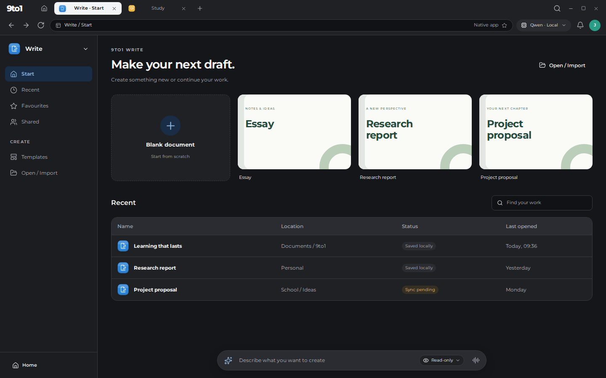
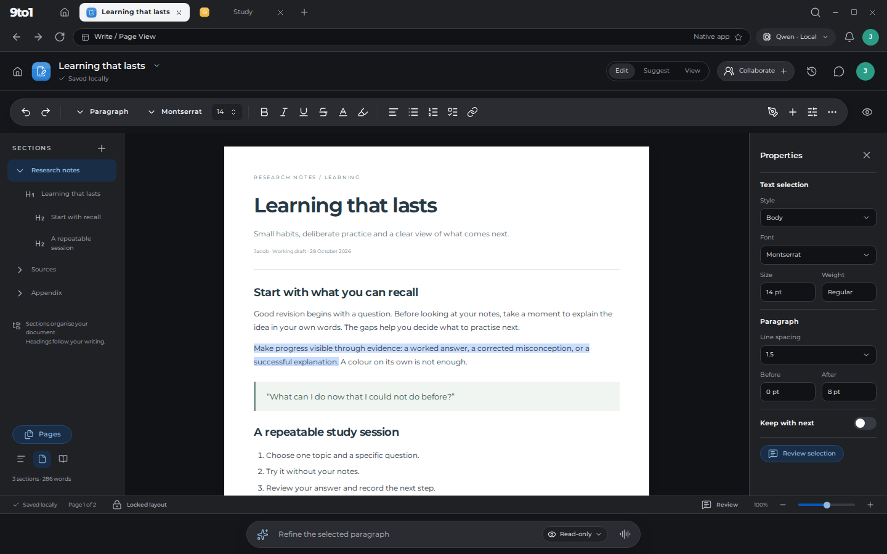
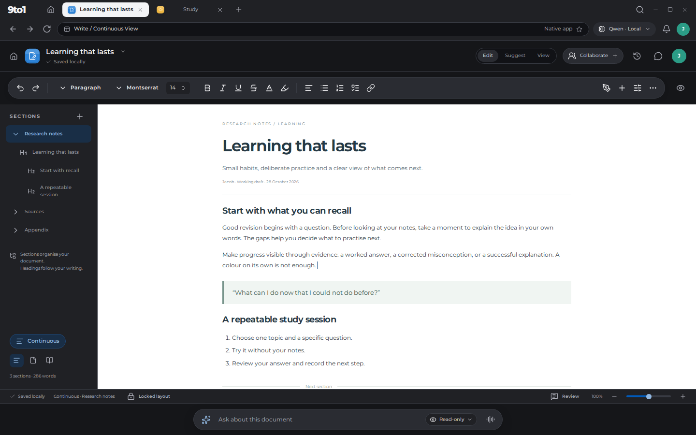
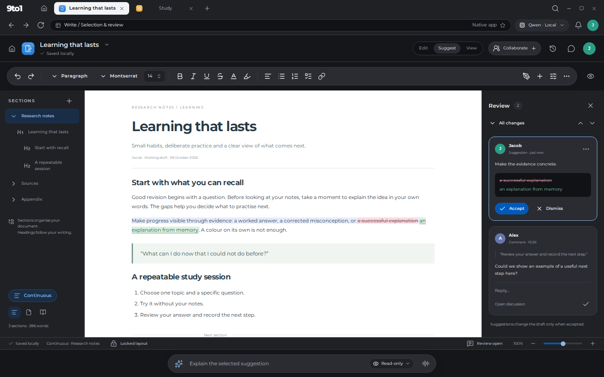
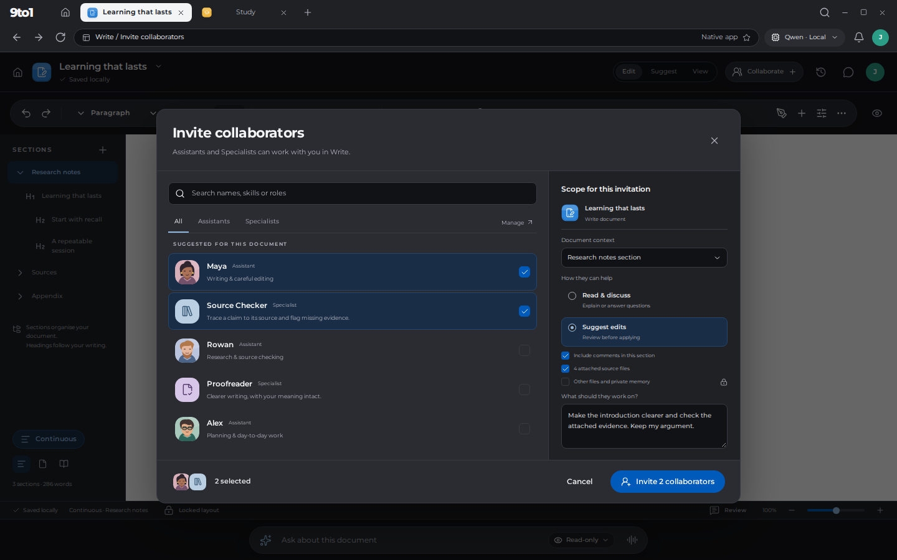
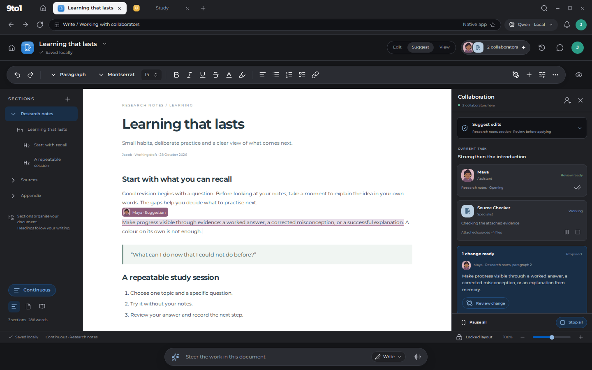

# Write — document authoring

Module ID: `write` · 9to1 Development Specification v3

## Prerequisites

- **CUI, themes and shared interaction system** — Typed UI components, theme tokens/materials, layout, focus, motion, accessibility and shared control states.
- **Shared productivity engine and canonical embeds** — Real document/object engines, semantic editing, canonical app embedding and donor feature parity.
- **Shared AI controls and artifact collaboration** — Contextual AI bars, shared model/permission controls, global collaborators and typed artifact proposals.
- **Artifacts, local persistence and recovery** — Canonical artifacts, revisions, typed edits, local saves, derived exports, sync and recovery.

## Overview

Write is a full document editor with a restrained contextual shell. Continuous, Pages and Book are genuine presentations of the same document, retaining substantive Writer/donor capability and canonical document semantics.

Current owner overrides: V3-OWNER-012.

## Layouts & visible states

- **V3-WRITE-LAY-01** — Use Home/title/save-state header, nested Sections outline and one contextual floating formatting toolbar. Persistent insert, view/eye and more controls remain discoverable; do not add an Office-style ribbon.
- **V3-WRITE-LAY-02** — Continuous is the default flowing document view. Pages shows real page boundaries and pagination; Book shows the supported facing-page reading/editing arrangement. Selecting a layout does not create a different document.
- **V3-WRITE-LAY-03** — Provide selected text/object, insertion picker, typing, comments/history, formatting/property and collaborator review states. Keep the AI bar separate from page content and bottom controls.

## Features & behaviour

- **V3-WRITE-FEA-01** — Support rich text/styles, structured sections, tables, objects, references, fields, comments, tracked suggestions, pagination and exports through the retained full engine contract.
- **V3-WRITE-FEA-02** — Edit/Suggest/View, layout lock and AI Read-only/Write are independent controls. A locked layout is not necessarily a read-only document, and AI Write does not bypass suggestions or document permission.
- **V3-WRITE-FEA-03** — Paragraph/character formatting acts on the actual selection with inspectable defaults. Caret/focus and undo survive toolbar/menu use.
- **V3-WRITE-FEA-04** — Global Assistant/Specialist collaborators create typed revision-bound changes with review, accept/reject and clear authorship.

## Canonical entities & persistence

- **V3-WRITE-ENT-01** — Persist DocumentID, section/block/object IDs, text ranges, styles, revision, comments/suggestions and layout configuration. Layout view state is separate from authored content.
- **V3-WRITE-ENT-02** — Keep native document content authoritative; previews and exported PDF/other formats are derived from a known revision.

## Permissions & recovery

- **V3-WRITE-PER-01** — Respect document and source permissions. A stale collaborator proposal requires reconciliation rather than overwriting intervening edits.
- **V3-WRITE-PER-02** — Autosave/reopen and failed export preserve the native document and meaningful undo/history.

## Acceptance checks

- **V3-WRITE-ACC-01** — Test typing/selection/formatting/insertion, nested Sections and switching Continuous/Pages/Book with unchanged content.
- **V3-WRITE-ACC-02** — Verify Edit/Suggest/View versus AI scope, locked layout, collaborator review, page/export correctness and recovery.

## Exact mock-up and state map

- **Write · Start** — screen `write-launch`. Launch.
- **Write · Page View** — screen `write-editor`. Pages & properties.
- **Write · Continuous View** — screen `write-continuous`. Pageless writing.
- **Write · Selection & review** — screen `write-review`. Suggested change.
- **Write · Invite collaborators** — screen `write-collaborators-picker`. Assistant & Specialist picker.
- **Write · Working with collaborators** — screen `write-collaborators`. Presence & scoped work.

## Source clause IDs

UX27-WRITE-001, UX27-WRITE-002, UX27-WRITE-003, UX27-WRITE-004, UX27-WRITE-005, UX27-WRITE-006, UX27-WRITE-007, SECTION-08, APP-AC-004, LAUNCH-001, LAUNCH-004, WRITE-AC-001, WRITE-AC-002, WRITE-AC-003, APP-AC-009, WRITE-UX-101, WRITE-AC-101, CUI-EDITOR-101, WRITE-UX-102, WRITE-UX-103, WRITE-UX-104, WRITE-UX-105, WRITE-UX-106, WRITE-UX-107, WRITE-UX-108, WRITE-UX-109, WRITE-UX-110, WRITE-UX-111, WRITE-UX-112, WRITE-UX-113, WRITE-UX-114, WRITE-UX-115, WRITE-UX-116, WRITE-UX-117, WRITE-UX-118, WRITE-UX-119, WRITE-UX-120, WRITE-AC-102, WRITE-AC-103, WRITE-AC-104, WRITE-AC-105, WRITE-AC-106, WRITE-AC-107, WRITE-AC-108, WRITE-AC-109, UX27-TEST-079, UX27-TEST-080, UX27-TEST-081, UX27-DATAFLOW-005, WRITE-SCALE-201

## Technical reading map

- Write — document authoring — Write — mature document editing through the actual engine; Real document, page and caret (part 01) — `technical/write-01.md` (2,384 words; V2-B1223, V2-B1224, V2-B1225…).
- Write — document authoring — Styles and custom styles; Tables (part 02) — `technical/write-02.md` (1,637 words; V2-B1291, V2-B1292, V2-B1293…).
- Write — document authoring — Non-substitutable word processor; Authentic integrated workflow and artifact inspection (part 03) — `technical/write-03.md` (3,084 words; V2-B1347).
- Write — document authoring — Write; Real document caret and multi-page editing (part 04) — `technical/write-04.md` (320 words; V2-B1348, V2-B2789, V2-B2790…).

Technical clauses retain APIs, data models, platform, recovery, donor and acceptance details. The technical files are part of this module, not optional background reading. Shared prerequisites mean stable service/interface contracts must be available; they do not require every dependent app UI to be complete. Use the named chunk for the relevant subtask or the complete module file for its full retained contract.

# Exact designs and implementation rules

These figures are the exact current atlas compositions. Their stable screen IDs match the Word specification and editable source. Open the atlas for full-size theme and interaction inspection.

## Write · Start

Screen ID: `write-launch`. Source: LAUNCH-001–006; Write Home/start; UX27-AUTH-005 for Boards.

- Start is a separate active view. The editor is not mounted under a welcome banner.
- New, Open, Import, Templates and Recent resolve actual artifact identities. Missing or failed imports receive their own recovery states.
- Direct-open and session restore bypass Start. Returning here preserves the existing document session.

## Write · Page View

Screen ID: `write-editor`. Source: Owner revision: retain the former editor as Page View; WRITE-UX-101–120; UX27-WRITE-001–007; Pages/Continuous/Book.

- This screen is Pages view: the opaque white page has authored margins, page geometry and restrained elevation. It must not be labelled Continuous.
- Pages, Continuous and Book are views of the same DocumentID, sections, comments, selection and revision. Switching views does not reformat the canonical document.
- New native documents open in the separate Continuous view unless a template explicitly requires pagination. Existing direct-open documents preserve their view state.
- The selected range, toolbar and Properties share one editing state. Document Edit/Suggest/View, Locked/Unlocked layout and AI Read-only/Write remain independent.
- The AI area reserves its own bottom space, leaving the document viewport and status controls reachable without text painting behind it.

## Write · Continuous View

Screen ID: `write-continuous`. Source: Owner revision: true notepad-like Continuous view; WRITE-UX-113; Write View modes / Sections / Locked layout.

- Continuous is one unpaginated flowing surface, with no paper card, page shadow or artificial inter-sheet gap. The readable text column sits within the continuous document area.
- The document retains page-aware semantics underneath: page/section breaks, margins, headers, footnotes and pagination are not discarded. A real break uses a quiet marker rather than a forced paper sheet.
- Authored fonts, sizes, colours and object content remain document values. A UI theme change affects the app controls, not the stored writing.
- Sections are authored structural nodes; the indented headings derive from heading styles. Collapse/resize is per-user view state and must preserve selection and scroll position.
- The caret and paragraph toolbar are one text editing state. Pages/Book, Locked/Unlocked, Edit/Suggest/View and AI permission remain independent controls.

## Write · Selection & review

Screen ID: `write-review`. Source: Owner revision: selected text, sections and review; WRITE-UX-101–120; Write review/comments and same-document view contracts.

- Suggest mode shows the precise changed range and its anchored review card. The replacement is pending until accepted; an open comment is not itself a text mutation.
- Accept and Dismiss operate on the selected revision/change, preserve document identity and support undo. Comments retain stable anchors if the surrounding section moves.
- The Review panel has its own scrolling; it does not cover the selected text. A link from the card reveals the exact range in the current view.
- This uses the same seamless Continuous layout. The authored text, inline change marks and app-theme controls remain distinguishable.
- AI stays Read-only here; opening a suggestion does not grant AI Write permission or alter user Edit/Suggest/View mode.

## Write · Invite collaborators

Screen ID: `write-collaborators-picker`. Source: Owner revision 28 October: Assistants and Specialists are global identities available from Home and every editor; later steering supersedes Space-only placement; canonical identity, document ownership, Task/Run and permission contracts.

- The editor header always exposes the same collaborator entry point. The picker opens over the current app and retains document identity, revision, selection and scroll.
- Assistants and Specialists are searchable in one picker but labelled as different types. The same named portrait/identity appears in Home, the picker, presence and work attribution.
- The invitation explicitly scopes document context, permitted operation mode and optional notes/comments. Other files and private memory are not included by membership.
- Suggest edits is staged here. Work begins only after Invite; applying a proposed change remains a separate review/commit against the current document revision.
- The modal traps focus, supports search/filter and Escape/Cancel, and restores focus to the invoking header control. On narrow screens it becomes one navigable sheet with reachable scope and invite controls.

## Write · Working with collaborators

Screen ID: `write-collaborators`. Source: Owner revision 28 October: Assistants and Specialists are global identities available from Home and every editor; later steering supersedes Space-only placement; canonical identity, document ownership, Task/Run and permission contracts.

- Assistant and Specialist avatars join the document header as actual collaborators, with the same stable identities shown in Home and Spaces. Presence is session UI, not authored document content.
- The work panel attributes each active task, target and proposed change to its participant. Working, paused, stopped, review-ready and committed states remain distinct.
- The owning app keeps the canonical document, object/range identities, revision history and undo. Collaboration does not copy the document into a private Spaces artifact.
- Suggest edits is the granted scope here. Write in the contextual AI bar does not waive range limits, current ACLs or review; a proposal remains unapplied until the user accepts the exact change.
- Pause and Stop are visible for the run and individual workers. Stop cancels future work, retains checkpoints/proposals and never silently reverts already committed edits.
- Remote selections, transient previews and presence overlays do not enter exports. Revision conflicts require revalidation of the exact change and cannot be resolved by unconditional last-writer-wins.
